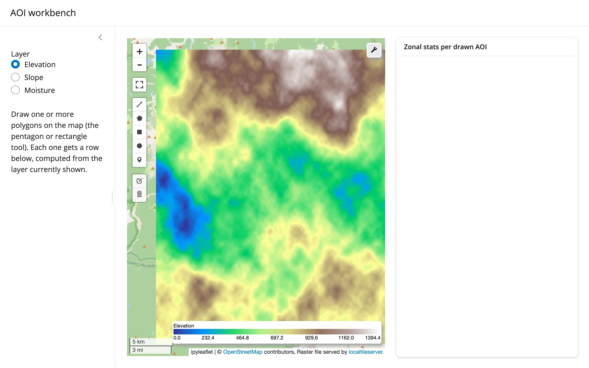

A `leafmap.Map` (built on ipyleaflet) serves a locally-generated multi-band raster through
`localtileserver`, with leaflet-draw's rectangle/polygon tools enabled. Draw one or more
areas of interest, and a card to the right shows a zonal-stats table and a bar chart --
computed in Python by clipping the current band to each drawn polygon with
`rioxarray`/`shapely`.



## Run it

```sh
git clone --depth 1 https://github.com/posit-dev/py-shinywidgets
cd py-shinywidgets/website/gallery/showcases/aoi-workbench
uv run --with leafmap --with rioxarray --with localtileserver shiny run app.py
```

Source: [app.py](app.py) · [Open in Shinylive](app.py){.sw-shinylive-link}

## Try this

- Draw a rectangle (or pentagon) on the map with the leaflet-draw toolbar. A row appears in
  the **Zonal stats per drawn AOI** table, and the bar chart below it updates, both driven
  entirely by `map.drawn_features()`.
- Draw a second shape: it gets its own row.
- Switch the **Layer** radio (Elevation / Slope / Moisture): the raster restyles and the
  zonal stats recompute against the newly selected band, for the *same* drawn polygons.

## Accessors demonstrated

- `map.drawn_features()` -- the list of GeoJSON features from every shape currently on the
  map's draw layer. `None`/empty until something is drawn; each entry is used here to clip
  the active raster band and compute mean/min/max/pixel-count.

## Layout note

This is one `ui.layout_columns()` card (not two): `layout_columns()` recycles `col_widths`
across its *top-level* children, so a second top-level card would reflow the whole grid.
Giving the table a fixed height (rather than letting it fill) is also what lets the chart
below it claim the rest of the card -- two fill-hungry outputs stacked with no height split
between them leaves the second with nothing to measure, so it never reveals itself.

## Verification

Server boots clean (after one transient `uv` cache error on a loaded machine, resolved on
retry). A real Playwright rectangle-draw gesture on the map produces a populated stats table
(`aoi=1, mean=471.7, min=290.1, max=734.3, pixels=11880`) and a non-empty bar chart, confirmed
against the rendered table text, not just a screenshot -- see `img/hero.webp` (before) and
`img/after_draw.webp` (after).

Source: promoted from `docs/widget-guides/leafmap/gallery/showcase_aoi_workbench.py`.
