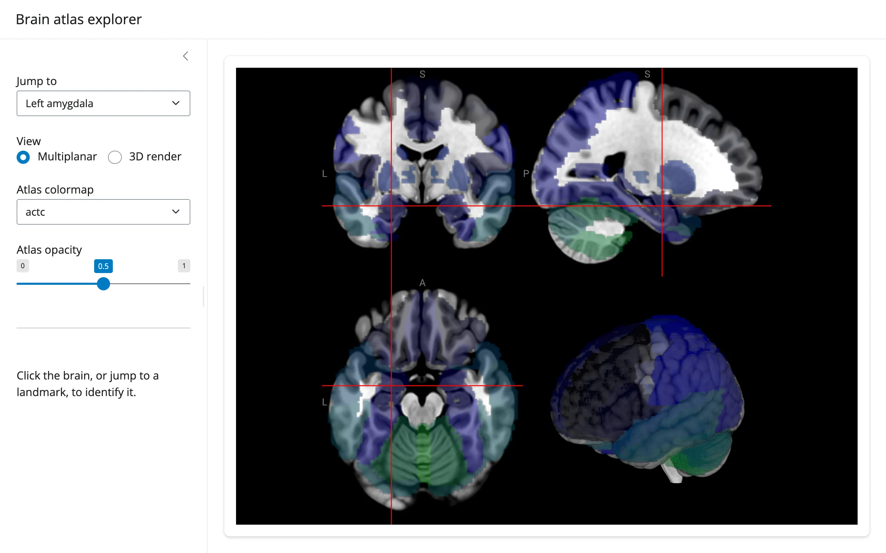

A NiiVue multiplanar/3D viewer loaded with the MNI152 template and the AAL (Automated
Anatomical Labeling) atlas overlay. A dropdown jumps the crosshair to one of five named
landmarks by converting MNI millimeter coordinates to voxel space with the volume's own
affine; clicking anywhere in the viewer looks up the AAL region and exact MNI coordinate
under the crosshair. The colormap/opacity controls restyle the existing overlay in place --
no re-render, no re-sending the volumes.



## Run it

```sh
git clone --depth 1 https://github.com/posit-dev/py-shinywidgets
cd py-shinywidgets/website/gallery/showcases/brain-atlas-explorer
uv run --with nibabel shiny run app.py
```

Source: [app.py](app.py) · [Open in Shinylive](app.py){.sw-shinylive-link}

## Try this

- Pick a landmark from **Jump to**: the crosshair moves there in all views, instantly.
- Switch **View** between Multiplanar and 3D render.
- Click anywhere in the brain: the sidebar identifies the AAL region name and the exact MNI
  (x, y, z) coordinate.
- Drag **Atlas opacity**, or change **Atlas colormap**: the overlay restyles in place.

## Accessors demonstrated

- `brain.location()` -- fires on a real click (or any crosshair move driven by user
  interaction), returning voxel/mm coordinates and the value under the crosshair in every
  loaded volume. **Does not fire** when Python itself sets `scene.crosshair_pos` (as the
  landmark dropdown does) -- a documented asymmetry, not a bug: `location()` is specifically
  for user-driven lookups, and the landmark jump visibly moves the crosshair without needing
  a round trip through it.

## Verification

Needs one ephemeral package (`nibabel`, used here for affine math; not in the project's
locked venv). Both the niivue.com image/JSON hosts were reachable from this machine at
verification time. Two real gestures, each confirmed against the rendered sidebar text:

- Selecting "Primary visual cortex" from the landmark dropdown visibly moved the crosshair
  to the correct, very posterior location in `img/after_landmark.webp` -- but the region card
  correctly stayed on its placeholder text, since `location()` only fires on user clicks.
- A real click on the canvas then populated the region card with
  `"Occipital Sup L", MNI (-14, -88, 10) mm` -- `img/after_click.webp`.

Source: promoted from `docs/widget-guides/niivue/gallery/showcase_atlas_explorer.py` (see
`NOTES.md`).
