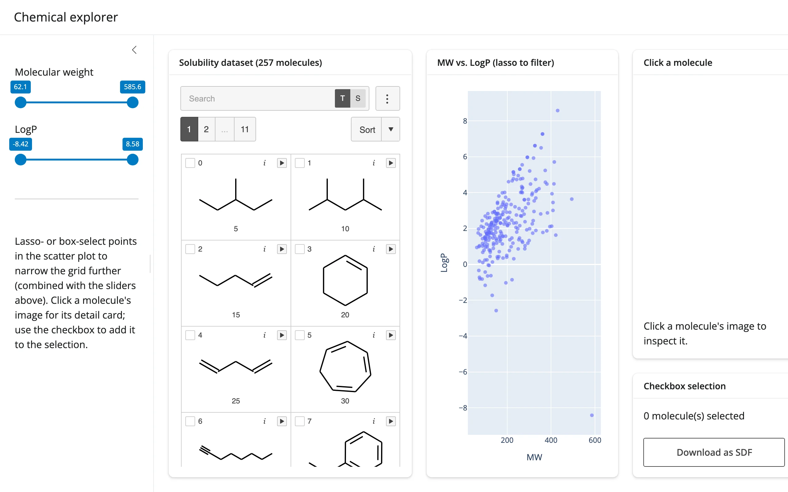

257 molecules from mols2grid's bundled solubility dataset, with molecular weight and LogP
computed via RDKit. Two molecular-weight/LogP sliders and a lasso-able plotly scatter plot
both narrow the *same* mols2grid grid -- combined with AND -- entirely through
`grid.grid.filter()`, so the grid is never rebuilt and the checkbox selection and scroll
position survive every adjustment.



## Run it

```sh
git clone --depth 1 https://github.com/posit-dev/py-shinywidgets
cd py-shinywidgets/website/gallery/showcases/chemical-explorer
uv run shiny run app.py
```

Source: [app.py](app.py) · [Open in Shinylive](app.py){.sw-shinylive-link}

## Try this

- Drag either slider: the grid's visible molecules narrow immediately.
- Lasso- or box-select points on the MW-vs-LogP scatter plot: the grid narrows to just those
  molecules, intersected with whatever the sliders already allow.
- Click a molecule's image in the grid: a detail card on the right redraws it with RDKit and
  shows its MW/LogP/LogS.
- Check a few molecules' boxes, then **Download as SDF**: downloads exactly the checked
  molecules as a standard SDF file.

## Accessors demonstrated

- `grid.clicked()` -- the full row (as a dict) of the most recently clicked molecule, used
  to drive both the RDKit depiction and the descriptor text. `None` until a first click.
- `grid.selected()` -- the dict of currently checkbox-selected molecules (by mols2grid's
  own index), read both for the live count and for the SDF export.
- `scatter.selected()` / `scatter.selected_rows()` -- the plotly lasso's selection, converted
  to a boolean mask over the same dataframe and combined with the slider mask before calling
  `grid.grid.filter()`.

## Verification

Server boots clean, no extra packages needed beyond the base `shinywidgets[mols2grid]` +
`shinywidgets[plotly]` install (RDKit ships with mols2grid). A real Playwright click on a
grid cell's `.m2g-callback` element (the per-cell click target mols2grid adds under
`clicks=True`) moved the "Click a molecule" card from a placeholder to a real RDKit
depiction and descriptor line (`MW 86.2 LogP 2.44 LogS -3.68`), confirmed against the
rendered text -- see `img/hero.webp` and `img/after_click.webp`.

Source: promoted from `docs/widget-guides/mols2grid/gallery/showcase_chem_explorer.py` (see
`NOTES.md`).
