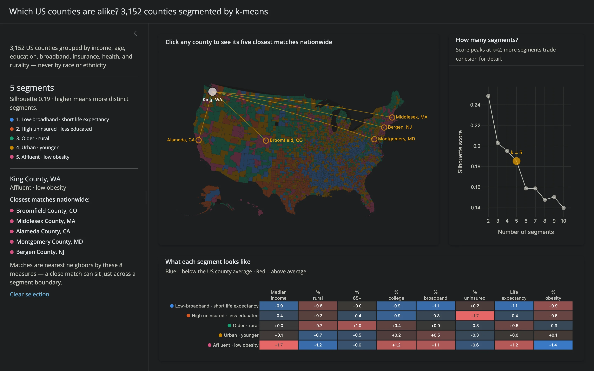

A model grouped 3,152 US counties into segments by income, age, education, broadband
access, insurance coverage, health, and rurality — never by race or ethnicity. The
silhouette-vs-k chart makes the k-means tradeoff visible instead of hidden behind a single
"best" number: fewer, broader segments score higher, but more segments reveal finer
structure, so the app starts at a readable 5 and lets you click any point from 2 to 10 to
re-cluster live. Click any county on the choropleth and its five closest matches
nationwide — nearest neighbors in standardized feature space, not geography — light up as
rings and lines on a dimmed map and list in the sidebar, each labeled with the same
plain-language segment name ("Rural · older", "Affluent · low obesity") that the profile
heatmap explains.



## Run it

```sh
git clone --depth 1 https://github.com/posit-dev/py-shinywidgets
cd py-shinywidgets/website/gallery/showcases/county-clusters
uv run --with scikit-learn shiny run app.py
```

`data/counties.parquet` is committed (prepared by `prep_data.py` from the County Health
Rankings 2025 analytic file; see its imputation counts below). On first run the app
downloads plotly's public counties GeoJSON (~3 MB) and caches it under `data/`.

Source: [app.py](app.py)

## Try this

- **Click a county.** The map dims and a ring appears at each of its five closest matches
  nationwide (by these 8 measures, not geography), connected by a line back to the county
  you picked and labeled by name. A twin can be a thousand miles away — King County, WA
  (Seattle) turns out to be closest to Broomfield County, CO, with Bergen County, NJ not
  far behind. The sidebar lists the same five, with a reminder that a close match can sit
  on either side of a segment boundary.
- **Click a point on the silhouette chart.** The map recolors in place (no reset of your
  selection) and the profile heatmap and sidebar legend update to the new segment count.
  Re-click: a county's twins stay the same — they don't depend on k — but its segment
  label follows the new clustering.
- **Read the profile heatmap.** Each row is a segment's z-score on every feature: strongly
  red means "much higher than the national average," strongly blue means "much lower." The
  two strongest traits become that segment's name, and the row's leading dot matches its
  color on the map and in the sidebar legend.

## Accessors demonstrated

- `silhouette.clicked()` reads the clicked point's `x` (the k value) directly — no
  `customdata` needed, since the x-axis *is* the thing being selected. `map.clicked()`
  reads `customdata` instead (the county's FIPS code), filtered to the base choropleth
  trace (`trace_index == 0`) so a click that lands on a twin's ring or connecting line
  doesn't get mistaken for a new county.
- The county choropleth is never fully re-rendered on a k change: a `reactive.effect`
  mutates `.widget.data[0]` (z-values, hover text, colorscale, and — while a county is
  selected — a dimmed `marker.opacity`) inside `with w.batch_update():`, so zoom and the
  twin markers survive. The profile heatmap takes the same approach, restyling
  `z`/`y`/`text` in place rather than rebuilding — both land in well under a second.
- The selected county and its five twins share one `Scattergeo` trace: each point's
  `marker.symbol`/`size`/`color` and `textposition` are plain Python lists (one entry per
  point, the selected county always first and largest), so a single `.update()` call
  repositions all six markers and their labels. A second `Scattergeo` trace draws the
  connecting lines, independent of the segment-recolor effect, so clicking a county and
  clicking a k point never race each other.

## Verification

Driven end-to-end with Playwright in headless Chromium: clicking a silhouette point moved
`k` from 5 to 6, recolored the map and reflowed the profile heatmap within ~1 s with no
server error; clicking King County, WA selected it and its five closest matches
(Broomfield County, CO; Middlesex County, MA; Alameda County, CA; Montgomery County, MD;
Bergen County, NJ), dimming the base map and drawing a ring and a line to each, with all
five listed in the sidebar; re-clicking a different k
with that county still selected kept the same five twins while the segment label and map
colors updated to the new clustering — confirming twins depend on feature-space distance,
not on k. `website/_tools/smoke.py` passes with no server-log errors or page exceptions.
