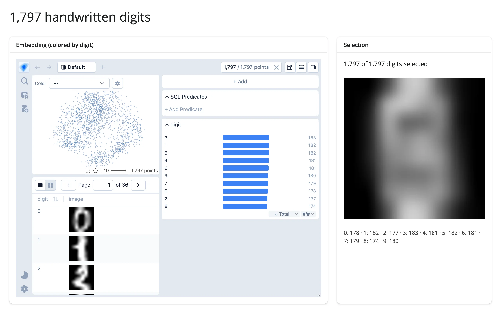

1,797 handwritten digit images (scikit-learn's bundled digits dataset), PCA-projected to 2D
and shown in `embedding-atlas`, each with its own image thumbnail. Lassoing a cluster, or
clicking a bar in the "digit" histogram to crossfilter, narrows `atlas.selected()` to
exactly those rows -- and the sidebar reconstructs the *average* image of exactly the
selected digits, live, from the raw 8x8 pixel arrays. It's a concrete payoff for "Python
computes on what the user circled": select mostly-3s, and the average image clearly looks
like a blurry 3.



## Run it

```sh
git clone --depth 1 https://github.com/posit-dev/py-shinywidgets
cd py-shinywidgets/website/gallery/showcases/digits-atlas
uv run --with scikit-learn shiny run app.py
```

Source: [app.py](app.py) · [Open in Shinylive](app.py){.sw-shinylive-link}

## Try this

- Click a bar in the **digit** histogram (e.g. "3"): the embedding, the image grid, and the
  **average digit** picture all narrow to just that digit -- and the averaged image visibly
  resembles the chosen digit.
- Lasso a cluster directly on the embedding (works in any WebGPU-capable browser): same
  effect, driven by the same `selected()` accessor.
- Watch the **digit breakdown** line: it's computed server-side from the exact same
  selection, every time.

## Accessors demonstrated

- `atlas.selected()` -- the currently-selected rows as a DataFrame slice (with a
  `__row_index__` column pointing back into the original data), fired by *either* a canvas
  lasso or a histogram/table crossfilter click -- the same accessor serves both gesture
  families, which is why this showcase works even without a WebGPU-capable browser for the
  lasso itself.

## Verification

Needs one ephemeral package (`scikit-learn`, not in the project's locked venv; used only for
`load_digits()` and `PCA`). Verified in headless Chromium with
`--enable-unsafe-webgpu --use-angle=metal` (WebGPU confirmed working on this machine, served
from `http://localhost`, a secure context). A real click on the digit-histogram's "3" bar
narrowed the selection from `1,797 of 1,797` to `183 of 1,797`, and the average-digit image
visibly changed from a blurry superposition of all ten digits to a recognizable blurry "3" --
confirmed against the rendered selection-count text, not just a screenshot. See
`img/hero.webp` and `img/after_lasso.webp`.

Source: promoted from `docs/widget-guides/embedding-atlas/gallery/showcase_digits_atlas.py`
(see `NOTES.md`).
