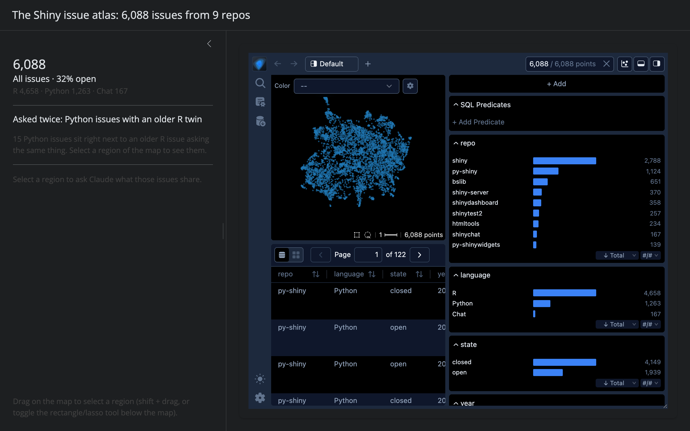

The map needs a WebGPU-capable browser, and the **Summarize selection** button makes a live
Claude call (`ANTHROPIC_API_KEY` required; the button explains itself when the key is unset).
There is no Shinylive link: WebGPU and a live model call don't belong in a browser tab.

6,088 GitHub issues from 9 Shiny-ecosystem repos (R and Python Shiny, bslib, htmltools,
shinywidgets, shinychat, shinytest2, shinydashboard, Shiny Server), embedded with
`all-MiniLM-L6-v2` and projected to 2D with `embedding-atlas`. Issues that ask for the same
thing cluster together -- including across languages, so a 2024 py-shiny issue can sit right
next to the 2015 R Shiny issue that asked first. The sidebar's "Asked twice" list surfaces
those pairs for whatever region you select, and a **Summarize selection** button asks Claude,
live, what the selected issues have in common and what single change would resolve most of
them.



## Run it

```sh
git clone --depth 1 https://github.com/posit-dev/py-shinywidgets
cd py-shinywidgets/website/gallery/showcases/issue-atlas
uv run --with chatlas --with anthropic shiny run app.py
```

On first run the app downloads `issues.parquet` (~3 MB) from
[py-shinywidgets-data](https://github.com/cpsievert/py-shinywidgets-data/releases/tag/showcase-v1);
`prep_data.py` (needs the GitHub CLI) and `embed.py` rebuild it from the GitHub Issues API:

```sh
uv run python prep_data.py
uv run --no-project --python 3.12 --with embedding-atlas --with sentence-transformers \
    --with umap-learn --with pyarrow python embed.py
```

`embed.py` downloads the embedding model on first run and caches projections under
`data/.cache/`.

Source: [app.py](app.py)

## Try this

- Drag a box over a dense cluster (shift + drag, or toggle rectangle-select mode in the
  map's own toolbar). The sidebar narrows to the selection and lists any "asked twice"
  pairs inside it.
- Click **Summarize selection**: Claude reads the selected issues' titles and says what
  they have in common and what single change would resolve the most of them.
- Clear the selection (the atlas's own "Clear filters" control) to go back to all 6,088
  issues.

## Accessors demonstrated

- `reactive_read(atlas.widget, "_predicate")` plus `atlas.widget.selection()` -- reaching
  into the `EmbeddingAtlasWidget` directly for the `__row_index__` positions of the
  currently-selected rows, read by the stats panel, the "Asked twice" list, and the
  `summary_titles()` call that feeds Claude -- one accessor driving three different views of
  the same selection.
- A `reactive.extended_task` wired to `ui.bind_task_button` -- the live Claude call runs off
  the main reactive graph so the rest of the UI (stats, twin list) stays responsive while
  "Reading issues..." is showing, and the result is keyed by `selection_key(sel)` so a stale
  response for a since-changed selection is dropped instead of displayed.

## Verification

Driven end-to-end with Playwright in headless Chromium (`--enable-unsafe-webgpu
--use-angle=metal`): a shift-drag selection over a dense cluster narrowed `6,088` points to
`1,492`, the "Asked twice" list populated with real issue pairs (e.g. py-shiny #1770 next to
the older shiny #2922 it echoes), and clicking **Summarize selection** returned a real,
on-topic Claude summary -- confirmed in `img/after_summary.webp` against `img/hero.webp`.

Source: promoted from `website/gallery/showcases/issue-atlas/README.md`.
