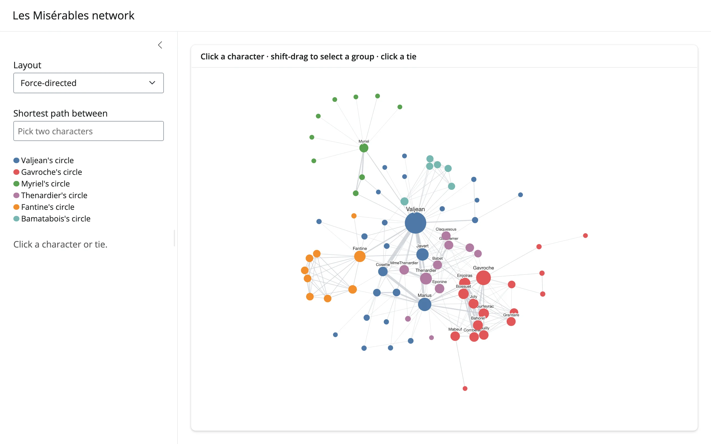

The classic Les Misérables character co-occurrence graph (bundled with `networkx`), with
Louvain communities colored, node size mapped to degree, and a force-directed/concentric/
circle layout picker. Click a character to see their circle and top co-occurring
characters; shift-drag a box to select a group and see its internal density; click a tie
for its scene count; or pick two characters for the shortest path between them (computed by
`networkx`, weighted by inverse scene count, so "strong ties" are short hops). Every one of
these restyles the graph by toggling CSS classes on existing elements -- the force-directed
layout never reruns, so your pan/zoom position is never lost.



## Run it

```sh
git clone --depth 1 https://github.com/posit-dev/py-shinywidgets
cd py-shinywidgets/website/gallery/showcases/les-miserables-network
uv run shiny run app.py
```

Source: [app.py](app.py) · [Open in Shinylive](app.py){.sw-shinylive-link}

## Try this

- Click **Valjean** (the largest node): the sidebar lists his five strongest ties, the graph
  fades everything except his immediate circle.
- Click a tie (edge) between two characters: see how many scenes they share.
- Shift-drag a box around a cluster: the sidebar reports the group's size, internal tie
  count, and density.
- Pick two characters in **Shortest path between**: the path lights up on the graph.
- Switch **Layout**: force-directed, concentric (by degree), or a plain circle.

## Accessors demonstrated

- `network.clicked_node()` -- the clicked node's full ipycytoscape element dict (`.data`
  holds the original attributes); drives both the sidebar's character card and the
  class-based restyle.
- `network.clicked_edge()` -- the clicked edge's element dict, used for the tie's scene
  count.
- `network.selected_nodes()` -- the box-selected nodes' data dicts, debounced by default (a
  box-select toggles many children's `selected` trait in a burst). Replaced a hand-rolled loop
  that read `reactive_read(n, "selected")` on every child node widget directly; `selected_nodes()`
  is the dedicated accessor for exactly this (new on current `main`).

## Verification

No extra packages needed beyond `networkx` (already bundled). A real Playwright click landed
on a tie between Javert and a minor character ("Woman1"): the sidebar updated from "Click a
character or tie." to `"Javert + Woman1: 1 scenes"`, and a dashed box-selection outline
appeared around the clicked area -- confirmed against the rendered sidebar text, not just a
screenshot. See `img/hero.webp` and `img/after_click.webp`. A real shift-drag box-select over
most of the canvas reported `"72 characters · 249 ties inside the group · density 0.10"` via
`selected_nodes()`, with visible black selection outlines on every caught node --
`img/after_box_select.webp`.

Source: promoted from `docs/widget-guides/ipycytoscape/gallery/showcase_les_miserables.py`.
