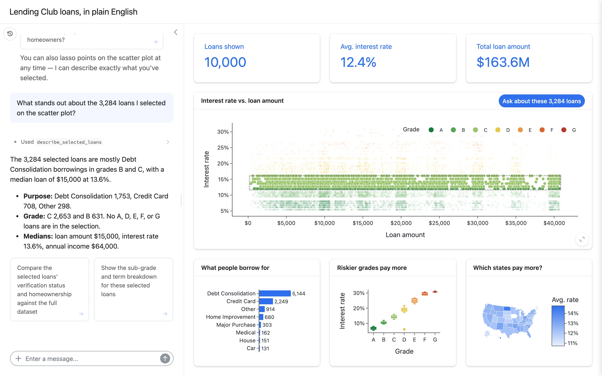

A querychat sidebar (Claude, via `chatlas`) sits next to a plain `shinywidgets` dashboard
of 10,000 Lending Club loans: a compact stat strip and three `render_plotly` cards, all
driven by `qc.df()`, querychat's current filtered frame. The shinywidgets-specific twist
is the full-width hero scatter (interest rate vs. loan amount, colored by grade -- Lending
Club prices loans almost entirely off their sub-grade, so each grade renders as its own
clean horizontal band): lasso a band and an "Ask about these N loans" pill submits a
question to the chat, which calls a registered `describe_selected_loans` tool that reads
the scatter's *live* selection -- the same accessor the dashboard itself would read -- so
the answer always matches what's actually lassoed, under whatever filter is currently
applied.



## Run it

```sh
git clone --depth 1 https://github.com/posit-dev/py-shinywidgets
cd py-shinywidgets/website/gallery/showcases/loan-chat
uv run --with querychat --with chatlas --with anthropic shiny run app.py
```

Needs `ANTHROPIC_API_KEY` to chat; without it, the dashboard still renders and the
sidebar explains what to set. `data/loans.parquet` is committed, trimmed from
OpenIntro's CSV by `prep_data.py` (state, income, grade, purpose, and 12 other columns,
plus a synthetic `loan_id`).

Source: [app.py](app.py) · [plots.py](plots.py)

## Try this

- Click a **Filter** suggestion ("Show California loans graded D or worse") and watch
  the stat strip and all three lower charts narrow to the matching 237 loans.
- Click an **Ask** suggestion ("Which loan purpose has the highest average interest
  rate?") for a plain-English answer computed from the live data, not a canned fact.
- Lasso a horizontal band on the hero scatter (grade C sits around 12-16%) and click the
  **Ask about these N loans** pill that appears in the card header. The chat calls
  `describe_selected_loans()` and summarizes exactly what you selected -- medians, grade
  mix, top purposes -- in at most a sentence and three bullets, no hedging.
- A filter that matches nothing (e.g. "Show Vermont loans graded F or G") zeroes the stat
  strip and swaps every chart for a "No loans match this filter" message instead of an
  empty plot.

## Accessors demonstrated

- `scatter_chart.selected_rows(df, key="loan_id")` -- matches the lasso's `customdata`
  (set via `custom_data=["loan_id", "loan_amount"]`; the key is always the first entry)
  back to rows of whatever frame you pass, so it works correctly after querychat
  re-filters and the scatter re-renders with new data. A re-render reseeds the selection
  to empty (see the widget's own docs), which is exactly the behavior that keeps
  `describe_selected_loans()` honest: the tool always reads the selection on the
  *current* scatter, never a stale one from before a filter changed what's plotted.
- `qc.server(client=...).client.register_tool(...)` -- registering an extra tool
  directly on querychat's own per-session chat client, alongside its built-in `filter`
  and `query` tools, so one conversation can both explore the data and reason about a
  widget gesture.
- `shinychat.Chat.update_user_input(value=..., submit=True)` -- the "Ask about these N
  loans" pill composes a question from the live selection count and submits it to the
  chat programmatically, the same as if the user had typed and pressed enter.

## Verification

Checked against independent pandas computations on `data/loans.parquet`:

| Question | Chat answer (claude-haiku-5-5) | pandas |
|---|---|---|
| Which loan purpose has the highest average interest rate? | Renewable Energy, 13.54% (10 loans) | Renewable Energy, 13.543% (10 loans) |
| (lasso) the full-width grade C band, as in the screenshot | 3,284 loans; grade C 2,653 (80.8%), grade B 631 (19.2%); median loan $15,000; median rate 13.6%; median income $64,000; Debt Consolidation 1,753, Credit Card 708, Other 298 | the exact same `loan_id`s read back from the plot (via `customdata`) and filtered in pandas: 3,284 loans; grade C 2,653, grade B 631; median loan $15,000; median rate 13.6%; median income $64,000; Debt Consolidation 1,753, Credit Card 708, Other 298 -- an exact match |

Model choice: `claude-haiku-5-5` over `claude-sonnet-5-5` -- both answered every test
question correctly, but haiku responded in ~5.4-5.9s against sonnet's ~7.7s for the same
query, and `map-chart-chat` and `issue-atlas` already default to haiku, so this keeps the
gallery consistent. `extra_instructions` asks for a one-sentence answer plus at most 3
bullets and no generic hedging, which both the query answers and the lasso tool's
summaries follow.

Also checked: a filter matching zero loans ("Show Vermont loans graded F or G") never
raises, and zeroes the stat strip and swaps every chart for an empty-state message
instead; lassoing nothing, or double-clicking to deselect, hides the "Ask about" pill
rather than showing "Ask about these 0 loans"; `website/_tools/smoke.py` passes both with
and without `ANTHROPIC_API_KEY` set.
