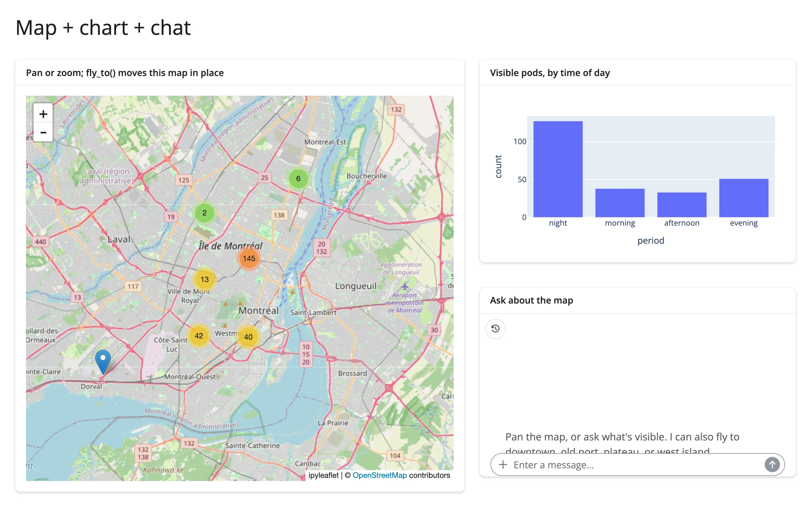

249 real car-share pod locations around Montreal, shown on an `ipyleaflet` map with a
plotly bar chart of what's currently in view. A chat panel (via `shinychat` + `chatlas`)
gives an LLM two tools: `summarize_view` (reads the exact same `map.bounds()` accessor the
chart uses) and `fly_to` (moves the map to one of five named places, validated against a
fixed allow-list). Because the tool and the chart share one accessor, the chat's answer and
the chart can never disagree.



## Run it

```sh
git clone --depth 1 https://github.com/posit-dev/py-shinywidgets
cd py-shinywidgets/website/gallery/showcases/map-chart-chat
uv run --with chatlas --with anthropic shiny run app.py
```

Source: [app.py](app.py) · [Open in Shinylive](app.py){.sw-shinylive-link}

## Try this

- Pan or zoom the map yourself and watch the bar chart recompute.
- Ask the chat "what's visible on the map right now?" -- it calls `summarize_view`, which
  reads `map.bounds()` directly, and its counts match the chart exactly.
- Ask it to "fly to the west island" (or downtown, old port, plateau, overview) -- the `fly_to`
  tool moves the map in place (`map.widget.center = ...`), and a follow-up question shows the
  chart and chat agreeing on the new, much smaller, visible set.

## Accessors demonstrated

- `map.bounds()` -- the map's current `((south, west), (north, east))` viewport. Read by the
  chart on every render, and again inside the `summarize_view` tool via
  `reactive.isolate()` (so the tool doesn't create a reactive dependency on the map).

## Read on demand

`summarize_view()` is a plain function -- not a `@render.*`/`@reactive.calc` -- called from
outside Shiny's reactive graph whenever the LLM decides to invoke the tool. It still gets an
accurate `map.bounds()`: every accessor attaches its browser-side listener as soon as the widget
renders and keeps recording interactions whether or not anything has read it yet, so there's no
warm-up step and no risk of missing a gesture made before the first chat turn.

## Verification

Server boots clean with `--with chatlas --with anthropic` (both ephemeral overlays; neither
is in the project's locked venv). Driven with Playwright + `shinychat.playwright.ChatController`,
making real calls to `claude-haiku-5-5` via `ANTHROPIC_API_KEY`:

- *"what's visible on the map right now?"* -> *"Used `summarize_view`. There are 249
  car-share pods visible on the map right now. By time of day, that breaks down to: Night:
  127, Morning: 38, Afternoon: 33, Evening: 51..."* -- matches the bar chart exactly.
- *"fly to the west island"* -> *"Used `fly_to`. The map is now centered on the West Island
  at zoom 12..."* -- map recentered, and the bar chart dropped to a single "evening" bar,
  confirmed in `img/after_fly_to.webp`.

Source: promoted from
`docs/widget-guides/articles/ai-exploration/examples/04_map_chart_chat_combined.py`.
