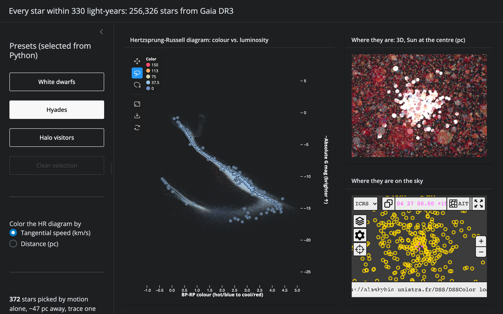

A Hertzsprung-Russell diagram of all 256,326 stars within 100 parsecs (jscatter, 256k
points on a canvas you can lasso), linked to a 3D view of where those stars actually are
(k3d, with the Sun at the center) and to their positions on the sky (ipyaladin, streaming
DSS imagery from CDS). One selection drives all three: lasso the white-dwarf sequence on
the HR diagram and watch white dwarfs appear scattered through the 3D neighborhood and all
over the sky -- small, faint, and everywhere. Preset buttons run the linking in the other
direction: Python computes the selection (white dwarfs by HR position, the Hyades by
proper motion, halo stars by tangential speed) and pushes it to all three widgets at once.



## Run it

```sh
git clone --depth 1 https://github.com/posit-dev/py-shinywidgets
cd py-shinywidgets/website/gallery/showcases/nearby-stars
uv run shiny run app.py
```

On first run the app downloads `stars.parquet` (~16 MB) from
[py-shinywidgets-data](https://github.com/cpsievert/py-shinywidgets-data/releases/tag/showcase-v1);
`prep_data.py` rebuilds it from the Gaia archive's TAP service. The sky panel streams
imagery from CDS (cds.unistra.fr), so it needs network access -- if CDS is unreachable,
the markers and fly-tos still work on a grey background. There is no Shinylive link: a
16 MB download and live tile servers don't belong in a browser tab.

Source: [app.py](app.py)

## Try this

- **Lasso the white dwarfs.** Drag a loop around the faint sequence at the bottom left of
  the HR diagram. The 3D view and the sky show them scattered everywhere. Press Esc to
  clear.
- **Press Hyades.** The 372 stars, picked by motion alone, form one thin sequence on the
  HR diagram; the 3D view flies to a tight clump ~47 pc away and the sky flies to Taurus.
- **Press Halo visitors.** The 1,421 stars faster than 150 km/s sit below the main
  sequence: old, metal-poor halo stars just passing through.
- **Recolor.** Switch the HR diagram between tangential speed and distance; the canvas
  restyles in place without losing your selection.

## Techniques demonstrated

- **One selection, three widget libraries.** A debounced `reactive_read` of jscatter's
  `selection` trait feeds a k3d highlight layer (`positions` updated in place on a hidden
  `points` object) and an ipyaladin overlay (`add_table` of the brightest 3,000 selected
  stars).
- **Python-driven selection and camera.** Presets call the renderer's
  `.selection(ids)` / `.zoom(to=ids)` methods and set k3d's `camera` and Aladin's
  `target`/`fov` directly -- the same three views, driven from the server.
- **Waiting for a widget to be ready.** Aladin's all-sky projection is applied only once
  `reactive_read(w, "_is_loaded")` fires, and the sky overlay is rebuilt only while the
  widget is loaded -- the pattern for widgets with an asynchronous client-side init.

## Verification

Driven end-to-end with Playwright on the hosted parquet: the preset buttons select exactly
the independently computed counts from Gaia DR3 (Hyades 372, halo visitors 1,421, white
dwarfs 18,632 out of 256,326 stars), the caption's `data-space`/`data-sky` attributes
confirm what was pushed to k3d and Aladin, and the HR diagram, 3D view, and sky all render
within ~3 s of first paint. See `img/hero.webp`: the Hyades preset mid-flight.
