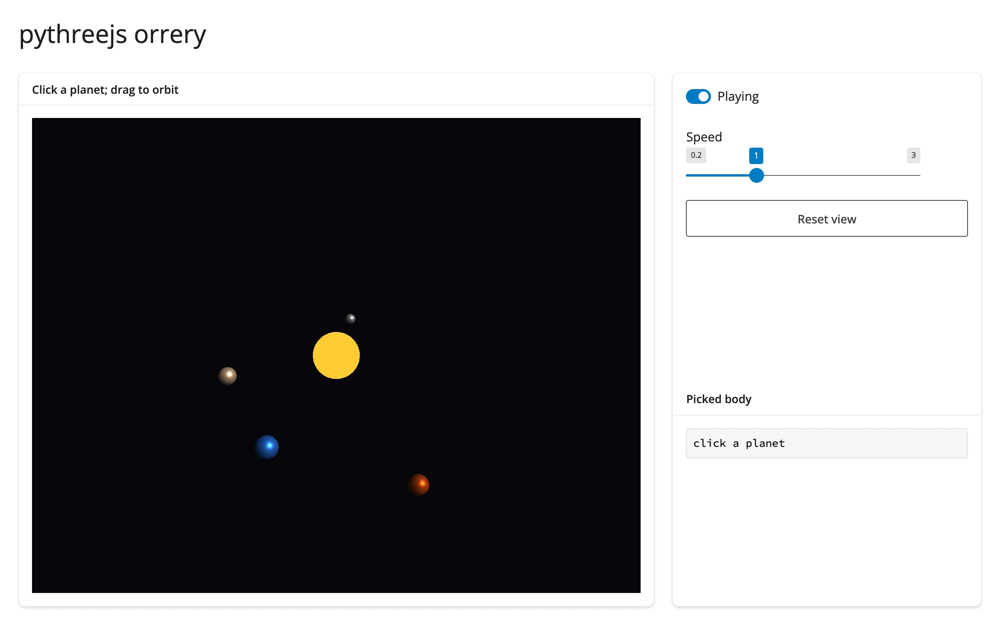

Four planets (Mercury, Venus, Earth, Mars) orbit a sun in a `pythreejs` scene, animated by a
30 fps `reactive.invalidate_later` clock that only mutates each mesh's `.position` -- no
re-render, ever, so your orbit/pan/zoom in the 3D view is never disturbed by playback. A
single `Picker` is shared across the whole scene graph (constructing it needs a real
`controlling` object, so it's built once against the `Scene` itself); clicking any body
resolves `picker.object` back to a name by identity comparison against the mesh dict.



## Run it

```sh
git clone --depth 1 https://github.com/posit-dev/py-shinywidgets
cd py-shinywidgets/website/gallery/showcases/orrery
uv run shiny run app.py
```

Source: [app.py](app.py) · [Open in Shinylive](app.py){.sw-shinylive-link}

## Try this

- Drag to orbit, scroll to zoom; the planets keep moving underneath you.
- Click a planet (or the sun): the sidebar identifies what you clicked, with its orbit radius
  and period.
- Drag **Speed**, or toggle **Playing**.
- Click **Reset view**: restores the camera to its home position/orientation/zoom without
  resetting the simulation clock.

## Accessors demonstrated

- `reactive_read(picker, "distance")` / `picker.object` -- pythreejs's own `Picker` control,
  read via `reactive_read()` since `render_pythreejs` has no dedicated click accessor;
  `distance` is `None` until the first click, and `.object` (not itself a trait) resolves to
  whichever mesh the picker most recently hit.

## Verification

No extra packages needed (pure pythreejs, no data download). A real Playwright click at the
canvas center (where the sun always renders, since it sits at the scene origin) changed
**Picked body** from `"click a planet"` to `"clicked the sun"` -- confirming the shared
`Picker` resolves clicks to the correct object across re-renders of the moving scene. See
`img/hero.webp` and `img/after_click.webp`.

Source: promoted from `docs/widget-guides/pythreejs/gallery/showcase_orrery.py`.
