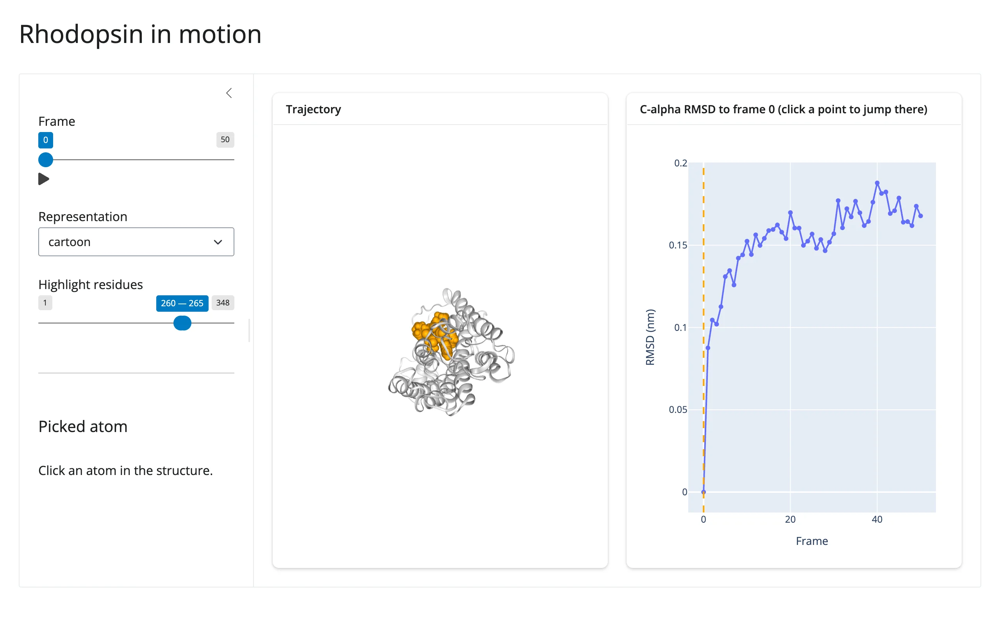

A bundled 1 ns molecular dynamics trajectory of rhodopsin (51 frames), loaded with `mdtraj`
and displayed with `nglview`. A single shared `reactive.value` (`current_frame`) is the one
source of truth for "what frame are we on": the frame slider, a click anywhere on the RMSD
chart, and playback (`animate=True`) all write to it, and three separate effects read it to
move the 3D viewer, the chart's reference line, and nothing else -- every update is in place,
so the camera and the chart's zoom are untouched.



## Run it

```sh
git clone --depth 1 https://github.com/posit-dev/py-shinywidgets
cd py-shinywidgets/website/gallery/showcases/rhodopsin-in-motion
uv run --with mdtraj shiny run app.py
```

Source: [app.py](app.py) · [Open in Shinylive](app.py){.sw-shinylive-link}

## Try this

- Drag the **Frame** slider (or press its play button): the structure and the chart's dashed
  reference line move together.
- Click anywhere on the RMSD chart: the frame jumps there, in both the viewer and the slider.
- Switch **Representation** (cartoon/licorice/spacefill/surface), or drag **Highlight
  residues**: the structure restyles without resetting the frame or the camera.
- Click an atom in the 3D structure: the sidebar's **Picked atom** card identifies it (residue
  name, number, chain).

## Accessors demonstrated

- `rmsd_plot.clicked()` -- the clicked point's `(x, y)` on the RMSD chart; `x` is used
  directly as a frame number.
- `structure.read("picked")` -- nglview's own `picked` trait, read via `.read()` (the taught
  fallback for any synced trait on a renderer output, replacing `reactive_read(x.widget, ...)`)
  since `render_nglview` has no dedicated accessors; `None` then an atom record once something
  has been clicked.

## Verification

Needs one ephemeral package (`mdtraj`, not in the project's locked venv; harmless to
overlay since nothing else in the venv depends on a specific mdtraj version). A real
Playwright click on the RMSD chart's line-plot markers moved the frame slider from `0` to
`20` and visibly shifted both the chart's reference line and the highlighted residue range
in the 3D view -- confirmed against the slider's actual value, not just a screenshot. A real
click on the 3D structure itself identified `TRP 265 chain B` in the **Picked atom** card. See
`img/hero.webp`, `img/after_click.webp` (chart click), `img/after_atom_click.webp` (structure
click).

Source: promoted from `docs/widget-guides/nglview/gallery/showcase_md_explorer.py` (see
`NOTES.md`).
