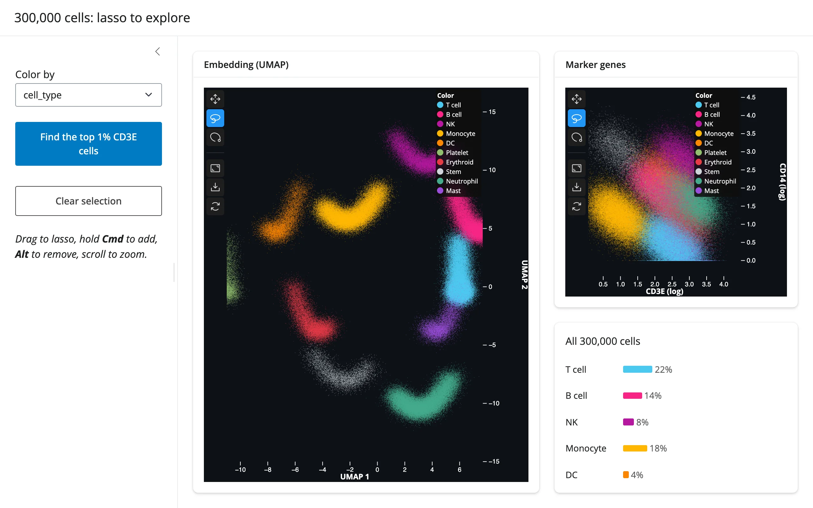

Two `jupyter-scatter` plots of a synthetic 300,000-cell single-cell atlas: a 2D UMAP
embedding, and a marker-gene scatter (CD3E vs. CD14). Dragging a lasso on either plot updates
the other one's selection too -- true two-way linked brushing, kept in sync by mirroring
`selected()` from each plot onto the other's `.widget.selection` trait. "Color by" restyles
both plots in place (the 300k points cross the wire exactly once, at first render); two
preset buttons drive the selection and camera from Python.



## Run it

```sh
git clone --depth 1 https://github.com/posit-dev/py-shinywidgets
cd py-shinywidgets/website/gallery/showcases/single-cell-atlas
uv run shiny run app.py
```

Source: [app.py](app.py) · [Open in Shinylive](app.py){.sw-shinylive-link}

## Try this

- Drag a lasso on either plot (hold Cmd/Meta to add to the selection, Alt to remove, scroll
  to zoom): the other plot highlights the same cells, and the **composition** panel
  recomputes cell-type percentages and median marker expression for exactly that selection.
- Click **Find the top 1% CD3E cells**: Python computes the 99th-percentile threshold,
  selects those cells on both plots, and zooms the embedding to fit them.
- Switch **Color by** between cell type and the two marker genes: both plots restyle without
  losing the current selection or zoom.

## Accessors demonstrated

- `umap.selected()` / `genes.selected()` -- the array of currently-selected point indices
  on each plot; read on both sides of the linking effect (`np.array_equal` guards against an
  infinite mirror loop) and by the composition panel.

## Verification

No extra packages needed (`jupyter-scatter` is already in the shared venv). A real Playwright
click on **Find the top 1% CD3E cells** changed the selection count from "All 300,000 cells"
to "3,000 cells selected (1.0%)" -- exactly 1% of 300,000, confirming the server-side
`np.quantile` threshold and the client-side `selection` trait agree -- and the embedding
visibly zoomed to the selected cluster while the marker-gene plot mirrored the same
selection. See `img/hero.webp` and `img/after_top.webp`.

Source: promoted from `docs/widget-guides/jscatter/gallery/showcase_single_cell_atlas.py`
(see `NOTES.md`).
