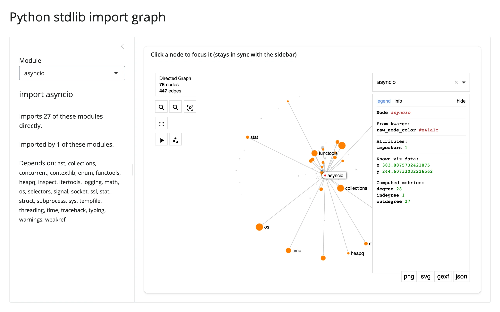

A directed graph of ~80 curated Python standard-library modules, built entirely by
statically parsing each module's own source with `ast.walk()` -- no downloads, no network,
just the interpreter running the app. Clicking a node (or typing into the sidebar) recolors
the graph: red/halo for the focused module, orange for what it imports, blue for what
imports it. Node size is in-degree (how many other modules depend on it). The camera is
carried across every re-render, so clicking around doesn't reset your pan/zoom.



## Run it

```sh
git clone --depth 1 https://github.com/posit-dev/py-shinywidgets
cd py-shinywidgets/website/gallery/showcases/stdlib-import-graph
uv run shiny run app.py
```

Source: [app.py](app.py) · [Open in Shinylive](app.py){.sw-shinylive-link}

## Try this

- Click a node: the sidebar updates to match, and the graph recolors around it.
- Type a module name into the sidebar's **Module** selectize (or use ipysigma's own built-in
  search box): same effect, the other direction.
- Pan and zoom freely -- it survives every click, since each click just re-renders with a
  different `raw_node_color` map and the same `camera_state` fed back in from Python.

## Accessors demonstrated

- `graph.read("selected_node")` -- ipysigma's own trait for "what node is currently selected,"
  read here (since `render_ipysigma` has no dedicated click accessor) to drive the sidebar's
  selectize two-way. `.read()` is the taught fallback for a renderer output's bare synced
  traits, replacing `reactive_read(graph.widget, ...)`.
- `graph.read("camera_state")` -- read on every render and fed back into the
  next `Sigma(..., camera_state=cam)` construction, which is what makes re-renders preserve
  pan/zoom instead of resetting the view.

## Verification

No extra packages needed (pure stdlib + networkx + ipysigma). A real Playwright click on the
"os" node changed the sidebar from `"import asyncio"` (28 modules, 1 importer) to
`"import os"` (0 modules, 28 importers) -- confirming `selected_node` fires on a genuine
click and the full round trip (click -> `.read()` -> sidebar selectize -> re-render ->
recolored graph) works. See `img/hero.webp` and `img/after_select.webp`.

Source: promoted from `docs/widget-guides/ipysigma/gallery/showcase_stdlib_imports.py`.
