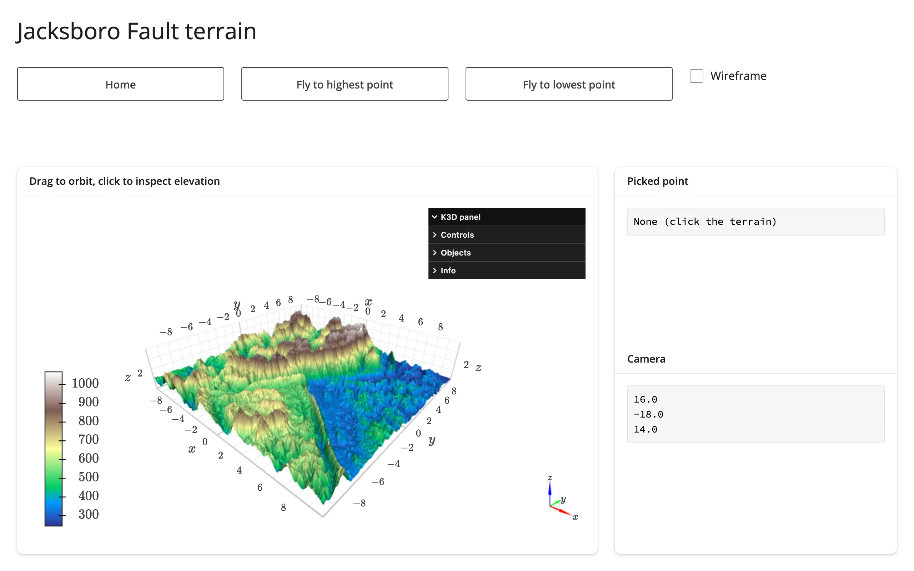

A real digital elevation model (matplotlib's bundled Jacksboro Fault sample, Texas),
rendered as a k3d surface you can drag to orbit. Clicking the terrain reads elevation at the
cursor via k3d's `click_callback`; two buttons fly the camera to the DEM's highest and lowest
points and drop a marker there; a checkbox toggles wireframe. Every one of these mutates the
existing k3d objects in place (`terrain.widget.camera = ...`, `layer.wireframe = ...`) --
the 139k-vertex surface is never resent.



## Run it

```sh
git clone --depth 1 https://github.com/posit-dev/py-shinywidgets
cd py-shinywidgets/website/gallery/showcases/terrain-explorer
uv run shiny run app.py
```

Source: [app.py](app.py) · [Open in Shinylive](app.py){.sw-shinylive-link}

## Try this

- Drag to orbit; scroll to zoom.
- Click anywhere on the terrain: the **Picked point** card shows the exact elevation and grid
  cell under the cursor.
- Click **Fly to highest/lowest point**: the camera animates there and a marker appears.
- Toggle **Wireframe**.
- Watch **Camera**: it reads the live camera vector via `terrain.camera()`, so it updates
  after every orbit, zoom, or fly-to -- not just clicks.

## Accessors demonstrated

- `k3d`'s `click_callback` -- not a shinywidgets accessor (k3d has no `clicked()` by design;
  real picking needs `plot.mode="callback"`), but the idiomatic pattern this guide
  recommends: route the callback's payload into a `reactive.value` so the rest of the app
  reacts to it normally.
- `terrain.camera()` -- the plot's camera as 9 floats, re-seeded from the new widget on every
  render and updated on every orbit/zoom/fly-to. Inherent widget state (not kept across
  re-renders like a click), and never `None` once the browser auto-fits.

## Verification

No extra packages needed. Two real gestures confirmed against server-rendered text:

- Clicking **Fly to highest point** moved `terrain.camera()`'s first
  three components to `(6.9, 1.4, 9.0)` and dropped a visible marker at the peak --
  `img/after_peak.webp`.
- A real click on the terrain canvas then set the click callback's payload: **Picked point**
  changed from `"None (click the terrain)"` to `"elevation: 1021 m\nrow, col: 139, 108"` --
  `img/after_click.webp`.

Source: promoted from `docs/widget-guides/k3d/gallery/showcase_terrain_explorer.py` (see
`NOTES.md`).
