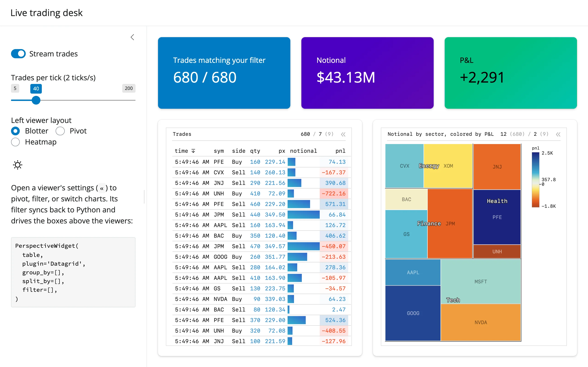

A single Perspective server-side `table` (a rolling window, capped at 3,000 rows) feeds two
`PerspectiveWidget` viewers: a blotter/pivot/heatmap grid on the left, and a sector treemap
on the right. A background effect streams new trades into the table twice a second; three
value boxes above the viewers recompute, server-side, from exactly the blotter's *current*
filter -- so pivoting, grouping, or typing a filter into the grid's own settings panel
immediately changes what the value boxes count, with no extra code to keep them in sync.



## Run it

```sh
git clone --depth 1 https://github.com/posit-dev/py-shinywidgets
cd py-shinywidgets/website/gallery/showcases/trading-desk
uv run shiny run app.py
```

Source: [app.py](app.py) · [Open in Shinylive](app.py){.sw-shinylive-link}

## Try this

- Watch the value boxes update live as trades stream in.
- Switch **Left viewer layout** between Blotter / Pivot / Heatmap: the whole preset (plugin,
  grouping, columns, column styling) is swapped in one `hold_sync()` batch.
- Open the grid's own settings panel (the `«` affordance) and add a filter (e.g. `sector ==
  "Tech"`): the value boxes above immediately recompute to match.
- Flip dark mode: both viewers' themes update in place.

## Accessors demonstrated

- `grid.view_config()` -- the blotter viewer's live configuration (plugin, group/split-by,
  sort, and critically `filter`), read both by the **config** code panel and by the
  `in_view()` calc that drives the three value boxes. This is the accessor that makes
  "the boxes always match whatever the user is looking at" possible without re-deriving the
  filter logic in Python.

## Verification

No extra packages needed. Confirmed the streaming accessor directly: **Trades matching your
filter** read `680 / 680` at page load, then `880 / 880` about 2.5 seconds later (with
streaming on at the default rate) -- a real, growing count, not a static display. Switching
**Left viewer layout** to Pivot visibly regrouped the blotter by sector/symbol/side and
changed the treemap's labels, confirmed in `img/after_pivot.webp` against `img/hero.webp`.

Source: promoted from `docs/widget-guides/perspective/gallery/showcase_trading_desk.py`.
