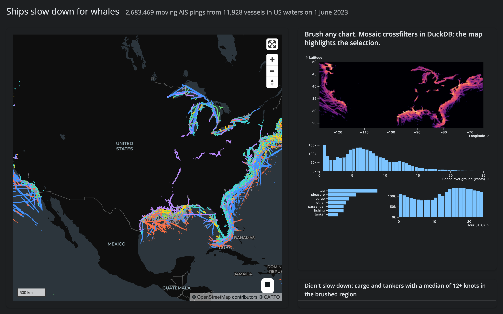

Every moving AIS ping from 11,928 vessels in US waters on a single day: 2,683,469 points in
one lonboard `ScatterplotLayer`, crossfiltered by four Mosaic selections -- a density map
(region), a speed histogram, a vessel-type bar chart, and an hour-of-day histogram. Mosaic
does the crossfiltering in DuckDB, so dragging a brush over millions of rows settles in about
a second, and the selection flows back into Python, which highlights exactly those pings on
the GPU map (an in-place layer swap; the 2.68M-point base layer is never re-sent).

The payoff is a real finding: brush the California coast, select **cargo** and **tanker**,
and the speed histogram grows a spike just under 10 knots -- the voluntary speed limit in
the Santa Barbara Channel's whale-protection zone. Brush the Gulf of Mexico instead and the
spike is gone; the mode sits at about 12 knots, and the "Didn't slow down" table names the
vessels that kept up speed.



## Run it

```sh
git clone --depth 1 https://github.com/posit-dev/py-shinywidgets
cd py-shinywidgets/website/gallery/showcases/whale-slowdown
uv run shiny run app.py
```

On first run the app downloads `pings.parquet` (~33 MB) from
[py-shinywidgets-data](https://github.com/cpsievert/py-shinywidgets-data/releases/tag/showcase-v1);
`prep_data.py` rebuilds it from the raw NOAA CSV. There is no Shinylive link: DuckDB and a
33 MB download don't belong in a browser tab.

Source: [app.py](app.py)

## Try this

- **Find the spike.** Drag a box around California on the density map (top right). Click
  **cargo** in the vessel-type bars, then shift-click **tanker**. The speed histogram grows
  a spike just under 10 kn, and the map flies to your brush.
- **Brush the spike.** Brush roughly 8.5-10 kn on the speed histogram. White pings trace
  the Santa Barbara Channel and the San Francisco approach lanes: the ships that slowed
  down, and exactly where.
- **Compare the Gulf.** Click outside the box to clear it, then draw a new box over the
  Gulf of Mexico. The spike is gone -- the hump is at about 12 kn, and the table names
  the fast cargo ships and tankers in that region.

Gestures: drag to brush, drag inside a box to move it, click outside a box to clear it,
shift-click the type bars to select several.

## Techniques demonstrated

- **Mosaic params as a reactive input.** The widget's `params` trait carries all four
  selections; a 300 ms debounce collapses a drag, and `w.data("pings", filter_by=[...])`
  asks Mosaic for the selected rows as a DuckDB relation -- the caption, the map highlight,
  and the slowpoke table all read the same debounced selection.
- **In-place highlight on a huge layer.** The selection becomes a second
  `ScatterplotLayer` swapped into `map.widget.layers` (sampled to 300k points when the
  selection is larger): 300k rows cross the wire in ~0.4 s while the 2.68M-point base
  layer stays put.
- **Brush-to-fly-to.** When the region brush settles, its lon/lat bounds become a
  `map.widget.fly_to(...)`; clearing the brush flies back to the full US view.

## Verification

Driven end-to-end with Playwright on the hosted parquet: a California brush selecting
cargo+tanker puts the speed mode in the 9.5-10 kn bin (8,940 pings) and a Gulf brush puts
it at 12 kn, matching the independently computed DuckDB counts (2,683,469 pings from
11,928 vessels). First paint is ~5.5 s with 43 MB over the websocket; a rapid 30-step
brush settles within 1 s. See `img/hero.webp`, captured mid-story: California cargo and
tankers brushed, spike visible just under 10 kn.
