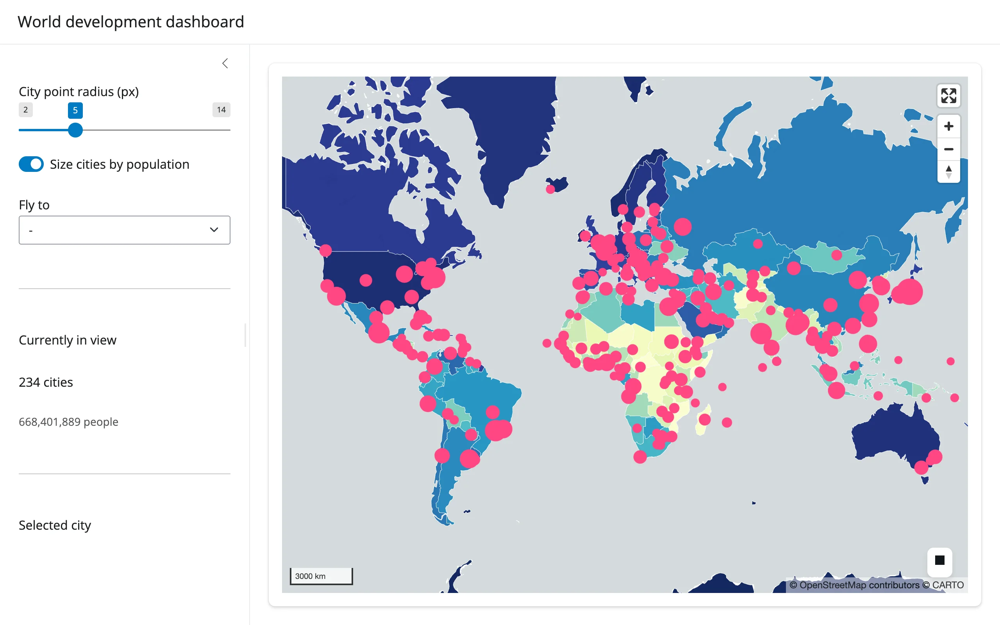

177 country polygons, colored by GDP per capita, with a 243-point city layer sized by
population on top. Everything you can do to the city layer -- resize the dots, switch
between a fixed radius and a population-scaled one, fly to a city -- restyles the existing
lonboard `Map` in place, so the 420 features backing it only cross the wire once.



## Run it

```sh
git clone --depth 1 https://github.com/posit-dev/py-shinywidgets
cd py-shinywidgets/website/gallery/showcases/world-development-dashboard
uv run shiny run app.py
```

Source: [app.py](app.py) · [Open in Shinylive](app.py){.sw-shinylive-link}

## Try this

- Drag the **City point radius** slider, or flip **Size cities by population**: the dots
  resize in place (`layer.get_radius = ...`), no re-render.
- Pick a city from **Fly to**: the map flies there (`map.widget.fly_to(...)`) while a small
  client-side `ResizeObserver` + ad hoc JS keeps reporting the canvas's pixel size, so Python
  can convert `view_state()` (center + zoom) into an exact lng/lat viewport box.
- Click any pink dot: the sidebar's **Selected city** card uses `map.selected()` to
  look up the clicked city's name and country.
- Watch **Currently in view**: it recomputes from `view_state()` on every pan/zoom, filtering
  the full city GeoDataFrame against the current viewport box.

## Accessors demonstrated

- `map.view_state()` -- center/zoom, read continuously to compute a viewport-filtered stat
  (paired with a tiny client-side `Shiny.setInputValue` for the canvas's pixel size, since
  lonboard has no bounds trait).
- `map.selected()` -- the clicked feature's row position in whichever GeoDataFrame was
  passed to the layer that was hit; used here to show a detail card.

## Verification

Smoke-tested in this environment: server boots clean, map and choropleth render over a real
network fetch of the Natural Earth GeoJSON (confirmed reachable), and a real Playwright click
on a city dot updates the "Selected city" card from `selected()` (verified against the
rendered DOM text, not just a screenshot) -- see `img/hero.webp` and `img/after_click.webp`.

Source: promoted from `docs/widget-guides/lonboard/gallery/showcase_world_dashboard.py`.
