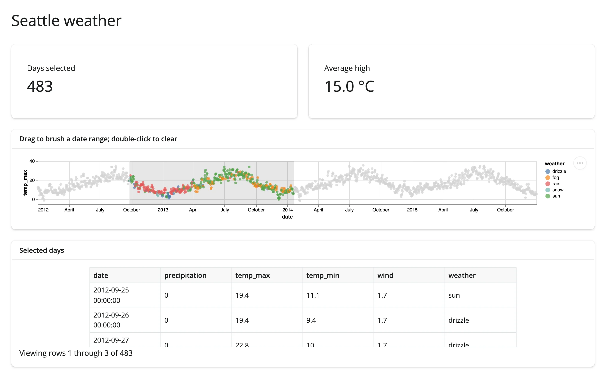

An interval selection on a single Altair chart, read back into Python as a DataFrame. No second
widget is needed to get a linked view: a value box and a `render.data_frame` table both derive
from the same `selected_rows("brush")` call.



## Run it

```sh
git clone --depth 1 https://github.com/posit-dev/py-shinywidgets
cd py-shinywidgets/website/gallery/templates/altair-weather-brush
uv run shiny run app.py
```

Source: [app.py](app.py) · [Open in Shinylive](app.py){.sw-shinylive-link}

## Try it

1. Drag left-to-right across the scatter to brush a date range.
2. Watch "Days selected" and "Average high" update, and the table below fill with the matching
   rows.
3. Double-click the chart to clear the brush.

## Accessors demonstrated

- `timeline.selected_rows("brush")` -- the rows of `weather` whose `date` falls inside the named
  `brush` selection, as a DataFrame. Empty (not `None`) when nothing is brushed.

## What to change for your own data

- Replace `weather` with your own DataFrame and adjust the `x`/`y`/`color` encodings.
- `encodings=["x"]` restricts the brush to one axis (a date range here); drop it for a full 2D
  rectangular brush.
- The selection name (`"brush"`) is arbitrary; keep it consistent between `add_params` and
  `selected_rows()`.

## Dependency note

Only needs `shinywidgets[altair]` -- the `seattle_weather` sample data comes from `altair.datasets`,
which is bundled with altair itself, so no extra package or `requirements.txt` entry is needed.
