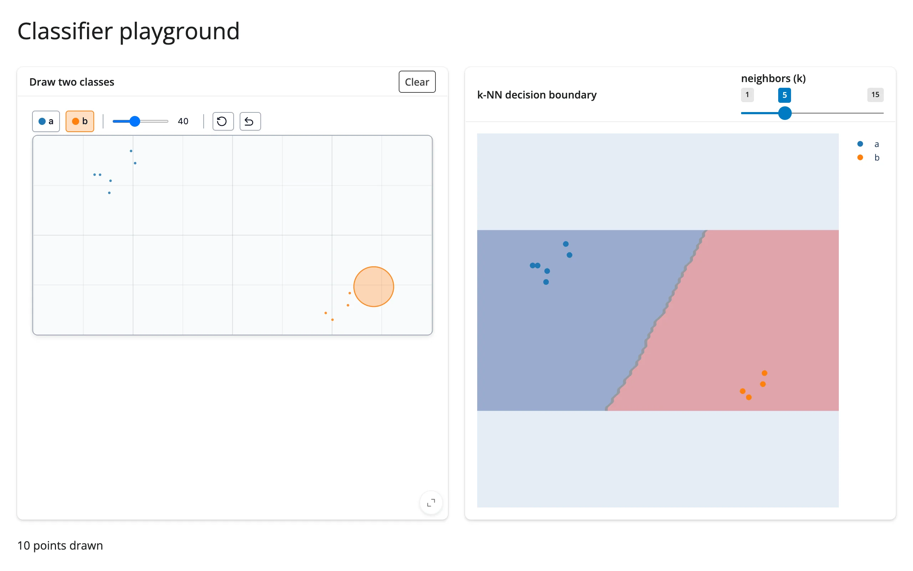

A hands-on way to build intuition for classifiers: draw points of two classes on a `drawdata`
canvas, and a `plotly` contour plot refits a k-NN model and redraws the decision boundary on every
change, live.



## Run it

```sh
git clone --depth 1 https://github.com/posit-dev/py-shinywidgets
cd py-shinywidgets/website/gallery/templates/drawdata-classifier-playground
uv run --with scikit-learn shiny run app.py
```

Source: [app.py](app.py) · [Open in Shinylive](app.py){.sw-shinylive-link}

## Try it

1. Draw a handful of points for class "a" (default).
2. Click "b" in the class switcher, then draw points for class "b" elsewhere on the canvas.
3. Watch the decision boundary appear once both classes have at least one point.
4. Drag the "neighbors (k)" slider to see how the boundary smooths out as k grows.
5. Click "Clear" to reset.

## Accessors demonstrated

drawdata has no dedicated accessors; this template uses `canvas.read("data")` -- the taught
fallback for a renderer output's bare synced traits, replacing `reactive_read(x.widget, ...)` --
to read the drawn points as a list of dicts (`x`, `y`, `label`, `color`), converted to a
DataFrame.

## What to change for your own data

- Swap `KNeighborsClassifier` for any other scikit-learn classifier (`LogisticRegression`, `SVC`, a
  small `MLPClassifier`, ...) -- the contour-plotting code is classifier-agnostic as long as
  `.fit()`/`.predict()` work the same way.
- `ScatterWidget(n_classes=2)` can go up to more classes; the `groupby("label")` loop already
  handles any number of classes.
