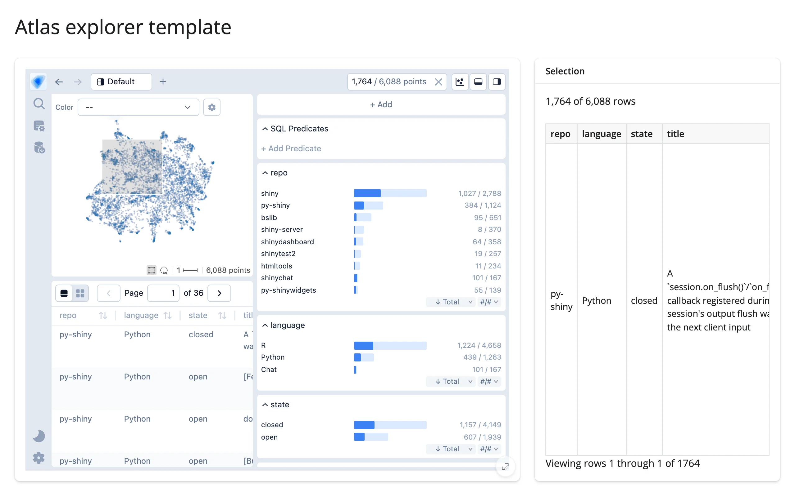

An `embedding_atlas` scatter view of a precomputed 2D projection, paired with a live row count
(computed via a direct DuckDB query using the brush's SQL predicate) and a detail table of the
selected rows.



## Run it

```sh
git clone --depth 1 https://github.com/posit-dev/py-shinywidgets
cd py-shinywidgets/website/gallery/templates/embedding-atlas-explorer
uv run shiny run app.py
```

Source: [app.py](app.py) · [Open in Shinylive](app.py){.sw-shinylive-link}

## Try it

1. Click the box-select icon in the canvas toolbar (a plain drag pans the view instead).
2. Drag a rectangle over a cluster of points.
3. Watch "N of 6,088 rows" update, and the detail table on the right fill with the matching
   issues (repo, language, state, title).

## Accessors demonstrated

- `atlas.predicate()` -- a SQL `WHERE`-clause fragment (as a string) describing the current brush,
  or `None` when nothing is selected. Used here directly in a DuckDB query for a fast count.
- `atlas.selected()` -- the selected rows as a DataFrame (minus the projection/internal-index
  columns), ready to display or export.

## What to change for your own data

- Swap `DATA`/`COLUMNS`/`X`/`Y`/`TEXT` for your own parquet file and projection columns. The
  projection (`projection_x`/`projection_y`) must be precomputed offline --
  `embedding_atlas.projection.compute_projection()` cannot run inside Shiny's event loop.
- `predicate()` composes with any DuckDB query against the same registered table, not just
  `count(*)` -- use it for any other live aggregate.

## Dependency note

This project's DuckDB connection (`con`) is a private, in-process connection created at module
load and used read-only by this app's own query -- it is not the same connection
`render_embedding_atlas` locks down against browser-sent SQL, and is not shared across sessions.
