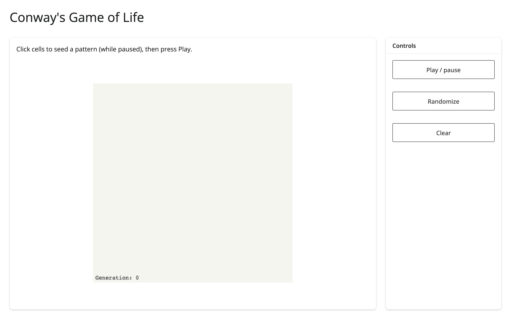

A 50x50 cellular automaton on an `ipycanvas` canvas: click cells while paused to seed a pattern,
then press Play to let a `reactive.invalidate_later()` tick step the simulation. Every writer
(click, randomize, clear, tick) redraws the same canvas object in place -- the render function
runs exactly once.



## Run it

```sh
git clone --depth 1 https://github.com/posit-dev/py-shinywidgets
cd py-shinywidgets/website/gallery/templates/ipycanvas-game-of-life
uv run shiny run app.py
```

Source: [app.py](app.py) · [Open in Shinylive](app.py){.sw-shinylive-link}

## Try it

1. Click a few cells to toggle them alive (while paused).
2. Press "Play / pause" to start the simulation; watch the generation counter climb.
3. Press "Randomize" for a random starting grid, or "Clear" to reset.

## Pattern demonstrated

No accessors: ipycanvas's `on_mouse_down` is a plain callback, bridged here to directly mutate a
module-level numpy array and redraw. The key idea worth copying is the *one* effect responsible for
pushing to the browser (`_tick`, gated by `reactive.invalidate_later()`), with every other handler
(click, randomize, clear) calling the same `redraw()` helper directly rather than going through a
reactive value -- that's what keeps `canvas()` itself a single render with no re-render loop.

## What to change for your own data

- Swap the `step()` function for any other 2D cellular automaton rule.
- `N`, `CELL`, and the tick interval (`0.12`s) control grid resolution, pixel size, and simulation
  speed.
