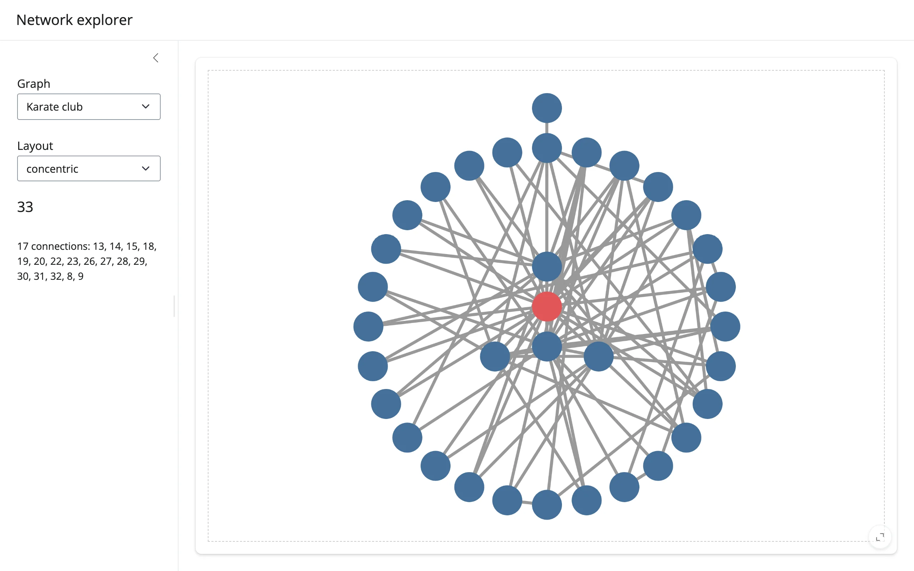

An `ipycytoscape` graph view with a graph picker, a layout picker, and a sidebar that shows a
clicked node's neighbor list. The clicked node is also highlighted in place (an in-place style
write, not a re-render) so the graph never reloads.



## Run it

```sh
git clone --depth 1 https://github.com/posit-dev/py-shinywidgets
cd py-shinywidgets/website/gallery/templates/ipycytoscape-network-explorer
uv run shiny run app.py
```

Source: [app.py](app.py) · [Open in Shinylive](app.py){.sw-shinylive-link}

## Try it

1. Click any node; the sidebar lists its neighbor count and ids, and the node turns red.
2. Switch the Layout dropdown (concentric/cose/breadthfirst/circle); the graph re-lays out in
   place.
3. Switch the Graph dropdown between the karate club and Les Miserables networks.

## Accessors demonstrated

- `network.clicked_node()` -- the clicked node's full Cytoscape data payload (a dict with `data`,
  `position`, etc.), or `None`. Clicks are *kept* across a re-render until the user clicks again,
  so switching the Graph dropdown (which re-renders `network` with a different graph) can leave a
  click payload pointing at a node id that doesn't exist in the new graph. `detail()` guards the
  id lookup with `next(..., None)` instead of an unguarded `next(...)`, falling back to the
  placeholder text -- see `img/after_switch_graph.webp`.

## What to change for your own data

- Add entries to the `GRAPHS` dict with any `networkx` graph (or build one from your own edge
  list).
- `STYLE` is a Cytoscape stylesheet list; add more selectors for additional visual states (e.g. a
  `.selected` class for multi-select).
- The highlight effect writes `node.classes` directly on `network.widget.graph.nodes` -- the
  pattern to copy for any other per-node, in-place visual update.
