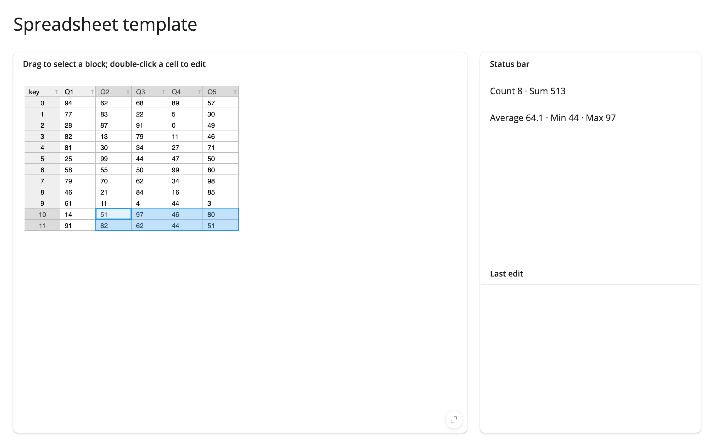

A starting point for a spreadsheet-like app: `ipydatagrid` with `selection_mode="cell"` and
`editable=True`, paired with a status bar that recomputes summary statistics from whichever block
of cells is currently selected, and a log of the last edit.



## Run it

```sh
git clone --depth 1 https://github.com/posit-dev/py-shinywidgets
cd py-shinywidgets/website/gallery/templates/ipydatagrid-spreadsheet
uv run shiny run app.py
```

Source: [app.py](app.py) · [Open in Shinylive](app.py){.sw-shinylive-link}

## Try it

1. Drag to select a rectangular block of cells; the status bar reports Count, Sum, Average, Min,
   and Max for that block.
2. Double-click a cell to edit its value, then press Enter; "Last edit" shows the row, column, and
   new value.

## Accessors demonstrated

- `grid.selected()` -- a list of cell-range dicts (`r1`/`r2`/`c1`/`c2`), one per selected block.
  Empty list when nothing is selected.
- `grid.visible_data()` -- the currently visible/filtered/sorted DataFrame, used here to resolve
  selection ranges back to values.
- `grid.edited_cell()` -- the most recent edit, as a dict with `row`, `column`, and `value`. `None`
  until the first edit.

## What to change for your own data

- Swap `df` for your own DataFrame.
- `selection_mode="cell"` also supports `"row"` and `"column"`; the status-bar logic would need to
  index `visible_data()` differently for those modes.

## Known limitation

`rate_policy`/`rate_delay` on `render_ipydatagrid` do not affect `selected()`, which streams
continuously during a drag (not just at release) and declares no default rate policy. A heavy
downstream computation per tick can stall the browser during a long drag; keep per-tick work cheap
or debounce it yourself. See `docs/widget-guides/ipydatagrid/NOTES.md`.
