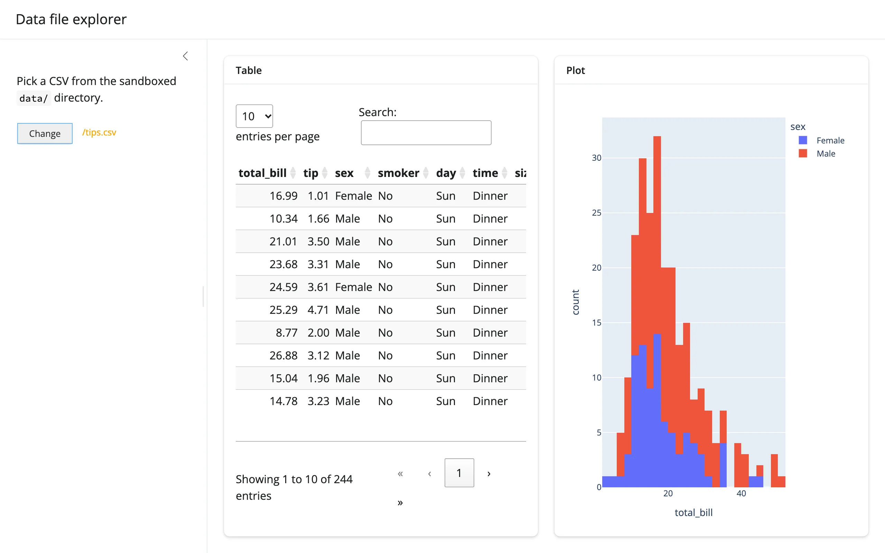

An `ipyfilechooser` scoped to a sandboxed directory (`sandbox_path=`), with a `register_callback()`
bridge into a `reactive.value` that drives both an `itables` preview table and a `plotly` plot
chosen based on the file's columns.



## Run it

```sh
git clone --depth 1 https://github.com/posit-dev/py-shinywidgets
cd py-shinywidgets/website/gallery/templates/ipyfilechooser-data-explorer
uv run shiny run app.py
```

Source: [app.py](app.py) · [Open in Shinylive](app.py){.sw-shinylive-link}

## Try it

1. Click "Select" to open the file dialog.
2. Pick a CSV from the sandboxed `data/` directory (two are seeded at startup: `gapminder.csv` and
   `tips.csv`).
3. Click "Select" again to confirm; the table and plot both populate.
4. Click "Change" to pick a different file.

## Pattern demonstrated

ipyfilechooser has no reactive accessors: `selected`/`selected_path`/`selected_filename` are plain
`@property` getters, not traits, so they can't be read with `reactive_read()` either. This template
uses `fc.register_callback(...)` to push the chosen path into a `reactive.value` the moment the
dialog closes.

## What to change for your own data

- Point `sandbox_path`/`path` at any server-side directory you control; `filter_pattern` restricts
  the picker to matching files.
- The `data()` calc just does `pd.read_csv`; swap in `pd.read_parquet`, `pd.read_excel`, or your
  own loader, and adjust `filter_pattern` to match.
- The plot branch switches on column names (`"lifeExp" in df.columns`); replace with whatever
  branching (or a single fixed chart) fits your own files.

## Security note

`sandbox_path` blocks `../` traversal attempts (verified in a real browser: the Select/Change
button disables itself on an out-of-sandbox path). Always set it when exposing a file picker to
end users.
