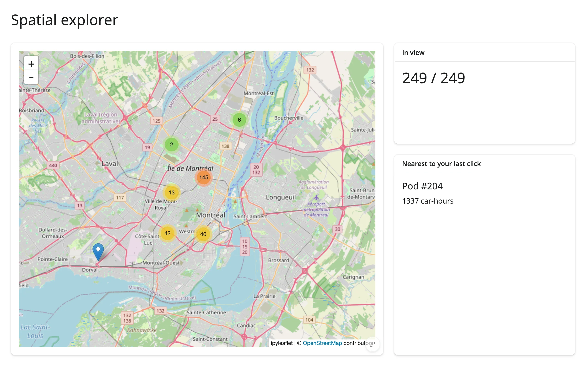

A clustered `ipyleaflet` marker map where panning or zooming updates a live "N in view" count
computed from the map's current bounds, and clicking anywhere on the map finds and displays the
nearest point.



## Run it

```sh
git clone --depth 1 https://github.com/posit-dev/py-shinywidgets
cd py-shinywidgets/website/gallery/templates/ipyleaflet-spatial-explorer
uv run shiny run app.py
```

Source: [app.py](app.py) · [Open in Shinylive](app.py){.sw-shinylive-link}

## Try it

1. Pan or zoom the map and watch "In view" recompute against the full dataset.
2. Click anywhere on the map; "Nearest to your last click" shows the closest pod and its usage.

## Accessors demonstrated

- `map.bounds()` -- the current viewport as `((south, west), (north, east))`. Used here to filter
  the full dataset down to what's visible.
- `map.clicked()` -- the click-event payload, including `coordinates`. `None` until the first
  click.

## What to change for your own data

- Swap `pods` for your own point DataFrame with latitude/longitude columns.
- The "nearest" computation uses squared Euclidean distance in lat/lon space, which is fine at
  this scale; swap in a proper haversine distance for larger geographic extents.
- `MarkerCluster` is optional -- drop it for a few dozen points or fewer.
