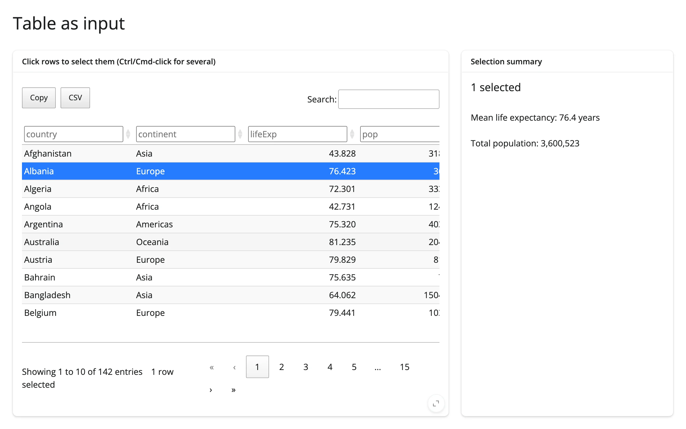

The simplest version of "selection drives a downstream view": one `itables` table with
`select=True`, and a summary panel that recomputes from whichever rows are selected (or the whole
table when nothing is selected).



## Run it

```sh
git clone --depth 1 https://github.com/posit-dev/py-shinywidgets
cd py-shinywidgets/website/gallery/templates/itables-table-as-input
uv run shiny run app.py
```

Source: [app.py](app.py) · [Open in Shinylive](app.py){.sw-shinylive-link}

## Try it

1. Click a row to select it; Ctrl/Cmd-click (or Shift-click) to extend the selection.
2. Watch the summary panel's mean life expectancy and total population recompute.
3. Use the search box or column filters to narrow the table, then select from the filtered set.
4. Try the Copy/CSV export buttons on the selected rows.

## Accessors demonstrated

- `table.selected_rows()` -- a list of the currently selected row *positions* (not labels). Empty
  list when nothing is selected.

## What to change for your own data

- Swap `countries` for your own DataFrame.
- Replace the two `ui.p(...)` stats in `summary()` with whatever your selection should drive: a
  plot, a model re-fit, a download handler, and so on.
- `buttons=["copyHtml5", "csvHtml5"]` and `column_filters="header"` are itables conveniences; drop
  either if you don't need them.
