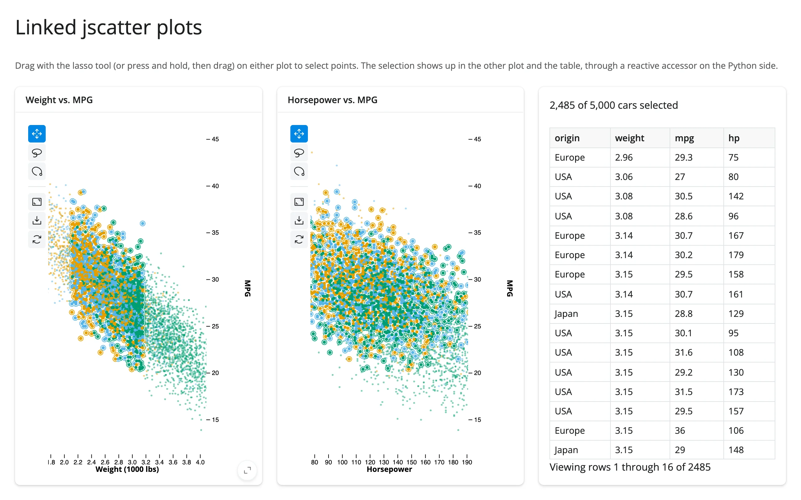

Two independent `jscatter` views of the same data (weight vs. MPG, horsepower vs. MPG), mirrored
so that lassoing points in either one highlights the same points in the other, plus a count and a
`render.data_frame` table of the selected rows.



## Run it

```sh
git clone --depth 1 https://github.com/posit-dev/py-shinywidgets
cd py-shinywidgets/website/gallery/templates/jscatter-linked-scatter
uv run shiny run app.py
```

Source: [app.py](app.py) · [Open in Shinylive](app.py){.sw-shinylive-link}

## Try it

1. Press and hold on one plot, then drag to lasso a region (jupyter-scatter starts its lasso on a
   long press, not an instant drag).
2. Watch the matching points outline themselves in the *other* plot, and the table fill with the
   selected cars.
3. Try lassoing in the second plot instead -- the link works both ways.

## Accessors demonstrated

- `weight_mpg.selected()` / `hp_mpg.selected()` -- the row indices of the current lasso
  selection, as a numpy array. Empty array when nothing is selected.

## What to change for your own data

- Swap `cars` for your own DataFrame and the `x`/`y`/`color_by` columns on each `Scatter`.
- The `link()` helper is the reusable piece: it reads one plot's `selected()` and writes it onto
  the other's `.widget.selection` inside `reactive.isolate()`, guarded by an equality check to
  avoid a feedback loop. Apply the same helper to link any two jscatter views.

## Scale note

At very large point counts (multi-million-row lasso selections), the selection payload can exceed
Shiny's websocket message size; see `docs/widget-guides/jscatter/guide.md` "Gotchas" for the
threshold and workaround.
