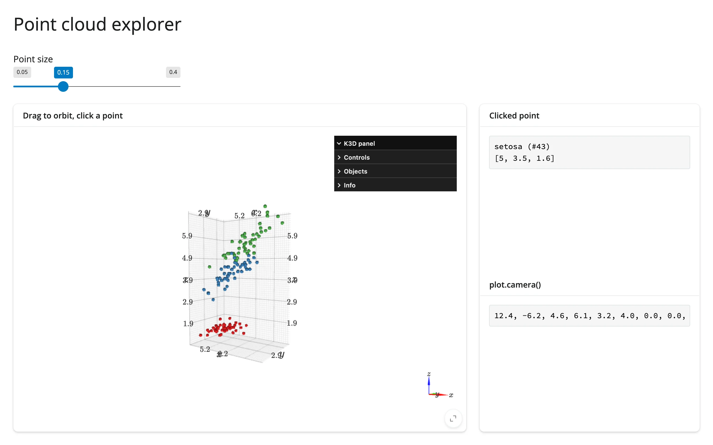

A `k3d` scene in `mode="callback"` (required for picking), with a slider that resizes points
in place, a click handler that reports the clicked point's label and coordinates, and the current
camera vector read back as text.



## Run it

```sh
git clone --depth 1 https://github.com/posit-dev/py-shinywidgets
cd py-shinywidgets/website/gallery/templates/k3d-point-cloud-explorer
uv run --with scikit-learn shiny run app.py
```

Source: [app.py](app.py) · [Open in Shinylive](app.py){.sw-shinylive-link}

## Try it

1. Drag to orbit the scene; scroll to zoom.
2. Click a point; its species label, index, and (x, y, z) position appear on the right.
3. Move the "Point size" slider; the scene updates in place (no re-render).
4. Watch `plot.camera()` track your orbit/zoom.

## Accessors demonstrated

- `plot.camera()` -- the current camera vector (`[pos_x, pos_y, pos_z, target_x, ..., up_z]`),
  nine floats. Updates as you orbit/pan/zoom.
- The click handler is a plain k3d `click_callback`, bridged to a `reactive.value` (k3d has no
  dedicated `clicked()` accessor by design -- picking needs `mode="callback"`).

## What to change for your own data

- Swap `xyz`/`labels`/`colors` for your own `(n, 3)` array and label/color scheme.
- The point-size slider writes to `plot.widget.objects[0].point_size` in a `@reactive.effect` --
  the in-place-update pattern to copy for any other per-object trait.

## Gotcha

Click picking needs a geometrically precise gesture: Playwright must land the click pixel-exactly
on a rendered point, not just "near" it (verified here with a pixel-calibrated click from a
reference screenshot). A real user has no such problem since they can see the points.
