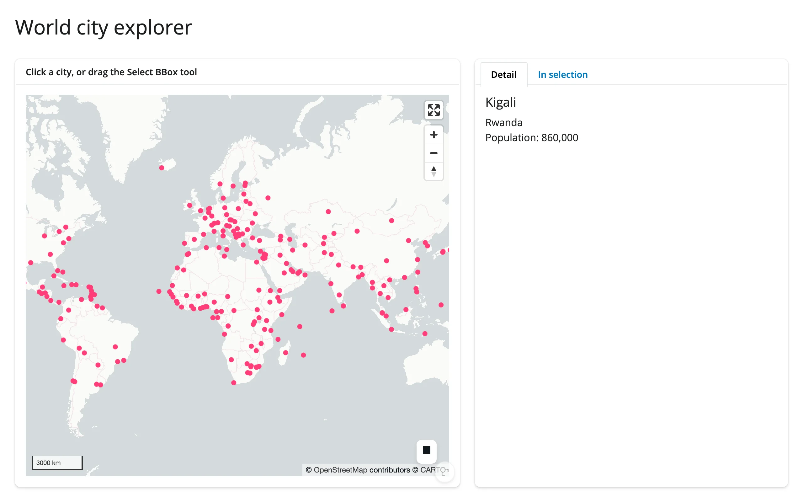

A `lonboard` point map over world cities, with two complementary accessors feeding two tabs: a
single click resolves to a detail card, and the built-in "Select BBox" tool resolves to a filtered
`itables` table.



## Run it

```sh
git clone --depth 1 https://github.com/posit-dev/py-shinywidgets
cd py-shinywidgets/website/gallery/templates/lonboard-city-explorer
uv run shiny run app.py
```

Source: [app.py](app.py) · [Open in Shinylive](app.py){.sw-shinylive-link}

## Try it

1. Click any city dot; the "Detail" tab shows its name, country, and population.
2. Use the box-select tool (top-right of the map) to drag a rectangle; the "In selection" tab
   fills with every city whose coordinates fall inside it.

## Accessors demonstrated

- `map.selected()` -- the row index of the last-clicked feature, or `None`.
- `map.selected_bounds()` -- the `(minx, miny, maxx, maxy)` of the last box selection, or `None`.

## What to change for your own data

- Replace the Natural Earth URL with your own GeoDataFrame (any point geometry works).
- `show_side_panel=False` is set because the two cards below already show feature detail; drop it
  if you want lonboard's built-in picking panel too.
- Swap `ScatterplotLayer` for another lonboard layer type (e.g. `PathLayer`, `PolygonLayer`); only
  `get_fill_color`/`pickable`/`auto_highlight` need to carry over for picking to keep working.

## Network note

Fetches a small (~2 MB) public GeoJSON from a GitHub mirror at startup. Swap in a bundled or local
file if you need a fully offline template.
