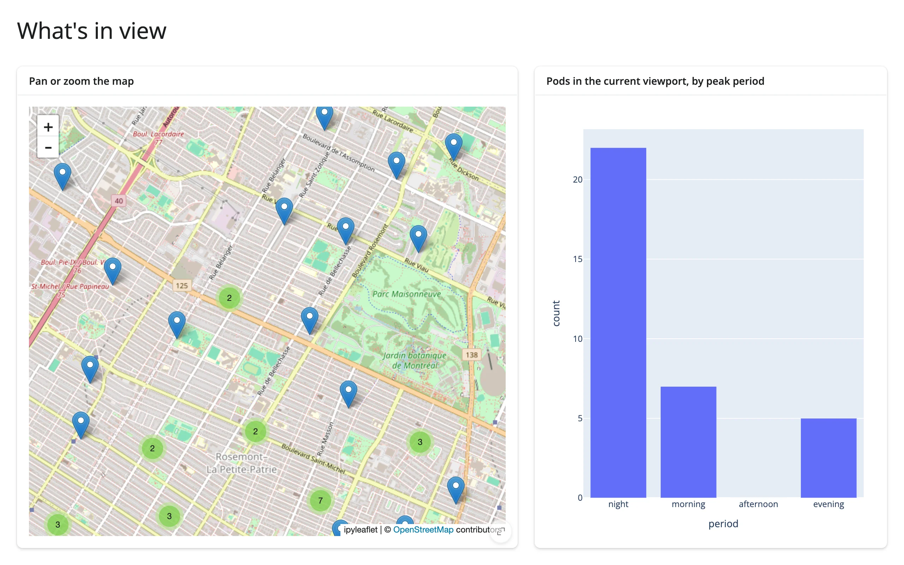

The "map viewport drives a chart" cross-widget pattern: an `ipyleaflet` map's current bounds feed a
`plotly` bar chart that always reflects what's visible, recomputed from the full dataset on every
pan or zoom. Two different widget libraries, one shared reactive read.



## Run it

```sh
git clone --depth 1 https://github.com/posit-dev/py-shinywidgets
cd py-shinywidgets/website/gallery/templates/map-viewport-to-chart
uv run shiny run app.py
```

Source: [app.py](app.py) · [Open in Shinylive](app.py){.sw-shinylive-link}

## Try it

1. Pan the map, or zoom in on a cluster.
2. Watch the bar chart on the right recompute the peak-period breakdown for only the pods
   currently in view.

## Accessors demonstrated

- `map.bounds()` -- the current viewport as `((south, west), (north, east))`. The chart filters the
  full `pods` DataFrame against these bounds on every render.

## What to change for your own data

- Swap `pods` for your own point DataFrame; replace `"period"` with whatever categorical (or
  binned numeric) breakdown you want charted.
- This same shape works for any map-widget-with-a-bounds-accessor paired with any chart library --
  see `docs/widget-guides/articles/linked-views/article.md` for the lonboard and maplibre variants.

## Credit

Promoted from `docs/widget-guides/articles/linked-views/examples/06_ipyleaflet_bounds_to_plotly.py`
(the cross-cutting linked-views article), with `full_screen=True` cards and a comment header added
for gallery consistency.
