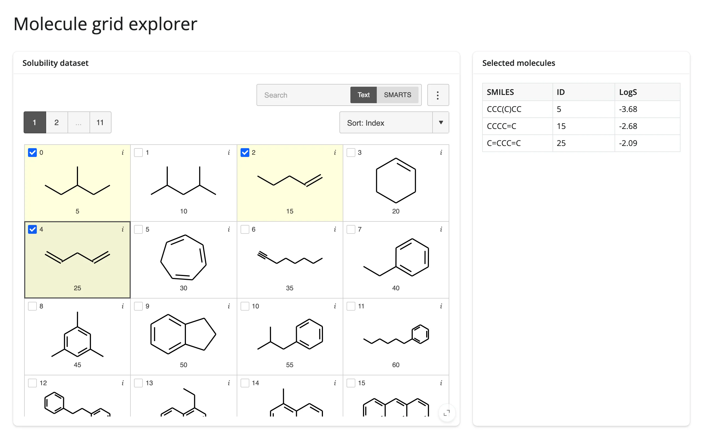

A `mols2grid` grid of chemical structures with per-cell checkboxes, paired with a
`render.data_frame` table that reflects the current selection -- the basic shape for any
"browse structures, keep a worklist" cheminformatics app.



## Run it

```sh
git clone --depth 1 https://github.com/posit-dev/py-shinywidgets
cd py-shinywidgets/website/gallery/templates/mols2grid-grid-explorer
uv run shiny run app.py
```

Source: [app.py](app.py) · [Open in Shinylive](app.py){.sw-shinylive-link}

## Try it

1. Check a few molecule cards (click the card or its checkbox).
2. Watch the "Selected molecules" table on the right fill with the SMILES/ID/LogS of exactly the
   checked structures.
3. Use the Search box (Text or SMARTS mode) to narrow the grid, then check from the filtered set.

## Accessors demonstrated

- `grid.selected()` -- a dict mapping row index (as a string key) to SMILES, for every currently
  checked structure. Empty dict when nothing is checked.

## What to change for your own data

- Swap `MOLS` for your own DataFrame; it needs a `SMILES` column (mols2grid derives the structure
  images from it).
- `subset=` and `tooltip=` control which columns show on the card face vs. on hover.

## Known limitation

`rate_policy`/`rate_delay` have no effect on `grid.selected()` or `grid.clicked()`: neither
accessor declares a default rate policy, and `reactive_read`'s own rate limit applies to the
composite `Box`, not the inner `.grid.widget`. See `docs/widget-guides/mols2grid/NOTES.md`.
