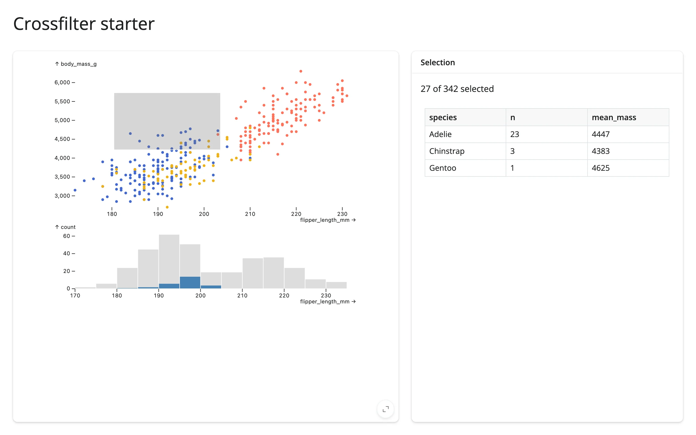

The canonical Mosaic crossfilter: a scatter plot and a histogram share one `intervalXY`/`intervalX`
selection (`$brush`), so brushing either one filters both in the browser -- no round trip to Python
needed for the charts themselves. A `@reactive.calc` reads the same selection back into Python for
a linked summary table.



## Run it

```sh
git clone --depth 1 https://github.com/posit-dev/py-shinywidgets
cd py-shinywidgets/website/gallery/templates/mosaic-crossfilter
uv run shiny run app.py
```

Source: [app.py](app.py) · [Open in Shinylive](app.py){.sw-shinylive-link}

## Try it

1. Drag a rectangle on the scatter plot (flipper length vs. body mass).
2. Watch the histogram below highlight the matching bin counts in blue, and "N of 342 selected"
   plus the per-species table update.

## Habits worth copying

- **Fixed domains** (`xDomain`/`yDomain: "Fixed"`) keep the axes stable as the selection changes --
  without this, Mosaic would otherwise rescale and make the before/after harder to read.
- **A background context layer** (the gray bars behind the blue ones in the histogram) shows the
  full distribution behind the filtered one, so you can see what you've excluded.
- **One shared `@reactive.calc`** (`selected()`) for the filtered data avoids recomputing the same
  DuckDB query twice for the count and the table.

## Accessors demonstrated

- `dashboard.params()` -- the current parameter values (here, the brush interval); reading it is
  what makes `selected()` reactive to brush changes.
- `dashboard.data()` -- an Ibis/DuckDB relation already filtered by every active Mosaic selection,
  ready to `.aggregate()` or `.df()`.

## What to change for your own data

- Replace the `penguins` DataFrame and the spec's `"from": "penguins"` references with your own
  table name and columns.
- Add more linked charts to the `vconcat` list; they all share the same `$brush` parameter.
