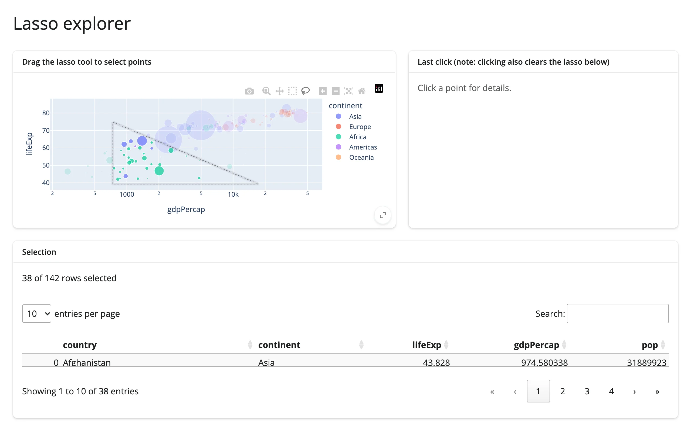

A scatter plot where lassoing a region of points drives a one-line summary and a searchable,
sortable `itables` table of just the selected rows, plus a click-through detail card for a
single point. This is the most common "explore my data frame visually" shape: one visual view,
one tabular view, kept in sync by a reactive accessor.



## Run it

```sh
git clone --depth 1 https://github.com/posit-dev/py-shinywidgets
cd py-shinywidgets/website/gallery/templates/plotly-lasso-explorer
uv run shiny run app.py
```

Source: [app.py](app.py) · [Open in Shinylive](app.py){.sw-shinylive-link}

## Try it

1. Drag the lasso tool over a cluster of points (dragmode is already set to `"lasso"`).
2. Watch the summary text and the table below update to the selected rows.
3. Click a single point for its country/continent/life-expectancy detail card. Note that a plain
   click also clears the lasso selection (both gestures share the same plotly event machinery).

## Accessors demonstrated

- `plot.selected_rows(df)` -- returns the rows of `df` matching the current lasso selection, as a
  DataFrame. Empty when nothing is selected.
- `plot.clicked()` -- the plotly click-event payload for the last clicked point, or `None`.

## What to change for your own data

- Swap `df` for your own DataFrame; keep a `custom_data=[df.index]` column on the trace so
  `clicked()` can map back to a row.
- Change `x`, `y`, `color`, `size` to your own columns.
- Change the `cols` list in `table()` to the columns you want visible in the table.
