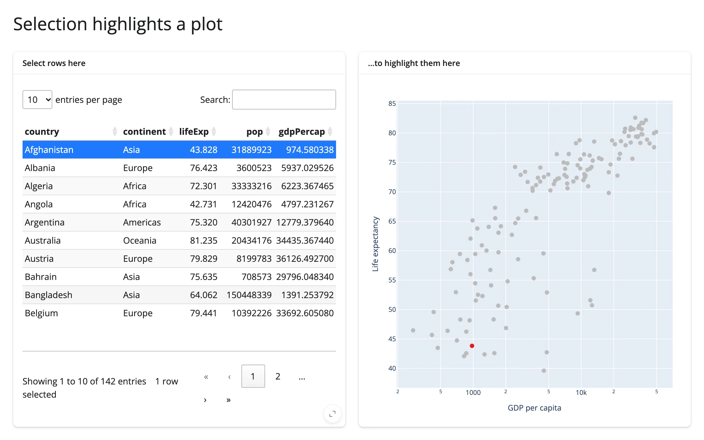

The "table row drives a plot highlight" cross-widget pattern, done the efficient way: instead of
rebuilding the scatter plot on every selection change, an effect writes directly to
`scatter.widget.data[0].marker.color` inside `reactive.isolate()`. The plot keeps its zoom/pan
state across selections, and only a small trace update is sent to the browser -- not the whole
figure.



## Run it

```sh
git clone --depth 1 https://github.com/posit-dev/py-shinywidgets
cd py-shinywidgets/website/gallery/templates/table-row-to-highlight
uv run shiny run app.py
```

Source: [app.py](app.py) · [Open in Shinylive](app.py){.sw-shinylive-link}

## Try it

1. Select a row (or Ctrl/Cmd-click several) in the table on the left.
2. Watch the matching point(s) turn red in the scatter plot on the right.
3. Zoom or pan the plot first, then change the selection -- the view doesn't reset.

## Accessors demonstrated

- `table.selected_rows()` -- the list of currently selected row positions in the itables table.

## What to change for your own data

- Swap `countries` for your own DataFrame and the `x`/`y` columns on the scatter.
- The in-place color-array rewrite (`scatter.widget.data[0].marker.color = [...]`) is the pattern
  to copy for any other per-point visual encoding (size, opacity, border) driven by a selection
  elsewhere on the page.

## Credit

Promoted from
`docs/widget-guides/articles/linked-views/examples/09_itables_selection_to_plotly_inplace.py` (the
cross-cutting linked-views article), with a comment header added for gallery consistency; no logic
changes (both cards already used `full_screen=True`).
