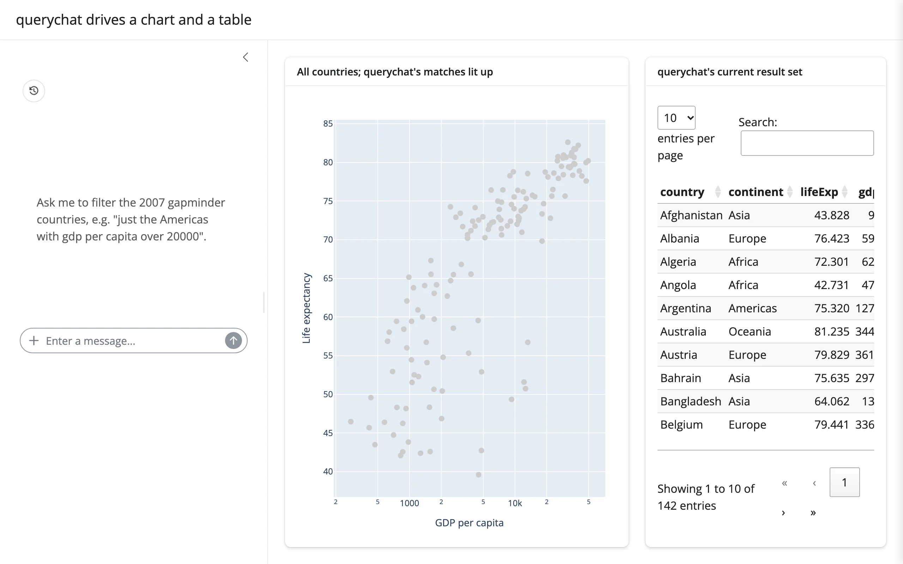
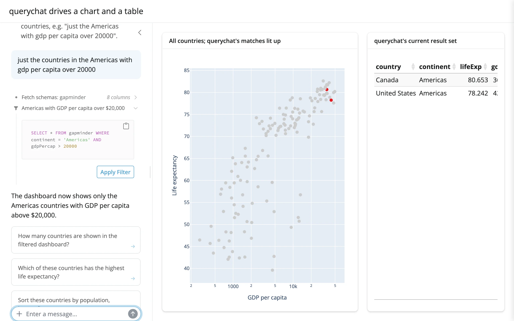
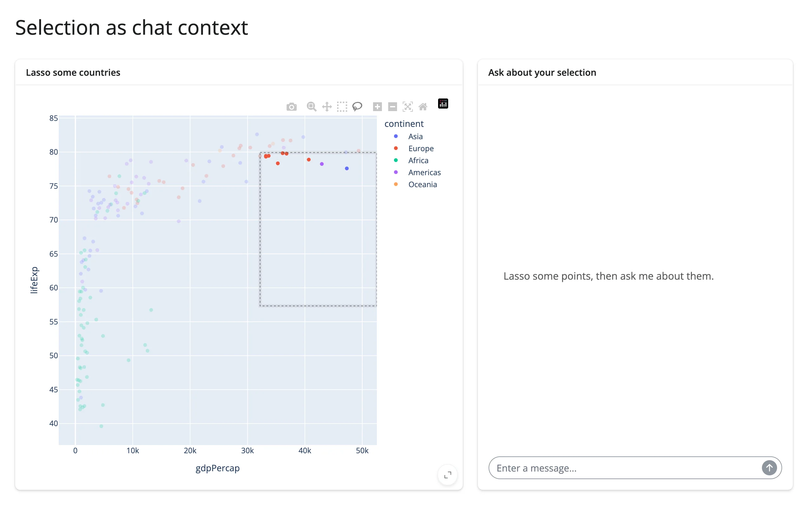
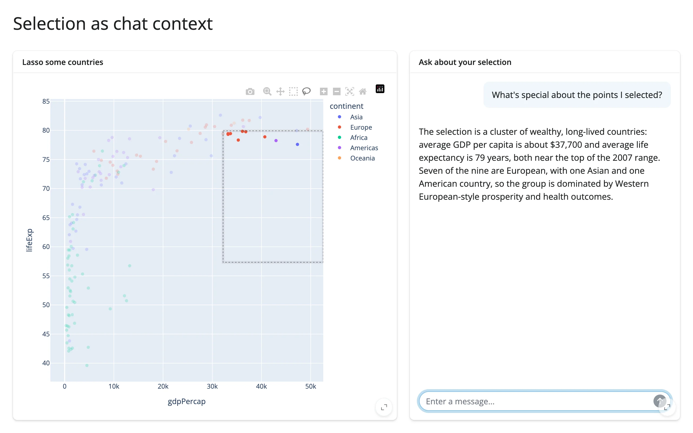
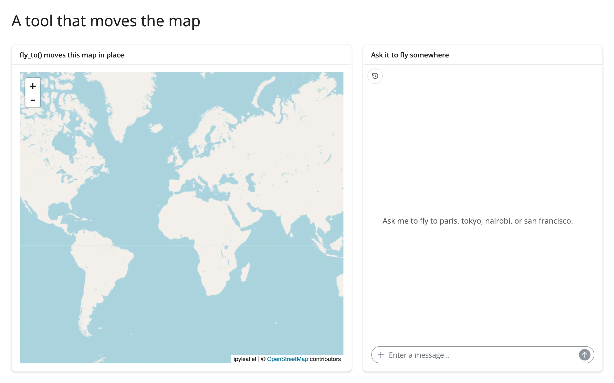
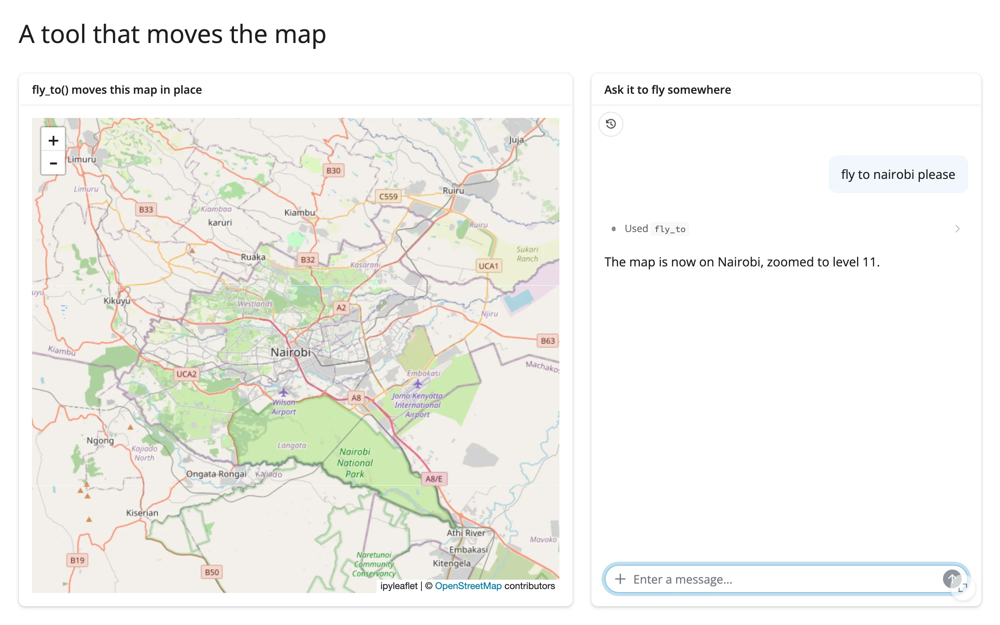
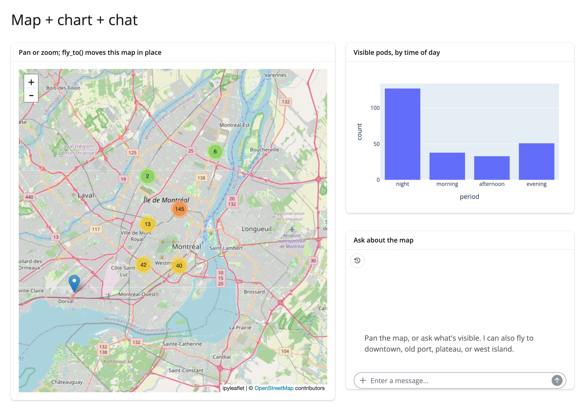
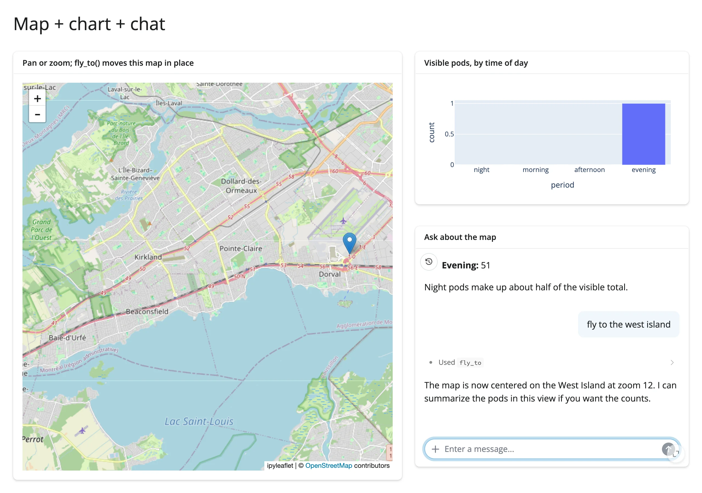

A chat panel next to a plot is not new. What reactive accessors change is that the
*model* can now read exactly what the user just did to a widget -- a lasso, a click, a
pan -- in the same typed, rate-limited way a human-written `@reactive.effect` would, and
can write back to that widget's live state through an ordinary Python tool call. The
user and the model end up looking at, and changing, the same view: not two separate
conversations that happen to share a browser tab.

This article is a short progression through the four things that make that possible:
querychat's filtered data driving a plain shinywidgets renderer, a widget's own
selection becoming chat context, a registered tool that moves a widget, and all of it
combined into one app. Each example is small and independently verified; the combined
one is the shape a real exploration tool takes. Every example below leans on **read on
demand**: an accessor attaches the moment its output renders and records the user's
gesture whether or not anything has read it yet, so a `chat.on_user_submit` handler or
a registered tool can read it for the first time long after the gesture happened, with
nothing lost in between. Read [Reacting to widgets](../reacting-to-widgets/index.md)
first -- in particular ["Read on
demand"](../reacting-to-widgets/index.md#read-on-demand) -- if that's new; this
article is that pattern's main worked example. [Linking widgets](../linked-views/index.md)'s
patterns (viewport &rarr; summary, table &rarr; map in place) are the same shapes used here,
with an LLM standing in for one side of the link.

## Installation

Three packages beyond `shinywidgets`, none of which are shinywidgets extras:

```
pip install querychat shinychat chatlas anthropic
```

`shinychat` ships the chat UI and the `Chat` server class; `chatlas` is the LLM client
every example below uses (`chatlas.ChatAnthropic`); `querychat` is a separate
natural-language-to-SQL layer used only in the first example. All four examples use
`anthropic`'s `claude-haiku-5-5` -- small, fast, and inexpensive enough to call on every
keystroke's worth of chat traffic in a demo app. Swap in any `chatlas` provider; nothing
below depends on Anthropic specifically.

Every example below makes real LLM calls and needs a live API key (`ANTHROPIC_API_KEY` in
the environment for the `chatlas.ChatAnthropic` client used here). Without one, each app
still renders -- only the chat turns fail.

## 1. querychat's filtered frame drives a chart and a table

**The idea**: querychat turns a typed question into SQL against your data frame and
exposes the result as `qc.df()`, a reactive read exactly like any other Shiny reactive
value. Anything already built to read a data frame reactively -- a renderer, a plain
`@render.data_frame`, a `@reactive.calc` -- can read it too, with no querychat-specific
code on that side at all.

```{.python file="examples/01_querychat_to_widgets.py"}
# Ask querychat to filter the data in plain English; the same filtered
# frame drives a plotly scatter plot (updated IN PLACE, so zoom/pan survive)
# and an itables table (re-rendered -- a table has no camera state worth
# preserving). Try: "just the countries in the Americas with gdp per capita
# over 20000".
import chatlas
import plotly.graph_objects as go
import plotly.express as px
from shiny import reactive
from shiny.express import ui
from querychat.express import QueryChat

from shinywidgets import render_itables, render_plotly

gapminder = px.data.gapminder().query("year == 2007").reset_index(drop=True)

qc = QueryChat(
    gapminder,
    "gapminder",
    client=chatlas.ChatAnthropic(model="claude-haiku-5-5"),
    tools=("filter", "query"),  # skip querychat's own chart tool; we have our own
    greeting="Ask me to filter the 2007 gapminder countries, e.g. "
    "\"just the Americas with gdp per capita over 20000\".",
)

ui.page_opts(title="querychat drives a chart and a table", fillable=True)

with ui.sidebar(width=380):
    qc.ui()

with ui.layout_columns(col_widths=[7, 5]):
    with ui.card(full_screen=True):
        ui.card_header("All countries; querychat's matches lit up")

        @render_plotly
        def scatter():
            return go.FigureWidget(
                go.Scatter(
                    x=gapminder["gdpPercap"],
                    y=gapminder["lifeExp"],
                    mode="markers",
                    marker={"color": "#ccc", "size": 8},
                    text=gapminder["country"],
                )
            ).update_xaxes(type="log", title="GDP per capita").update_yaxes(
                title="Life expectancy"
            )

        @reactive.effect
        def _highlight_matches():
            matched = set(qc.df()["country"])
            all_matched = len(matched) == len(gapminder)  # no filter applied yet
            with reactive.isolate():
                scatter.widget.data[0].marker.color = [
                    "#ccc" if all_matched or c not in matched else "#e41a1c"
                    for c in gapminder["country"]
                ]

    with ui.card(full_screen=True):
        ui.card_header("querychat's current result set")

        @render_itables
        def table():
            cols = ["country", "continent", "lifeExp", "gdpPercap", "pop"]
            return qc.df()[cols]
```

Use `querychat.express.QueryChat` (not the plain `querychat.QueryChat`) in a Shiny
Express app: it calls `.server()` for you and gives `qc.df()` directly, instead of the
`qc.server(...)` / `ServerValues.df()` two-step the core class needs. `tools=("filter",
"query")` opts out of querychat's own charting tool, since this app already has a
chart of its own.

Real gapminder data (142 countries, 2007), a real `claude-haiku-5-5` call, asking "just
the countries in the Americas with gdp per capita over 20000":




The two widgets diverge on purpose: the scatter plot updates **in place**
(`scatter.widget.data[0].marker.color = [...]`, guarded by `reactive.isolate()` per
[Writing back](../updating-in-place/index.md#writing-back)) so a user's zoom or pan
survives every new question; the table just re-renders, because a table has no camera
state worth preserving and `render_itables` already handles the common case cleanly.
Every `querychat` question is a real SQL query against a locked-down DuckDB connection
-- see [Pitfalls](#pitfalls) below for what that lockdown does and does not cover.

## 2. A widget's selection becomes chat context

**The idea**: the reverse direction. A lasso, a click, a brush -- any accessor -- can be
read into a short, pre-digested summary and handed to the model alongside the user's
question, so "what's special about the points I selected?" actually means something.
The summary, not the raw rows, is what keeps the prompt small regardless of selection
size (see [Pitfalls](#pitfalls)).

`shinychat`'s `Chat(id, client=...)` auto-wires submission for you, but that only works
when the model's reply doesn't need anything beyond the user's literal text. Here it
does -- the prompt sent to the model needs the selection summary spliced in first -- so
this example drives the chat manually with `@chat.on_user_submit`, reads the accessor,
builds the augmented prompt, and streams the response itself:

```{.python file="examples/02_selection_to_chat_context.py"}
# Lasso some points, THEN ask the chat about "the points I selected" -- the
# question is augmented with a small SUMMARY of plot.selected_rows(df) (not
# the raw rows) before it goes to the model, keeping the prompt small no
# matter how big the selection is.
#
# Nothing here reads plot.selected_rows() until chat.on_user_submit runs,
# which only happens after the user's first message -- the textbook "read on
# demand" case. That's safe because the accessor attaches the moment `plot`
# renders and records the lasso whether or not anything has read it yet; see
# ../../reacting-to-widgets/article.md#read-on-demand.
import chatlas
import plotly.express as px
from shiny.express import ui
from shinychat.express import Chat

from shinywidgets import render_plotly

df = px.data.gapminder().query("year == 2007").reset_index(drop=True)
chat_client = chatlas.ChatAnthropic(
    model="claude-haiku-5-5",
    system_prompt="You analyze a lasso selection from a gapminder scatter plot "
    "(gdp per capita vs. life expectancy, 2007). Answer in 2-3 sentences.",
)

ui.page_opts(title="Selection as chat context", fillable=True)

with ui.layout_columns(col_widths=[7, 5]):
    with ui.card(full_screen=True):
        ui.card_header("Lasso some countries")

        @render_plotly
        def plot():
            fig = px.scatter(
                df, x="gdpPercap", y="lifeExp", color="continent",
                custom_data=[df.index],
            )
            return fig.update_layout(dragmode="lasso")

    with ui.card(full_screen=True):
        ui.card_header("Ask about your selection")
        chat = Chat("chat", greeting="Lasso some points, then ask me about them.")
        chat.ui()

        @chat.on_user_submit
        async def _respond(user_input: str):
            rows = plot.selected_rows(df)
            if rows.empty:
                summary = "Nothing is currently selected on the plot."
            else:
                top_continents = rows["continent"].value_counts().head(3).to_dict()
                summary = (
                    f"{len(rows)} countries selected. "
                    f"Mean life expectancy {rows['lifeExp'].mean():.1f}, "
                    f"mean gdp per capita {rows['gdpPercap'].mean():.0f}. "
                    f"Continents: {top_continents}."
                )
            prompt = f"Selection summary: {summary}\n\nQuestion: {user_input}"
            response = await chat_client.stream_async(prompt)
            await chat.append_message_stream(response)
```

Lasso the wealthy, long-lived cluster in the top right, then ask "What's special about
the points I selected?":




`claude-haiku-5-5` answered: *"The selection is a cluster of wealthy, long-lived
countries: average GDP per capita is about \$37,700 and average life expectancy is 79
years, both near the top of the 2007 range. Seven of the nine are European, with one
Asian and one American country, so the group is dominated by Western European-style
prosperity and health outcomes."* -- every number traces back to the summary string, not
to the model inventing statistics, because the summary **is** the only thing about the
selection the model ever saw.

Nothing in this app reads `plot.selected_rows()` before `chat.on_user_submit` does, and
that is the point: the accessor started recording the lasso the moment `plot` rendered,
long before the user typed a word, so the gesture is still there when the handler
finally reads it. Three independent runs of the lasso-then-ask sequence above all
produced a correctly-populated summary -- see [NOTES.md](NOTES.md) for the verification
log.

## 3. A registered tool that moves a widget

**The idea**: `chatlas.Chat.register_tool()` takes a plain Python function -- type hints
and a docstring become the tool's schema -- and the model decides when to call it. The
tool body is ordinary Python: read the argument, validate it, then write to the
widget's live state through `.widget`, the same in-place idiom every linked-view example
in this roster uses.

```{.python file="examples/03_llm_tool_drives_map.py"}
# Register a tool the model can call to move the map. The tool validates
# `city` against a fixed allow-list before touching the widget -- the model's
# argument is untrusted text, so never pass it straight into widget state
# (or, worse, a file path, a URL, or a SQL string) without checking it first.
import chatlas
from ipyleaflet import Map
from shiny.express import ui
from shinychat.express import Chat

from shinywidgets import render_ipyleaflet

CITIES = {
    "paris": (48.8566, 2.3522, 11),
    "tokyo": (35.6762, 139.6503, 10),
    "nairobi": (-1.2921, 36.8219, 11),
    "san francisco": (37.7749, -122.4194, 11),
}

ui.page_opts(title="A tool that moves the map", fillable=True)

with ui.layout_columns(col_widths=[7, 5]):
    with ui.card(full_screen=True):
        ui.card_header("fly_to() moves this map in place")

        @render_ipyleaflet
        def map():
            return Map(center=(20, 0), zoom=2)

    with ui.card(full_screen=True):
        ui.card_header("Ask it to fly somewhere")

        def fly_to(city: str) -> str:
            """
            Move the map to a named city.

            Parameters
            ----------
            city : str
                One of: paris, tokyo, nairobi, san francisco.
            """
            key = city.strip().lower()
            if key not in CITIES:
                return f"Unknown city {city!r}. Valid cities: {', '.join(CITIES)}."
            lat, lng, zoom = CITIES[key]
            map.widget.center = (lat, lng)
            map.widget.zoom = zoom
            return f"Map moved to {city} (zoom {zoom})."

        chat_client = chatlas.ChatAnthropic(
            model="claude-haiku-5-5",
            system_prompt="You control a map via the fly_to tool. "
            "Only call it with one of its supported cities.",
        )
        chat_client.register_tool(fly_to)

        chat = Chat(
            "chat",
            client=chat_client,
            greeting="Ask me to fly to paris, tokyo, nairobi, or san francisco.",
        )
        chat.ui()
```

"fly to nairobi please" moves the *same* `Map` instance (no re-render, so any other
in-progress state would survive too):




shinychat's chat bubble discloses the call ("Used `fly_to`") before the model's
follow-up text -- useful for a reader checking that the map moved *because* the tool
ran, not because the model described moving it. The allow-list check is the whole
safety story here: asked to "fly to `../../etc/passwd`", the tool returned `"Unknown
city '../../etc/passwd'. Valid cities: paris, tokyo, nairobi, san francisco."` and the
model relayed that back instead of touching the widget -- see
[Pitfalls](#pitfalls) for why this check belongs in the tool, not in the prompt.

## 4. A combined app: map, chart, and chat agree

**The idea**: put a map, a chart that reactively summarizes the map's current viewport
([Linking widgets, pattern 3](../linked-views/index.md#3-viewport--whats-visible-summary)),
and a chat with two tools -- one that *reads* the same viewport accessor the chart
reads, one that *writes* to the map -- in one app. The chart and the chat's answers are
guaranteed to agree, because both read `map.bounds()`.

```{.python file="examples/04_map_chart_chat_combined.py"}
# A realistic combination: pan/zoom the map, read a plotly bar chart of
# what's visible, or just ask the chat -- "summarize_view" reads the SAME
# map.bounds() accessor the chart uses (read on demand, from inside a tool
# call, with no warm-up read needed), so the chat's answer and the chart
# always agree. "fly_to" is a second tool, validated against a fixed
# allow-list, that moves the map. Real data: 249 car2go pod locations
# around Montreal (plotly's carshare dataset).
import chatlas
import ipyleaflet as L
import pandas as pd
import plotly.express as px
from shiny import reactive
from shiny.express import ui
from shinychat.express import Chat

from shinywidgets import render_ipyleaflet, render_plotly

pods = px.data.carshare()
pods["period"] = pd.cut(
    pods["peak_hour"], bins=[-1, 5, 11, 17, 23],
    labels=["night", "morning", "afternoon", "evening"],
)
PERIODS = ["night", "morning", "afternoon", "evening"]

PLACES = {
    "downtown": (45.5017, -73.5673, 13),
    "old port": (45.5075, -73.5540, 15),
    "plateau": (45.5234, -73.5825, 14),
    "west island": (45.4443, -73.8275, 12),
    "overview": (45.52, -73.59, 11),
}

ui.page_opts(title="Map + chart + chat", fillable=True)

with ui.layout_columns(col_widths=[7, 5]):
    with ui.card(full_screen=True):
        ui.card_header("Pan or zoom; fly_to() moves this map in place")

        @render_ipyleaflet
        def map():
            m = L.Map(center=(45.52, -73.59), zoom=11)
            markers = [L.Marker(location=(r.centroid_lat, r.centroid_lon)) for r in pods.itertuples()]
            m.add(L.MarkerCluster(markers=markers))
            return m

    with ui.div(class_="d-flex flex-column gap-3", style="height: 100%;"):
        with ui.card(full_screen=True):
            ui.card_header("Visible pods, by time of day")

            @render_plotly
            def chart():
                (south, west), (north, east) = map.bounds()
                visible = pods[pods.centroid_lat.between(south, north) & pods.centroid_lon.between(west, east)]
                counts = visible["period"].value_counts().reindex(PERIODS).reset_index()
                counts.columns = ["period", "count"]
                return px.bar(counts, x="period", y="count")

        with ui.card(full_screen=True):
            ui.card_header("Ask about the map")

            def summarize_view() -> str:
                """Summarize the car-share pods currently visible on the map, by time of day."""
                with reactive.isolate():
                    (south, west), (north, east) = map.bounds()
                visible = pods[pods.centroid_lat.between(south, north) & pods.centroid_lon.between(west, east)]
                counts = visible["period"].value_counts().reindex(PERIODS, fill_value=0)
                parts = ", ".join(f"{p}: {n}" for p, n in counts.items())
                return f"{len(visible)} pods visible ({parts})."

            def fly_to(place: str) -> str:
                """
                Move the map to a named place.

                Parameters
                ----------
                place : str
                    One of: downtown, old port, plateau, west island, overview.
                """
                key = place.strip().lower()
                if key not in PLACES:
                    return f"Unknown place {place!r}. Valid places: {', '.join(PLACES)}."
                lat, lng, zoom = PLACES[key]
                map.widget.center = (lat, lng)
                map.widget.zoom = zoom
                return f"Map moved to {place} (zoom {zoom})."

            chat_client = chatlas.ChatAnthropic(
                model="claude-haiku-5-5",
                system_prompt="You help explore a map of Montreal car-share pods. "
                "Use summarize_view to describe what's currently visible, and "
                "fly_to to move the map to one of its supported places.",
            )
            chat_client.register_tool(summarize_view)
            chat_client.register_tool(fly_to)

            chat = Chat(
                "chat",
                client=chat_client,
                greeting="Pan the map, or ask what's visible. "
                "I can also fly to downtown, old port, plateau, or west island.",
            )
            chat.ui()
```

Loaded over the whole region (249 pods, all visible), asking "what's visible on the
map right now?" and then "fly to the west island":




After `fly_to` moves the map, the bar chart drops to a single evening pod -- not because
anything told it to, but because `chart()` and `fly_to()` both ultimately depend on
`map.bounds()`, and `fly_to` only ever writes to `map.widget.center`/`.zoom`, never to
`bounds` itself. That one-way data flow (tool writes center/zoom &rarr; browser reports a
new viewport &rarr; `bounds()` updates &rarr; chart and `summarize_view()` both see the new
value) is what keeps this from being a loop -- see [Pitfalls](#pitfalls).

`summarize_view()` is itself another read-on-demand case: nothing reads `map.bounds()`
until a tool call does. `bounds()` has no seeded value of its own -- it cancels until the
browser reports its first viewport -- but that report arrives within a fraction of a
second of the map rendering, well before a user can type a question, so asking "what's
visible" as the very first thing in the session already gets the right answer.

This app is a reasonable template for "point an LLM at a map app," but it is not
gallery-polished (a single hardcoded place list, two tools, no error recovery beyond the
allow-list message). It stays in `examples/`; see [NOTES.md](NOTES.md) for why it isn't
promoted to `gallery/showcases/` as-is.

## Pitfalls

**Keep the model's context small; send summaries, not rows.** Every example above hands
the model statistics (`len(rows)`, a mean, a `value_counts().head(3)`) or a short string,
never a raw data frame. A selection of a few dozen rows costs almost nothing either way,
but the pattern has to hold at the size a real exploration session reaches -- a lasso
over 50,000 points, or a querychat query that matches most of a large table. Compute the
summary your prompt actually needs (counts, aggregates, a handful of representative
rows) and never interpolate `df.to_string()` or `df.to_json()` into a prompt.

**Validate every tool argument before it touches a widget.** The model's tool call
arguments are no more trustworthy than any other text a remote system handed you --
`fly_to`'s allow-list check (example 3) is the whole defense, and it is checked, not
suggested in a system prompt (a system prompt is guidance, not enforcement; the model
can still emit anything the tool's schema allows). The same applies doubly to anything
that ends up in a file path, a URL, or a SQL string. On that last point: if a tool
builds its own SQL from the model's arguments, see the
[quak and mosaic DuckDB lockdown finding](https://github.com/posit-dev/py-shinywidgets/blob/main/docs/widget-guides/FINDINGS.md#quak-and-mosaic-security) --
`render_quak` and `render_mosaic_widget`'s *browser-sent* SQL path was found to allow
arbitrary file reads before a fix landed. querychat's own SQL tool does not have this
problem out of the box: its DuckDB connection is locked down
(`enable_external_access = false`, `disabled_filesystems = 'LocalFileSystem'`, extension
autoloading off) and non-`SELECT` statements are rejected before a query ever runs (see
`querychat/_datasource.py`'s `duckdb_lock_down()` and `querychat/_utils.py`'s
`check_query()` in the installed package). That is a property of querychat, not of
shinywidgets or of LLM tool-calling in general -- a tool you write yourself that builds
its own SQL needs the same lockdown applied by hand.

**Reactive loops: writing state that an accessor reads.** This is the same hazard
[Writing back](../updating-in-place/index.md#writing-back) already covers for
non-LLM code, and it does not get worse with an LLM in the loop -- a tool that writes a
widget trait is just another `@reactive.effect`-shaped write, and the same
`reactive.isolate()` discipline applies. Example 4's `fly_to` only ever writes
`center`/`zoom`; `summarize_view` only ever *reads* `bounds()` (and isolates that read,
since it runs outside any reactive context). Had a tool instead read `bounds()` and
written something that fed back into `bounds()`, it would hang the same way an
unguarded `count.set(count() + 1)` effect does -- silently, with no error, pinning a CPU
core (see `docs/widget-guides/FINDINGS.md`'s itables and mosaic entries for two
independently-discovered cases of exactly that shape).

**Latency and streaming.** A tool-calling turn is at least two model round trips (decide
to call a tool, then respond to its result), and a lasso-to-chat turn like example 2 adds
a websocket round trip for the accessor itself before the prompt is even built. Stream
the response (`chat.append_message_stream(...)`, as every example here does) so the user
sees tokens arrive instead of staring at a blank bubble for the whole turn. `shinychat`
also discloses tool calls in the UI ("Used `fly_to`") automatically when using
`register_tool` through `client=` or `chat_client`, which doubles as a debugging aid: if
a widget didn't update, check whether the chat shows the tool was actually called.

## Where to go next

- [Reacting to widgets](../reacting-to-widgets/index.md) for the accessor mental
  model every example here relies on -- especially
  [Read on demand](../reacting-to-widgets/index.md#read-on-demand), what a re-render
  keeps versus re-seeds, re-fire and clearing, rate limits, and writing back without
  looping.
- [Linking widgets](../linked-views/index.md) for the non-LLM version of pattern 4
  here (viewport &rarr; summary) and six more coordination shapes to reuse as chat tools.
- The [plotly](../../widgets/plotly/index.md), [itables](../../widgets/itables/index.md), and
  [ipyleaflet](../../widgets/ipyleaflet/index.md) guides for the full accessor reference on each
  widget used above.
- `docs/widget-guides/FINDINGS.md` for the quak/mosaic DuckDB lockdown finding
  referenced in Pitfalls.
