**Your widget isn't on the list? Here's how.** Every other guide in this roster covers one library's dedicated
`render_*` decorator. This guide covers the decorator underneath all of them: `render_widget`, which renders
*any* `ipywidgets.Widget` subclass, does no library-specific coercion, and has no accessors of its own. It's the
answer to three different questions: "the widget I want isn't on the roster yet," "I want to build my own
interactive widget," and "I just need a plain ipywidgets control." All three go through the same decorator,
because all three are, underneath, just an `ipywidgets.Widget` -- a slider is one,
[anywidget](https://anywidget.dev/)'s `AnyWidget` base class is one, and
[ipyreact](https://github.com/widgetti/ipyreact)'s JSX components are one.

The decorator itself does very little: it coerces non-widget return values with the same
[`as_widget()`](https://github.com/posit-dev/py-shinywidgets/blob/main/shinywidgets/_as_widget.py) used everywhere else (so a `plotly.graph_objects.Figure`
or an `altair.Chart` still renders, just without that library's layout fixes or accessors), applies the same
generic fill-sizing logic every renderer shares, and gives you `.widget` to mutate the live instance, plus
`.read("trait")` to reactively read one of its traits (a documented shortcut for `reactive_read(.widget,
"trait")`). Reach for a dedicated `render_*` instead whenever one exists for your library: it adds layout
defaults tuned to that widget's quirks, and usually a handful of accessors (`clicked()`, `selected_rows()`,
...) that turn a raw trait into a documented, rate-limited, typed read. Reach for plain `render_widget` when
there is no dedicated decorator (yet), or when you're building a widget yourself and there's nothing to be
dedicated *to*.

Every example on this page is Shiny Express, where a render function displays itself wherever it's defined. In
Shiny Core, pair any renderer -- `render_widget` or a dedicated one -- with
[`output_widget("id")`](https://github.com/posit-dev/py-shinywidgets/blob/main/shinywidgets/_output_widget.py) in `app_ui`, the placeholder every renderer in
this roster fills at render time; see [Shiny Core & modules](../core-and-modules/index.md) for a
full app written both ways.

This guide is also the anywidget guide. If you've never built a custom ipywidget before, "What you can build"
walks through a small, real one -- a canvas sparkline -- covering Python-to-JS trait sync, JS-to-Python trait
sync, custom messages in both directions, a binary trait for bigger payloads, and the three ways to load a
widget's JavaScript. It also covers two third-party widgets that have no dedicated renderer yet (so
`render_widget` is the only way to use them today), and ipyreact, a different way to write a custom widget
entirely in JSX.

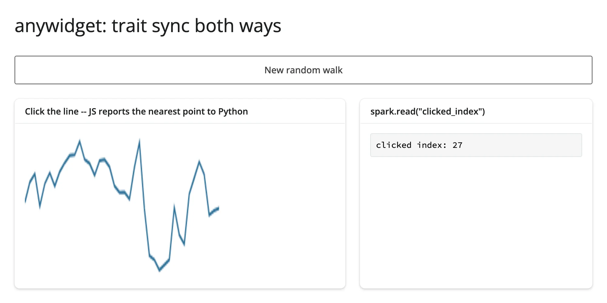

## Installation

`render_widget` ships in base `shinywidgets` -- no extra to install. The widgets used in this guide's examples
need their own packages: `pip install anywidget ipyreact` for the custom-widget and ipyreact sections (anywidget
is already a shinywidgets dependency, so it's normally already present), and, for the third-party examples,
`pip install mapwidget` or `pip install ipydeck`.

## Quick start

```{.python file="examples/01_quickstart.py"}
from ipywidgets import IntSlider
from shiny.express import render, ui
from shinywidgets import render_widget

ui.page_opts(title="render_widget quick start", fillable=True)

with ui.card():
    ui.card_header("Any ipywidgets.Widget subclass works, no coercion needed")

    @render_widget
    def slider():
        return IntSlider(value=7, min=0, max=10, description="Threshold:")

    @render.code
    def slider_val():
        return f"slider.read('value') = {slider.read('value')}"
```

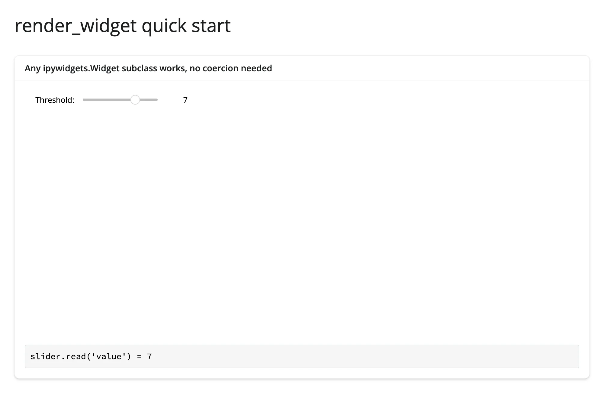

Any `ipywidgets.Widget` subclass -- including every anywidget and ipyreact widget, since they're built on the
same base class -- works with zero changes. `slider.read('value')` is a shortcut for
`reactive_read(slider.widget, 'value')` -- see [Reacting to user interaction](#reacting-to-user-interaction)
for when to reach for one over the other. The empty space below the slider is itself worth noticing: plain
ipywidgets *controls* (sliders, dropdowns, checkboxes -- anything shipped in `@jupyter-widgets/controls`) don't
get the fill-to-container treatment other renderers apply by default, so they render at their natural size
instead of stretching. See [Layout and sizing](#layout-and-sizing).

## What you can build

### Plain ipywidgets: composing controls without a Shiny input

Most of the time, reach for Shiny's own `ui.input_slider()` instead of an `ipywidgets.IntSlider` -- Shiny's
inputs are better integrated (styling, accessibility, validation) and don't need `.read()`'s extra step.
Plain ipywidgets controls earn their place in Shiny for a narrower case: porting an existing Jupyter
`interactive_output()`-style dashboard, or composing several linked widgets into one self-contained unit where
the wiring lives in widget-land, not in Shiny's reactive graph.

```{.python file="examples/02_plain_composition.py"}
import ipywidgets as widgets
from shiny.express import render, ui
from shinywidgets import reactive_read, render_widget

ui.page_opts(title="Composing plain ipywidgets", fillable=True)

with ui.card():
    ui.card_header("A self-contained ipywidgets dashboard (interactive_output)")

    @render_widget
    def panel():
        x = widgets.IntSlider(description="x", min=0, max=20, value=4)
        y = widgets.IntSlider(description="y", min=0, max=20, value=6)
        out = widgets.Label()

        def show_sum(*_):
            out.value = f"x + y = {x.value + y.value}"

        for w in (x, y):
            w.observe(show_sum, "value")
        show_sum()

        return widgets.VBox([x, y, out])

with ui.card():
    ui.card_header("Shiny still sees inside it: reactive_read() on a child widget")

    @render.code
    def x_value():
        x = panel.widget.children[0]
        return f"x.value = {reactive_read(x, 'value')}"
```

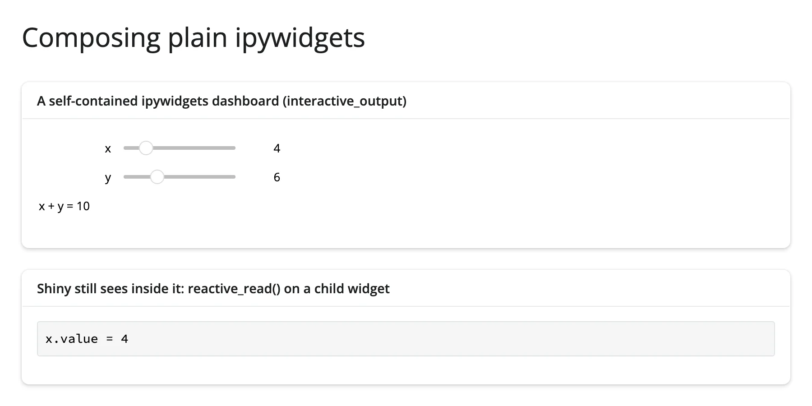

The two sliders stay in sync with the label entirely through their own `.observe()` callback -- no Shiny
reactivity involved -- while `reactive_read()` on a *child* widget (`panel.widget.children[0]`) still lets Shiny
watch one piece of it. (`with out: print(...)` inside an `ipywidgets.Output()` writes to the server's own
process stdout, not into the widget -- there's no live Jupyter kernel here for it to hook into. Use
`out.append_stdout(...)`/`out.append_display_data(...)` instead, which write directly to the widget's state the
same way any other trait sync does; a plain `Label` with a `.value` assignment, as used here, is an even simpler
option when you don't need `Output`'s own API -- see [Gotchas](#gotchas-and-limitations).)

### anywidget, the star

[anywidget](https://anywidget.dev/) is the modern way to write a custom ipywidget: one Python class, a JS
`_esm` string (or file, or CDN import) implementing a `render({ model, el })` function, and optionally `_css`.
No build step, no npm, no bundler. Every trait you declare with `.tag(sync=True)` is automatically kept in sync
between Python and the browser in both directions.

The rest of this section builds one small widget -- a canvas sparkline -- and uses it to demonstrate every
piece of the anywidget contract. The full widget (shown once, in full, below) is defined in a shared module,
[`examples/sparkline_widget.py`](examples/sparkline_widget.py), so each example that follows can import it and
stay short:

```{.python file="examples/sparkline_widget.py"}
# A small, hand-written anywidget used by several examples in this guide
# (03_anywidget_trait_sync.py, 04_anywidget_messages.py, 07_accessor_helper.py,
# 11_coordinate_brush_to_table.py, 12_coordinate_table_to_widget.py). Defined
# once here so each example stays short; none of this file is Shiny-specific
# -- it is exactly what you'd write for plain Jupyter too.
from __future__ import annotations

import anywidget
import traitlets

_JS = r"""
function render({ model, el }) {
  const canvas = document.createElement("canvas");
  canvas.width = 320;
  canvas.height = 90;
  // shinywidgets gives a fill output's direct child `flex: 1 1 auto` so
  // generic (e.g. <div>-based) widgets stretch to fill their card. A
  // <canvas>'s width/height ATTRIBUTES (its drawing-buffer resolution)
  // don't count as a CSS size for that purpose, so without an explicit
  // style.width/height a canvas gets stretched to fill the card while its
  // pixel buffer stays at 320x90 -- a blurry, upscaled line. Pinning the
  // CSS size to match keeps it crisp (see "Layout and sizing" in the
  // guide for the fill-aware alternative: a ResizeObserver that redraws at
  // the new size).
  canvas.style.width = canvas.width + "px";
  canvas.style.height = canvas.height + "px";
  canvas.style.cursor = "pointer";
  el.appendChild(canvas);
  const ctx = canvas.getContext("2d");

  function draw() {
    const values = model.get("values");
    const highlight = model.get("highlight") || [];
    ctx.clearRect(0, 0, canvas.width, canvas.height);
    if (values.length < 2) return;
    const min = Math.min(...values);
    const max = Math.max(...values);
    const span = max - min || 1;
    const xy = (i) => [
      (i / (values.length - 1)) * canvas.width,
      canvas.height - ((values[i] - min) / span) * (canvas.height - 10) - 5,
    ];

    ctx.beginPath();
    values.forEach((_, i) => {
      const [x, y] = xy(i);
      i === 0 ? ctx.moveTo(x, y) : ctx.lineTo(x, y);
    });
    ctx.strokeStyle = "#2a6f97";
    ctx.lineWidth = 2;
    ctx.stroke();

    // Rows in `highlight` (e.g. a linked table's selection) get a dot.
    highlight.forEach((i) => {
      if (i < 0 || i >= values.length) return;
      const [x, y] = xy(i);
      ctx.beginPath();
      ctx.arc(x, y, 5, 0, 2 * Math.PI);
      ctx.fillStyle = "#e85d04";
      ctx.fill();
    });
  }

  // Python -> JS: redraw whenever `values` or `highlight` changes, in place
  // (no new widget, no re-sent JS bundle -- see "Updating the widget from
  // Python" in the guide).
  model.on("change:values", draw);
  model.on("change:highlight", draw);

  // JS -> Python: a click (or a drag -- see mousemove below) reports the
  // nearest point's index via a synced trait. `save_changes()` is what
  // actually flushes the `model.set()` call to Python;
  // `spark.read("clicked_index")` on the Python side picks it up (see
  // "Reacting to user interaction").
  // The canvas's CSS size (it stretches to fill its card) differs from its
  // drawing-buffer size (canvas.width/height, used by draw() above), so
  // input handlers must convert through the rendered bounding box, not the
  // intrinsic pixel size.
  function indexAt(e) {
    const values = model.get("values");
    const rect = canvas.getBoundingClientRect();
    const frac = (e.clientX - rect.left) / rect.width;
    const i = Math.round(frac * (values.length - 1));
    return Math.max(0, Math.min(values.length - 1, i));
  }
  function reportNearest(e) {
    model.set("clicked_index", indexAt(e));
    model.save_changes();
  }
  canvas.addEventListener("click", reportNearest);

  // A held-down drag reports a rapid stream of updates -- used by the rate
  // limiting example to compare an unthrottled vs. a debounced reader. It
  // also reports the drag's start..end index range as `brush` once released
  // -- used by the "coordinating multiple views" brush-to-table example.
  let dragStart = null;
  canvas.addEventListener("mousedown", (e) => (dragStart = indexAt(e)));
  window.addEventListener("mouseup", (e) => {
    if (dragStart === null) return;
    const end = indexAt(e);
    model.set("brush", [Math.min(dragStart, end), Math.max(dragStart, end)]);
    model.save_changes();
    dragStart = null;
  });
  canvas.addEventListener("mousemove", (e) => {
    if (dragStart !== null) reportNearest(e);
  });

  // Custom messages, JS -> Python: model.send() for a one-off event that
  // isn't really "state" (see "Custom messages" in the guide).
  canvas.addEventListener("dblclick", () => {
    model.send({ type: "reset-requested" });
  });

  // Custom messages, Python -> JS: widget.send() on the Python side arrives
  // here as a "msg:custom" model event.
  model.on("msg:custom", (msg) => {
    if (msg.type === "flash") {
      canvas.style.filter = "brightness(1.6)";
      setTimeout(() => {
        canvas.style.filter = "";
      }, 200);
    }
  });

  draw();
}
export default { render };
"""

_CSS = """
.sparkline-widget canvas { display: block; }
"""


class Sparkline(anywidget.AnyWidget):
    """A tiny canvas line chart. See sparkline_widget.py for the full source."""

    _esm = _JS
    _css = _CSS
    values = traitlets.List(traitlets.Float()).tag(sync=True)
    highlight = traitlets.List(traitlets.Int()).tag(sync=True)
    clicked_index = traitlets.Int(allow_none=True, default_value=None).tag(sync=True)
    brush = traitlets.List(traitlets.Int()).tag(sync=True)


class BinarySparkline(anywidget.AnyWidget):
    """
    Same chart, but `values` is a packed float32 buffer (`numpy.ndarray.tobytes()`)
    instead of a JSON list -- see 05_anywidget_binary_trait.py.
    """

    _esm = r"""
    function render({ model, el }) {
      const canvas = document.createElement("canvas");
      canvas.width = 320;
      canvas.height = 90;
      // See the matching comment in Sparkline's _esm above: pin the CSS size
      // to the drawing-buffer size so the fill layout can't stretch (and
      // blur) this canvas.
      canvas.style.width = canvas.width + "px";
      canvas.style.height = canvas.height + "px";
      el.appendChild(canvas);
      const ctx = canvas.getContext("2d");

      function draw() {
        // A `Bytes` trait arrives as a DataView; read it as float32.
        const buf = model.get("values");
        const values = new Float32Array(buf.buffer, buf.byteOffset, buf.byteLength / 4);
        ctx.clearRect(0, 0, canvas.width, canvas.height);
        if (values.length < 2) return;
        let min = Infinity, max = -Infinity;
        for (const v of values) { if (v < min) min = v; if (v > max) max = v; }
        const span = max - min || 1;
        ctx.beginPath();
        values.forEach((v, i) => {
          const x = (i / (values.length - 1)) * canvas.width;
          const y = canvas.height - ((v - min) / span) * (canvas.height - 10) - 5;
          i === 0 ? ctx.moveTo(x, y) : ctx.lineTo(x, y);
        });
        ctx.strokeStyle = "#9d4edd";
        ctx.lineWidth = 1.5;
        ctx.stroke();
      }
      model.on("change:values", draw);
      draw();
    }
    export default { render };
    """
    _css = _CSS
    values = traitlets.Bytes().tag(sync=True)
```

[`examples/sparkline_widget.py`](examples/sparkline_widget.py) -- the complete shared module, used by
`03_anywidget_trait_sync.py`, `04_anywidget_messages.py`, `07_accessor_helper.py`,
`11_coordinate_brush_to_table.py`, and `12_coordinate_table_to_widget.py` (`Sparkline`), and
`05_anywidget_binary_trait.py` (`BinarySparkline`, below).

#### Python -> JS trait sync, in place

```{.python file="examples/03_anywidget_trait_sync.py" files="sparkline_widget.py"}
import numpy as np
from shiny import reactive
from shiny.express import input, render, ui
from shinywidgets import render_widget

from sparkline_widget import Sparkline

ui.page_opts(title="anywidget: trait sync both ways", fillable=True)
ui.input_action_button("new_data", "New random walk")

with ui.layout_columns(col_widths=[7, 5]):
    with ui.card():
        ui.card_header("Click the line -- JS reports the nearest point to Python")

        @render_widget
        def spark():
            rng = np.random.default_rng(1)
            return Sparkline(values=list(rng.normal(size=40).cumsum()))

        # Python -> JS: a NEW `values` list is pushed into the SAME widget
        # instance (spark.widget), so the canvas redraws in place -- no
        # re-render, no new comm, no re-sent JS bundle.
        @reactive.effect
        @reactive.event(input.new_data)
        def _new_walk():
            rng = np.random.default_rng()
            spark.widget.values = list(rng.normal(size=40).cumsum())

    with ui.card():
        ui.card_header('spark.read("clicked_index")')

        @render.code
        def clicked_out():
            idx = spark.read("clicked_index")
            return "click the sparkline" if idx is None else f"clicked index: {idx}"
```

Clicking the line reports the nearest point's index back to Python immediately:


Clicking "New random walk" pushes a fresh `values` list into the *same* widget instance -- the line redraws
with a different shape, with no re-render and no new JS bundle sent:

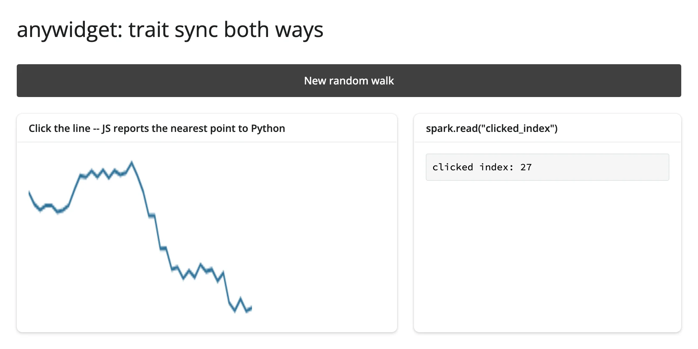

This is the whole anywidget trait-sync contract: `model.get("values")`/`model.on("change:values", ...)` on the
JS side, and plain attribute assignment (`spark.widget.values = ...`) on the Python side -- the same mechanism
every built-in widget in the roster uses internally.

#### JS -> Python: model.set() + save_changes()

The click handler above already showed this: `model.set("clicked_index", i)` followed by `model.save_changes()`
is what actually flushes a browser-side change back to Python. `save_changes()` is easy to forget -- without it,
`model.set()` only updates the browser's local copy of the trait, and Python never sees it. Once it's called,
`spark.read("clicked_index")` on the Python side behaves exactly like reading any other synced trait of the
rendered widget.

#### Custom messages, both directions

Not everything worth sending is a trait. A one-off instruction ("flash the line") or event ("the user asked to
reset") doesn't need to be *remembered* as state -- `model.send()` (JS -> Python) and `widget.send()` (Python ->
JS) are the message-passing escape hatch, paired with `widget.on_msg()` (Python) and `model.on("msg:custom",
...)` (JS).

```{.python file="examples/04_anywidget_messages.py" files="sparkline_widget.py"}
import numpy as np
from shiny import reactive
from shiny.express import input, render, ui
from shinywidgets import render_widget

from sparkline_widget import Sparkline

ui.page_opts(title="anywidget: custom messages both ways", fillable=True)
ui.input_action_button("flash", "Flash the line (Python -> JS message)")
ui.markdown("Double-click the line to send a message the other way (JS -> Python).")

with ui.layout_columns(col_widths=[7, 5]):
    with ui.card():

        @render_widget
        def spark():
            rng = np.random.default_rng(2)
            return Sparkline(values=list(rng.normal(size=40).cumsum()))

        # Python -> JS, a custom message: `widget.send(...)` arrives in JS as
        # a "msg:custom" event (see sparkline_widget.py). A widget gets a
        # placeholder comm until the first post-render flush opens the real
        # one; a send made before then -- even from inside the render
        # function itself -- queues on that placeholder and is delivered, in
        # order, once the real comm opens, so it's never lost (see "Reacting
        # to user interaction" in the guide). The button click here is just
        # this toy app's trigger for "flash on demand," not a workaround.
        @reactive.effect
        @reactive.event(input.flash)
        def _flash():
            spark.widget.send({"type": "flash"})

    with ui.card():
        ui.card_header("Messages received from the widget")

        reset_count = reactive.value(0)

        @reactive.effect
        def _wire_on_msg():
            def _on_msg(widget, content, buffers):
                if content.get("type") == "reset-requested":
                    reset_count.set(reset_count() + 1)

            spark.widget.on_msg(_on_msg)

        @render.code
        def resets_out():
            idx = spark.read("clicked_index")
            return (
                f"clicks so far (via trait): {idx}\n"
                f"double-click messages received: {reset_count()}"
            )
```

Double-clicking the line sends a message to Python, counted on the right:

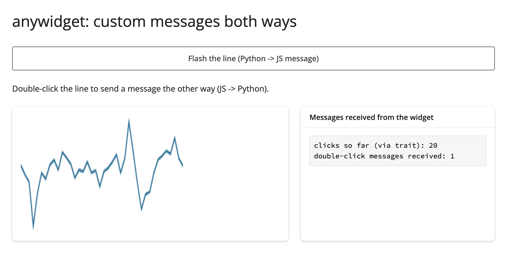

Clicking "Flash the line" sends a message the other way; the screenshot below was taken mid-flash (the line
genuinely brightens for 200ms, driven entirely by the browser-side `setTimeout`):

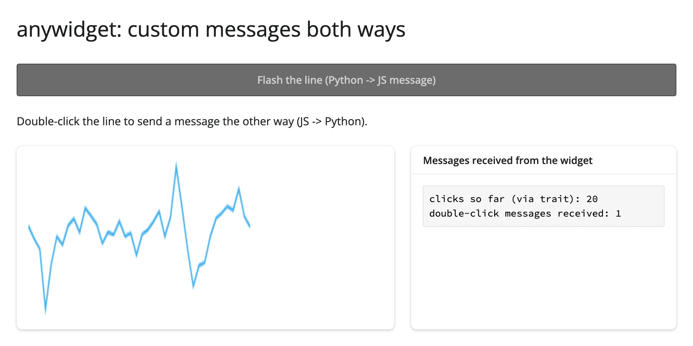

**A widget's comm starts as a placeholder and is swapped for the real one on a later reactive flush.** A
`widget.send(...)` issued before that swap -- including from inside the render function that builds the
widget, or from a bare `@reactive.effect` with no dependency -- used to be silently dropped. It no longer is:
the placeholder now queues every send and replays it, in order, once the real comm opens, so a message is
never lost regardless of when it's sent. Verified directly: a `widget.send(...)` call placed literally inside
the render function above, and a bare effect with no `@reactive.event` gate, both reached the browser in this
pass's testing. This guide's own [mapwidget example](#third-party-widgets-with-no-dedicated-renderer) hits the
same mechanism through `add_call()` (mapwidget's own custom-call queue, a trait write rather than a literal
`widget.send()`); the showcase gallery app's engine-swap scenario is verified to deliver correctly too, even
across a re-render.

#### Binary traits for bigger data

A `traitlets.Bytes()` trait is transmitted as a raw binary buffer (base64-encoded for the trip over Shiny's
text-only websocket, decoded back into a JS `DataView` on arrival) instead of a JSON array -- worth it once a
plain `List(Float())` trait starts measuring in the hundreds of kilobytes.

```{.python file="examples/05_anywidget_binary_trait.py" files="sparkline_widget.py"}
import base64
import json

import numpy as np
from shiny.express import render, ui
from shinywidgets import render_widget

from sparkline_widget import BinarySparkline

N = 20_000
rng = np.random.default_rng(3)
DATA = rng.normal(size=N).cumsum().astype("float32")

ui.page_opts(title="anywidget: a binary trait for bigger data", fillable=True)

with ui.card():
    ui.card_header(f"{N:,} points as a packed float32 buffer, not a JSON list")

    @render_widget
    def spark():
        return BinarySparkline(values=DATA.tobytes())

with ui.card():
    ui.card_header(f"Measured payload for this array (same {N:,} floats either way)")

    @render.code
    def sizes():
        as_json = json.dumps(DATA.tolist()).encode()
        as_binary_b64 = base64.b64encode(DATA.tobytes())
        return (
            f"JSON list trait:      {len(as_json):>8,} bytes\n"
            f"Bytes trait (base64): {len(as_binary_b64):>8,} bytes "
            f"(raw buffer: {DATA.nbytes:,} bytes)"
        )
```

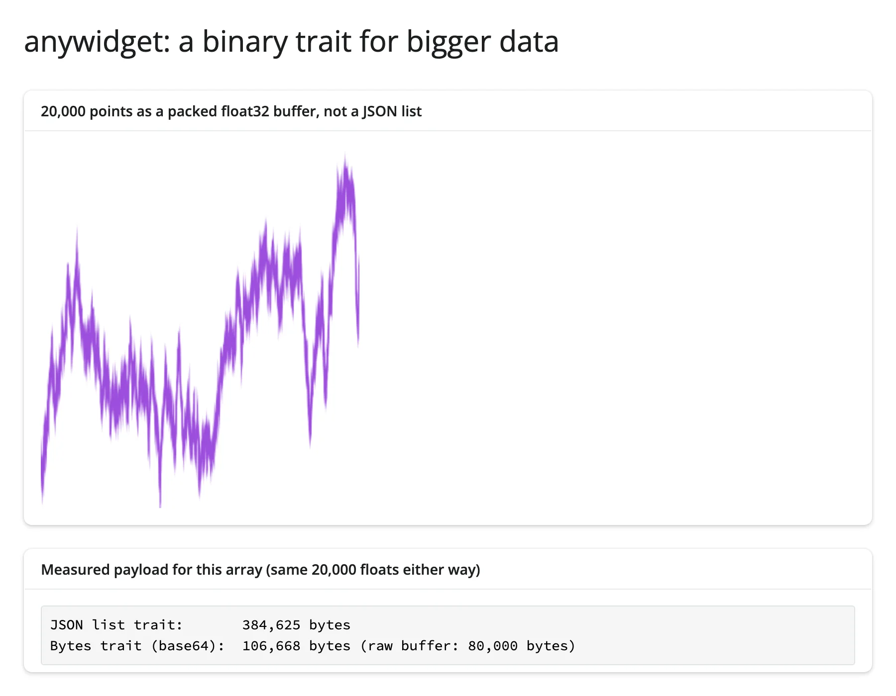

For this 20,000-point array: a JSON list trait measures 384,625 bytes; the identical data as a `Bytes` trait
(base64-encoded for transport) measures 106,668 bytes -- about 3.6x smaller, and the gap widens with array size
(JSON's per-number overhead is fixed; the binary encoding's 33% base64 inflation is constant). The JS side reads
it back with `new Float32Array(buf.buffer, buf.byteOffset, buf.byteLength / 4)` -- see
[`sparkline_widget.py`](examples/sparkline_widget.py)'s `BinarySparkline` class for the complete widget.

#### Three ways to load `_esm`

```{.python file="examples/06_esm_sources.py" files="box_widget.js"}
from pathlib import Path

import anywidget
import traitlets
from shiny.express import ui
from shinywidgets import render_widget

ui.page_opts(title="Three ways to load an anywidget's JS", fillable=True)


class InlineBox(anywidget.AnyWidget):
    # `_esm` as a plain string: the simplest option, and what every other
    # example in this guide uses. The whole string is sent to the browser as
    # part of the widget's synced state.
    _esm = """
    function render({ model, el }) {
      const box = document.createElement("div");
      box.textContent = "click me";
      box.style.cssText =
        "display:flex;align-items:center;justify-content:center;" +
        "width:160px;height:90px;border-radius:8px;cursor:pointer;" +
        "background:#2a6f97;color:white;font:14px sans-serif;";
      let n = 0;
      box.addEventListener("click", () => {
        n += 1;
        box.textContent = `clicked ${n}x`;
        model.set("clicks", n);
        model.save_changes();
      });
      el.appendChild(box);
    }
    export default { render };
    """
    clicks = traitlets.Int(0).tag(sync=True)


class FileBox(anywidget.AnyWidget):
    # `_esm` as a Path: anywidget reads the file at render time, and
    # (outside headless testing) watches it for hot reload -- edit
    # box_widget.js and re-render to see the change without restarting
    # Python. Byte-for-byte the same widget as InlineBox above.
    _esm = Path(__file__).parent / "box_widget.js"
    clicks = traitlets.Int(0).tag(sync=True)


class CdnBarChart(anywidget.AnyWidget):
    # `_esm` can import straight from a CDN. No local JS dependency, no
    # bundler -- but the browser needs network access to esm.sh (or
    # whichever CDN), and that import is on the critical path of every
    # render.
    _esm = """
    import * as d3 from "https://esm.sh/d3@7";

    function render({ model, el }) {
      const data = model.get("data");
      const width = 220, height = 90;
      const svg = d3.create("svg").attr("width", width).attr("height", height);
      const x = d3.scaleBand().domain(data.map((_, i) => i)).range([0, width]).padding(0.2);
      const y = d3.scaleLinear().domain([0, d3.max(data)]).range([height, 0]);
      svg.selectAll("rect").data(data).join("rect")
        .attr("x", (_, i) => x(i))
        .attr("y", (d) => y(d))
        .attr("width", x.bandwidth())
        .attr("height", (d) => height - y(d))
        .attr("fill", "#9d4edd");
      el.appendChild(svg.node());
    }
    export default { render };
    """
    data = traitlets.List(traitlets.Float()).tag(sync=True)


with ui.layout_columns():
    with ui.card():
        ui.card_header("Inline string")

        @render_widget
        def inline_box():
            return InlineBox()

    with ui.card():
        ui.card_header("Sibling file (box_widget.js)")

        @render_widget
        def file_box():
            return FileBox()

    with ui.card():
        ui.card_header("CDN import (d3, via esm.sh)")

        @render_widget
        def bars():
            return CdnBarChart(data=[4, 8, 15, 16, 23, 42])
```

[`examples/06_esm_sources.py`](examples/06_esm_sources.py) (`FileBox`'s sibling file:
[`examples/box_widget.js`](examples/box_widget.js))

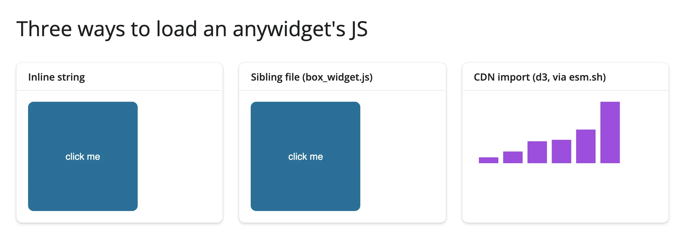

The inline box is interactive like the others; clicking it updates its own synced trait:


All three render identically -- `InlineBox` and `FileBox` are byte-for-byte the same widget. Prefer the file
form while actively developing a widget (faster edit loop via hot reload, outside headless test environments);
prefer inline for a widget that's done, so the whole class is self-contained in one file. A CDN import needs
nothing installed locally, at the cost of a network dependency on every render (and, for widgets that aren't
trivial like this one, real bytes downloaded by the browser each time).

### Third-party widgets with no dedicated renderer

If a package's own `pip install` gives you a class that's already an `ipywidgets.Widget` (every anywidget-based
package qualifies automatically), plain `render_widget` just works -- no coercion needed, no renderer PR
required. Two real packages without a roster entry demonstrate this.

**[mapwidget](https://github.com/opengeos/mapwidget)** wraps MapLibre GL, Leaflet, and OpenLayers behind one
small anywidget API (`center`, `zoom`, `clicked_latlng`, plus `add_call()`/`add_basemap()` for driving the map
from Python).

```{.python file="examples/08_third_party_mapwidget.py"}
# Needs: uv run --no-sync --with mapwidget python -m shiny run 08_third_party_mapwidget.py
#
# mapwidget (https://github.com/opengeos/mapwidget) has no dedicated
# shinywidgets renderer -- plain `render_widget` is enough, because
# mapwidget.maplibre.Map is already an ipywidgets.Widget subclass; there is
# nothing to coerce. This is the common case for "my widget isn't on the
# roster": if `pip install <library>` gives you an anywidget/ipywidgets class
# directly, `@render_widget` just works.
import mapwidget.maplibre as maplibregl
from shiny import reactive
from shiny.express import input, render, ui
from shinywidgets import render_widget

ui.page_opts(title="A third-party widget with no dedicated renderer", fillable=True)

with ui.layout_columns(col_widths=[8, 4]):
    with ui.card(full_screen=True):
        ui.card_header("mapwidget.maplibre.Map (click the map)")
        ui.input_action_button("dark", "Switch to dark style")

        @render_widget
        def map():
            return maplibregl.Map(center=[40.7128, -74.0060], zoom=10)

        # Python -> JS state changes on this widget are forwarded with
        # `add_call(method, args)`, not by assigning a trait (assigning
        # `map.widget.center = ...` changes the Python-side trait but never
        # moves the rendered map -- documented, verified upstream behavior).
        # A call made before the widget's real comm opens -- even from
        # inside the render function above -- is no longer dropped (see
        # "Reacting to user interaction"); the button here is just this toy
        # app's trigger for "restyle on demand," not a workaround.
        @reactive.effect
        @reactive.event(input.dark)
        def _dark_style():
            map.widget.add_call(
                "setStyle", ["https://tiles.openfreemap.org/styles/fiord"]
            )

    with ui.card():
        ui.card_header('map.read("clicked_latlng") / map.read("zoom")')

        @render.code
        def state_out():
            lat, lng = map.read("clicked_latlng")
            zoom = map.read("zoom")
            clicked = "nowhere yet" if lat is None else f"({lat:.3f}, {lng:.3f})"
            return f"zoom: {zoom:.1f}\nlast click: {clicked}"
```

Default style, after a click (nearby lat/lng reported):

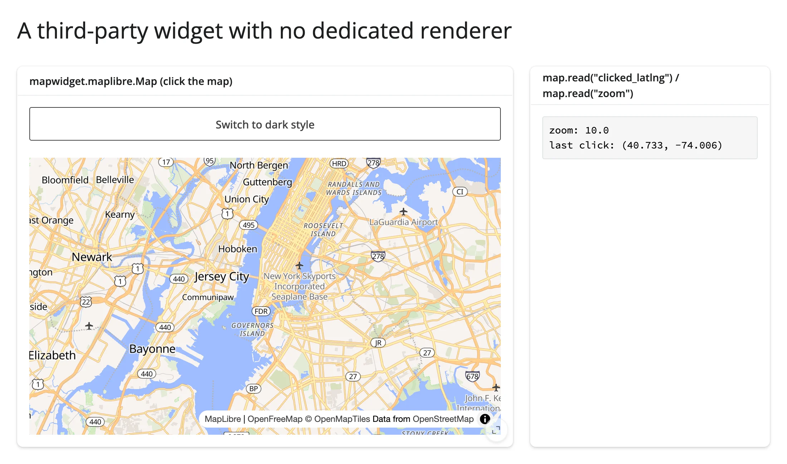

Clicking "Switch to dark style" applies it correctly:

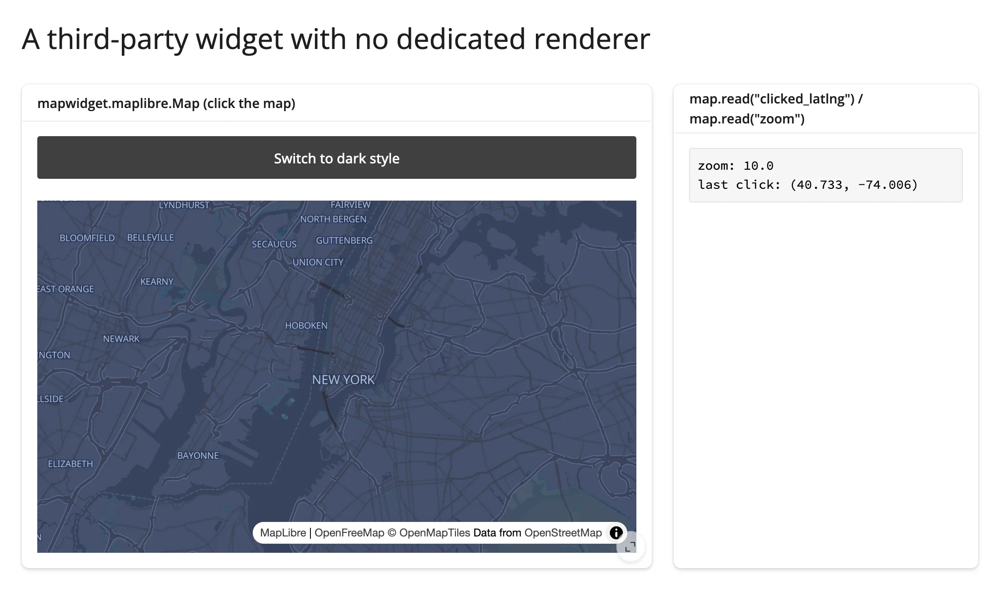

**[ipydeck](https://github.com/ozekik/ipydeck)** wraps deck.gl layers directly. It's a good second example
precisely because it has a sharp, verified upstream edge: deck.gl's own "accessor" properties
(`get_position`, `get_fill_color`, ...) only become functions when the Python value is a string prefixed `@@=`
-- a plain column name (the way `pydeck` itself accepts it) silently renders nothing, with no error anywhere.

```{.python file="examples/09_third_party_ipydeck.py"}
# Needs: uv run --no-sync --with ipydeck python -m shiny run 09_third_party_ipydeck.py
#
# A second no-dedicated-renderer example: ipydeck (deck.gl layers as an
# anywidget). Same `render_widget` recipe as mapwidget, but ipydeck has a
# sharp upstream edge worth knowing before you try it: deck.gl's own
# "accessor" properties (`get_position`, `get_fill_color`, ...) only become
# functions when the Python value is a string prefixed `@@=`. A plain column
# name -- which is exactly how pydeck accepts it -- renders nothing, with no
# error anywhere.
from ipydeck import Deck, Layer, ViewState
from shiny.express import render, ui
from shinywidgets import render_widget

CITIES = [
    {"name": "San Francisco", "position": [-122.42, 37.78]},
    {"name": "Oakland", "position": [-122.27, 37.80]},
    {"name": "Berkeley", "position": [-122.27, 37.87]},
    {"name": "San Jose", "position": [-121.89, 37.34]},
]

with ui.layout_columns(col_widths=[8, 4]):
    with ui.card(full_screen=True):
        ui.card_header('get_position="@@=position" -- required, not "position"')

        @render_widget
        def deck():
            return Deck(
                layers=[
                    Layer(
                        "ScatterplotLayer",
                        data=CITIES,
                        id="cities",
                        pickable=True,
                        on_click=True,
                        get_position="@@=position",  # plain "position" silently draws nothing
                        get_radius=8000,
                        get_fill_color=[255, 140, 0],
                    )
                ],
                initial_view_state=ViewState(longitude=-122.3, latitude=37.7, zoom=8),
                map_style="dark",
                tooltip={"html": "<b>{name}</b>"},
            )

    with ui.card():
        ui.card_header('deck.read("click") -- the picked object')

        @render.code
        def click_out():
            picked = deck.read("click")
            return "click a city" if not picked else str(picked.get("object"))
```

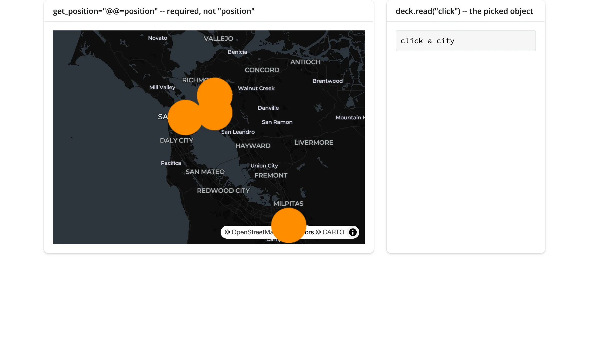

A pick reports the full data row back to Python (verified via a model-level `set()`, since real clicks under
headless Chromium + swiftshader landed between deck.gl's picking buffer and the visible marker radius more
often than not -- see [Gotchas](#gotchas-and-limitations)):

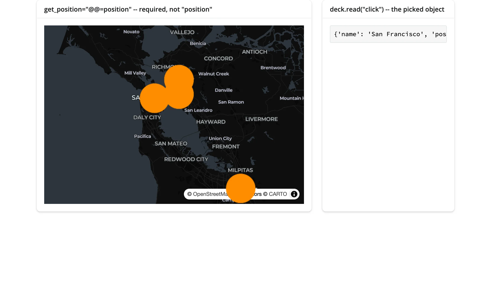

A third option worth knowing about (not demonstrated here): **[carbonplan-maps](https://github.com/manzt/carbonplan-maps)**,
an experimental anywidget that renders cloud-native Zarr pyramids as GPU map tiles -- the browser streams chunks
straight from S3, with no tile server and no Python in the render loop. It works in Shiny with one required CSS
fix (its raster layer paints at `z-index: -1`, which an opaque `bslib::card` background hides without an
override rule) -- not re-verified in this pass.

### ipyreact: JSX widgets, no build step

[ipyreact](https://github.com/widgetti/ipyreact) is a different way to build a custom widget: instead of
`anywidget`'s imperative `render({ model, el })` function, you write a real React component in JSX, and
`setValue` (handed to your component as a prop) writes straight back to the widget's `value` trait.

```{.python file="examples/10_ipyreact_confetti.py"}
import ipyreact
from shiny.express import render, ui
from shinywidgets import render_widget

# ipyreact's own idiom: write real JSX in `_esm`, and `setValue` is handed to
# the component as a prop that writes straight back to the widget's `value`
# trait (ValueWidget's one synced trait). No separate click handler plumbing
# -- this is the whole widget.
CONFETTI_ESM = """
import confetti from "https://esm.sh/canvas-confetti@1";
import * as React from "react";

export default function ({ value, setValue }) {
  return React.createElement(
    "button",
    { onClick: () => { confetti(); setValue((value || 0) + 1); } },
    `${value || 0} times confetti`
  );
}
"""


class ConfettiButton(ipyreact.ValueWidget):
    _esm = CONFETTI_ESM


ui.page_opts(title="ipyreact: JSX widgets with no JS build step", fillable=True)

with ui.card():
    ui.card_header("ipyreact.ValueWidget subclass")

    @render_widget
    def button():
        return ConfettiButton()

    @render.code
    def count_out():
        n = button.read("value")
        return f"confetti fired {n or 0} time(s)"
```

Before and after one click:

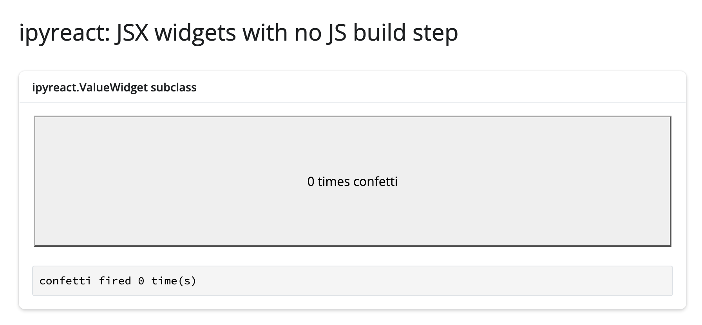
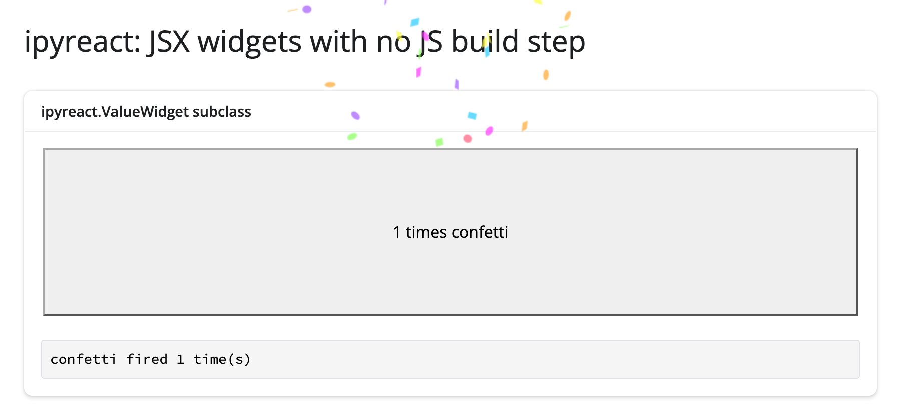

`ipyreact.ValueWidget` is a real `ipywidgets.ValueWidget` subclass, so `button.read("value")` works exactly
like any other synced trait -- composition (JSX, `useState`, React's own rendering) is entirely ipyreact's
concern; shinywidgets just sees another widget. Subclassing a third-party widget directly in your own app
module -- as `ConfettiButton` does here -- works the same way it does in Jupyter, with no special handling
needed on your part.

**ipyreact's process-global registry, handled for you.** `ipyreact.define_module()`/`define_import_map()` (used
internally by reactable-py, and available for your own reusable JS modules) register process-wide dependency
widgets that every ipyreact consumer waits on by name. shinywidgets detects these and mirrors them into every
session automatically, the same way it handles `shared_lifetime()` widgets -- you don't need to do anything
differently to use them in Shiny. The one thing to know: a `Module`'s `code`/`url` are Python-authored and
guarded against being overwritten by a browser-sent message (only its `status` field, which the frontend uses to
report load progress, can come from the client) -- see `shinywidgets/_ipyreact.py` if you're curious about the
mechanism.

## Reacting to user interaction

`render_widget` has no accessors (it's the one renderer in the roster that doesn't -- see the cheat sheet's
"Renderers with no accessors" list in `../articles/reacting-to-widgets/cheatsheet.md`), because there's no
single library's semantics to build one against. That leaves the other two tiers described in
[Reacting to widgets](../reacting-to-widgets/index.md#the-mental-model-accessors-are-inputs-that-remember):

1. **`output.read("trait")`** for a trait of the output's *own* rendered widget -- every example above uses
   this (`spark.read("clicked_index")`, `map.read("zoom")`, `button.read("value")`, ...). It's a documented
   shortcut for `reactive_read(output.widget, "trait")` with one practical edge: an unknown name raises with a
   "did you mean?" hint instead of silently returning `None`, which catches a typo'd trait name immediately
   instead of showing an empty-looking UI.
2. **`reactive_read(widget, "trait")`** for a widget that *isn't* the output itself -- a child widget a parent
   owns, like `panel.widget.children[0]` in [Plain ipywidgets](#plain-ipywidgets-composing-controls-without-a-shiny-input)
   above. There's no `.read()` for these, because there's no renderer output wrapping them.

### Beyond the accessors: which traits are worth reading

For the widgets in this guide:

| Widget | Trait | Meaning |
|---|---|---|
| `Sparkline` (custom) | `clicked_index` | Index of the most recently clicked/dragged-over point. `None` until first interaction; does not reset on re-render (no re-render happens in these examples). |
| `Sparkline` (custom) | `brush` | `[start_index, end_index]` of the last completed drag; `[]` before the first drag. |
| `BinarySparkline` (custom) | `values` | The raw buffer itself -- not usually read back, but demonstrates the binary wire format. |
| mapwidget (`maplibre`/`leaflet`/`openlayers`) | `center`, `zoom`, `clicked_latlng` | All three backends share these; `clicked_latlng` defaults to `[None, None]` -- guard for it. |
| ipydeck `Deck` | `click` | The picked object (`{"object": {...}, "index": N}` or `{}`); requires `pickable=True, on_click=True` on the layer. |
| ipyreact `ValueWidget` | `value` | Whatever your component passes to `setValue()`. |

For a widget you didn't write, the method is the same one used to find these: skim `widget.trait_names()` for
anything that looks user-facing, then `.read()` it (or `reactive_read()`, for a child widget) and confirm with
a real gesture that it actually updates (some traits -- especially ones an upstream library treats as internal
-- don't sync reliably; this guide's own `mapwidget` example has one: assigning `.center`/`.zoom` *from Python*
changes the trait but never moves the rendered map, because none of mapwidget's three backends register a
`change:center`/`change:zoom` JS-side handler -- state flows browser-to-Python only there).

### Rate limiting, and a reusable accessor-like helper

The renderer's `rate_policy`/`rate_delay` kwargs rate-limit `.read()`/`reactive_read()` on that output's widget
(this is the one case where they matter for `render_widget`, since there are no accessors for them to govern).
The contrast below drives a slow drag across two separate `Sparkline` instances -- one plain, one rendered with
`@render_widget(rate_policy="debounce", rate_delay=0.5)` -- and counts how many times each reader actually
fires.

Custom widgets also don't come with built-in accessors the way `render_plotly`'s `clicked()` does -- but
nothing stops you from writing the equivalent yourself: a small function that wraps `.read()` in a
`@reactive.calc`, giving every call site the same typed, documented value instead of repeating a raw
index-to-row lookup.

```{.python file="examples/07_accessor_helper.py" files="sparkline_widget.py"}
import numpy as np
from shiny import reactive
from shiny.express import render, ui
from shinywidgets import render_widget

from sparkline_widget import Sparkline

rng = np.random.default_rng(4)
DATA = list(rng.normal(size=40).cumsum())


def nearest_point(output, data):
    """
    Accessor-like helper: turns a raw `clicked_index` trait into the actual
    data point. Custom widgets don't come with built-in accessors like
    `render_plotly`'s `clicked()` -- this is the pattern for writing your
    own: wrap `.read()` in a function returning a `@reactive.calc`, so every
    call site gets the same typed value instead of repeating the
    index-to-row lookup.
    """

    @reactive.calc
    def _():
        idx = output.read("clicked_index")
        return None if idx is None else data[idx]

    return _


ui.page_opts(title="A reusable accessor-like helper, and rate limiting", fillable=True)
ui.markdown("Drag across each sparkline (slowly, over ~1 second) and compare the counts.")

with ui.layout_columns():
    with ui.card():
        ui.card_header("default: .read() fires on every drag update")

        @render_widget
        def spark():
            return Sparkline(values=DATA)

        n_default = reactive.value(0)

        @reactive.effect
        def _count_default():
            spark.read("clicked_index")
            with reactive.isolate():
                n_default.set(n_default() + 1)

        @render.code
        def out_default():
            return f"fired {n_default()} times"

    with ui.card():
        ui.card_header("render_widget(rate_policy='debounce', rate_delay=0.5)")

        @render_widget(rate_policy="debounce", rate_delay=0.5)
        def spark_slow():
            return Sparkline(values=DATA)

        n_slow = reactive.value(0)

        @reactive.effect
        def _count_slow():
            spark_slow.read("clicked_index")
            with reactive.isolate():
                n_slow.set(n_slow() + 1)

        @render.code
        def out_slow():
            return f"fired {n_slow()} times"

with ui.card():
    ui.card_header("nearest_point(spark, DATA)() -- the helper in use")

    point = nearest_point(spark, DATA)

    @render.code
    def point_out():
        p = point()
        return "drag the left sparkline" if p is None else f"value at that index: {p:.3f}"
```

One slow drag across each sparkline, plus a click on the left one:

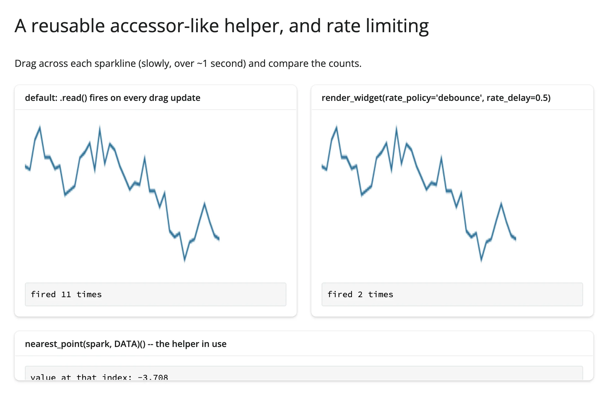

The same drag produces 11 raw updates against the debounced reader's 2 -- `rate_delay` only governs
`.read()`/`reactive_read()` calls on that specific widget instance (keyed by `id(widget)`), so two outputs
built from two separate instances can have independently tuned rates. The `nearest_point()` helper at the
bottom shows the payoff: callers get a typed data value, not an index they have to look up themselves every
time.

## Updating the widget from Python

Every in-place example above follows the same shape: read or mutate `.widget` from a `@reactive.effect`, rather
than making the render function depend on the same state (which would rebuild the widget from scratch). This is
covered in full, with the `reactive.isolate()` caveat for self-referential counters, in the
[Updating in place article's "Writing back" section](../updating-in-place/index.md#writing-back)
-- everything there applies unchanged to a hand-built anywidget; there's nothing `render_widget`-specific about
it beyond what each example above already demonstrates (`spark.widget.values = ...`,
`heatmap.widget.counts = ...`, `map.widget.add_call(...)`).

## Coordinating multiple views

### Custom widget brush -> filtered table

```{.python file="examples/11_coordinate_brush_to_table.py" files="sparkline_widget.py"}
import numpy as np
import pandas as pd
from shiny import reactive
from shiny.express import render, ui
from shinywidgets import render_widget

from sparkline_widget import Sparkline

rng = np.random.default_rng(5)
values = rng.normal(size=60).cumsum()
df = pd.DataFrame({"day": range(len(values)), "value": values})

ui.page_opts(title="Custom widget brush -> filtered table", fillable=True)
ui.markdown("Drag across the sparkline to select a range of days.")

with ui.layout_columns(col_widths=[7, 5]):
    with ui.card():
        ui.card_header("Sparkline -- drag to brush a range")

        @render_widget
        def spark():
            return Sparkline(values=list(values))

        # The widget's own `brush` reports [start_index, end_index]; feed it
        # right back in as `highlight` so the brushed range stays visibly
        # marked on the SAME widget (in place -- see "Updating the widget
        # from Python"), not just reflected in the table on the right.
        @reactive.effect
        def _mark_brush():
            lo, hi = spark.read("brush") or (0, -1)
            spark.widget.highlight = list(range(lo, hi + 1))

    with ui.card(full_screen=True):
        ui.card_header("Rows inside the brushed range")

        @render.data_frame
        def filtered():
            brush = spark.read("brush")
            if not brush:
                return render.DataGrid(df.iloc[0:0])
            lo, hi = brush
            return render.DataGrid(df.iloc[lo : hi + 1])
```

Before any interaction, and after dragging across a falling section of the line:

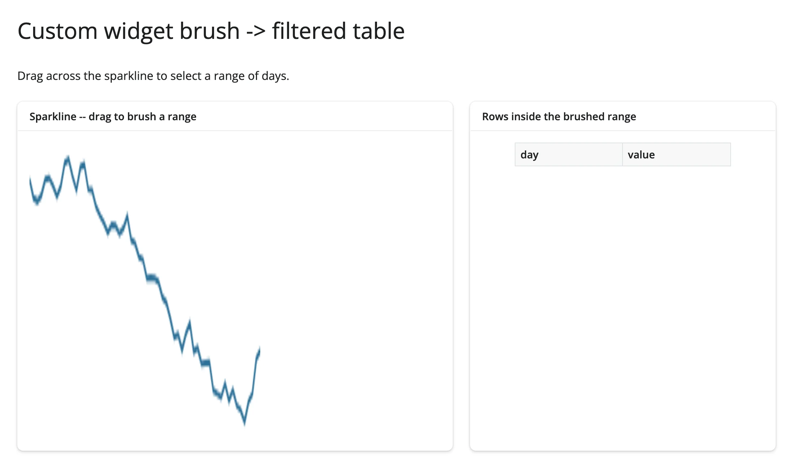
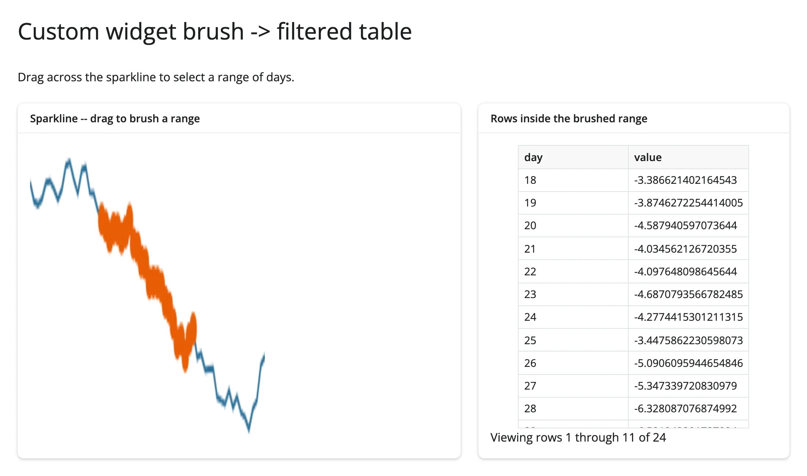

The brushed range drives two things at once: the table on the right (a derived view), and the *same* widget's
own `highlight` trait (an in-place update, so the selection stays visibly marked without a re-render).

### Table row selection -> custom widget highlight

```{.python file="examples/12_coordinate_table_to_widget.py" files="sparkline_widget.py"}
import numpy as np
import pandas as pd
from shiny import reactive
from shiny.express import render, ui
from shinywidgets import render_widget

from sparkline_widget import Sparkline

rng = np.random.default_rng(6)
values = rng.normal(size=30).cumsum()
df = pd.DataFrame({"day": range(len(values)), "value": values.round(3)})

ui.page_opts(title="Table row selection -> custom widget highlight", fillable=True)

with ui.layout_columns(col_widths=[5, 7]):
    with ui.card(full_screen=True):
        ui.card_header("Select a row")

        @render.data_frame
        def table():
            return render.DataGrid(df, selection_mode="row")

    with ui.card():
        ui.card_header("The same row, highlighted in place on the sparkline")

        @render_widget
        def spark():
            return Sparkline(values=list(values))

        # Shiny's own render.data_frame accessor (.cell_selection()) drives a
        # widget that has nothing to do with tables: no re-render, just an
        # in-place trait write on the existing Sparkline instance.
        @reactive.effect
        def _sync_highlight():
            rows = table.cell_selection()["rows"]
            spark.widget.highlight = list(rows)
```

Before selecting a row, and after selecting row 10 (a local peak in the series):

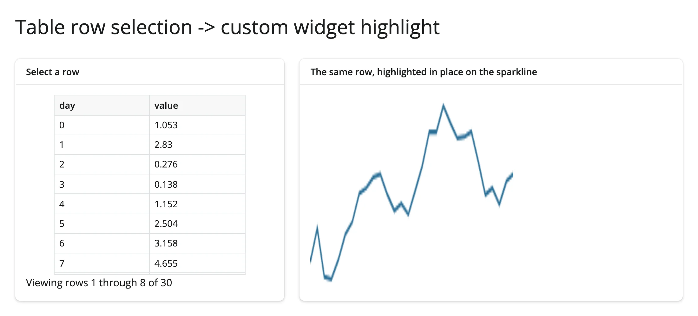
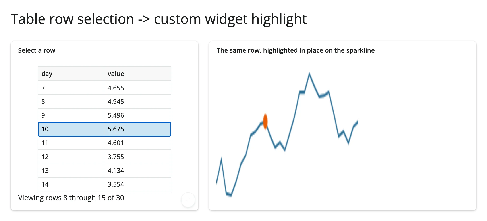

This is the reverse pairing: a *built-in* Shiny output (`render.data_frame`'s own `cell_selection()`) drives a
custom widget. Nothing about the custom widget needs to know it's being driven by a table -- it just has a
`highlight` trait, and anything that can compute a list of indices can set it.

(These two patterns generalize directly to the roster's own widgets: swap `render.data_frame` for
`render_plotly`/`render_itables`/`render_reactable` and their own `selected_rows()` accessors are drop-in
replacements for `table.cell_selection()["rows"]`; swap the custom `Sparkline` for any roster widget's `.widget`
and the same "read one side, write the other's trait in place" shape applies.)

## Layout and sizing

`render_widget` applies the same generic fill logic every renderer shares (`set_layout_defaults()` in
`_render_widget_base.py`): a `DOMWidget` fills its container by default, unless it has an explicit
`Layout(height=...)` (other than `"auto"`), in which case it renders at its natural size instead. One
case is specific to the generic path, and worth knowing before you build your own widget:

- **Plain ipywidgets *controls* never fill**, regardless of layout. Any widget whose `_model_module` is
  `@jupyter-widgets/controls` (every slider, dropdown, checkbox, ...) opts out of fill sizing entirely -- see the
  empty space below the slider in [Quick start](#quick-start). This only applies to the base controls package;
  a few specific libraries (plotly, altair, bokeh, ...) get their own fill handling layered on top, which is
  why a plotly figure fills its card but an `IntSlider` doesn't.
- **A `<canvas>`-based widget needs to handle its own sizing**, or it will be stretched -- and blurred -- to fill
  its container. The fill behavior is implemented as `flex: 1 1 auto` on the widget's direct child in the DOM;
  a `<canvas>` element's `width`/`height` *attributes* (its drawing-buffer resolution) don't count as a CSS size
  for that rule's purposes, only an explicit `style.width`/`style.height` does. This guide's `Sparkline` widget
  pins its CSS size to its buffer size (see the comment in
  [`sparkline_widget.py`](examples/sparkline_widget.py)) to stay crisp at a fixed size; a widget that should
  genuinely scale with its container instead needs a `ResizeObserver` that resizes the canvas's drawing buffer
  (ideally by `window.devicePixelRatio`) and redraws whenever the container's size changes -- not built in this
  guide's examples, but worth knowing if your widget needs to fill a resizable card.

## Gotchas and limitations

Verified on current `main` (commit `d882da46`):

- **`ipydeck`'s deck.gl-style accessor properties require a literal `@@=` string prefix** (`get_position="@@=position"`,
  not `get_position="position"`); the plain form silently renders nothing, with no console error. This is the
  opposite of `pydeck`'s own convention, so pydeck snippets don't port verbatim.
- **mapwidget's three backends are browser-to-Python only for `center`/`zoom`**: assigning
  `map.widget.center = [...]` from Python changes the Python-side trait, but none of the three backends register
  a JS-side `change:center` handler, so the rendered map never moves. Use `add_call("flyTo", ...)` (maplibre) or
  re-render instead.
- **`with out: print(...)` inside an `ipywidgets.Output()` renders nothing** -- not a shinywidgets limitation,
  but expected: `Output.__enter__`/`__exit__` work by recording the current Jupyter kernel's message id so the
  *frontend* can later match incoming IOPub stream messages to that output, the same mechanism any notebook cell
  uses for its stdout. shinywidgets has no real IPython kernel, so that id is never set, and `print()` just
  writes to the server process's literal stdout (verified: the printed text shows up in the server log, not the
  browser). **Use `out.append_stdout(...)` / `out.append_display_data(...)` / `out.clear_output()` instead** --
  these mutate the widget's `outputs` trait directly, which is the normal state-sync path shinywidgets already
  handles correctly, and render exactly as expected (verified). A plain `ipywidgets.Label` with direct `.value`
  assignment, as used in [Plain ipywidgets](#plain-ipywidgets-composing-controls-without-a-shiny-input), is a
  simpler substitute for the common "compute and show a short message" case when you don't need `Output`'s own
  API.
- **Pick your output function's name carefully.** It becomes a plain module-level name like any other; naming a
  `@render_widget` output `map`, `list`, `type`, `input`, `filter`, or similar shadows the Python builtin (or a
  Shiny import) of the same name for the rest of that module. Caught during this guide's own verification: a
  showcase app named its map output `map`, which broke an unrelated helper function's use of the builtin
  `map()`.

## Gallery candidates

**[`gallery/template_anywidget_starter.py`](gallery/template_anywidget_starter.py) -- build your own anywidget, wired to Shiny** (~80 lines)

A minimal, from-scratch starting point: a click-counter heatmap (an 8x8 grid of divs, redrawn by intensity),
wired to a reset button (Python -> JS, in place) and a `heatmap.read(...)` readout (JS -> Python). Meant to be
copied and adapted for a new custom widget.

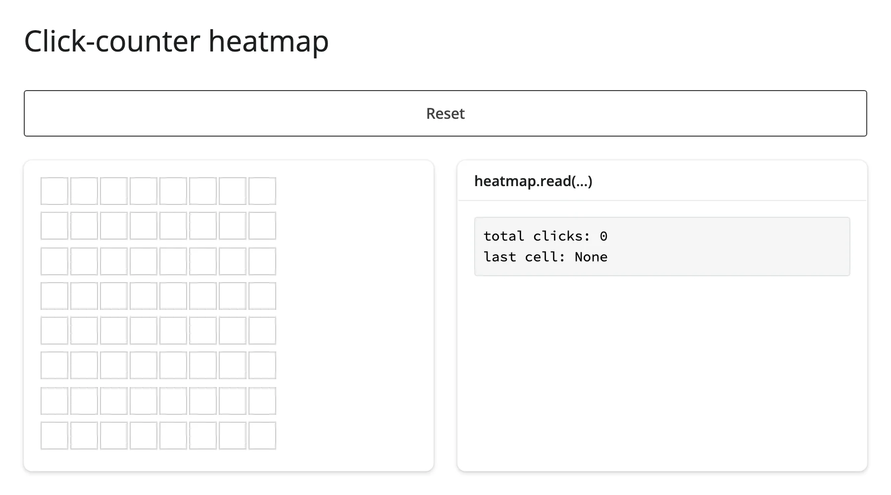
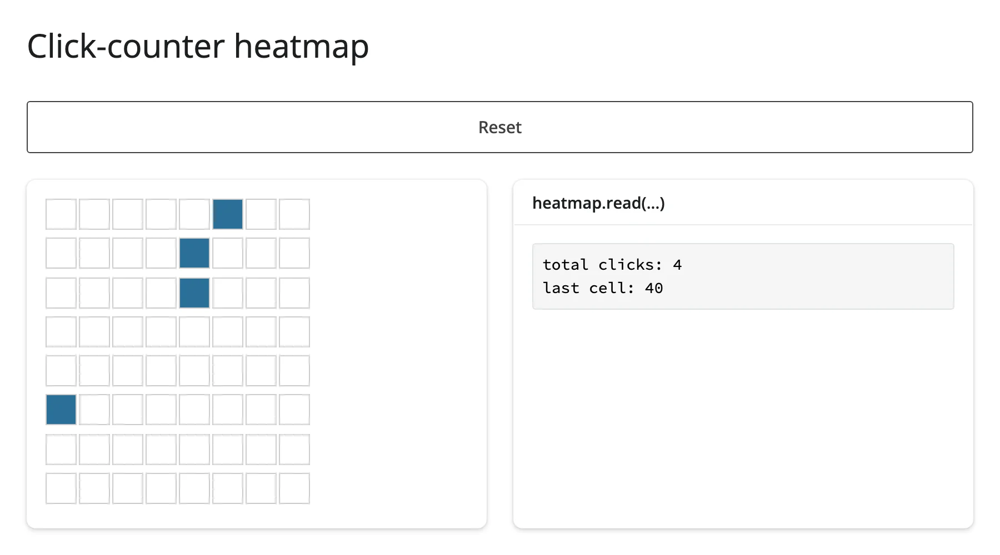

**[`gallery/showcase_mapwidget_engines.py`](gallery/showcase_mapwidget_engines.py) -- three map engines, one widget** (~110 lines)

A more developed demo built on mapwidget (the third-party, no-dedicated-renderer widget from "What you can
build"): swap between MapLibre GL, Leaflet, and OpenLayers from a dropdown; click the map to look up the nearest
of five world cities via `mw.read(...)`; restyle MapLibre or swap the Leaflet basemap in place; fly to a city
with an animated `add_call("flyTo", ...)`.

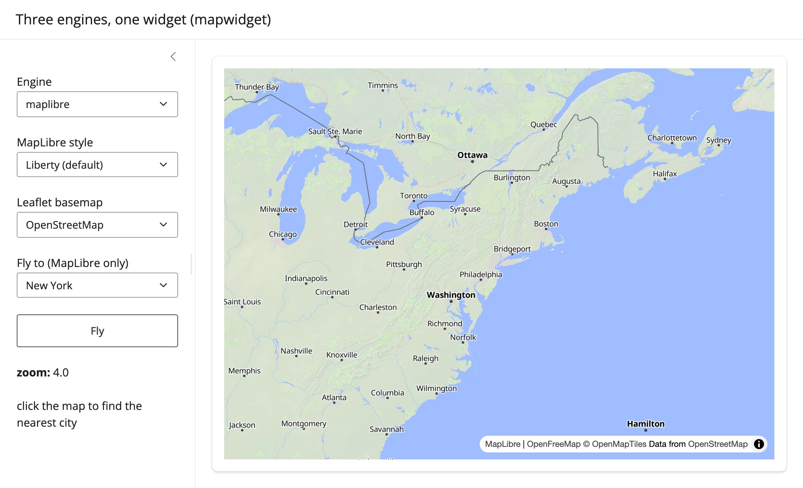

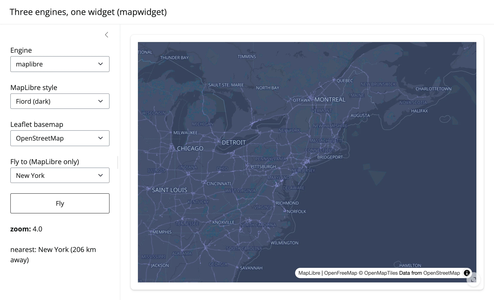
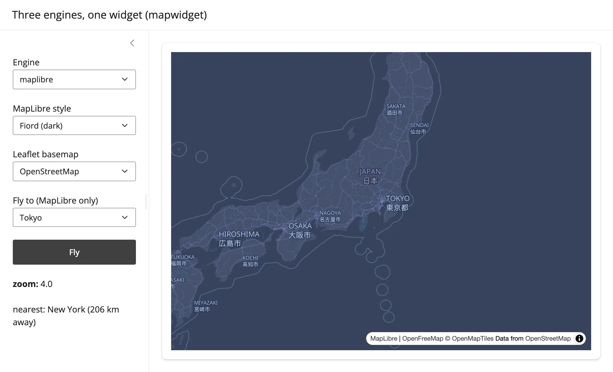
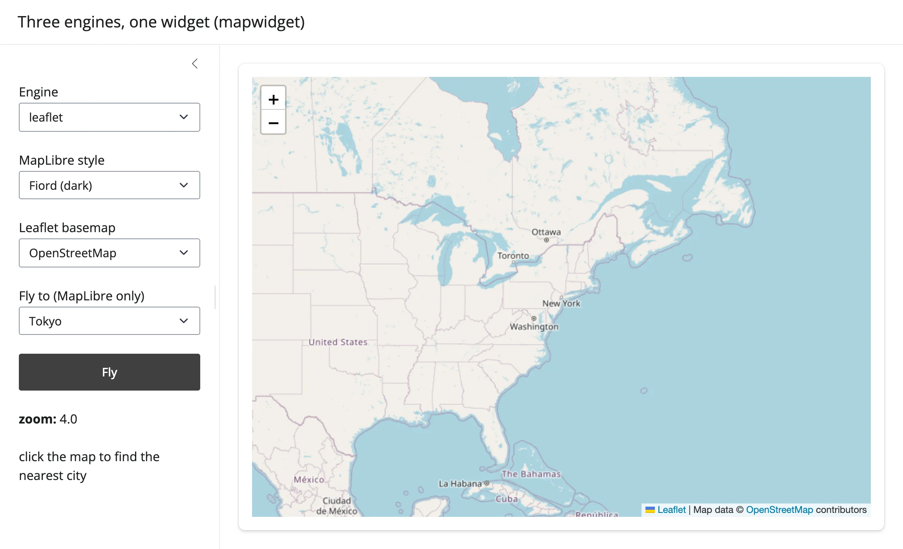

The chosen style also survives an engine swap: switch from MapLibre back to a brand-new MapLibre widget (via
Leaflet) with Fiord selected, and the dark style is still applied on the new widget, with no need to touch the
style control again -- the queued `add_call()` is delivered once the new widget's comm opens, not dropped:

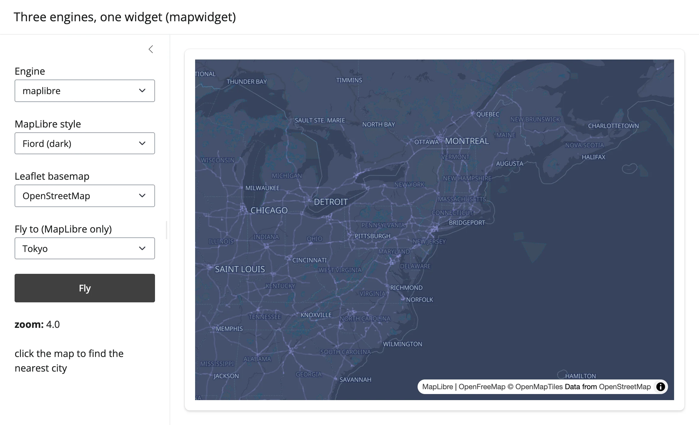

## Learn more

- [ipywidgets documentation](https://ipywidgets.readthedocs.io/) -- the base `Widget`/`DOMWidget` API every
  renderer in the roster (and this guide) builds on.
- [anywidget documentation](https://anywidget.dev/) -- the full `_esm`/`_css`/trait contract, plus its own guide
  to custom serializers for complex trait types.
- [ipyreact on GitHub](https://github.com/widgetti/ipyreact) -- the JSX-component approach to custom widgets,
  including its hot-reload tutorial notebook.
- [Reacting to widgets](../reacting-to-widgets/index.md) -- the cross-cutting article this guide
  leans on throughout: the three kinds of "nothing yet," re-fire/clearing rules, rate limiting, `.read()` vs.
  `reactive_read()`, writing back without looping, and the three widget lifetimes
  (`session_lifetime()`/`shared_lifetime()`), all demonstrated with roster widgets rather than custom ones.
- Any dedicated renderer's guide (start with [plotly](../../widgets/plotly/index.md) or [ipyleaflet](../../widgets/ipyleaflet/index.md))
  for what a library-specific `render_*` adds on top of everything in this guide: layout defaults tuned to that
  library's quirks, input coercion, and accessors.
