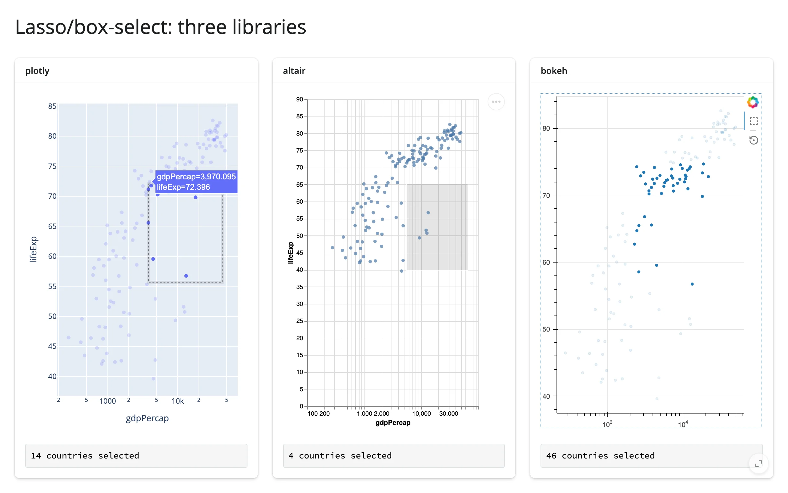
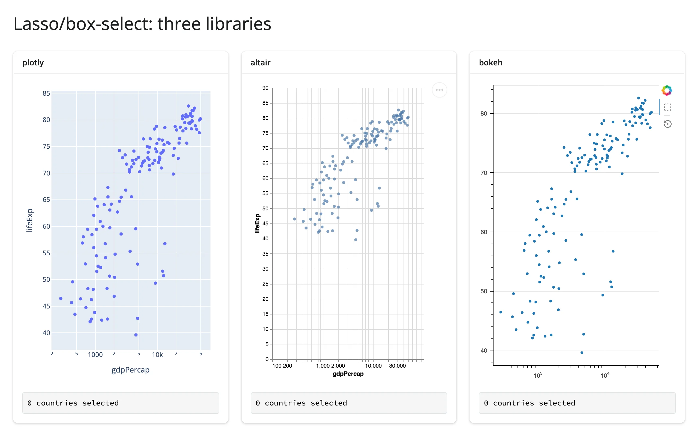
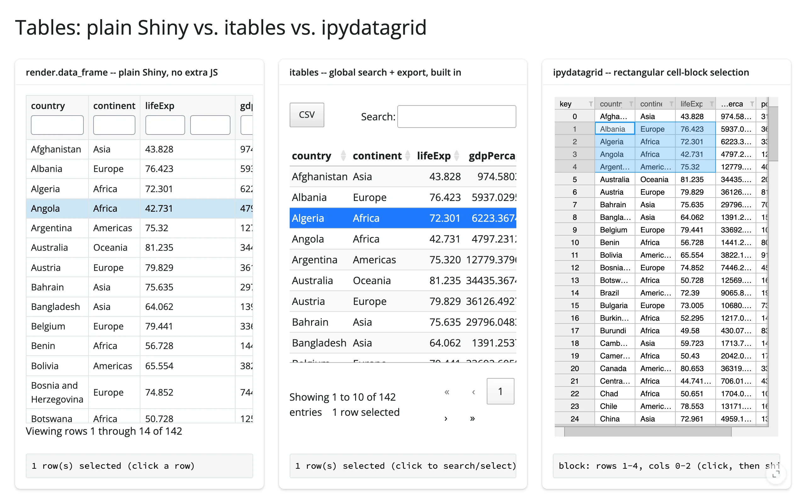
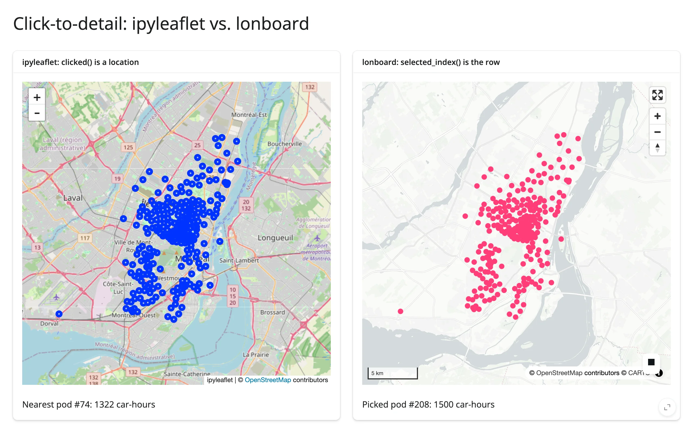

shinywidgets integrates roughly 40 widget libraries. Almost none of them compete head-to-head --
each earns its place in the roster by doing one task well: GPU scatter plots at a scale DOM-based
charts choke on, a full desktop-GIS map embedded in a Shiny card, a neuroimaging viewer, a
molecule grid. The hard part isn't learning any one of them (each has its own guide for that);
it's knowing which one to reach for, and when the honest answer is "you don't need a widget at
all -- `render.plot` or `render.data_frame` already does this."

This article is organized by task, not by library. For each task it names a default
recommendation, the real trade-offs (not a feature-matrix dump), and links to the guide that goes
deep on each candidate. [Reacting to widgets](../reacting-to-widgets/index.md) explains what a
*reactive accessor* is and how to read one; this release's headline feature is that most of the
plotting, table, and map widgets below now have them, so a user's click, lasso, or drag flows back
into Python as a normal reactive value, no JavaScript required. [Linking widgets](../linked-views/index.md)
covers the shapes of apps you build once you've picked your widgets. This article answers the
question one level up: *which* widgets.



## How to read the trade-offs

Four things matter more in Shiny than they do in a notebook, because a Shiny app is long-running,
multi-user, and server-rendered:

- **Accessors.** Does user interaction (click, lasso, pan, edit) come back to Python as a named
  accessor you can read with `req()`, or do you have to fall back to `.read("trait")` (every
  renderer output has this, even with zero named accessors), or `reactive_read()` on a *nested*
  widget the output doesn't wrap directly? More accessors generally means less code for you to
  write, but it only matters if your app needs that interaction. See
  [Reacting to widgets](../reacting-to-widgets/index.md#beyond-the-accessors-read-and-reactive_read)
  for the three tiers.
- **In-place updates.** Can you change the widget via `.widget.<trait> = ...` inside an effect
  (preserving zoom, camera, selection, and avoiding re-sending the JS bundle), or does every data
  change force a full re-render? This is the difference between an app that feels instant and one
  that flickers on every input change.
- **Scale.** The point at which a widget stops being usable -- measured by each guide, not
  guessed. A DOM-based table or map tops out in the thousands of rows; a GPU scatter plot or a
  server-side-aggregated raster keeps going into the millions or tens of millions.
- **Maturity and lifetime.** Some integrations in this roster are new, upstream-fragile, or have a
  known fix sitting on an unmerged branch (see the callout boxes below). A few widgets also have
  real constraints on being shared across sessions (`shared_lifetime()`), which matters if you're
  building a dashboard other people will use concurrently.

---

## Statistical charts

**Default: plotly**, if you don't already have a reason to pick something else. It has the richest
accessor set in the whole roster -- `clicked()`, `double_clicked()`, `hover()`,
`selected()`/`selecting()`, `brushed()`/`brushing()`, `relayout()`, `legend_clicked()`,
`visible_traces()`, and `selected_rows()` -- covers click, double-click (a "view reset" pulse),
hover, lasso/box select (both live-during-drag and settled), zoom/pan, and legend toggles, and
`plotly.express` gets you a real chart in one line. See the [plotly guide](../../widgets/plotly/index.md).

Reach for something else when:

- **You want the selection declared in the chart's own grammar, not assembled from callbacks.**
  [Altair](../../widgets/altair/index.md)'s `selected()`/`selected_rows()` read a Vega-Lite
  `selection_interval`/`selection_point` you declare with `.add_params(...)` -- the selection *is*
  part of the chart spec, which composes cleanly across layers and facets. Trade-off: two
  Vega-Lite selections sharing one view clear each other (a legend click clears a brush), and
  `selected_rows()` only matches layers using the identical underlying frame object.
- **You're building Bokeh plots from live Python objects** (a `ColumnDataSource` you mutate, a
  custom `CustomJS`), and want `selected()`, `selected_rows()`, `tapped()`, and `zoomed()` as
  accessors on top. See [bokeh](../../widgets/bokeh/index.md). One upstream quirk: raw
  `on_change`/`on_event` callbacks you register yourself fire twice per browser change (the
  accessors already dedupe this for you).
- **You need something already written in matplotlib or plotnine/ggplot2.** `render_matplotlib`
  (`clicked()`, `picked()`, `limits()`) and `render_plotnine` (`clicked()`, `limits(ax=0)`, same
  ipympl canvas) turn a static figure into a zoomable, clickable one without a rewrite -- see
  [matplotlib](../../widgets/matplotlib/index.md) and [plotnine](../../widgets/plotnine/index.md). This is also the
  only path to a `render.plot`-style composition Shiny's built-in static renderer can't show at
  all (patchwork/subplot compositions).
- **You want grammar-of-graphics plots with native widget state** (not just static output) and
  don't mind a narrower community than Vega-Lite's. [bqplot](../../widgets/bqplot/index.md)'s
  `selected()`/`brush()` track per-mark selected indices and animate data updates in place; no
  `clicked()` by design (the figure's own interaction overlay would swallow it).
- **You already live in HoloViews/hvPlot/Panel.** [Panel](../../widgets/panel/index.md)'s `param(name)`
  accessor (e.g., `slider.param("value")`) reads any rendered object's param value reactively, no
  bridge code needed. HoloViews and [obsplot](../../widgets/obsplot/index.md) still have no dedicated
  accessors -- crossfilter via `hv.link_selections`, or read `.read("trait")`/`reactive_read()` on
  streams and params directly. See [holoviews](../../widgets/holoviews/index.md). One tip worth knowing up
  front: a composite `hv.link_selections` `Layout` (several linked elements) defaults to the Pan
  tool, not box-select, at any canvas width -- set `.opts(active_tools=["box_select"])` on each
  element so the box-select tool is armed without requiring a manual toolbar click first.

**Use a plain `render.plot` instead** when the chart is genuinely static (no zoom, no click, no
data that changes after render) -- a matplotlib figure doesn't need `render_matplotlib`'s ipympl
canvas, and you skip the bundle entirely.

## Tables and grids: display vs. input

The question to ask first: does the user need to *do* anything with the table besides read it? If
not, **`render.data_frame` (plain Shiny core, no extra package)** already gives you a virtualized,
sortable grid with row selection via `cell_selection()` -- no `shinywidgets[...]` extra, no bundle.
Reach for a dedicated table widget only when you need one of these specific things it doesn't have:

| Need | Widget | Why |
|---|---|---|
| Zero-config global search, export (CSV/Excel), faceted SearchPanes filters | [itables](../../widgets/itables/index.md) | `selected_rows()`; richest "classic DataTables" feature catalog of the three client-side tables |
| Rectangular cell-block selection, in-cell bars/heatmaps, editable cells | [ipydatagrid](../../widgets/ipydatagrid/index.md) | `selected()`, `clicked_cell()`, `edited_cell()`, `visible_data()` -- the only one with real cell-block (not just row) selection |
| Grouping/aggregation, expandable detail rows, custom cell renderers, theming | [reactable](../../widgets/reactable/index.md) | richest display/theming feature set; `selected_rows()`, `page()`, `sorted()`, `filtered()`, `search()` |
| User-driven pivot/BI exploration: drag-and-drop group-by, a dozen chart plugins | [perspective](../../widgets/perspective/index.md) | `filter()`, `view_config()` round-trip the user's own query as a dict |
| Browse millions of rows with per-column histograms, zero app code | [quak](../../widgets/quak/index.md) | `sql()`/`data()`; a 5M-row table paints like 5k because only on-screen rows + histogram bins cross the wire -- locked down by default, see callout below |
| Full Tableau-style ad hoc chart builder, size-independent cost | [pygwalker](../../widgets/pygwalker/index.md) | no accessors (only `on_msg` for save/export, plus the `.read()` tier for a bare trait); DuckDB computes every chart server-side, so 500 rows and 1,000,000 rows cost the same bytes and time |
| Several linked charts/tables/inputs crossfiltering one spec | [mosaic](../../widgets/mosaic/index.md) | `params()`/`data(filter_by=...)`; the only *dashboard-spec* widget here, not a single view -- locked down by default, see callout below |

> **Security, quak and mosaic:** both run browser-supplied SQL against the widget's DuckDB
> connection, so an unrestricted connection would let a visitor read or write arbitrary server
> files. By default, the renderer locks the connection down before display
> (`SET enable_external_access = false`, `SET lock_configuration = true`) -- the same pattern
> `embedding-atlas` uses. Pass `allow_unrestricted_connection=True` to opt out (e.g., a local,
> single-user app). For a *shared* DuckDB connection (`con=`, or a relation registered on
> `duckdb.default_connection()`), mosaic's lockdown is permanent and database-wide -- it also locks
> every other cursor on that connection, not just the widget's -- so do any server-side file reads
> before the first render, or opt out for that connection.

## Maps and geospatial

Five different sub-tasks hide under "I need a map":

| Sub-task | Widget | Notes |
|---|---|---|
| Use the map itself as an input: draw a region, click a feature, read bounds/zoom | [ipyleaflet](../../widgets/ipyleaflet/index.md) | 5 accessors (`bounds`, `zoom`, `center`, `clicked`, `drawn_features`) and a mature drawing toolbar; DOM-based, so prefer one GeoJSON layer over many `Marker`s past a few hundred points |
| One high-level API when you don't know which engine you need | [leafmap](../../widgets/leafmap/index.md) | a thin wrapper (`add_gdf`, `add_cog_layer`, split-map, legends, time sliders) over ipyleaflet, MapLibre, or kepler.gl -- shares ipyleaflet's 5 accessors on its default backend |
| Styled vector tiles, labels, 3D pitch/bearing/extrusion, globe projection | [maplibre](../../widgets/maplibre/index.md) | real Mapbox GL style spec; comfortable to a few hundred thousand features; accessors `view_state()`, `clicked()`, `drawn_features()`; the migration target for deprecated pydeck |
| GPU scale: tens to hundreds of thousands of points, data-driven styling | [lonboard](../../widgets/lonboard/index.md) | WebGL/deck.gl via GeoArrow (zero-copy, not GeoJSON); richest map selection model (`view_state`, `selected_index`, `selected_bounds`, `clicked`); the "scale" answer for everyone else in this list |
| Raster data: GeoTIFF/COG/elevation on a map, no separate tile service | [localtileserver](../../widgets/localtileserver/index.md) | produces an ordinary `ipyleaflet.TileLayer`; no accessors of its own (it's a tile server, not a renderer); the only one engineered for safe deployment (per-session reverse proxy, guarded against path/SSRF abuse) |
| Real cartographic (non-Mercator) projections | [geoviews](../../widgets/geoviews/index.md) | Cartopy projections through HoloViews/Bokeh; a server-side rasterization path (Datashader) for scaling past raw point rendering, same idempotent-subscriber caveat as holoviews |
| Hand the user a full desktop-GIS authoring app | [geolibre](../../widgets/geolibre/index.md) | embeds the entire GeoLibre app (layer panel, styling, drawing, measuring) with two-way state sync; young and moves fast; blocking methods (`fly_to()`, `to_image()`) must run on a worker thread |
| Hand the user a no-code geospatial analysis studio | [kepler.gl](../../widgets/keplergl/index.md) | auto-layers, filters, 3D hexbins, time playback, returns a reusable `config`; ships a ~12.9 MB JS bundle per fresh render, so in-place config updates matter more here than almost anywhere else in the roster |

> **Upstream bug, lonboard:** `GlobeView` permanently breaks `view_state()` sync (the browser sends
> pitch/bearing, which `GlobeViewState` has no fields for; the sync throws, silently, and never
> recovers). Stick to the default `MapView` if you need `view_state()` to keep working.
>
> **Deprecated: pydeck.** `render_pydeck` is deprecated -- pydeck >= 0.9 dropped its live Jupyter
> widget entirely, so no ipywidgets bridge can render a `pydeck.Deck` anymore. Bring your
> `pdk.Layer` objects to [maplibre](../../widgets/maplibre/index.md)'s `add_deck_layers()` (works
> unchanged, recommended default) or re-express them in [lonboard](../../widgets/lonboard/index.md)'s
> native API for very large data. See the [pydeck migration guide](../../widgets/pydeck/index.md).

## Big data (10^5 - 10^7 points)

Three different strategies, not three competing widgets:

- **Render every point on the GPU.** [jscatter](../../widgets/jscatter/index.md) is the simplest version of
  this -- a real WebGL scatter plot built for hundreds of thousands of points and up (the guide's
  showcase runs 300k), with `selected()` giving you the lassoed row positions directly. No server
  aggregation, no SQL: every point really is in the browser. One upstream limit: only two of
  color/size/opacity can combine on one chart.
- **Aggregate on the server into a screen-sized image, and re-aggregate on every zoom.**
  [datashader](../../widgets/datashader/index.md) (via `render_holoviews`) is built for the case where
  individual marks would be meaningless anyway -- the payload is flat at about 6.9 MB whether
  you're plotting 100k or 10M points (a plain scatter through the same renderer grows from 2.1 MB
  to 20.6 MB and doesn't finish at 10M within 90 seconds), and re-aggregating after a wheel-zoom at
  10M points took 0.24s measured. The cost: no true per-point picking, since a pixel can represent
  many points.
- **One widget, several linked views, crossfiltered through DuckDB.**
  [embedding-atlas](../../widgets/embedding-atlas/index.md) packages a GPU map, auto-generated charts for
  every column, a searchable table, and SQL cross-filtering behind one `predicate()`/`selected()`
  accessor pair -- built for thousands to millions of rows, at the cost of a hard WebGPU
  requirement for the map view itself (the rest still works without it). For tables specifically at
  this scale, see quak and mosaic above -- same DuckDB-crossfilter idea, no map.

For point *maps* at this scale specifically, see lonboard in the next section.

## 3D and scientific visualization

This category is really ten different domains that happen to share "3D" as a label. Pick by
domain, not by feature list:

| Domain | Widget | Notes |
|---|---|---|
| Generic 3D scene: points, surfaces, isosurfaces, vectors | [k3d](../../widgets/k3d/index.md) | a do-everything scientific 3D plotter; 1M points stayed orbitable at interactive rates even on software rendering; `camera()` accessor plus click/hover picking callbacks |
| Volumetric (ray-marched) rendering | [ipyvolume](../../widgets/ipyvolume/index.md) | the only widget here with real-time ray-marched `ipv.volshow()` and built-in frame animation; **unmaintained upstream since 2021-2023** -- don't expect fixes, and a per-point string color array hangs the entire server process, not just the output |
| Arbitrary custom scene graph (meshes, lights, cameras you build by hand) | [pythreejs](../../widgets/pythreejs/index.md) | a direct three.js binding for when k3d/ipyvolume/pyvista's higher-level APIs don't cover what you need; several unfixed three.js-level upstream bugs (`mesh.rotation` is inert; lights leak browser objects per re-render) |
| Meshes/volumes/point clouds via VTK (CFD, geoscience, medical) | [pyvista](../../widgets/pyvista/index.md) | the toolkit behind most scientific/medical 3D visualization; **zero accessors by design** -- everything is re-render-driven, no camera/click ever reaches Python; **current regression**: a shared, process-wide viewer widget (trame-pyvista 0.3.x) breaks multi-session apps -- fix exists on an unmerged branch, not yet on main |
| Molecular structures and MD trajectories | [nglview](../../widgets/nglview/index.md) | native trajectory playback (`.frame`, bidirectional with its own player) and atom-level click picking (`picked`, full residue/chain/element record) |
| Neuroimaging (NIfTI/DICOM volumes, overlays, surfaces) | [niivue](../../widgets/niivue/index.md) | clinical-grade WebGL2; the only widget with a true `location()` accessor (voxel/mm coordinates plus intensity under the crosshair); re-renders are expensive (~5 MB bundle plus the whole volume re-uploaded) -- prefer in-place updates or `Volume(url=...)` for remote data |
| 2D chemistry (SMILES, substructure search) -- filed here despite the name | [mols2grid](../../widgets/mols2grid/index.md) | client-side RDKit WebAssembly powers SMARTS search; `selected()`/`clicked()` accessors; needs CDN access (fails silently, empty grid, if unreachable); tens of thousands of molecules approach the websocket message limit |
| Astronomy (real navigable sky, HiPS surveys) | [ipyaladin](../../widgets/ipyaladin/index.md) | richest accessor set in this entire category (`clicked_object`, `selected_objects`, `target`, `fov`); needs live network access to CDS; **`set_listener()` is a shared, cross-session-unsafe class-level dict -- use the accessors instead** in a multi-user app |
| Multimodal, time-indexed logs (3D + images + plots + text, one timeline) | [rerun](../../widgets/rerun/index.md) | streams live into an already-rendered viewer with no re-render; ~55 MB bundle by default (self-hostable); **`rr.init()`'s default recording is process-global -- use a per-session `RecordingStream` or one session's data leaks into every other session's viewer** |
| Gigapixel multichannel bioimaging (OME-Zarr/OME-NGFF) | [vizarr](../../widgets/vizarr/index.md) | multiscale pyramid tiling via Viv/deck.gl; no accessors, one synced `view_state` trait; pins `zarr<3`, which conflicts with vitessce's `zarr>=3` -- the two can't share an environment |
| Single-cell / spatial-omics coordinated dashboards | [vitessce](../../widgets/vitessce/index.md) | the entire interaction surface is one synced `_config` dict (every pan/zoom/lasso loops back); richest "coordinated multi-view dashboard in one output" story here, but **the least mature: unreleased, only exists on an unmerged PR** |

The common thread across this whole category: most of these widgets have thin or no accessor
surfaces compared to plotting/table widgets, because the interesting state (a VTK camera, a
Vega-less 3D scene) often lives entirely client-side. When a widget here has no accessor you need,
check its "Beyond the accessors: reactive_read" section before assuming the interaction is
unreachable from Python.

## Networks

Two widgets, and the choice is almost entirely about scale and styling depth, not features:

- **[ipycytoscape](../../widgets/ipycytoscape/index.md)** for a themed, precisely styled graph --
  community/shortest-path coloring computed in Python with networkx, a CSS-like stylesheet, and a
  real layout vocabulary. Comfortable into the low thousands of nodes (every node and edge is its
  own ipywidgets model, so render time scales with element count). Lightly maintained upstream
  (last PyPI release in 2022); real open bugs worth knowing before you rely on them: removing a
  node from Python can corrupt the rest of the graph, and position/zoom/pan never sync browser to
  Python. `clicked_node()`/`clicked_edge()` (single click, kept across re-render) and
  `selected_nodes()`/`selected_edges()` (box/multi-select, debounced) accessors exist and work.
- **[ipysigma](../../widgets/ipysigma/index.md)** for GPU-rendered scale -- 20,000 nodes and 40,000 edges
  measured rendering promptly, with built-in search, legend filtering, and zoom/pan an SVG renderer
  can't sustain. Trade-off: no named accessors (use the `.read()` tier for `selected_node`,
  `selected_edge`, `camera_state`, and friends), no Python-to-browser trait sync at all (changing a
  trait updates the model but nothing on screen until you re-render), and each `Sigma` view holds 3
  WebGL contexts -- browsers cap around 16 per page, so keep to about 5 ipysigma graphs on one
  page before older ones start going blank.

## Drawing and canvas input

Three distinct "the user draws/picks something" tasks:

- **A hand-drawn dataset**, for ML demos (classifier/regressor/clustering playgrounds, sculpting a
  distribution by hand): [drawdata](../../widgets/drawdata/index.md). The canvas output *is* a tabular
  dataset (points or bar heights), read via the `.read()` tier (`data`/`brushsize`) -- no named
  accessors, but also no code needed to turn strokes into rows. One real limitation:
  `BarWidget` ignores every Python-side trait write after its first render, so it's browser-driven
  only.
- **Arbitrary pixels, shapes, or a game loop**: [ipycanvas](../../widgets/ipycanvas/index.md), a thin
  binding to the real HTML5 Canvas API -- freehand sketch pads, pixel editors, cellular automata,
  click-to-annotate tools. No named accessors by design; wire raw mouse/keyboard callbacks to a
  `reactive.value` and read `canvas.read("image_data")` for the bitmap. Content is
  stateless per session (a refresh starts blank, no built-in undo).
- **A file already on the server's filesystem**: [ipyfilechooser](../../widgets/ipyfilechooser/index.md)
  -- the mirror image of Shiny's own `ui.input_file()`, which uploads from the visitor's machine.
  `selected`/`selected_path` are plain properties, not traits, so use `register_callback()` rather
  than `reactive_read()`. Sandbox it to a directory before pointing it at a multi-tenant server;
  unsandboxed, a visitor can browse anything the server process can read.

**Use Shiny's own `ui.input_file()` instead** when you actually want the visitor to upload a file
from their own machine -- none of the three widgets above do that.

## ML and embedding exploration

For exploring a set of embeddings (clusters, outliers, nearest neighbors), reach for
[embedding-atlas](../../widgets/embedding-atlas/index.md) first -- it was built for exactly this and gives
you auto-generated per-column charts plus the map, all crossfiltered together. [jscatter](../../widgets/jscatter/index.md)
is the lighter-weight option if you already have a 2D projection and just want a fast, lassoable
scatter plot without the rest of the workbench. For pairing either with an LLM-driven exploration
loop (a chat interface that writes the filter/query for the user), see
[AI exploration](../ai-exploration/index.md).

## Bring your own widget

If a third-party ipywidget, anywidget, or ipyreact widget you want isn't in this roster at all
(not every widget on PyPI gets a dedicated `render_*`), **[render_widget](../any-widget/index.md)**
is the generic escape hatch: it renders any `ipywidgets.Widget` subclass, applies the same
fill-sizing and `as_widget()` coercion the dedicated renderers get, and gives you `.widget` for
in-place updates and `.read("some_trait")` for a reactive read (a shortcut for `reactive_read()`
on `.widget`). It has no named accessors of its own and no library-specific bug fixes -- always
prefer a dedicated `render_*` when one exists in this roster, and fall back to `render_widget` only
when one doesn't.

A custom widget message (`widget.send()`, or a method like `add_call()`/`add_basemap()` that sends
one under the hood) called from the render function itself, or from an effect that runs in the same
flush as a re-render, is delivered once the widget's comm opens, not dropped -- a plain trait
assignment always synced normally, and now a custom message does too. Some libraries' own
JavaScript still won't visibly act on an early call until a later, genuine user gesture (browser
autoplay-style restrictions, not a shinywidgets limitation) -- see k3d's Gotchas section for a
worked example.

---

## Comparison matrix

"Accessors" counts named reactive accessors on the renderer (`0` means fall back to that output's
`.read("trait")` tier instead -- not a dead end, just a different tier; see
[Reacting to widgets](../reacting-to-widgets/index.md)).
"In-place" is whether you can update the rendered widget from an effect without a full re-render
(preserving zoom/camera/selection). "Measured scale" is a number from the widget's own guide, not a
guess -- "not benchmarked" means no guide measured a ceiling, not that one doesn't exist.

| Category | Widget | Accessors | In-place updates | Measured scale | Typical use |
|---|---|---|---|---|---|
| Charts | [plotly](../../widgets/plotly/index.md) | 10 | yes (`batch_update`) | WebGL past ~10k pts; 200k pts <1s | general-purpose interactive charting |
| Charts | [altair](../../widgets/altair/index.md) | 2 | yes (`.widget.chart =`) | 5,000-row cap unless VegaFusion/`disable_max_rows()` | grammar-of-graphics, native Vega-Lite selections |
| Charts | [bokeh](../../widgets/bokeh/index.md) | 4 | yes (mutate `ColumnDataSource`) | not benchmarked | live Python object model, zero-round-trip linked views |
| Charts | [matplotlib](../../widgets/matplotlib/index.md) | 3 | yes (axes methods + redraw) | fine for typical use; use `render.plot` for very large data | make any existing matplotlib/seaborn/sklearn plot interactive |
| Charts | [plotnine](../../widgets/plotnine/index.md) | 2 | no dedicated update API | exploration-sized | ggplot2-style plots, true plot compositions |
| Charts | [bqplot](../../widgets/bqplot/index.md) | 3 | yes, tweened (`animation_duration`) | small-to-medium (fixed-pixel chrome) | charts that double as multi-point inputs |
| Charts | [holoviews](../../widgets/holoviews/index.md) | 0 | yes (idempotent subscriber required) | not benchmarked | crossfilter dashboards via `link_selections` |
| Charts | [datashader](../../widgets/datashader/index.md) | 0 (rides `render_holoviews`) | yes (flat payload) | flat ~6.9 MB payload at 100k/1M/10M points | aggregate 10M+ points server-side into an image |
| Charts | [jscatter](../../widgets/jscatter/index.md) | 2 | see guide | hundreds of thousands and up (300k in showcase) | simplest huge GPU scatter plot with lasso |
| Charts | [obsplot](../../widgets/obsplot/index.md) | 0 | yes (`.widget.spec =`) | message size grows with data; aggregate first | Observable Plot's exact grammar and look |
| Charts | [panel](../../widgets/panel/index.md) | 1 (`param(name)`, dynamic) | yes (set the Panel object's params, e.g. `.value =`) | not benchmarked | reuse Panel's component library as one Shiny output |
| Tables & grids | [itables](../../widgets/itables/index.md) | 1 | limited (`.update()` drops some options) | whole frame client-side; downsamples past 64KB JSON | zero-config searchable/sortable/exportable table |
| Tables & grids | [reactable](../../widgets/reactable/index.md) | 5 | yes (`props["data"]`) | not a big-data tool | grouping/aggregation, expandable rows, theming |
| Tables & grids | [ipydatagrid](../../widgets/ipydatagrid/index.md) | 4 | yes (`set_cell_value*`, `StreamingDataGrid`) | plain grid ships whole frame; `StreamingDataGrid` serves visible window only | rectangular cell-block selection, in-cell rendering, editing |
| Tables & grids | [perspective](../../widgets/perspective/index.md) | 2 | yes (`.update()`/`.clear()`; `.replace()` broken upstream) | strong through hundreds of thousands of rows (WASM) | user-driven pivot/BI exploration |
| Data exploration | [pygwalker](../../widgets/pygwalker/index.md) | 0 (`on_msg` tier) | via `update_spec` on save | cost flat from 500 to 1,000,000 rows (DuckDB server-side) | full ad hoc Tableau-style chart builder |
| Data exploration | [quak](../../widgets/quak/index.md) | 2 (DuckDB locked down by default) | yes | 5M-row table paints like 5k | browse millions of rows via per-column histograms, zero app code |
| Data exploration | [mosaic](../../widgets/mosaic/index.md) | 2 (DuckDB locked down by default) | yes (`.widget.spec =`) | 1M rows brushed with no lag (raster/density marks never ship points) | several linked views crossfiltering one spec |
| Data exploration | [embedding-atlas](../../widgets/embedding-atlas/index.md) | 2 | yes | thousands to millions (map view needs WebGPU) | one-widget embedding workbench (map+charts+table+SQL) |
| Maps & geospatial | [ipyleaflet](../../widgets/ipyleaflet/index.md) | 5 | yes | DOM-based; prefer one GeoJSON layer past a few hundred markers | map as interactive input, per-layer control |
| Maps & geospatial | [leafmap](../../widgets/leafmap/index.md) | 5 (default backend) | yes (inherits backend) | inherits chosen backend | one high-level API across 3 map engines |
| Maps & geospatial | [maplibre](../../widgets/maplibre/index.md) | 3 | yes (restyle in place, verified) | comfortable to a few hundred thousand features (140k demoed) | styled vector tiles, 3D/globe, deck.gl layers |
| Maps & geospatial | [lonboard](../../widgets/lonboard/index.md) | 5 | yes (preserves zoom/camera) | tens/hundreds of thousands of GPU points, smooth | GPU map scale + data-driven styling |
| Maps & geospatial | [geolibre](../../widgets/geolibre/index.md) | 0 | yes (two-way project-state sync) | not benchmarked (full app UI) | embedded desktop-GIS authoring app for end users |
| Maps & geospatial | [kepler.gl](../../widgets/keplergl/index.md) | 0 | yes (matters more: ~12.9 MB bundle/render) | not benchmarked numerically this pass | no-code geospatial analysis studio, time playback |
| Maps & geospatial | [geoviews](../../widgets/geoviews/index.md) | 0 | yes (idempotent subscriber required) | 200k points demoed raw vs. rasterized | real cartographic projections + Datashader scale path |
| Maps & geospatial | [localtileserver](../../widgets/localtileserver/index.md) | 0 | yes (band/colormap/vmin-vmax restyle verified) | n/a -- raster tile server, not a feature-count renderer | local/remote raster (GeoTIFF/COG) on a map |
| Maps & geospatial | [pydeck](../../widgets/pydeck/index.md) (deprecated) | 0 | n/a | historically 140k points before breaking | none -- migrate to maplibre or lonboard |
| 3D | [k3d](../../widgets/k3d/index.md) | 1 | yes (gate behind user action) | 1M points interactive, even on software rendering | generic do-everything scientific 3D scene |
| 3D | [pythreejs](../../widgets/pythreejs/index.md) | 1 | yes | not a scale play (scene-graph flexibility) | arbitrary custom 3D scene graph |
| 3D | [pyvista](../../widgets/pyvista/index.md) | 0 | limited (snapshot-based) | payload ~proportional to mesh size (12 KB - 800 KB measured) | VTK meshes/volumes/point clouds (CFD, geoscience, medical) |
| 3D | [ipyvolume](../../widgets/ipyvolume/index.md) | 1 | yes | tens of thousands (GPU-instanced); unmaintained upstream | ray-marched volumetric rendering |
| Scientific | [mols2grid](../../widgets/mols2grid/index.md) | 2 | see guide | tens of thousands of molecules approach the websocket limit | 2D chemistry grid, SMARTS substructure search |
| Scientific | [nglview](../../widgets/nglview/index.md) | 0 | yes (`.frame` bidirectional) | streams only changed atom coordinates per frame | molecular structures and MD trajectories |
| Scientific | [vitessce](../../widgets/vitessce/index.md) | 0 | yes, 3 measured cost tiers (23-132 requests) | n/a (dashboard, not point-count) | single-cell/spatial-omics coordinated dashboards |
| Scientific | [vizarr](../../widgets/vizarr/index.md) | 0 | limited (camera restore races deck.gl on re-render) | gigapixel via multiscale pyramids | gigapixel multichannel bioimaging (OME-Zarr) |
| Scientific | [niivue](../../widgets/niivue/index.md) | 1 | yes (preferred over re-render) | ~5 MB bundle + full volume reupload per full render | neuroimaging (clinical-grade WebGL2) |
| Scientific | [ipyaladin](../../widgets/ipyaladin/index.md) | 4 | yes (`target`/`fov` follow Python) | not a point-count story | real navigable sky atlas (astronomy) |
| Scientific | [rerun](../../widgets/rerun/index.md) | 1 | yes (streams live, no re-render) | built for continuous streaming, not a fixed ceiling | multimodal, time-indexed logs (robotics) |
| Networks | [ipycytoscape](../../widgets/ipycytoscape/index.md) | 4 | limited (zoom-from-Python has no effect) | comfortable into the low thousands of nodes | themed/styled graph, community/shortest-path coloring |
| Networks | [ipysigma](../../widgets/ipysigma/index.md) | 0 | no (no Python-to-browser trait sync at all) | 20,000 nodes / 40,000 edges verified | GPU network explorer for large graphs |
| Input & drawing | [drawdata](../../widgets/drawdata/index.md) | 0 | no (`BarWidget` ignores post-render writes) | n/a (small hand-drawn datasets) | freehand dataset drawing for ML demos |
| Input & drawing | [ipycanvas](../../widgets/ipycanvas/index.md) | 0 | yes (draw commands; content is stateless per session) | thousands of shapes, or a full-res image, quickly | raw canvas drawing/game-loop input |
| Input & drawing | [ipyfilechooser](../../widgets/ipyfilechooser/index.md) | 0 | n/a | n/a | server-side file picker (sandboxed) |
| Concepts | [render_widget](../any-widget/index.md) | 0 | yes | n/a -- depends entirely on the wrapped widget | escape hatch for any ipywidget/anywidget without a dedicated guide |

## Decision flow

Start here if you'd rather answer a question than read a table.

**Need selection/click events back in Python, from a chart?**
→ Already using plotly, altair, or bokeh? Stay there -- all three have accessors (plotly's set is
richest). → Starting from scratch and it's a 2D scatter plot? [plotly](../../widgets/plotly/index.md) for
the most accessor coverage, [altair](../../widgets/altair/index.md) if you want the selection declared in
the chart's own grammar. → Hundreds of thousands of points or more? [jscatter](../../widgets/jscatter/index.md).

**Need selection/click events back in Python, from a map?**
→ Few hundred features, need draw tools or per-layer control?
[ipyleaflet](../../widgets/ipyleaflet/index.md). → Tens of thousands to millions of points?
[lonboard](../../widgets/lonboard/index.md). → No accessors needed, just a styled basemap with 3D/globe?
[maplibre](../../widgets/maplibre/index.md).

**Just need to show a table, nothing more?**
→ `render.data_frame` (Shiny core, no extra package). Add a widget only once you need search +
export ([itables](../../widgets/itables/index.md)), rectangular cell editing
([ipydatagrid](../../widgets/ipydatagrid/index.md)), or pivoting ([perspective](../../widgets/perspective/index.md)).

**Data too big to put a mark on screen per row (>~500k rows)?**
→ A table? [quak](../../widgets/quak/index.md) or [mosaic](../../widgets/mosaic/index.md) (DuckDB crossfilter). →
A scatter plot? [datashader](../../widgets/datashader/index.md) (server-side rasterized) or
[jscatter](../../widgets/jscatter/index.md) (real GPU points, no aggregation). → A map?
[lonboard](../../widgets/lonboard/index.md). → An exploratory workbench over all of the above at once?
[embedding-atlas](../../widgets/embedding-atlas/index.md) (needs WebGPU).

**3D, and you know which domain?**
→ Generic scene: [k3d](../../widgets/k3d/index.md). → VTK mesh/volume you already have in pyvista:
[pyvista](../../widgets/pyvista/index.md) (mind the multi-session caveat above). → Molecule/protein:
[nglview](../../widgets/nglview/index.md) (structures) or [mols2grid](../../widgets/mols2grid/index.md) (2D SMILES
grids). → Brain/medical volume: [niivue](../../widgets/niivue/index.md). → Sky survey:
[ipyaladin](../../widgets/ipyaladin/index.md). → Microscopy image pyramid:
[vizarr](../../widgets/vizarr/index.md). → Single-cell/spatial-omics dashboard:
[vitessce](../../widgets/vitessce/index.md) (not yet merged). → Robotics/multimodal log stream:
[rerun](../../widgets/rerun/index.md).

**A graph/network?**
→ Thousands of nodes, want fine styling control: [ipycytoscape](../../widgets/ipycytoscape/index.md). →
Tens of thousands of nodes, want it to stay smooth: [ipysigma](../../widgets/ipysigma/index.md).

**The user needs to draw or pick something by hand?**
→ A dataset to feed a model: [drawdata](../../widgets/drawdata/index.md). → Arbitrary pixels/shapes/a game
loop: [ipycanvas](../../widgets/ipycanvas/index.md). → A file already on the server:
[ipyfilechooser](../../widgets/ipyfilechooser/index.md). → A file from the visitor's own computer: plain
`ui.input_file()`, no widget needed.

**None of the above fits** (a third-party ipywidget/anywidget without a dedicated guide)?
→ [render_widget](../any-widget/index.md).

## Examples

Three short apps, each showing the *same* task implemented in two or three different widgets, side
by side, so the differences are visible rather than described.

### Selection: plotly vs. altair vs. bokeh

The same gapminder-2007 scatter plot (GDP per capita vs. life expectancy), box-selected in all
three libraries. Same task, three different selection idioms: plotly's dashed selection box,
altair's declared `selection_interval` (drawn as a gray brush), bokeh's `BoxSelectTool`. All three
report back through a `selected_rows()`-shaped accessor.

```{.python file="examples/01_selection_three_libraries.py"}
# Same lasso-selection task in plotly, altair, and bokeh, side by side.
# Shows how similar the *shape* of the task is across libraries, and the one
# real difference: altair's selection is declared in the chart spec (a
# grammar object you read by name); plotly's and bokeh's are accessors on
# the renderer itself, driven by `dragmode`/`BoxSelectTool`.
# Run: uv run shiny run docs/widget-guides/articles/choosing-a-widget/examples/01_selection_three_libraries.py
import altair as alt
import plotly.express as px
from bokeh.models import ColumnDataSource
from bokeh.plotting import figure
from shiny.express import render, ui
from shinywidgets import render_altair, render_bokeh, render_plotly

ui.page_opts(title="Lasso/box-select: three libraries", fillable=True)

df = px.data.gapminder().query("year == 2007").reset_index(drop=True)

with ui.layout_columns():
    with ui.card(full_screen=True):
        ui.card_header("plotly")

        @render_plotly
        def plot_plotly():
            fig = px.scatter(df, x="gdpPercap", y="lifeExp", log_x=True, custom_data=[df.index])
            fig.update_layout(dragmode="select", margin=dict(l=16, r=16, t=16, b=16))
            return fig

        @render.code
        def count_plotly():
            rows = plot_plotly.selected_rows(df)
            return f"{len(rows)} countries selected"

    with ui.card(full_screen=True):
        ui.card_header("altair")

        @render_altair
        def plot_altair():
            brush = alt.selection_interval(name="brush")
            return (
                alt.Chart(df)
                .mark_circle()
                .encode(x=alt.X("gdpPercap", scale=alt.Scale(type="log")), y="lifeExp")
                .add_params(brush)
            )

        @render.code
        def count_altair():
            rows = plot_altair.selected_rows("brush")
            return f"{len(rows)} countries selected"

    with ui.card(full_screen=True):
        ui.card_header("bokeh")

        @render_bokeh
        def plot_bokeh():
            source = ColumnDataSource(df)
            fig = figure(x_axis_type="log", tools="box_select,reset", active_drag="box_select")
            fig.scatter("gdpPercap", "lifeExp", source=source)
            return fig

        @render.code
        def count_bokeh():
            rows = plot_bokeh.selected_rows()
            return f"{len(rows)} countries selected"
```

Before and after a real box-select drag on all three panels:




The counts differ because each library's own axis scaling puts the drag box over a different data
range -- not a bug. The point is the shape of the code: plotly and bokeh read an accessor on the
*renderer*; altair reads an accessor keyed by the *selection's name*, because in Vega-Lite the
selection is part of the chart spec, not an afterthought bolted onto the renderer.

### Tables: plain Shiny vs. itables vs. ipydatagrid

The same 142-country data frame through three outputs. `render.data_frame` needs no extra package
and already supports row selection and per-column filters. itables adds a global search box and a
one-line CSV export button. ipydatagrid adds rectangular, multi-cell selection (not just rows).

```{.python file="examples/02_tables_display_vs_input.py"}
# The same data frame through three table outputs, to show what each adds
# over plain Shiny: render.data_frame (free, built in, virtualized), itables
# (global search, export, zero config), ipydatagrid (cell-block selection,
# editable cells). None of these needs the others -- pick by what the task
# needs, not by default.
# Run: uv run shiny run docs/widget-guides/articles/choosing-a-widget/examples/02_tables_display_vs_input.py
import plotly.express as px
from ipydatagrid import DataGrid
from itables.widget import ITable
from shiny import req
from shiny.express import render, ui
from shinywidgets import render_ipydatagrid, render_itables

ui.page_opts(title="Tables: plain Shiny vs. itables vs. ipydatagrid", fillable=True)

df = px.data.gapminder().query("year == 2007").reset_index(drop=True)
cols = ["country", "continent", "lifeExp", "gdpPercap", "pop"]

with ui.layout_columns():
    with ui.card(full_screen=True):
        ui.card_header("render.data_frame -- plain Shiny, no extra JS")

        @render.data_frame
        def grid_plain():
            return render.DataGrid(df[cols], selection_mode="row", filters=True)

        @render.code
        def sel_plain():
            idx = grid_plain.cell_selection()["rows"]
            return f"{len(idx)} row(s) selected (click a row)"

    with ui.card(full_screen=True):
        ui.card_header("itables -- global search + export, built in")

        @render_itables
        def table_itables():
            return ITable(df[cols], select=True, buttons=["csvHtml5"])

        @render.code
        def sel_itables():
            n = len(table_itables.selected_rows())
            return f"{n} row(s) selected (click to search/select)"

    with ui.card(full_screen=True):
        ui.card_header("ipydatagrid -- rectangular cell-block selection")

        @render_ipydatagrid
        def grid_datagrid():
            return DataGrid(df[cols], selection_mode="cell")

        @render.code
        def sel_datagrid():
            blocks = req(grid_datagrid.selected())
            r1, r2 = blocks[0]["r1"], blocks[0]["r2"]
            c1, c2 = blocks[0]["c1"], blocks[0]["c2"]
            return f"block: rows {r1}-{r2}, cols {c1}-{c2} (click, then shift-click)"
```



### Maps: a location click vs. a feature pick

The same 249 real car2go pod locations around Montreal, in ipyleaflet (every point a real DOM
marker) and lonboard (one GPU `ScatterplotLayer`). The API difference is the point: ipyleaflet's
`clicked()` reports *where* you clicked (`{"coordinates": [lat, lng]}`) and your code finds the
nearest feature; lonboard's `selected()` reports *which row* you picked directly, because
deck.gl does GPU-native hit-testing. Neither is "better" -- ipyleaflet gives you per-layer control
(clustering, popups, draw tools) that a GPU layer doesn't; lonboard's picking is exact and scales
to far more points than 249 (see Big data, above, and the [lonboard guide](../../widgets/lonboard/index.md)
for the hundred-thousand-point case).

```{.python file="examples/03_maps_location_vs_feature_pick.py"}
# The same "click a point, see its detail" task on the same 249 real
# car2go pods (Montreal), in ipyleaflet and lonboard. The point: ipyleaflet's
# clicked() reports a *location* (you find the nearest feature yourself);
# lonboard's selected() reports the picked *row* directly. Neither is
# "better" -- ipyleaflet gives per-layer control (clustering, popups,
# drawing); lonboard gives GPU-native picking that also scales past the ~250
# points shown here (see the lonboard guide for the multi-hundred-thousand-
# point case).
# Run: uv run shiny run docs/widget-guides/articles/choosing-a-widget/examples/03_maps_location_vs_feature_pick.py
import geopandas as gpd
import ipyleaflet as L
import plotly.express as px
from lonboard import Map as LonboardMap
from lonboard import ScatterplotLayer
from shiny import req
from shiny.express import render, ui
from shinywidgets import render_ipyleaflet, render_lonboard

ui.page_opts(title="Click-to-detail: ipyleaflet vs. lonboard", fillable=True)

pods = px.data.carshare()  # 249 real car2go pod locations around Montreal

with ui.layout_columns():
    with ui.card(full_screen=True):
        ui.card_header("ipyleaflet: clicked() is a location")

        @render_ipyleaflet
        def map_leaflet():
            m = L.Map(center=(45.52, -73.59), zoom=11)
            markers = [L.CircleMarker(location=(r.centroid_lat, r.centroid_lon), radius=4) for r in pods.itertuples()]
            m.add(L.LayerGroup(layers=markers))
            return m

        @render.ui
        def detail_leaflet():
            c = req(map_leaflet.clicked())
            lat, lng = c["coordinates"]
            d2 = (pods["centroid_lat"] - lat) ** 2 + (pods["centroid_lon"] - lng) ** 2
            row = pods.loc[d2.idxmin()]
            return ui.div(f"Nearest pod #{row.name}: {row['car_hours']:.0f} car-hours")

    with ui.card(full_screen=True):
        ui.card_header("lonboard: selected() is the row")

        @render_lonboard
        def map_lonboard():
            gdf = gpd.GeoDataFrame(
                pods, geometry=gpd.points_from_xy(pods.centroid_lon, pods.centroid_lat)
            )
            layer = ScatterplotLayer.from_geopandas(
                gdf, get_fill_color=[255, 60, 120], radius_min_pixels=5, pickable=True
            )
            return LonboardMap(layer, show_side_panel=False)

        @render.ui
        def detail_lonboard():
            index = req(map_lonboard.selected())
            row = pods.iloc[index]
            return ui.div(f"Picked pod #{row.name}: {row['car_hours']:.0f} car-hours")
```



> **Gotcha:** the two `clicked()` accessors aren't shaped the same. ipyleaflet returns a dict,
> `{"coordinates": [lat, lng]}` (latitude first). lonboard returns a bare tuple, `(lng, lat)`
> (longitude first). Mixing the two up silently swaps your latitude and longitude. Keep this guide
> open the first time you port code from one to the other.

## Learn more

- [Reacting to widgets](../reacting-to-widgets/index.md) -- what an accessor is, `None`
  semantics, rate policies, `reactive_read()`, in-place updates, widget lifetimes.
- [Linking widgets](../linked-views/index.md) -- the shapes of apps built from these accessors
  (selection to table, map to chart, table to plot, crossfilter, bidirectional linking).
- Every widget named above has its own guide at `../../<slug>/guide.md` with the full accessor
  reference, verified code, and a Gotchas section.
