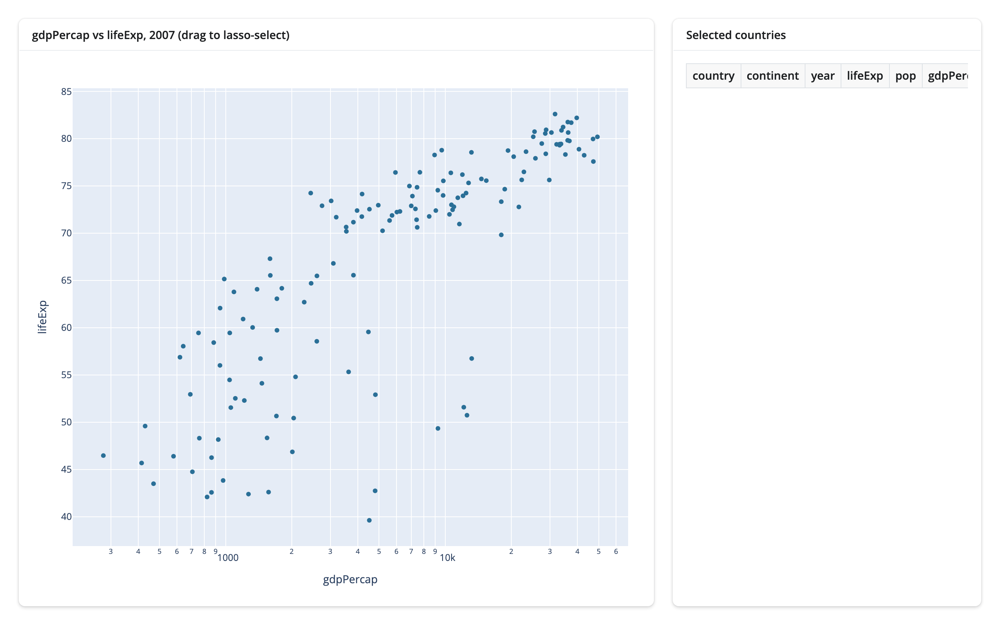
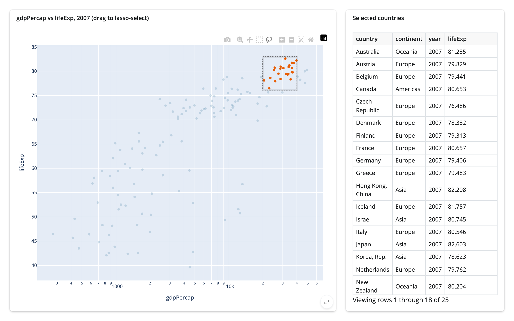
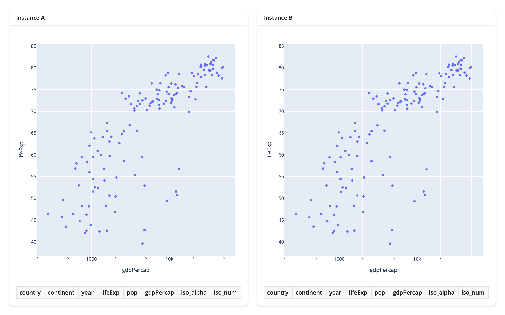
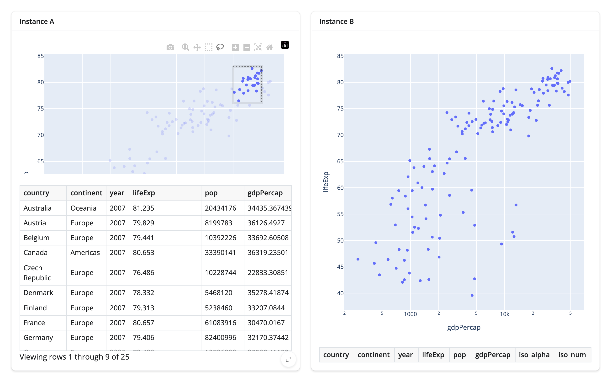
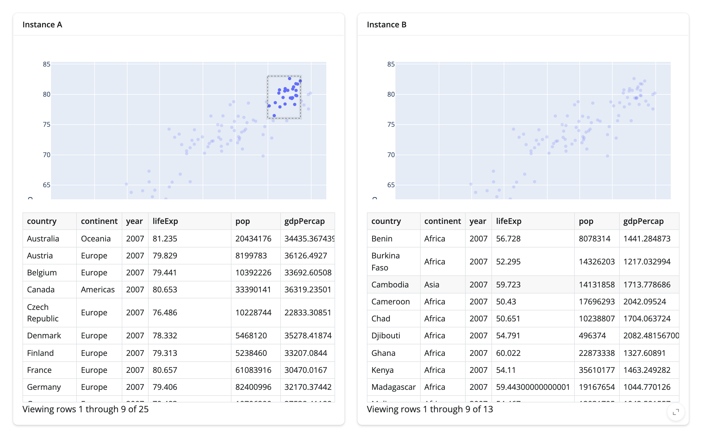
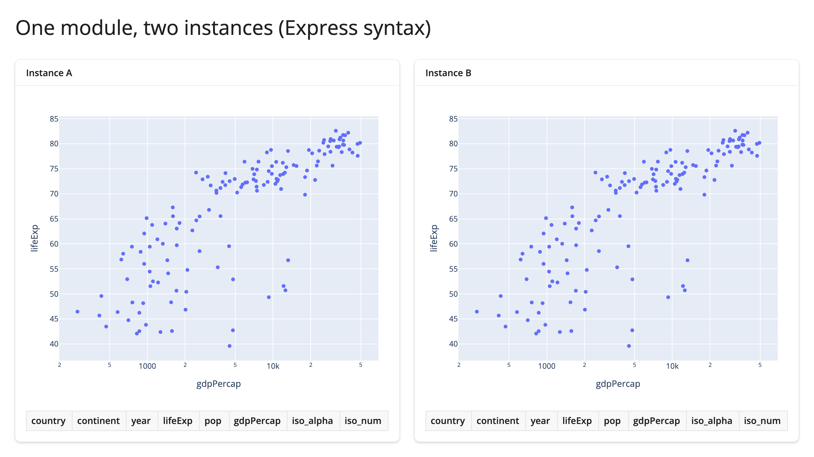

Every snippet elsewhere on this site is Shiny Express, because it's shorter to read and write. But shinywidgets
has no idea which syntax built the app around it: a `@render_plotly` output and its accessors (`.selected()`,
`.selected_rows()`, ...) work exactly the same way whether they're defined under Express's implicit top-level
UI or inside an explicit Shiny Core `server()` function -- and the same again inside a Shiny module. This page
covers both: the Core equivalent of [Your first widget app](../first-app/index.md), and what changes (nothing,
as it turns out) when that same app is instantiated twice as a module.

## Core: explicit UI, renderers inside `server()`

In Core, `output_widget("plot")` goes in `app_ui` instead of appearing wherever the render function is defined,
and every render function and accessor lives inside `server(input, output, session)`. The renderer itself --
`@render_plotly`, `.widget`, `.selected_rows(df)` -- is identical to the Express version:

```{.python file="examples/01_core_app.py"}
# Shiny Core equivalent of the "Your first widget app" walkthrough
# (../../first-app/article.md): render a plotly scatter, read the user's
# lasso selection with an accessor, and highlight the selection in place.
# Everything about shinywidgets is identical to Express -- only the app's
# own scaffolding (app_ui/server, output_widget() in the UI) changes.
import plotly.express as px
from shiny import App, Inputs, Outputs, Session, reactive, render, ui
from shinywidgets import output_widget, render_plotly

gapminder = px.data.gapminder()
df = gapminder[gapminder.year == 2007].reset_index(drop=True)

app_ui = ui.page_fillable(
    ui.layout_columns(
        ui.card(
            ui.card_header("gdpPercap vs lifeExp, 2007 (drag to lasso-select)"),
            output_widget("plot"),
            full_screen=True,
        ),
        ui.card(
            ui.card_header("Selected countries"),
            ui.output_data_frame("selected_table"),
        ),
        col_widths=[8, 4],
    ),
    title="shinywidgets in Shiny Core",
)


def server(input: Inputs, output: Outputs, session: Session):
    @render_plotly
    def plot():
        fig = px.scatter(
            df, x="gdpPercap", y="lifeExp", custom_data=[df.index], log_x=True
        )
        fig.update_layout(dragmode="lasso")
        return fig

    @render.data_frame
    def selected_table():
        return plot.selected_rows(df)

    # Highlighting in place, not re-rendering: the effect only mutates
    # `plot.widget`'s existing marker-color trait, so the SAME FigureWidget
    # keeps running in the browser. A zoom the user made before lassoing is
    # untouched, because nothing about the figure itself was rebuilt --
    # compare a render function that read `plot.selected_rows(df)` and
    # returned a brand new `px.scatter(...)`, which would reset the zoom on
    # every selection. No `reactive.isolate()` around the write below:
    # restyling `plot.widget` doesn't feed back into `selected_rows()`,
    # which only updates from the browser's own selection events -- see
    # "Writing back" in ../../updating-in-place/article.md#writing-back for
    # the pattern where isolate() IS required (an effect that reads and
    # writes the SAME reactive state).
    @reactive.effect
    def _highlight_selection():
        rows = plot.selected_rows(df)
        selected_idx = set(rows.index)
        colors = ["#e85d04" if i in selected_idx else "#2a6f97" for i in df.index]
        plot.widget.data[0].marker.color = colors


app = App(app_ui, server)
```

Before any selection, and after lassoing the cluster of high-income, high-life-expectancy countries:




Nothing about this is Core-specific -- `plot.selected_rows(df)` returns an empty frame until the user selects
(so it can feed `@render.data_frame` directly), and the marker-color write happens on the same `FigureWidget`
the browser already has, which is why a zoom made before the lasso survives it. See
[Updating in place](../updating-in-place/index.md#writing-back) for the general mechanism and the measured
bytes it saves over re-rendering.

## Modules: the same renderer, two independent instances

A Shiny module bundles a UI function and a server function behind one `id`, so the whole pair can be
instantiated more than once in the same app, each with its own namespaced inputs and outputs. Nothing about a
`@render_plotly` output (or any other renderer in this roster) needs to change to live inside one: the module
decorators handle namespacing the output's underlying id, and the renderer and its accessors work on whatever
namespaced output they end up attached to, same as ever.

```{.python file="examples/02_module_two_instances.py"}
# Two instances of one Shiny module, each rendering its own plotly scatter
# with its own selection table. The point of this example is namespacing:
# lassoing points in instance A must not affect instance B's accessor, and
# vice versa (see the article's "Modules" section for what was verified).
import plotly.express as px
from shiny import App, Inputs, Outputs, Session, module, render, ui
from shinywidgets import output_widget, render_plotly

gapminder = px.data.gapminder()
df = gapminder[gapminder.year == 2007].reset_index(drop=True)


@module.ui
def scatter_ui(label: str):
    return ui.card(
        ui.card_header(label),
        output_widget("plot"),
        ui.output_data_frame("selected_table"),
        full_screen=True,
    )


@module.server
def scatter_server(input: Inputs, output: Outputs, session: Session):
    @render_plotly
    def plot():
        fig = px.scatter(
            df, x="gdpPercap", y="lifeExp", custom_data=[df.index], log_x=True
        )
        fig.update_layout(dragmode="lasso")
        return fig

    @render.data_frame
    def selected_table():
        return plot.selected_rows(df)


app_ui = ui.page_fillable(
    ui.layout_columns(
        scatter_ui("a", "Instance A"),
        scatter_ui("b", "Instance B"),
    ),
    title="One module, two instances",
)


def server(input: Inputs, output: Outputs, session: Session):
    scatter_server("a")
    scatter_server("b")


app = App(app_ui, server)
```

Both instances load identically (the id passed to `scatter_ui()`/`scatter_server()` becomes the DOM id prefix,
e.g. `a-plot` and `b-plot` -- open the page source if you want to see it):



### Namespacing, verified with real gestures

The question a module raises that a single instance doesn't: does `plot.selected_rows(df)` in instance A's
server function ever see instance B's selection, or vice versa? It shouldn't -- each call to `scatter_server()`
gets its own module session, so `plot` in A and `plot` in B are two separate renderer objects with two separate
accessor states -- but "shouldn't" is a claim worth driving, not assuming.

Lassoing only instance A's cluster populates A's table (25 rows) and leaves B's completely empty:



Lassoing a *different* region in instance B (a cluster of lower-income African countries, picked to be
visibly distinct from A's selection) then populates B's table (13 rows) without touching A's, which still
shows its own 25 selected rows:



**No accessor leak across module instances.** Each instance's `plot.selected_rows(df)` reported only the
gestures made in that instance's own plot, in both directions, across both module construction styles tested on
this page (`module.ui`/`module.server`, and the Express `@module` below). This isn't a surprising result --
module namespacing is a long-standing Shiny Core feature, and shinywidgets' renderer objects don't share any
global state across sessions or module scopes -- but it's the one thing specific to combining modules with
shinywidgets that this page set out to confirm.

## Express modules

Shiny Express has its own module syntax, `@module` from `shiny.express`, built on the same namespacing as
`module.ui`/`module.server` underneath (`@expressify` plus a session scoped to the given `id`). It works with
shinywidgets with no changes at all -- the renderer and its accessors don't know or care that they were
constructed inside a module-scoped session instead of the top-level one:

```{.python file="examples/03_express_module.py"}
# The same two-instance module as 02_module_two_instances.py, but written
# with Shiny Express's module syntax (`@module`, from `shiny.express`)
# instead of the `@module.ui`/`@module.server` pair. Express modules work
# with shinywidgets with no changes: `@render_plotly` and its accessors
# behave identically inside an `@module`-decorated function.
import plotly.express as px
from shiny.express import module, render, ui
from shinywidgets import render_plotly

gapminder = px.data.gapminder()
df = gapminder[gapminder.year == 2007].reset_index(drop=True)


@module
def scatter(input, output, session, label: str):
    with ui.card(full_screen=True):
        ui.card_header(label)

        @render_plotly
        def plot():
            fig = px.scatter(
                df, x="gdpPercap", y="lifeExp", custom_data=[df.index], log_x=True
            )
            fig.update_layout(dragmode="lasso")
            return fig

        @render.data_frame
        def selected_table():
            return plot.selected_rows(df)


ui.page_opts(title="One module, two instances (Express syntax)", fillable=True)

with ui.layout_columns():
    scatter("a", "Instance A")
    scatter("b", "Instance B")
```



Re-running the same lasso-instance-A-only check against this version gave the same result: instance A's table
filled to 25 rows and instance B's stayed at 0. If you're deciding between the two module styles for reasons
unrelated to shinywidgets (Core's explicit `module.ui`/`module.server` pair vs. Express's single `@module`
function), that choice carries over here unchanged.

## Where to go next

- [Your first widget app](../first-app/index.md) builds the same render -> react -> update-in-place app from
  nothing, in Express, with the full walkthrough of each step.
- [Updating in place](../updating-in-place/index.md) covers the general in-place-vs-re-render mechanism this
  page's Core example uses, including the measured bytes it saves and the `reactive.isolate()` self-trigger
  loop it actually guards against.
- [Reacting to widgets](../reacting-to-widgets/index.md) is the full accessor mental model (what `None`
  means, re-firing and clearing, rate limiting) -- identical whether the output lives in Express, Core, or a
  module.
- Shiny's own [module documentation](https://shiny.posit.co/py/docs/modules.html) for everything about modules
  that isn't specific to shinywidgets: passing arguments beyond an id, nesting modules, and namespacing inputs.
