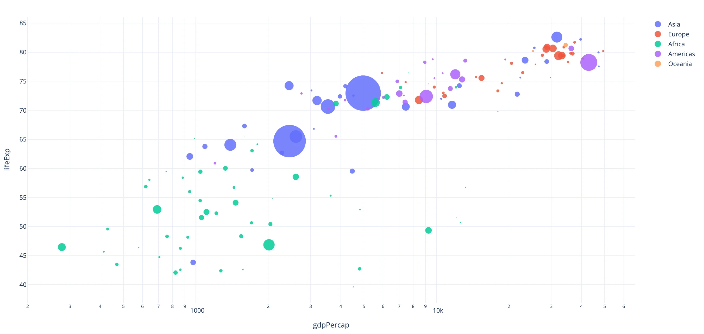
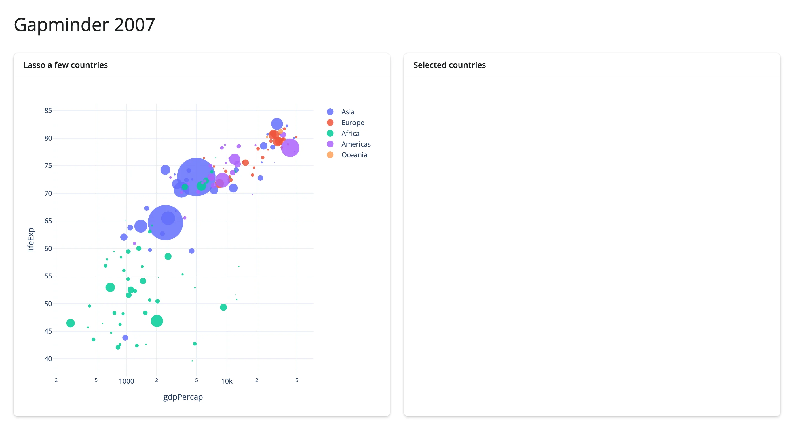
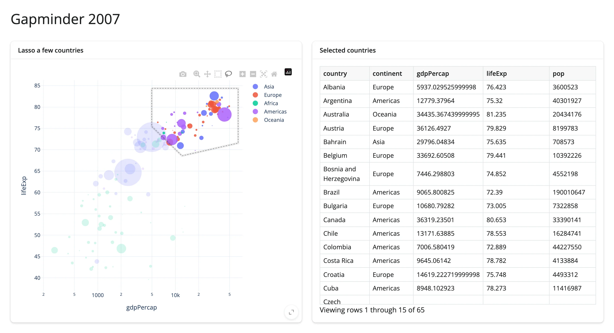
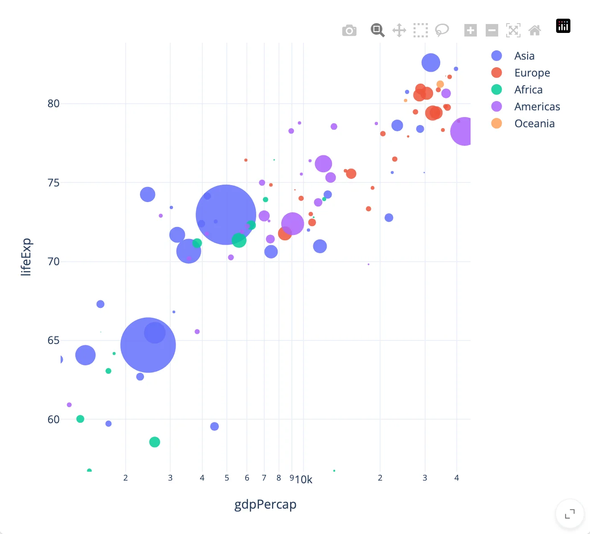
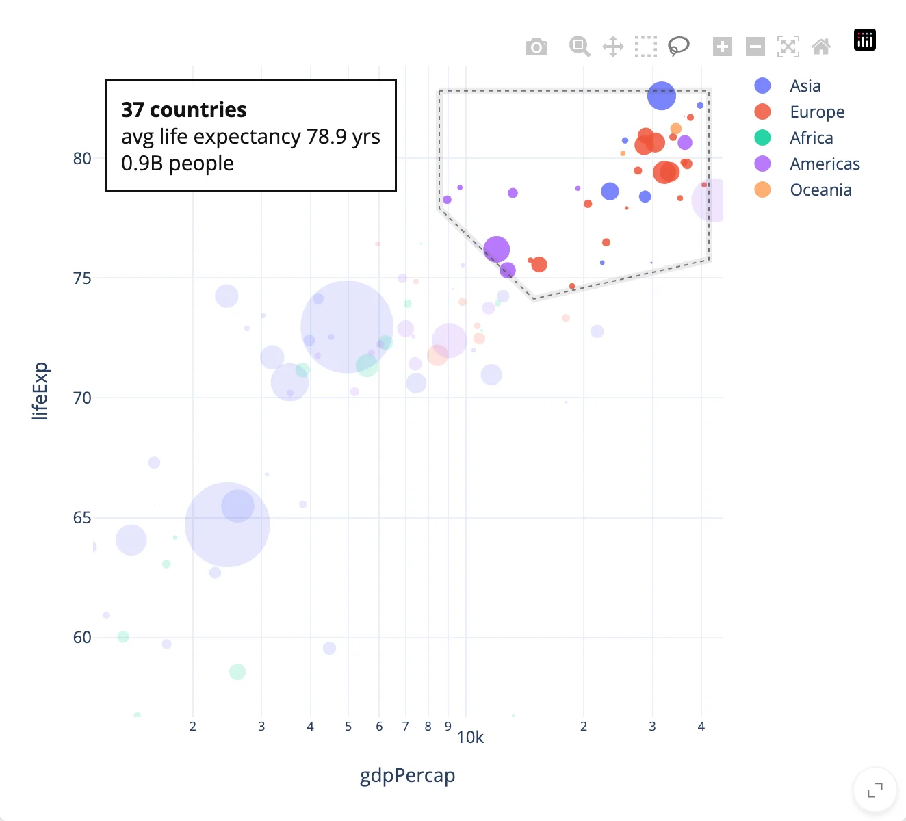

This builds one small app in three steps: render a chart, react to what the user selects, then update the chart
in place. Each step is a complete, runnable app that adds one idea to the previous one. All three use the same
data: `plotly.express.data.gapminder()`, filtered to the year 2007 (141 countries' GDP per capita and life
expectancy -- it ships with plotly, no download needed).

To follow along, install shinywidgets with plotly (`pip install 'shinywidgets[plotly]'`), save an example as
`app.py`, and run it with `shiny run app.py`.

## 1. Render a widget

In a Shiny app, a function with a render decorator is an *output*: Shiny calls it and shows what it returns,
where the function appears in the file. `@render_plotly` is one of those, for a function that returns a plotly
figure. (`ui.page_opts()` sets the page title, and `fillable=True` lets the chart fill the window.) Setting
`dragmode="lasso"` makes the lasso tool active by default (without it, the user would have to pick it from
the plot's modebar first), and `custom_data=[df.index]` tags every point with its row in `df`, which the next
step needs to turn a selection back into rows of data:

```{.python file="examples/01_render.py"}
import plotly.express as px
from shiny.express import ui
from shinywidgets import render_plotly

df = px.data.gapminder().query("year == 2007").reset_index(drop=True)

ui.page_opts(title="Gapminder 2007", fillable=True)


@render_plotly
def plot():
    fig = px.scatter(
        df,
        x="gdpPercap",
        y="lifeExp",
        size="pop",
        color="continent",
        size_max=48,
        hover_name="country",
        custom_data=[df.index],
        log_x=True,
        template="plotly_white",
    )
    fig.update_traces(marker=dict(opacity=0.85, line=dict(width=0)))
    fig.update_layout(dragmode="lasso", legend_title_text="")
    return fig
```



That's a complete app: one bubble per country, sized by population and colored by continent. Nothing reads
the user's interaction yet -- that's the next step.

## 2. React to the user

`plot.selected_rows(df)` is a reactive accessor: it returns the rows of `df` whose points are inside the most
recent lasso, matched up via the `custom_data` set in step 1. A second output, `@render.data_frame`, calls it,
and because it does, Shiny reruns it every time the selection changes. The accessor returns an empty data frame
until the user selects something, so `req(not rows.empty)` holds the table back until there's a real selection
to show. The `with ui.layout_columns()` and `with ui.card()` blocks arrange the page: outputs inside a `with`
block go inside that column or card.

```{.python file="examples/02_react.py"}
import plotly.express as px
from shiny import req
from shiny.express import render, ui
from shinywidgets import render_plotly

df = px.data.gapminder().query("year == 2007").reset_index(drop=True)

ui.page_opts(title="Gapminder 2007", fillable=True)

with ui.layout_columns():
    with ui.card(full_screen=True):
        ui.card_header("Lasso a few countries")

        @render_plotly
        def plot():
            fig = px.scatter(
                df,
                x="gdpPercap",
                y="lifeExp",
                size="pop",
                color="continent",
                size_max=48,
                hover_name="country",
                custom_data=[df.index],
                log_x=True,
                template="plotly_white",
            )
            fig.update_traces(marker=dict(opacity=0.85, line=dict(width=0)))
            fig.update_layout(dragmode="lasso", legend_title_text="")
            return fig

    with ui.card(full_screen=True):
        ui.card_header("Selected countries")

        @render.data_frame
        def selected_countries():
            rows = plot.selected_rows(df)
            req(not rows.empty)
            return rows[["country", "continent", "gdpPercap", "lifeExp", "pop"]]
```

Before any selection, the table card is empty. Lasso the rich, high-life-expectancy cluster in the
upper-right and it fills in:




`plot.selected_rows()` is one of eleven accessors on `@render_plotly` -- `clicked()`, `hover()`, `relayout()`
(pan/zoom), and more. [Reacting to widgets](../reacting-to-widgets/index.md) covers what they all have in
common: what they return before the first interaction, what survives a re-render, and how to rate-limit a
noisy one.

## 3. Update it in place

Nothing so far changes the plot itself from Python. This step adds a `@reactive.effect`, which reruns like an
output when what it reads changes, but displays nothing; it's for side effects. This one writes a
summary of the lassoed countries onto the existing figure, as an annotation -- `plot.widget` is the live
`FigureWidget`, and setting `plot.widget.layout.annotations` pushes the change to the browser without
rebuilding the chart:

```{.python file="examples/03_update.py"}
import plotly.express as px
from shiny import reactive, req
from shiny.express import render, ui
from shinywidgets import render_plotly

df = px.data.gapminder().query("year == 2007").reset_index(drop=True)

ui.page_opts(title="Gapminder 2007", fillable=True)

with ui.layout_columns():
    with ui.card(full_screen=True):
        ui.card_header("Lasso a few countries")

        @render_plotly
        def plot():
            fig = px.scatter(
                df,
                x="gdpPercap",
                y="lifeExp",
                size="pop",
                color="continent",
                size_max=48,
                hover_name="country",
                custom_data=[df.index],
                log_x=True,
                template="plotly_white",
            )
            fig.update_traces(marker=dict(opacity=0.85, line=dict(width=0)))
            fig.update_layout(dragmode="lasso", legend_title_text="")
            return fig

    with ui.card(full_screen=True):
        ui.card_header("Selected countries")

        @render.data_frame
        def selected_countries():
            rows = plot.selected_rows(df)
            req(not rows.empty)
            return rows[["country", "continent", "gdpPercap", "lifeExp", "pop"]]


# Summarize the lassoed countries directly on the existing figure, as an
# annotation, without rebuilding the plot: a re-render would clear the lasso
# itself and reset any zoom the user made first. No `reactive.isolate()`
# around the write below: restyling `plot.widget` doesn't feed back into
# `selected_rows()`, which only updates from the browser's own selection
# events. See "Writing back" in the Updating in place guide for the pattern
# where isolate() IS required (an effect that reads and writes the SAME reactive
# state).
@reactive.effect
def _summarize():
    rows = plot.selected_rows(df)
    note = (
        f"<b>{len(rows)} countries</b><br>"
        f"avg life expectancy {rows.lifeExp.mean():.1f} yrs<br>"
        f"{rows['pop'].sum() / 1e9:.1f}B people"
        if len(rows)
        else ""
    )
    plot.widget.layout.annotations = [
        dict(
            text=note,
            xref="paper", yref="paper", x=0.02, y=0.98,
            xanchor="left", yanchor="top", align="left",
            showarrow=False, font=dict(size=15, color="#111"),
            bgcolor="rgba(255,255,255,0.92)", bordercolor="#111",
            borderwidth=1.5, borderpad=10,
        )
    ] if note else []
```

Even though `color="continent"` now splits the figure into one trace per continent, `plot.selected_rows(df)`
still works: it matches each selected point back to a row of `df` by the `custom_data=[df.index]` value
carried on that point, not by which trace it came from.

Zoomed in with the plot's modebar, then lassoed again -- the zoom is still in place, because the effect only
sets `plot.widget.layout.annotations`; the render function that built the figure (and would reset the zoom
if it re-ran) never executes again:




Compare this to what re-rendering would do: reading `input.something()` directly in `plot`'s render function
would rebuild the whole figure on every change, resetting the zoom and clearing the lasso along with it.
[Updating in place](../updating-in-place/index.md) covers this trade-off for every widget in the roster,
including the cases where re-rendering is actually fine.

## Where to go next

- [Choosing a widget](../choosing-a-widget/index.md) -- which library fits your data, if it isn't plotly.
- [Reacting to widgets](../reacting-to-widgets/index.md) -- the full accessor model.
- [Updating in place](../updating-in-place/index.md) -- `.widget`, `reactive.isolate()`, and the three
  widget lifetimes.
- [Troubleshooting](../troubleshooting/index.md) -- what to check if a widget doesn't show up.
- The [plotly guide](../../widgets/plotly/index.md) -- every accessor `@render_plotly` has, and more linked-view
  patterns than this walkthrough needs.
