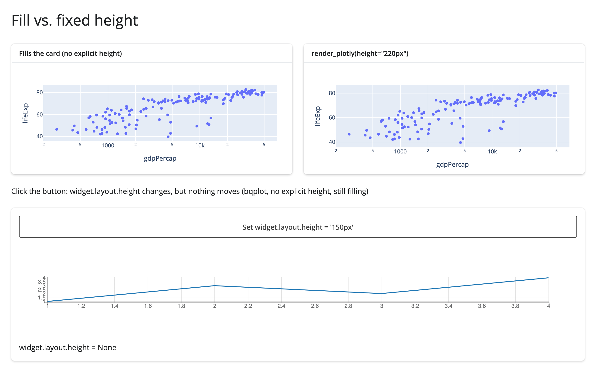
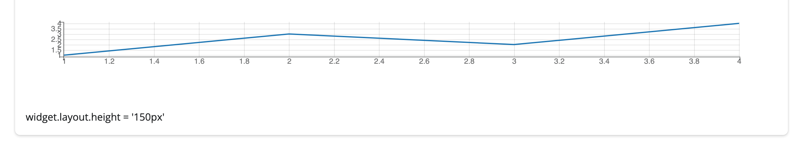
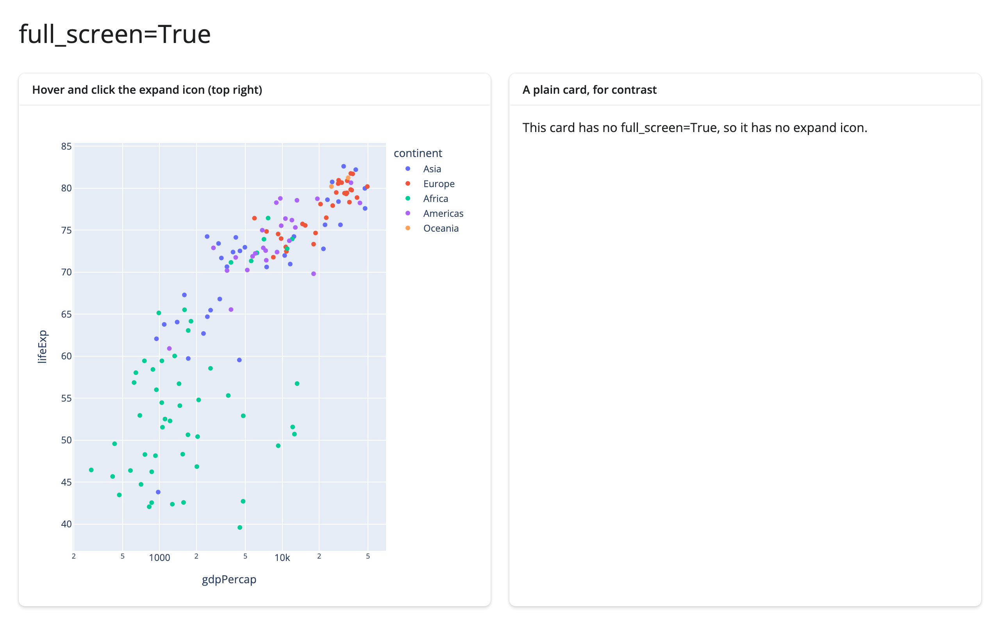
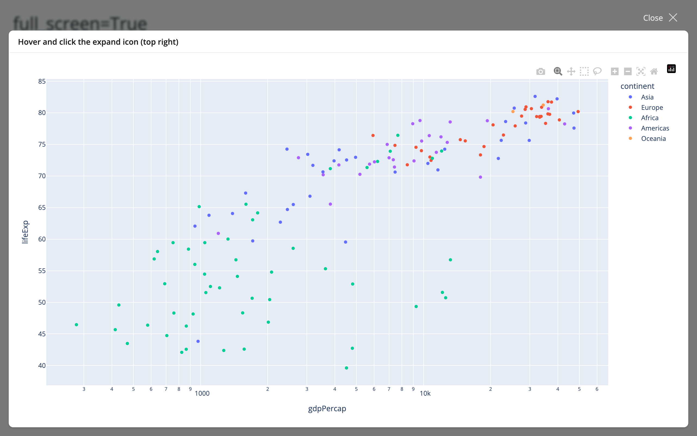
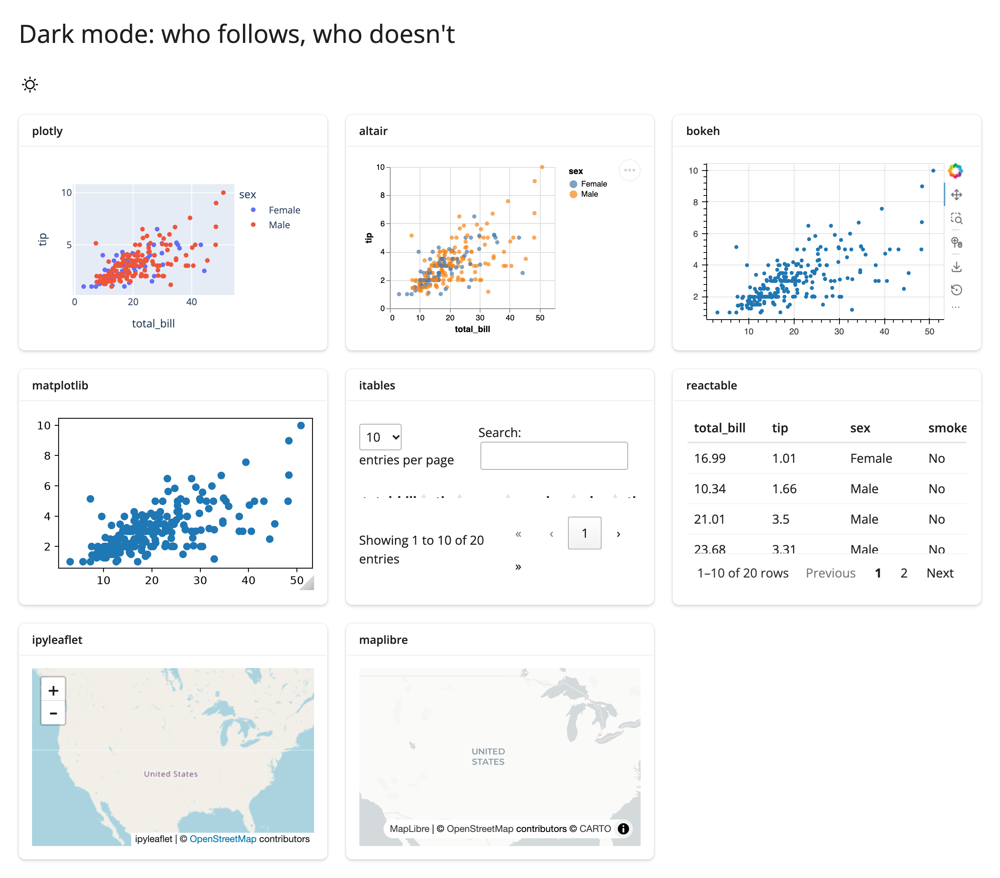
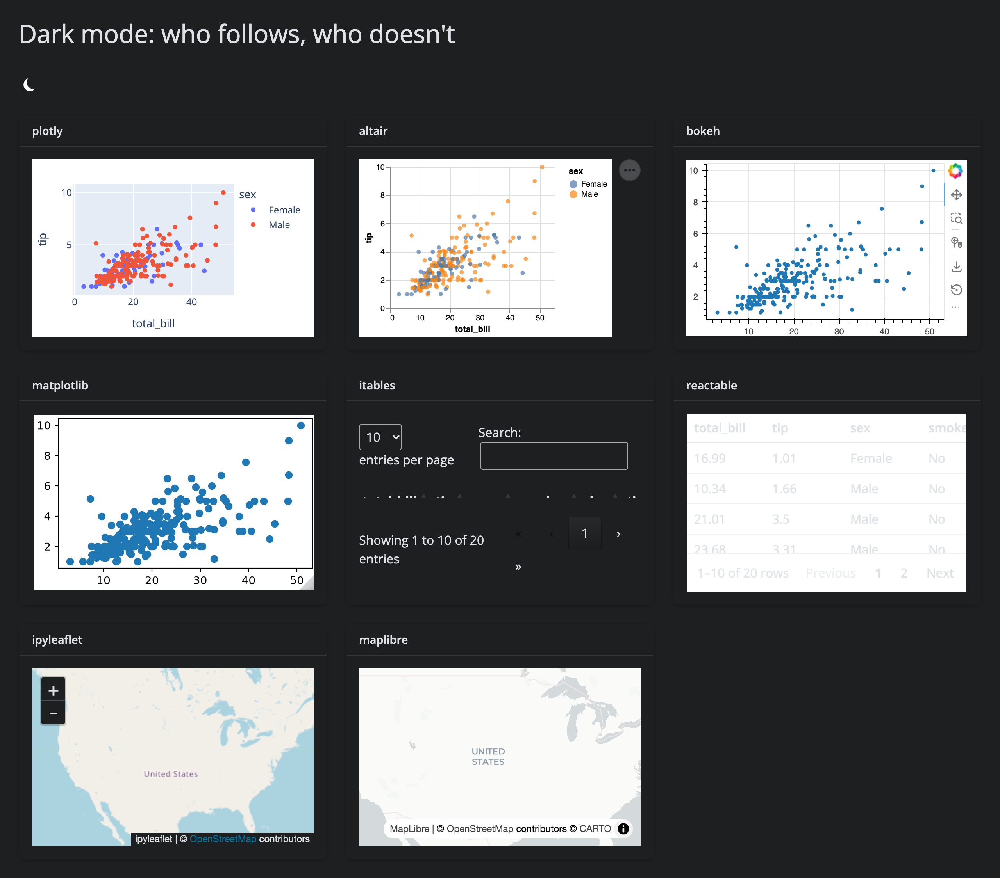
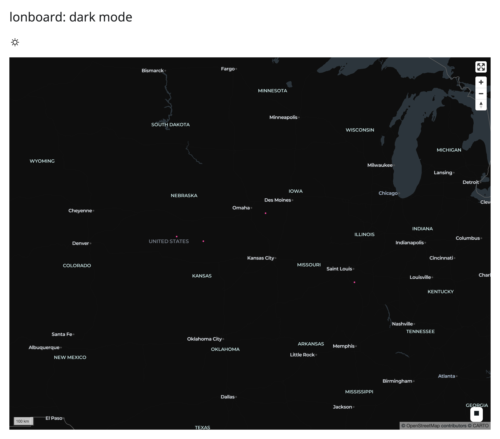
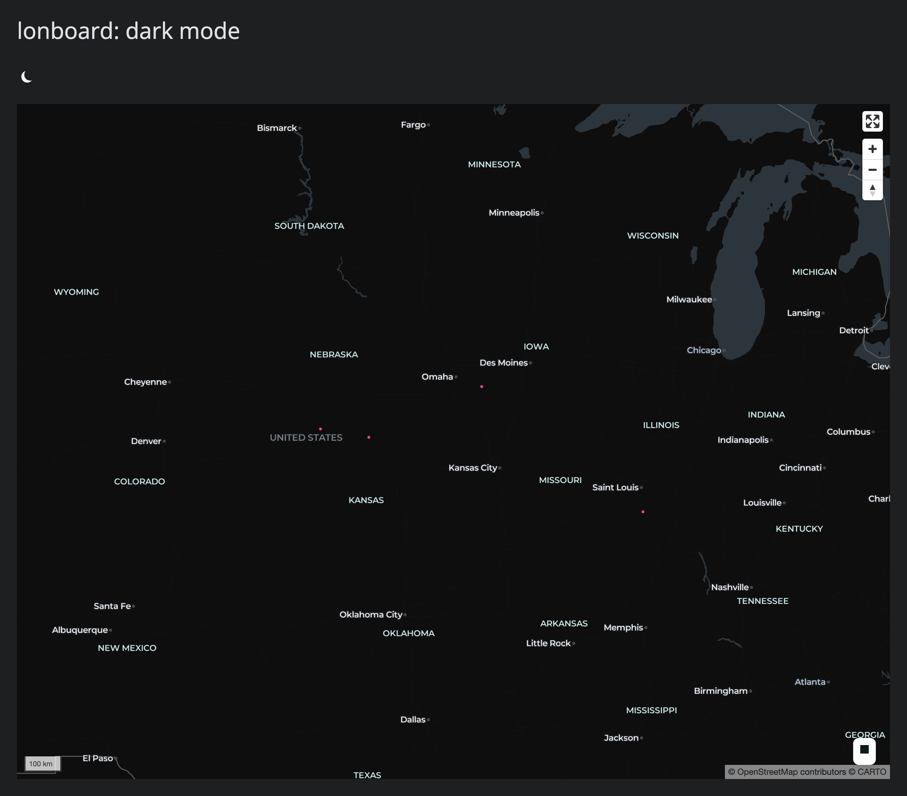

Every `@render_*` decorator in shinywidgets runs the same widget through one generic layout pass,
`set_layout_defaults()` (in `shinywidgets/_render_widget_base.py`), before it reaches the browser. That
function is why every guide's "Layout and sizing" section tells a similar story -- "fills its card unless you
give it a height" -- no matter which library the page is about: the fill logic lives in one place, and most
widgets only layer a small, package-specific adjustment on top of it (how to tell their own default height
apart from a real one). This page states the shared story once, generalized from reading every guide's
"Layout and sizing" section; go to a specific guide's own section for that widget's exceptions and numbers.

Dark mode and theming are the other half of this page. There's no shinywidgets-wide dark mode feature --
`ui.input_dark_mode()` is a plain Shiny input, and each widget decides for itself whether it listens to the
page's theme. The table near the end says exactly which of nine widgets do, built only from screenshots that
were actually looked at (not from assumptions about what "should" happen).

## Fill is the default

With no explicit height, a widget output fills its container: a `ui.card()` under
`ui.page_opts(fillable=True)`, a sidebar, a column. Giving the output (or the widget itself) an explicit height
opts it out, and it renders at that fixed size instead.

```{.python file="examples/01_fill_vs_fixed.py"}
from __future__ import annotations

import bqplot
import plotly.express as px
from shiny import reactive, req
from shiny.express import input, render, ui
from shinywidgets import reactive_read, render_bqplot, render_plotly

df = px.data.gapminder().query("year == 2007")

ui.page_opts(title="Fill vs. fixed height", fillable=True)

with ui.layout_columns():
    with ui.card(full_screen=True):
        ui.card_header("Fills the card (no explicit height)")

        @render_plotly
        def fills():
            return px.scatter(df, x="gdpPercap", y="lifeExp", log_x=True)

    with ui.card():
        ui.card_header('render_plotly(height="220px")')

        @render_plotly(height="220px")
        def fixed():
            return px.scatter(df, x="gdpPercap", y="lifeExp", log_x=True)


ui.card_header(
    "Click the button: widget.layout.height changes, but nothing moves "
    "(bqplot, no explicit height, still filling)"
)
with ui.card():
    ui.input_action_button("resize", "Set widget.layout.height = '150px'")

    @render_bqplot
    def line():
        x_sc, y_sc = bqplot.LinearScale(), bqplot.LinearScale()
        mark = bqplot.Lines(x=[1, 2, 3, 4], y=[1, 3, 2, 4], scales={"x": x_sc, "y": y_sc})
        return bqplot.Figure(
            marks=[mark],
            axes=[bqplot.Axis(scale=x_sc), bqplot.Axis(scale=y_sc, orientation="vertical")],
        )

    @render.text
    def height_trait():
        widget = line.widget
        req(widget)
        return f"widget.layout.height = {reactive_read(widget.layout, 'height')!r}"

    @reactive.effect
    @reactive.event(input.resize)
    def _set_height():
        with reactive.isolate():
            widget = line.widget
        if widget is not None:
            # A plain ipywidgets.Layout(height=...) set after the figure is
            # already on screen and filling: the trait changes (height_trait()
            # above re-renders to show it), but the figure's size doesn't,
            # because filling is CSS (flex: 1 1 auto) applied once at render
            # time -- set_layout_defaults() only reads layout.height to decide
            # the *initial* fill flag, not on every later change.
            widget.layout.height = "150px"
```



The two plotly cards above show the two ends of the same mechanism: the left card has no height anywhere, so
the figure fills its card and tracks resizes; the right card's `render_plotly(height="220px")` gives the
*output* an explicit height, which steps the widget out of filling. Three equivalent ways to give a widget an
explicit height, across the whole roster:

- The decorator or `output_widget()`'s own `height=` (as above) -- sizes the *output container*.
- The widget's own constructor height, when the library has one (`Scatter(height=300)`, `k3d.plot(height=250)`,
  Reactable's `height=` prop, ...).
- A plain `ipywidgets.Layout(height=...)` assigned to `.layout` -- the generic path `set_layout_defaults()`
  reads directly: "if the ipywidget `Layout()` height is set to something other than `'auto'`, then don't do
  filling layout."

Any of the three flips the per-render `fill` flag to `False`, and the widget renders at its own (or the
output's) size instead of stretching to the container.

**A library's own default height often can't be told apart from a real one, so most guides treat it as
"unset."** lonboard (500px), maplibre and rerun (400/640px), k3d (512px), jscatter (240px), keplergl (400px),
ipysigma (500px), ipyaladin (400px), and several others always set a concrete height trait rather than leaving
it unset the way plain ipywidgets does. Each has a small package-specific handler in shinywidgets that treats
exactly that one value as "the user didn't ask for a height" (so the widget still fills) and any other value as
a real request to opt out. This is a deliberate, documented tradeoff, not a bug -- but it does mean a height
that happens to equal the library's default is indistinguishable from no height at all; if you want a genuinely
fixed size at that exact number, ask for a slightly different one (jscatter's guide gives this exact example:
ask for `height=241`, not `240`, for a truly fixed 240-ish-pixel plot). See the widget's own guide for its
specific default value and number.

## The gotcha: `widget.layout.height` after render has no effect while filling

The bqplot card in the example above is the interesting one. Click the button and the caption below the figure
updates from `widget.layout.height = None` to `widget.layout.height = '150px'` -- the trait really did change.
The figure's size does not move at all:

| Before clicking | After clicking |
|---|---|
|  |  |

This is the one layout behavior that isn't obvious from reading a guide's "Layout and sizing" section, because
it isn't about any one widget: `set_layout_defaults()` reads `.layout.height` exactly once, at render time, to
decide the `fill` flag it sends to the browser for *that render*. Filling itself is plain CSS (`flex: 1 1 auto`
on the widget's direct child element), applied once the payload reaches the browser. Changing `.layout.height`
from a `@reactive.effect` afterwards updates the ipywidgets trait -- any code reading it with `reactive_read()`
sees the new value, as `height_trait()` does above -- but there's no later CSS pass that goes back and reads it
again. If you want a widget's size to actually change in place, resize its *container* (the card, the
`output_widget()`), not the widget's own `.layout.height`; or re-render it, which runs
`set_layout_defaults()` fresh and picks the new height up as a real opt-out.

## `full_screen=True`

`ui.card(full_screen=True)` adds an expand icon that opens the card to fill the browser window; the widget
inside resizes to match, exactly the same way it resizes to any other container.

```{.python file="examples/02_full_screen.py"}
from __future__ import annotations

import plotly.express as px
from shiny.express import ui
from shinywidgets import render_plotly

df = px.data.gapminder().query("year == 2007")

ui.page_opts(title="full_screen=True", fillable=True)

with ui.layout_columns():
    with ui.card(full_screen=True):
        ui.card_header("Hover and click the expand icon (top right)")

        @render_plotly
        def scatter():
            return px.scatter(
                df, x="gdpPercap", y="lifeExp", color="continent", log_x=True
            )

    with ui.card():
        ui.card_header("A plain card, for contrast")
        "This card has no full_screen=True, so it has no expand icon."
```

| Before (card-sized) | After clicking the expand icon |
|---|---|
|  |  |

Nothing about the gesture is shinywidgets-specific -- bslib fires a resize event when the card expands or
collapses, and the widget's own resize handling (the same mechanism that handles a window resize or a sidebar
collapse) picks it up. Every renderer in the roster handles this the same way; a handful of guides call out a
widget-specific wrinkle worth knowing (e.g. ipycytoscape doesn't re-run its own graph layout on a resize, so a
big jump can leave part of the graph outside the visible area) -- see that widget's own "Layout and sizing"
section.

## Dark mode and theming

`ui.input_dark_mode()` is a plain Shiny input: it flips `data-bs-theme` on `<html>` and lets Bootstrap's CSS
variables (`--bs-body-bg`, `--bs-body-color`, ...) cascade to anything that reads them. shinywidgets patches
exactly two widgets' own CSS variables onto those Bootstrap variables -- bqplot and itables -- plus the
chrome (not the imagery) of ipyleaflet maps. Every other widget draws its own colors (an SVG/canvas figure, a
WebGL map style, a React/DataTables theme prop) with no connection to the page's theme at all, and only
follows dark mode if your app code explicitly re-themes it.

```{.python file="examples/03_dark_mode.py"}
from __future__ import annotations

import altair as alt
import ipyleaflet as L
import plotly.express as px
from bokeh.plotting import figure
from itables.widget import ITable
from maplibre import Map as MaplibreMap
from maplibre import MapOptions
from maplibre.basemaps import Carto
from matplotlib.figure import Figure
from reactable import Reactable
from shiny.express import ui
from shinywidgets import (
    render_altair,
    render_bokeh,
    render_ipyleaflet,
    render_itables,
    render_maplibre,
    render_matplotlib,
    render_plotly,
    render_reactable,
)

cars = px.data.tips()

ui.page_opts(title="Dark mode: who follows, who doesn't", fillable=True)
ui.input_dark_mode(id="mode")

# lonboard is covered separately, in 04_dark_mode_lonboard.py: on the same
# page as maplibre it fails to render at all (see NOTES.md -- the two
# widgets' bundled copies of deck.gl collide: "deck.gl - multiple versions
# detected"), unrelated to dark mode.
with ui.layout_columns(col_widths=[4, 4, 4]):
    with ui.card():
        ui.card_header("plotly")

        @render_plotly
        def plot_plotly():
            return px.scatter(cars, x="total_bill", y="tip", color="sex")

    with ui.card():
        ui.card_header("altair")

        @render_altair
        def plot_altair():
            return (
                alt.Chart(cars)
                .mark_circle()
                .encode(x="total_bill:Q", y="tip:Q", color="sex:N")
            )

    with ui.card():
        ui.card_header("bokeh")

        @render_bokeh
        def plot_bokeh():
            p = figure(sizing_mode="stretch_both")
            p.scatter(cars["total_bill"], cars["tip"])
            return p

    with ui.card():
        ui.card_header("matplotlib")

        @render_matplotlib
        def plot_matplotlib():
            fig = Figure(layout="constrained")
            ax = fig.subplots()
            ax.scatter(cars["total_bill"], cars["tip"])
            return fig

    with ui.card():
        ui.card_header("itables")

        @render_itables
        def tbl_itables():
            return ITable(cars.head(20))

    with ui.card():
        ui.card_header("reactable")

        @render_reactable
        def tbl_reactable():
            return Reactable(cars.head(20))

    with ui.card():
        ui.card_header("ipyleaflet")

        @render_ipyleaflet
        def map_ipyleaflet():
            return L.Map(center=(39.8, -98.5), zoom=3)

    with ui.card():
        ui.card_header("maplibre")

        @render_maplibre
        def map_maplibre():
            return MaplibreMap(
                MapOptions(style=Carto.POSITRON, center=(-98.5, 39.8), zoom=2.5)
            )
```

Every widget above is rendered with its plain, default code -- nothing in this file tries to theme anything.
Click the real `ui.input_dark_mode()` toggle and compare:

| Light | Dark |
|---|---|
|  |  |

| Widget | Follows `input_dark_mode()`? | What the screenshots show |
|---|---|---|
| plotly | No | Plot background and template are unchanged. |
| altair | No | Chart background and text colors are unchanged. |
| bokeh | No | Figure background and glyph colors are unchanged; only the card around it goes dark. |
| matplotlib | No | A default `Figure()` stays a white canvas in both modes. |
| itables | **Yes** | Header, body, footer, and the search box switch to DataTables' dark palette. |
| reactable | No -- and a low-contrast trap | The table's background stays hard-coded white, but its text switches to Bootstrap's dark-mode font color (light gray) -- the result is *harder* to read than either theme on its own ([#460](https://github.com/posit-dev/py-shinywidgets/issues/460)). |
| ipyleaflet | Partial | The zoom control and attribution strip go dark; the OpenStreetMap tile imagery itself doesn't (it's a raster image from the tile server, not page CSS). |
| maplibre | No | Basemap style and colors are unchanged. |
| lonboard | No | Verified in its own page (below); scatter layer and basemap are unchanged. |

itables follows because shinywidgets ships a CSS rule mapping `:root[data-bs-theme=dark] .itables_anywidget`
onto DataTables' own dark-palette variables (DataTables only switches itself on a `.dark`/`data-theme` marker
class, not Bootstrap's `data-bs-theme`). bqplot (not pictured above, but in the same position) follows the same
way, through a similar CSS variable patch. Both are a `shinywidgets`-side fix, not something the library does
on its own.

**If you want a widget that doesn't follow automatically to match the toggle anyway**, read `input.<id>()` in a
`@reactive.effect` and re-theme the figure in place (update `.widget` rather than re-rendering, so you don't
lose the user's zoom/selection along the way -- re-rendering is simpler to write but resets both). The
matplotlib guide's "Figures can match bslib's light/dark theme" example (in
[What you can build](../../widgets/matplotlib/index.md#what-you-can-build)) and the perspective guide's theme-sync
effect (in [Updating the widget from Python](../../widgets/perspective/index.md#updating-the-widget-from-python)) both
show this pattern end to end; this page doesn't repeat the code.

### lonboard, on its own page

```{.python file="examples/04_dark_mode_lonboard.py"}
from __future__ import annotations

import geopandas as gpd
import lonboard
import pandas as pd
from shiny.express import ui
from shinywidgets import render_lonboard

# Kept separate from 03_dark_mode.py: rendering a lonboard map on the same
# page as a maplibre map crashes lonboard's view (see NOTES.md -- the two
# widgets load conflicting bundled copies of deck.gl), unrelated to dark
# mode. This file isolates lonboard to get a clean dark-mode screenshot.
ui.page_opts(title="lonboard: dark mode", fillable=True)
ui.input_dark_mode(id="mode")

points = pd.DataFrame({"lon": [-98.5, -100, -95, -90], "lat": [39.8, 40, 41, 38]})
cities = gpd.GeoDataFrame(
    points, geometry=gpd.points_from_xy(points.lon, points.lat), crs="EPSG:4326"
)


@render_lonboard
def map_lonboard():
    return lonboard.viz(cities)
```

| Light | Dark |
|---|---|
|  |  |

`lonboard.viz()` draws no basemap at all unless you pass one explicitly, so the canvas is already black; the
toggle changes nothing in either screenshot beyond the page chrome around it.

## Gotchas and limitations

- **A widget's own default height can masquerade as "unset."** See "Fill is the default" above -- if a fixed
  size doesn't seem to take effect, check whether the number you chose happens to match the library's own
  default.
- **`widget.layout.height` doesn't resize an already-filling widget.** Resize the container, or re-render.
- **reactable in dark mode is lower-contrast than in light mode**, not merely unchanged -- see the table above
  and [#460](https://github.com/posit-dev/py-shinywidgets/issues/460).
- **Rendering a lonboard map and a maplibre map on the same page breaks the lonboard map** (a `deck.gl -
  multiple versions detected` error from lonboard's own anywidget bundle). Verified on current `main`; not
  specific to dark mode. See `NOTES.md` for the repro and `FINDINGS.md`.

## Where to go next

- [Any widget](../any-widget/index.md#layout-and-sizing) covers the one layout rule generic
  `render_widget` adds on top of this page: plain `@jupyter-widgets/controls` widgets (sliders, checkboxes, ...)
  never fill, regardless of layout.
- Each widget's own guide has a "Layout and sizing" section with that widget's specific numbers and defaults --
  this page only states the shared mechanism.
- [Updating in place](../updating-in-place/index.md) covers `.widget` mutation and `reactive.isolate()` in
  general, the same tool the dark-mode-sync pattern above depends on.
- [Large data & performance](../performance/index.md) covers what a re-render vs. an in-place update costs in
  bytes, relevant if you're theme-switching a widget with a lot of data in it.
