A single widget answers one question at a time. Most real dashboards need two or three
views of the same data talking to each other: lasso a cluster in a scatter plot and see
those rows in a table; click a map feature and see its detail; pan the map and watch a
chart update to describe only what's on screen. [Reacting to widgets](../reacting-to-widgets/index.md)
covers the mechanism one accessor at a time -- what a value returns, when it fires, how
to rate-limit it, how to write back without looping. This article is the next layer up:
**shapes of apps**, built out of those accessors, that recur across almost every pairing
of widgets in the roster.

Each pattern below gets: when you'd reach for it, the one-paragraph idea, and 2-3 short
verified examples using different widget combinations, so you can see the shape
generalize rather than memorize one library's syntax. Every pattern includes at least
one example that crosses a library boundary -- a map driving a plot, a scatter plot
driving a table, two unrelated libraries pointed at the same selection -- because that's
where accessors earn their keep: gluing together widgets that have never heard of each
other.

Thirteen of the twenty examples below are reused verbatim from already-verified
per-widget guides; one (the maplibre viewport example) is adapted from its guide to use
`.read()` instead of `reactive_read()` directly, per the current accessor narrative. The
three examples original to this article -- a click-to-detail card that crosses altair
into plotly, a lonboard/plotly bidirectional broker, and a three-output
`@reactive.calc` -- were built and driven with real Playwright gestures specifically for
it. All seventeen of those were re-verified against the exact commit this article is
checked against (see [NOTES.md](NOTES.md)). Three more (18-20), built for the
large-data brushing pattern below, are new in this same pass.

## 1. Selection &rarr; table of rows

**When**: the user picks a subset visually (lasso, box-select, brush) and you want the
underlying records -- to read the exact values, sort them, export them, or just prove
the selection means what you think it means.

**The idea**: almost every plotting widget's selection accessor reports points in its
*own* coordinate space (a point index into a trace, a row position in a currently-sorted
view) -- not a row of your data frame. `selected_rows()` (plotly, altair, bokeh, jscatter,
bqplot, lonboard) and the equivalent methods on itables/reactable close that gap, and
a table renderer (itables, reactable, or plain `render.data_frame`) is the natural place
to put the result: it already knows how to show rows, sort them, and page through them.

### plotly lasso &rarr; itables table

[`examples/01_plotly_lasso_to_itables.py`](examples/01_plotly_lasso_to_itables.py)
(reused verbatim from the [plotly guide](../../widgets/plotly/index.md#coordinating-multiple-views)):

```{.python file="examples/01_plotly_lasso_to_itables.py"}
import plotly.express as px
from shiny.express import render, ui
from shinywidgets import render_itables, render_plotly

df = px.data.gapminder().query("year == 2007").reset_index(drop=True)

ui.page_opts(title="Lasso to table", fillable=True)

with ui.layout_columns(col_widths=[7, 5]):
    with ui.card(full_screen=True):

        @render_plotly
        def plot():
            fig = px.scatter(
                df,
                x="gdpPercap",
                y="lifeExp",
                color="continent",
                log_x=True,
                custom_data=[df.index],
            )
            fig.update_layout(dragmode="lasso")
            return fig

    with ui.card(full_screen=True):
        ui.card_header("Selected countries")

        @render_itables
        def table():
            cols = ["country", "continent", "lifeExp", "gdpPercap"]
            return plot.selected_rows(df)[cols]

        @render.text
        def summary():
            rows = plot.selected_rows(df)
            if rows.empty:
                return "Lasso some bubbles to see summary stats."
            return (
                f"{len(rows)} countries, mean life expectancy "
                f"{rows['lifeExp'].mean():.1f} years"
            )
```

`custom_data=[df.index]` is the contract that makes `selected_rows(df)` possible: every
point carries its row's pandas index as `customdata`, so plotly's reported selection can
be matched back to `df` by label, surviving any later filter or sort.

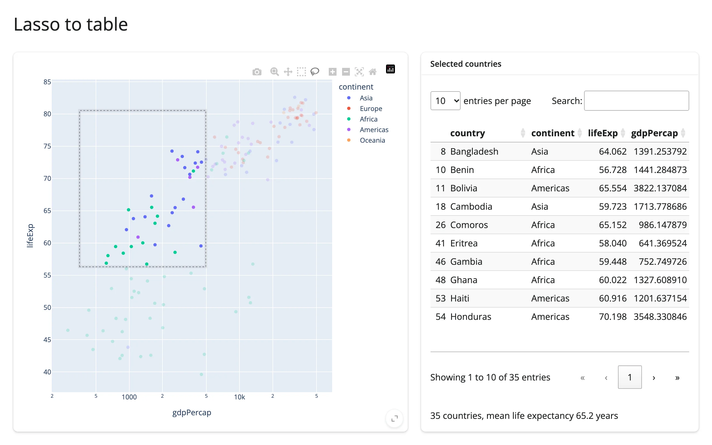

### jscatter lasso &rarr; itables table

[`examples/02_jscatter_lasso_to_itables.py`](examples/02_jscatter_lasso_to_itables.py)
(reused verbatim from the [jscatter guide](../../widgets/jscatter/index.md#coordinating-multiple-views)):

```{.python file="examples/02_jscatter_lasso_to_itables.py"}
import numpy as np
import pandas as pd
from jscatter import Scatter
from shiny.express import ui
from shinywidgets import render_itables, render_jscatter

rng = np.random.default_rng(1)
n = 1500
origin = pd.Series(rng.choice(["USA", "Europe", "Japan"], n, p=[0.5, 0.25, 0.25]))
weight = origin.map({"USA": 3.4, "Europe": 2.6, "Japan": 2.4}) + rng.normal(0, 0.5, n)
cars = pd.DataFrame({"origin": origin.astype("category"), "weight": weight.round(2)})
cars["mpg"] = (45 - 6 * cars["weight"] + rng.normal(0, 2.5, n)).round(1)

ui.page_opts(title="Lasso selection drives an itables table", fillable=True)

with ui.layout_columns():
    with ui.card(full_screen=True):

        @render_jscatter
        def plot():
            return Scatter(data=cars, x="weight", y="mpg", color_by="origin").lasso(
                initiator=True
            )

    with ui.card(full_screen=True):
        ui.card_header("Rows inside the lasso")

        @render_itables
        def table():
            return plot.selected_rows()
```

jscatter's `selected()` is already positional (`numpy.ndarray[uint32]`), so no
customdata trick is needed -- `selected_rows()` maps those positions back into the
plot's own data frame, empty while nothing is selected.

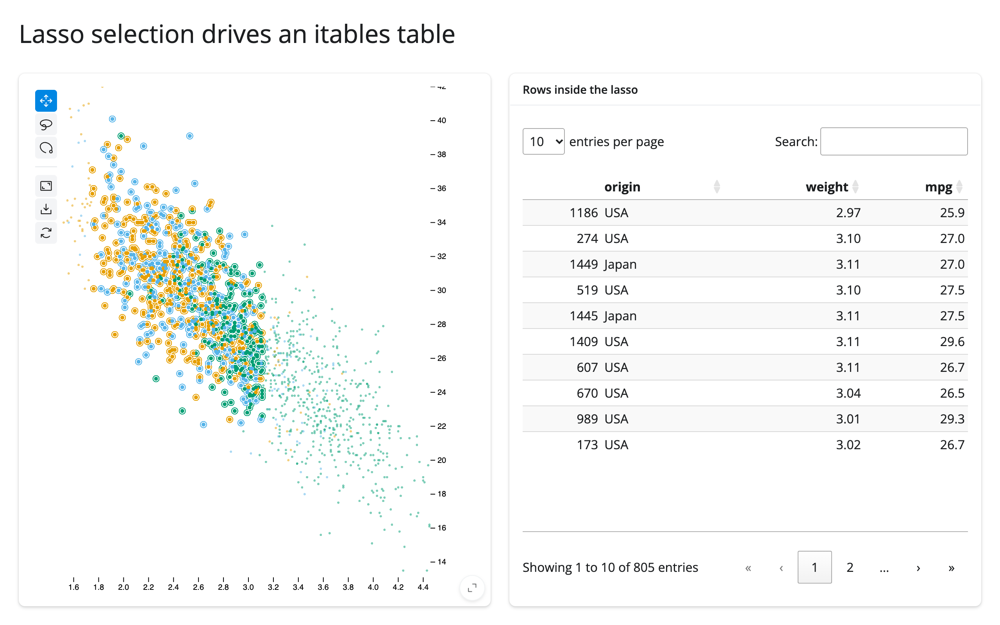

A third variant worth knowing: bqplot's `selected_rows(df)` maps one mark's selected
positions back into a data frame the same way (`df` is required -- a figure retains no
frame of its own), and feeds a plain `render.data_frame` instead of a
dedicated table widget -- see the [bqplot guide](../../widgets/bqplot/index.md#coordinating-multiple-views)'s
"Brush select &rarr; filtered table" for the full snippet. All three converge on the same
shape: an accessor that returns rows of your data frame, straight into a table output.

The selection doesn't have to come from a drag at all: plotly's `visible_traces()`
reports which traces a legend click (or double-click-to-isolate) left visible, seeded
from the figure as drawn and updated after every toggle -- filter a summary table or
chart by *which categories are currently shown* instead of which points are lassoed.
See the [plotly guide's `legend_clicked()` and `visible_traces()`
section](../../widgets/plotly/index.md#legend_clicked-and-visible_traces) for the full, verified
snippet (a `render.data_frame` summary that drops a continent's row the moment its
legend entry is hidden).

## 2. Click &rarr; detail card

**When**: the user needs to go from "a mark on a chart" to "everything else about that
record" -- a map feature's name and population, a graph node's neighbors, a data point's
other columns that aren't plotted.

**The idea**: a single-item click accessor is *user-interaction state* -- it's
[**kept** across a re-render](../reacting-to-widgets/index.md#across-re-renders) until
the user clicks the new widget, rather than resetting to `None` -- and
feeds one `@render.ui` that handles the "nothing clicked yet" case explicitly, then looks
up and formats the rest of the row. The output doesn't have to be plain text -- it can be
an entirely different widget, rendered small, which is where this pattern crosses library
lines.

### lonboard click &rarr; detail card (map feature)

[`examples/03_lonboard_click_to_detail.py`](examples/03_lonboard_click_to_detail.py)
(reused verbatim from the [lonboard guide](../../widgets/lonboard/index.md#coordinating-multiple-views)):

```{.python file="examples/03_lonboard_click_to_detail.py"}
import geopandas as gpd
from lonboard import Map, ScatterplotLayer
from shiny import req
from shiny.express import render, ui
from shinywidgets import render_lonboard

ui.page_opts(fillable=True)

CITIES_URL = "https://raw.githubusercontent.com/nvkelso/natural-earth-vector/master/geojson/ne_110m_populated_places.geojson"


with ui.layout_columns(col_widths=[8, 4]):
    with ui.card(full_screen=True):

        @render_lonboard
        def map():
            cities = gpd.read_file(CITIES_URL)
            layer = ScatterplotLayer.from_geopandas(
                cities,
                get_fill_color=[255, 60, 120],
                radius_min_pixels=4,
                pickable=True,
                auto_highlight=True,
            )
            # The "Selected city" card already shows feature detail
            return Map(layer, show_side_panel=False)

    with ui.card():
        ui.card_header("Selected city")

        @render.ui
        def detail():
            # selected_rows() is the picked row itself, taken from the
            # layer's own data -- no second read of the file, no iloc. It's
            # an empty frame until the first pick; req() waits instead of
            # showing an empty card on load.
            rows = map.selected_rows()
            req(len(rows) > 0)
            row = rows.iloc[0]
            return ui.TagList(
                ui.h5(row["NAME"]),
                ui.p(row["ADM0NAME"]),
                ui.p(f"Population: {int(row['POP_MAX']):,}"),
            )
```

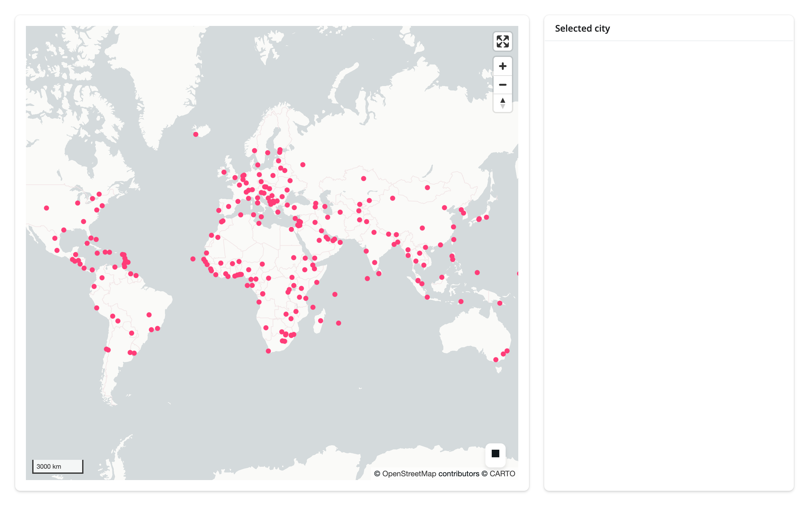
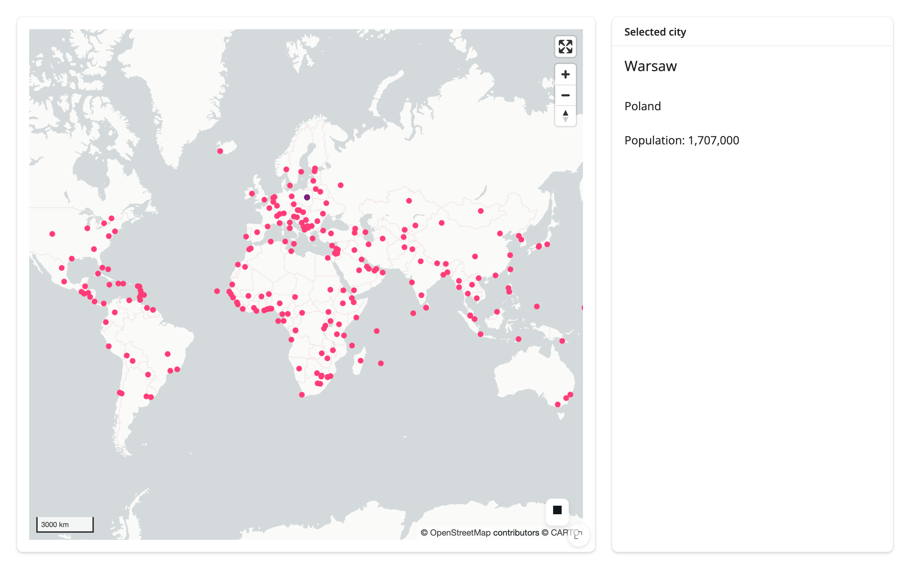

### ipycytoscape click &rarr; detail (graph node)

[`examples/04_ipycytoscape_click_to_detail.py`](examples/04_ipycytoscape_click_to_detail.py)
(reused verbatim from the [ipycytoscape guide](../../widgets/ipycytoscape/index.md#coordinating-multiple-views)):

```{.python file="examples/04_ipycytoscape_click_to_detail.py"}
import networkx as nx
from ipycytoscape import CytoscapeWidget
from shiny import reactive
from shiny.express import render, ui
from shinywidgets import render_ipycytoscape

G = nx.les_miserables_graph()
STYLE = [
    {"selector": "node", "style": {"background-color": "#447099"}},
    {"selector": "node[degree >= 15]", "style": {"label": "data(id)"}},
    {"selector": ".faded", "style": {"opacity": 0.1, "text-opacity": 0}},
    {"selector": "node.focus", "style": {"border-width": 3, "border-color": "#212529"}},
]
for n in G.nodes:
    G.nodes[n]["degree"] = G.degree(n)

ui.page_opts(title="Click to highlight a neighborhood", fillable=True)

with ui.layout_columns(col_widths=[8, 4]):
    with ui.card(full_screen=True):

        @render_ipycytoscape
        def network():
            widget = CytoscapeWidget(G)
            widget.set_style(STYLE)
            widget.set_layout(name="concentric")
            return widget

    with ui.card():
        ui.card_header("Selected character")

        @render.ui
        def detail():
            clicked = network.clicked_node()
            if clicked is None:
                return ui.p("Click a character to see their circle.")
            name = clicked["data"]["id"]
            return ui.p(f"{name} and {G.degree(name)} co-characters are highlighted.")

    @reactive.effect
    def _():
        # Restyle in place by toggling classes: the layout never reruns and
        # the user's pan/zoom is kept
        clicked = network.clicked_node()
        center = clicked["data"]["id"] if clicked else None
        focus = {center, *G[center]} if center else set()
        for node in network.widget.graph.nodes:
            name = node.data["id"]
            if not focus:
                node.classes = ""
            else:
                node.classes = (
                    "focus" if name == center else "" if name in focus else "faded"
                )
        for edge in network.widget.graph.edges:
            s, t = edge.data["source"], edge.data["target"]
            edge.classes = "" if not focus or center in (s, t) else "faded"
```

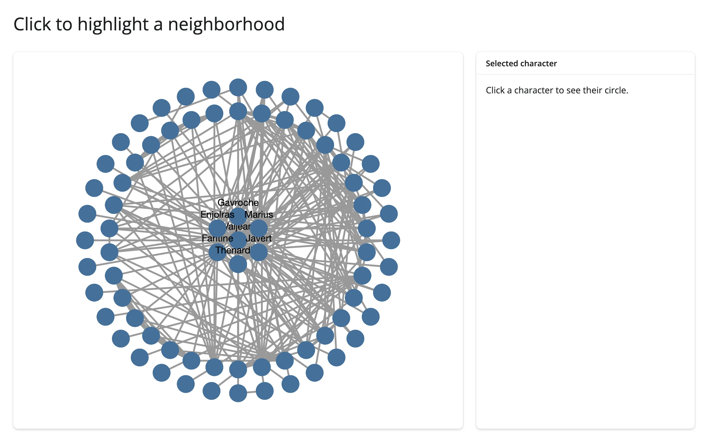
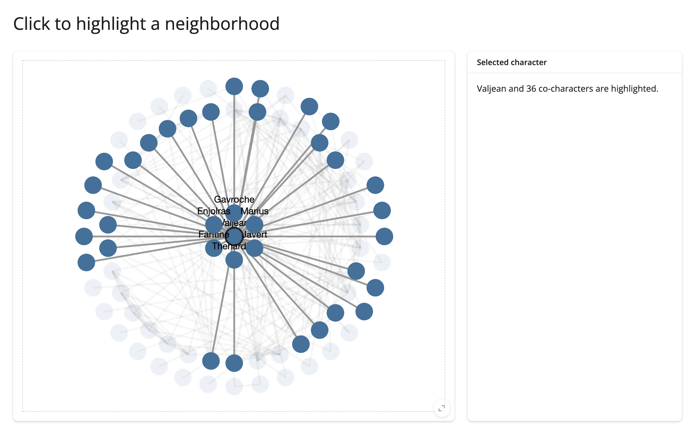

### altair click &rarr; detail card with an embedded plotly chart (chart point, cross-library)

The detail card itself doesn't have to be plain text. Here, clicking a point in an altair
scatter plot (the same `selection_point()` idiom as the altair guide's own detail-card
example) drives both a text summary *and* a small `render_plotly` bar chart comparing the
clicked car to the fleet average -- two different plotting libraries, one click:

```{.python file="examples/05_altair_click_to_plotly_detail.py"}
import altair as alt
from altair.datasets import data
import plotly.graph_objects as go
from shiny.express import render, ui

from shinywidgets import render_altair, render_plotly

cars = data.cars()
avg_hp = cars["Horsepower"].mean()

ui.page_opts(title="Click a car for a detail card", fillable=True)

with ui.layout_columns(col_widths=[7, 5]):
    with ui.card(full_screen=True):
        ui.card_header("Click a car")

        @render_altair
        def scatter():
            pick = alt.selection_point(name="pick")
            return (
                alt.Chart(cars)
                .mark_circle()
                .encode(
                    x="Horsepower:Q",
                    y="Miles_per_Gallon:Q",
                    color=alt.condition(pick, alt.value("steelblue"), alt.value("lightgray")),
                )
                .add_params(pick)
            )

    with ui.card(full_screen=True):
        ui.card_header("Detail card")

        @render.ui
        def detail():
            rows = scatter.selected_rows("pick")
            if len(rows) == 0:
                return ui.p("Click a car to see its detail.")
            car = rows.iloc[0]
            return ui.TagList(
                ui.h5(car["Name"]),
                ui.p(f"{car['Horsepower']:.0f} hp, {car['Miles_per_Gallon']:.1f} mpg, {car['Origin']}"),
            )

        @render_plotly
        def hp_bar():
            # The detail card's second half is a different library entirely: a
            # small plotly bar comparing the clicked car to the fleet average.
            rows = scatter.selected_rows("pick")
            hp = rows.iloc[0]["Horsepower"] if len(rows) else 0
            colors = ["#e45756", "#bbb"] if len(rows) else ["#eee", "#eee"]
            fig = go.Figure(go.Bar(x=["This car", "Fleet average"], y=[hp, avg_hp], marker_color=colors))
            fig.update_layout(
                title="Horsepower vs. fleet average",
                margin=dict(l=10, r=10, t=40, b=10),
                yaxis_title="Horsepower",
            )
            return fig
```

Clicking the Honda Civic colors it in the scatter plot and draws it against the fleet
average, 53 hp vs. roughly 105 hp:

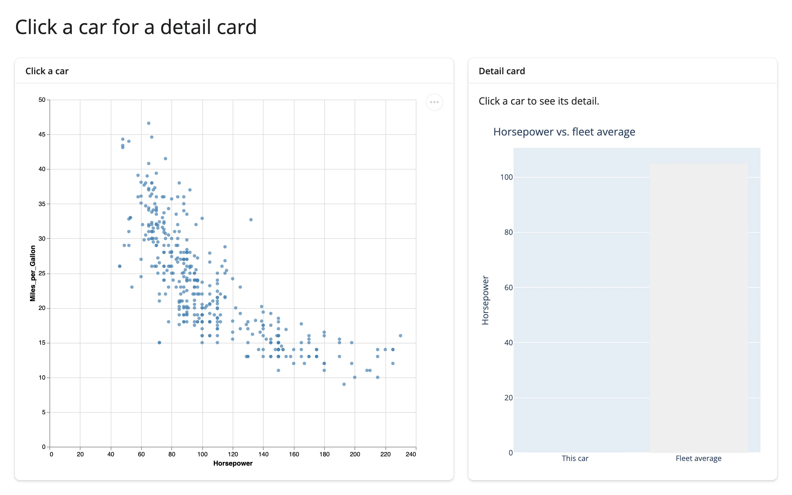
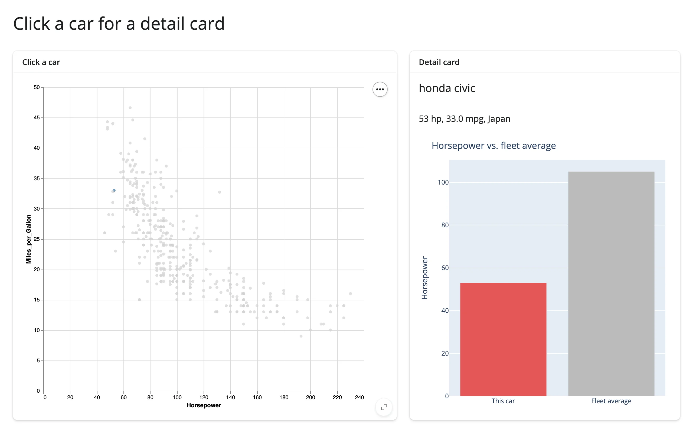

### plotly hover &rarr; detail card, without a click

A detail card doesn't have to wait for a click. `hover()` reports the same columns as
`clicked()`, but fires continuously as the pointer moves over points and clears back to
`None` the moment it leaves them (debounced 250ms by default, so a reader updates once
the pointer settles rather than on every pixel) -- a frictionless upgrade over `clicked()`
for a card whose only job is to preview whatever's under the cursor:

[`examples/17_plotly_hover_to_detail.py`](examples/17_plotly_hover_to_detail.py)
(reused verbatim from the [plotly guide](../../widgets/plotly/index.md#hover)):

```{.python file="examples/17_plotly_hover_to_detail.py"}
import plotly.express as px
from shiny.express import render, ui
from shinywidgets import render_plotly

df = px.data.gapminder().query("year == 2007").reset_index(drop=True)

ui.page_opts(title="Hover for details", fillable=True)

with ui.layout_columns(col_widths=[8, 4]):
    with ui.card(full_screen=True):

        @render_plotly
        def plot():
            return px.scatter(
                df,
                x="gdpPercap",
                y="lifeExp",
                color="continent",
                log_x=True,
                size="pop",
                size_max=40,
                custom_data=[df.index],
            )

    with ui.card():

        @render.ui
        def detail():
            pts = plot.hover()
            if pts is None:
                return ui.p("Hover a bubble for details.", class_="text-muted")
            row = df.loc[pts["customdata"].iloc[0][0]]
            return ui.TagList(
                ui.h4(row["country"]),
                ui.p(f"Continent: {row['continent']}"),
                ui.p(f"Life expectancy: {row['lifeExp']:.1f} years"),
                ui.p(f"GDP per capita: ${row['gdpPercap']:,.0f}"),
            )
```

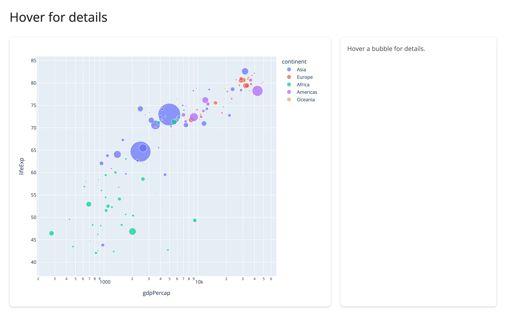
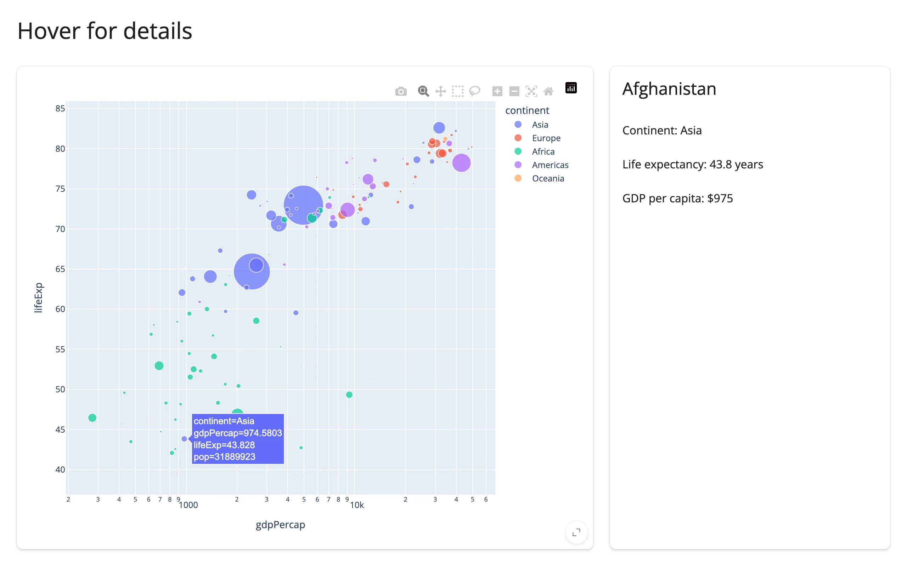

Unlike `clicked()`, nothing here needs a `req()` for the "not hovering anything" case to
read cleanly -- `hover()` is already `None` there, same as before any interaction -- and
there's no extra state to clear when the pointer moves on, since the next hover (or
leaving the plot entirely) does that for you.

## 3. Viewport &rarr; "what's visible" summary

**When**: the data is too large to summarize all at once, and the interesting question
is "what am I looking at right now" -- panning a map, zooming a scatter plot, both answer
the same shape of question.

**The idea**: a viewport accessor (`bounds()`, `view_state()`, `relayout()`, a matplotlib
`limits()`) reports a box in data coordinates; filter your underlying data frame against
that box and feed the result to a second output. The second output doesn't re-fetch
anything -- it recomputes from whatever data you already loaded, against whichever
rectangle the user is currently inside.

### ipyleaflet viewport &rarr; plotly bar chart

[`examples/06_ipyleaflet_bounds_to_plotly.py`](examples/06_ipyleaflet_bounds_to_plotly.py)
(reused verbatim from the [ipyleaflet guide](../../widgets/ipyleaflet/index.md#coordinating-multiple-views)):

```{.python file="examples/06_ipyleaflet_bounds_to_plotly.py"}
import pandas as pd
import plotly.express as px
import ipyleaflet as L
from shiny.express import ui
from shinywidgets import render_ipyleaflet, render_plotly

ui.page_opts(title="What's in view", fillable=True)

# plotly's carshare dataset: 249 real car2go pod locations around Montreal,
# labeled with when each pod sees its heaviest use
pods = px.data.carshare()
pods["period"] = pd.cut(
    pods["peak_hour"], bins=[-1, 5, 11, 17, 23], labels=["night", "morning", "afternoon", "evening"]
)

with ui.layout_columns(col_widths=[7, 5]):
    with ui.card():

        @render_ipyleaflet
        def map():
            m = L.Map(center=(45.52, -73.59), zoom=11)
            markers = [L.Marker(location=(r.centroid_lat, r.centroid_lon)) for r in pods.itertuples()]
            m.add(L.MarkerCluster(markers=markers))
            return m

    with ui.card():
        ui.card_header("Pods in the current viewport, by peak period")

        @render_plotly
        def in_view():
            (south, west), (north, east) = map.bounds()  # pairs with: plotly
            visible = pods[pods.centroid_lat.between(south, north) & pods.centroid_lon.between(west, east)]
            counts = visible["period"].value_counts().reindex(["night", "morning", "afternoon", "evening"]).reset_index()
            counts.columns = ["period", "count"]
            return px.bar(counts, x="period", y="count")
```

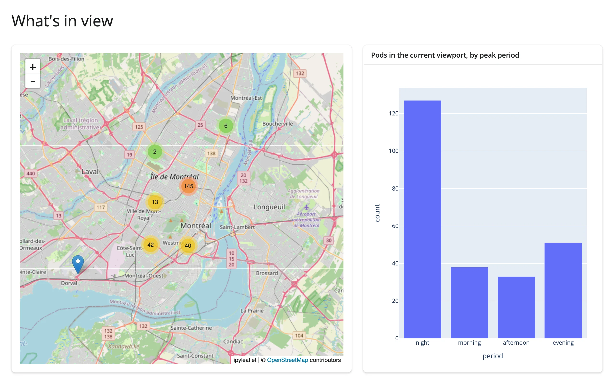
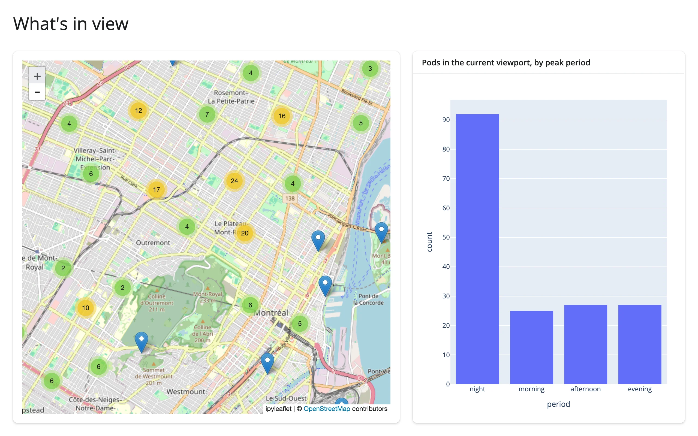

### maplibre viewport &rarr; matplotlib histogram

[`examples/07_maplibre_viewport_to_matplotlib.py`](examples/07_maplibre_viewport_to_matplotlib.py)
(adapted from the [maplibre guide](../../widgets/maplibre/index.md#coordinating-multiple-views),
using its `view_state()` accessor):

```{.python file="examples/07_maplibre_viewport_to_matplotlib.py"}
import matplotlib.pyplot as plt
import numpy as np
import requests
from maplibre import Layer, LayerType, Map, MapOptions
from maplibre.basemaps import Carto
from maplibre.sources import GeoJSONSource
from shiny.express import render, ui
from shinywidgets import render_maplibre

EARTHQUAKES = requests.get(
    "https://maplibre.org/maplibre-gl-js/docs/assets/earthquakes.geojson"
).json()
LNG = np.array([f["geometry"]["coordinates"][0] for f in EARTHQUAKES["features"]])
LAT = np.array([f["geometry"]["coordinates"][1] for f in EARTHQUAKES["features"]])
MAG = np.array([f["properties"]["mag"] for f in EARTHQUAKES["features"]])

ui.page_opts(fillable=True)

with ui.layout_columns(col_widths=[8, 4]):
    with ui.card(full_screen=True):

        @render_maplibre
        def quakes():
            m = Map(MapOptions(style=Carto.DARK_MATTER, center=(0, 20), zoom=1.2))
            m.add_source("quakes", GeoJSONSource(data=EARTHQUAKES))
            m.add_layer(
                Layer(
                    id="quakes-circle",
                    type=LayerType.CIRCLE,
                    source="quakes",
                    paint={"circle-radius": 2, "circle-color": "#fd8d3c", "circle-opacity": 0.6},
                )
            )
            return m

    with ui.card():
        ui.card_header("What's on screen")

        @render.plot
        def visible_mags():
            vs = quakes.view_state()
            sw, ne = vs["bounds"]["_sw"], vs["bounds"]["_ne"]
            mask = (LNG >= sw["lng"]) & (LNG <= ne["lng"]) & (LAT >= sw["lat"]) & (LAT <= ne["lat"])
            fig, ax = plt.subplots()
            ax.hist(MAG[mask], bins=np.arange(0, 9, 0.5))
            ax.set_title(f"{int(mask.sum())} earthquakes in view")
            ax.set_xlabel("Magnitude")
            return fig
```

Zooming in from the whole world (2601 earthquakes) to a stretch of the Atlantic (106, a
visibly different, narrower magnitude distribution):

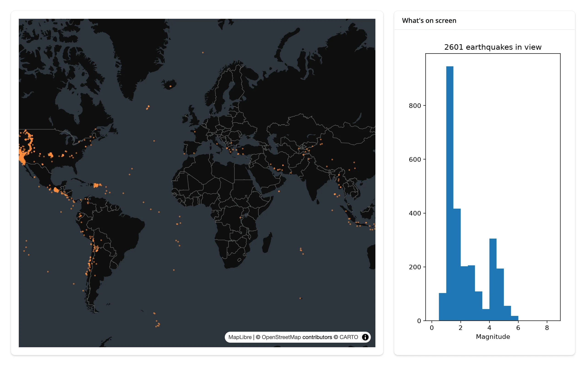
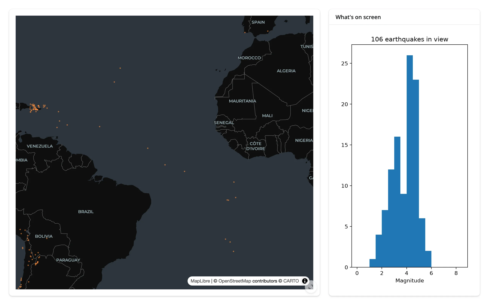

### Not just maps: plotly's own zoom filters a second view

The same question -- "what's currently visible" -- applies to a plot's own zoom, not
just a map's viewport. `relayout()`'s axis-range keys stay `None` through renders,
modebar clicks, and selections, firing only on a real zoom/pan/autoscale:

```{.python file="examples/08_plotly_relayout_to_plotly.py"}
import plotly.express as px
from shiny.express import ui
from shinywidgets import render_plotly

df = px.data.gapminder().query("year == 2007").reset_index(drop=True)

ui.page_opts(title="Zoom to filter a second view", fillable=True)

with ui.layout_columns(col_widths=[7, 5]):
    with ui.card(full_screen=True):

        @render_plotly
        def scatter():
            return px.scatter(df, x="lifeExp", y="gdpPercap", color="continent")

    with ui.card(full_screen=True):
        ui.card_header("Mean GDP/capita in the visible life-expectancy range")

        @render_plotly
        def summary_bar():
            axes = scatter.relayout() or {}
            if "xaxis.range[0]" in axes:
                lo, hi = axes["xaxis.range[0]"], axes["xaxis.range[1]"]
                visible = df[df["lifeExp"].between(lo, hi)]
            else:
                visible = df
            means = visible.groupby("continent", as_index=False)["gdpPercap"].mean()
            return px.bar(means, x="continent", y="gdpPercap")
```

[`examples/08_plotly_relayout_to_plotly.py`](examples/08_plotly_relayout_to_plotly.py)
(reused verbatim from the [plotly guide](../../widgets/plotly/index.md#coordinating-multiple-views))

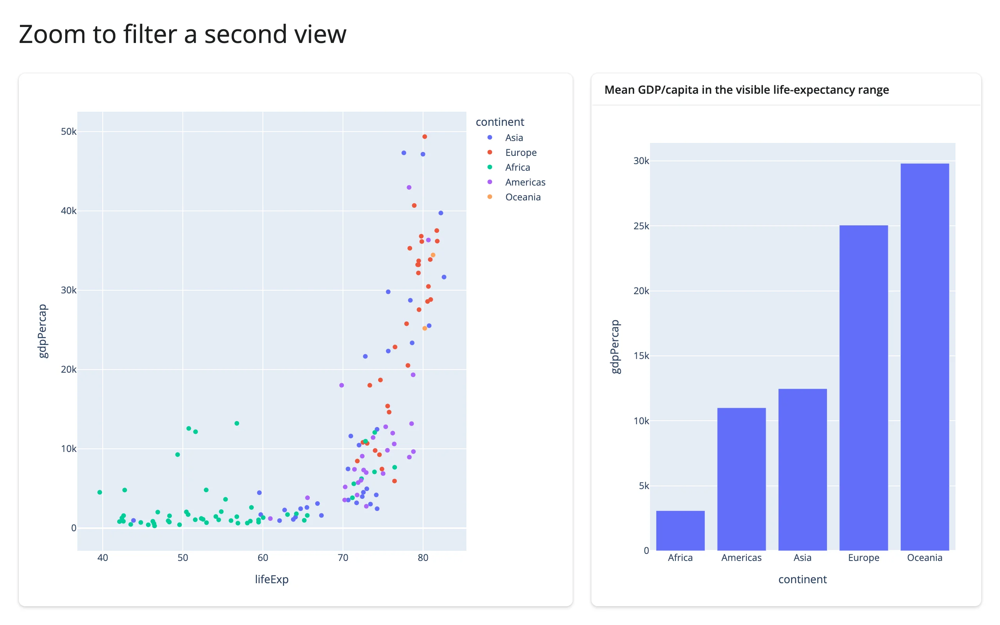
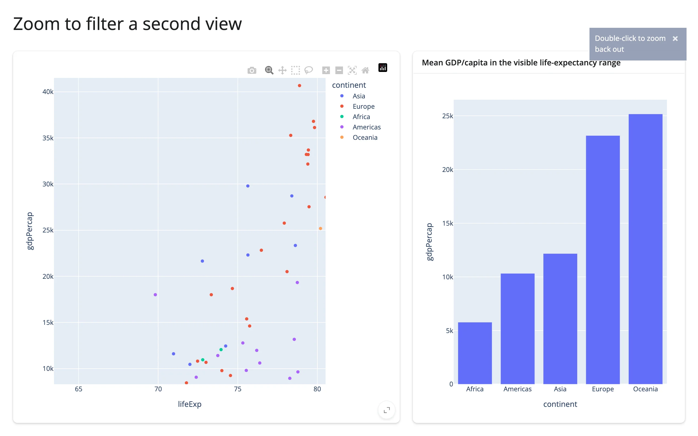

## 4. Table &rarr; plot/map, updated in place

**When**: a table is the easiest place to search, sort, and page through records, but
you still want selecting a row to do something visual -- highlight it in a plot, fly a
map to it.

**The idea**: read the table's selection accessor in a `@reactive.effect` and write the
result into the *other* widget's trait directly (`.widget.<trait> = ...`), not by
re-rendering. Re-rendering would rebuild the whole figure or map -- a fresh zoom level, a
fresh WebGL context, the JS bundle sent again. An in-place write changes only what needs
to change and keeps everything else (zoom, pan, the user's own in-progress gesture on
that widget) untouched. This is the same `reactive.isolate()`-guarded write-back idiom
from [Writing back](../updating-in-place/index.md#writing-back), just triggered by a
table instead of a click.

### itables selection &rarr; plotly marker colors, in place

[`examples/09_itables_selection_to_plotly_inplace.py`](examples/09_itables_selection_to_plotly_inplace.py)
(reused verbatim from the [itables guide](../../widgets/itables/index.md#coordinating-multiple-views)):

```{.python file="examples/09_itables_selection_to_plotly_inplace.py"}
from __future__ import annotations

import plotly.express as px
import plotly.graph_objects as go
from itables.widget import ITable
from shiny import reactive
from shiny.express import ui
from shinywidgets import render_itables, render_plotly

countries = px.data.gapminder().query("year == 2007")[
    ["country", "continent", "lifeExp", "pop", "gdpPercap"]
].reset_index(drop=True)

ui.page_opts(title="Selection highlights a plot", fillable=True)

with ui.layout_columns(col_widths=[6, 6]):
    with ui.card(full_screen=True):
        ui.card_header("Select rows here")

        @render_itables
        def table():
            return ITable(countries, select=True)

    with ui.card(full_screen=True):
        ui.card_header("...to highlight them here")

        @render_plotly
        def scatter():
            fig = go.FigureWidget(
                go.Scatter(
                    x=countries["gdpPercap"],
                    y=countries["lifeExp"],
                    mode="markers",
                    marker={"color": "#bbb", "size": 8},
                    text=countries["country"],
                )
            )
            fig.update_xaxes(type="log", title="GDP per capita")
            fig.update_yaxes(title="Life expectancy")
            return fig


@reactive.effect
def _highlight_selection():
    selected = set(table.selected_rows())
    with reactive.isolate():
        # In place: the scatter keeps its zoom/pan state across selections,
        # instead of rebuilding (and resending) the whole figure.
        scatter.widget.data[0].marker.color = [
            "#e41a1c" if i in selected else "#bbb" for i in range(len(countries))
        ]
```

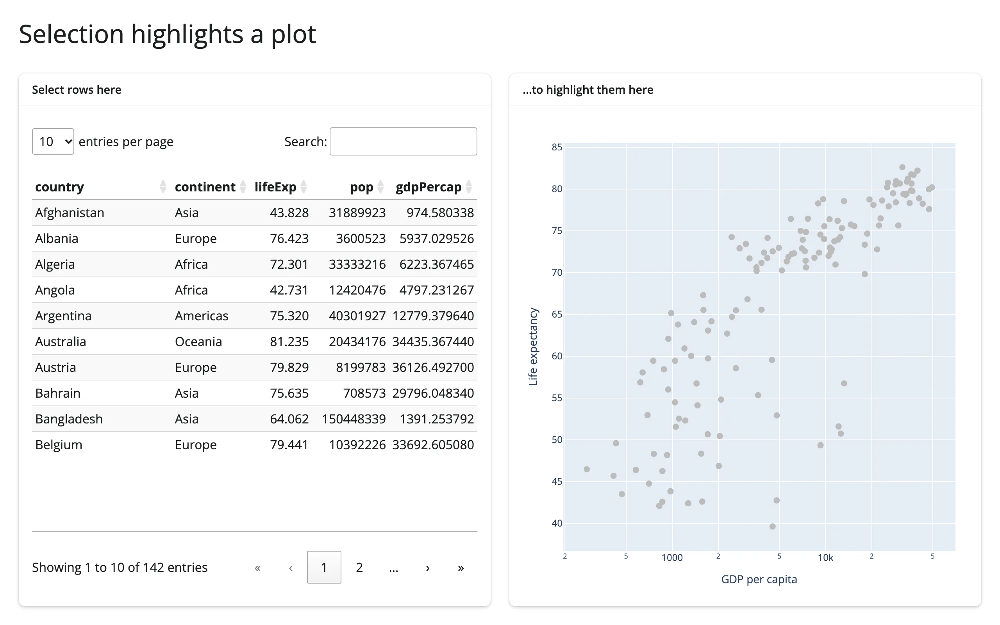
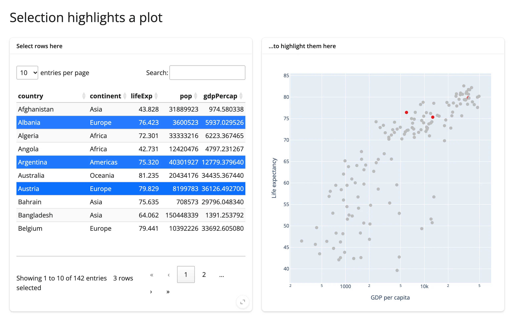

### Table row &rarr; geolibre map re-centers, in place

[`examples/10_geolibre_table_to_map.py`](examples/10_geolibre_table_to_map.py)
(reused verbatim from the [geolibre guide](../../widgets/geolibre/index.md#coordinating-multiple-views)):

```{.python file="examples/10_geolibre_table_to_map.py"}
from __future__ import annotations

import pandas as pd
from geolibre import Map
from shiny import reactive, render
from shiny.express import ui

from shinywidgets import render_geolibre

ui.page_opts(title="Table selection -> map", fillable=True)

CITIES = pd.DataFrame(
    [
        ("New York", -74.0, 40.7, 8.48),
        ("Los Angeles", -118.2, 34.0, 3.88),
        ("Chicago", -87.6, 41.9, 2.72),
        ("Houston", -95.4, 29.8, 2.31),
        ("Phoenix", -112.1, 33.4, 1.65),
    ],
    columns=["city", "lng", "lat", "population_m"],
)

with ui.layout_columns(col_widths=[5, 7]):
    with ui.card():
        ui.card_header("5 largest US cities")

        @render.data_frame
        def table():
            return render.DataGrid(CITIES[["city", "population_m"]], selection_mode="row")

    with ui.card(full_screen=True):

        @render_geolibre
        def map():
            return Map(center=(-98.5, 39.8), zoom=3.5)


@reactive.effect
def _():
    rows = table.cell_selection()["rows"]
    if not rows:
        return
    row = CITIES.iloc[rows[0]]
    map.widget.set_center(row["lng"], row["lat"], zoom=9)
```

This one uses a **plain `render.data_frame`**, not a dedicated table widget -- the
"table" side of this pattern doesn't need accessors at all when Shiny's own
`cell_selection()` already gives you row positions.

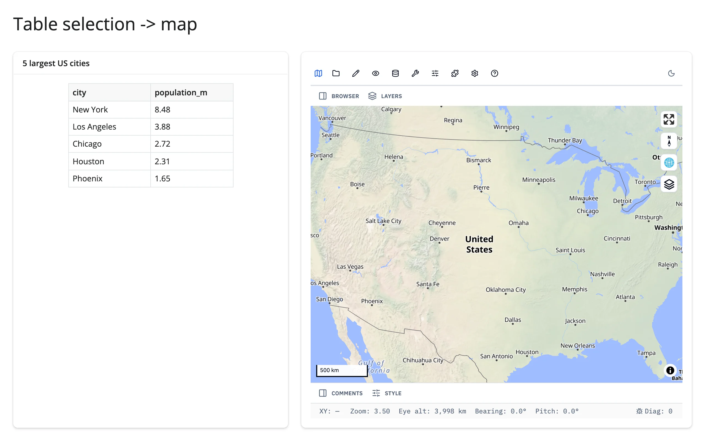
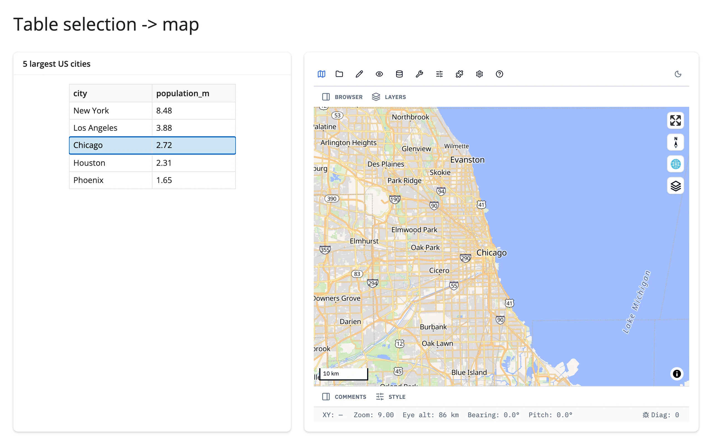

## 5. Two-way linking without loops

**When**: two widgets should mirror each other's selection -- brush plot A and plot B
highlights the same rows, and vice versa.

**The idea**: the mechanical risk is an effect that reads a value and writes it
somewhere that re-triggers the same effect, forever (see
[Writing back](../updating-in-place/index.md#writing-back) for the counter-shaped
version of this bug). Two *different* widgets' selection traits linking to each other
have the same shape of risk. Two techniques handle it:

- **Direct trait mirroring with an equality guard**: when both widgets expose a
  genuinely compatible, Python-settable selection trait (jscatter's `.widget.selection`
  is the same array the `selected()` accessor reads), write to the *other* widget's
  trait, but only when the incoming value actually differs from what's already there.
  The guard breaks the cycle: A sets B (different, so it writes); B's effect reads the
  new value, compares against A's current value, finds them equal, and does nothing.
- **A shared broker value**: when the two widgets don't share a compatible trait (a map
  pick and a plot click are different *kinds* of event), route both through one
  `reactive.value` instead of wiring the widgets to each other directly. Each widget's
  own effect only ever writes to the broker (guarded the same way); two more effects fan
  the broker out to each widget's in-place highlight. Neither widget's effect ever reads
  the *other* widget's accessor, so there's no cycle to break in the first place.

### jscatter &harr; jscatter: direct trait mirroring

[`examples/11_jscatter_bidirectional.py`](examples/11_jscatter_bidirectional.py)
(reused verbatim from the [jscatter guide](../../widgets/jscatter/index.md#coordinating-multiple-views)):

```{.python file="examples/11_jscatter_bidirectional.py"}
import numpy as np
import pandas as pd
from jscatter import Scatter
from shiny import reactive
from shiny.express import ui
from shinywidgets import render_jscatter

rng = np.random.default_rng(1)
n = 3000
origin = pd.Series(rng.choice(["USA", "Europe", "Japan"], n, p=[0.5, 0.25, 0.25]))
weight = origin.map({"USA": 3.4, "Europe": 2.6, "Japan": 2.4}) + rng.normal(0, 0.5, n)
cars = pd.DataFrame({"origin": origin.astype("category"), "weight": weight.round(2)})
cars["mpg"] = (45 - 6 * cars["weight"] + rng.normal(0, 2.5, n)).round(1)
cars["hp"] = (45 * cars["weight"] + rng.normal(0, 25, n)).round()

ui.page_opts(title="Linked brushing between two jscatter plots", fillable=True)

with ui.layout_columns():
    with ui.card(full_screen=True):
        ui.card_header("Weight vs. MPG")

        @render_jscatter
        def weight_mpg():
            return Scatter(data=cars, x="weight", y="mpg", color_by="origin").lasso(
                initiator=True
            )

    with ui.card(full_screen=True):
        ui.card_header("Horsepower vs. MPG")

        @render_jscatter
        def hp_mpg():
            return Scatter(data=cars, x="hp", y="mpg", color_by="origin").lasso(
                initiator=True
            )


def link(source, target):
    @reactive.effect
    def _():
        selection = source.selected()
        with reactive.isolate():
            if not np.array_equal(selection, target.widget.selection):
                target.widget.selection = selection


link(weight_mpg, hp_mpg)
link(hp_mpg, weight_mpg)
```

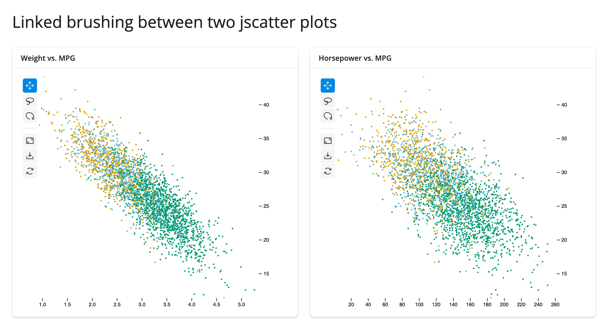
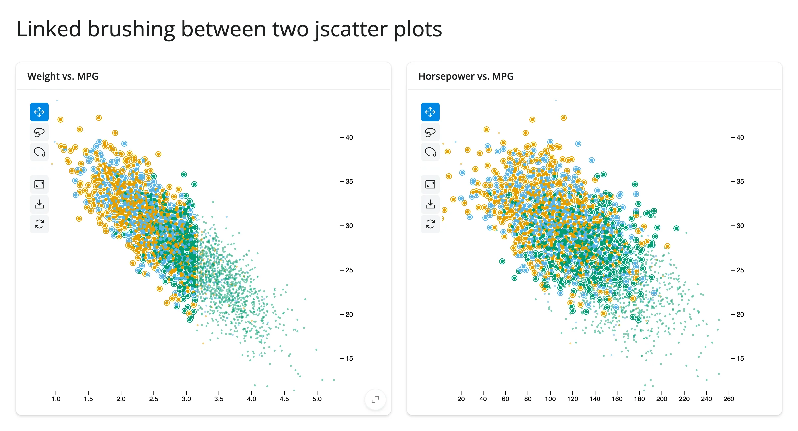

`np.array_equal` is the whole safety mechanism: without it, each plot setting the
other's `selection` would trigger the other effect right back -- it would still
converge (both ends end up holding the same array), but on every gesture it'd do the
work twice over.

**bqplot's version of this same idea has a sharp edge worth knowing before you try it**:
bqplot's own idiom for linked brushing is sharing one `Selector` object across marks that
belong to two separately-rendered `Figure`s. In shinywidgets this fails outright --
`Could not create a view for model id ...`, the brush overlay never renders on either
figure. It's not an upstream bqplot bug (the identical code works in a plain Jupyter
notebook); it reproduces every time in this frontend. The
[bqplot guide](../../widgets/bqplot/index.md#gotchas-and-limitations) works around it with the
same Python round-trip as above (read one mark's `selected()`, write the other mark's
`.selected` trait) instead of the shared-`Selector` idiom -- **if you're linking two
bqplot figures, start from that pattern, not bqplot's own notebook examples.**

### lonboard &harr; plotly: a shared broker value (cross-library)

lonboard and plotly have no selection trait in common to mirror directly, so this
example routes both through one `reactive.value` instead:

```{.python file="examples/12_lonboard_plotly_bidirectional.py"}
# Two-way linking without loops, across two different widget libraries.
#
# lonboard and plotly have no shared "selection" trait to mirror directly
# (unlike two jscatter plots -- see 11_jscatter_bidirectional.py), so instead
# of wiring the widgets to each other, both point at ONE shared
# `reactive.value`: whichever widget was clicked writes the row index there
# (guarded by an equality check + reactive.isolate() so the write doesn't
# depend on itself), and two more effects fan that single value out to both
# widgets' in-place highlight. Neither widget ever reads the other's
# accessor, so there is no cycle to break -- the broker IS the loop-breaker.
import geopandas as gpd
import numpy as np
import plotly.express as px
from lonboard import Map, ScatterplotLayer
from shiny import reactive
from shiny.express import ui
from shinywidgets import render_lonboard, render_plotly

pods = px.data.carshare().reset_index(drop=True)
GDF = gpd.GeoDataFrame(
    pods, geometry=gpd.points_from_xy(pods["centroid_lon"], pods["centroid_lat"]), crs="EPSG:4326"
)
DIM, BRIGHT = (120, 140, 200, 140), (230, 30, 30, 255)

ui.page_opts(title="Two-way linking without loops", fillable=True)

selected = reactive.value(None)

with ui.layout_columns():
    with ui.card(full_screen=True):
        ui.card_header("lonboard: click a pod")

        @render_lonboard
        def geo():
            layer = ScatterplotLayer.from_geopandas(
                GDF,
                get_fill_color=np.array([DIM] * len(pods), dtype=np.uint8),
                radius_min_pixels=5,
                pickable=True,
            )
            # The plotly panel already shows which pod is selected
            return Map(layer, show_side_panel=False)

    with ui.card(full_screen=True):
        ui.card_header("plotly: click the same pod")

        @render_plotly
        def chart():
            fig = px.scatter(pods, x="centroid_lon", y="centroid_lat")
            fig.update_traces(marker_color="#9ecae1")
            fig.update_layout(margin=dict(l=10, r=10, t=10, b=10))
            return fig


@reactive.effect
def _map_sets_selection():
    idx = geo.selected()
    if idx is None:
        return
    with reactive.isolate():
        if selected() != idx:
            selected.set(idx)


@reactive.effect
def _chart_sets_selection():
    pts = chart.clicked()
    if pts is None:
        return
    idx = int(pts["point_index"].iloc[0])
    with reactive.isolate():
        if selected() != idx:
            selected.set(idx)


@reactive.effect
def _highlight_map():
    idx = selected()
    colors = np.array([BRIGHT if i == idx else DIM for i in range(len(pods))], dtype=np.uint8)
    with reactive.isolate():
        w = geo.widget
        if w is not None:
            w.layers[0].get_fill_color = colors


@reactive.effect
def _highlight_chart():
    idx = selected()
    colors = ["#e41a1c" if i == idx else "#9ecae1" for i in range(len(pods))]
    with reactive.isolate():
        w = chart.widget
        if w is not None:
            w.data[0].marker.color = colors
```

Clicking a pod on the map highlights it red on both widgets:


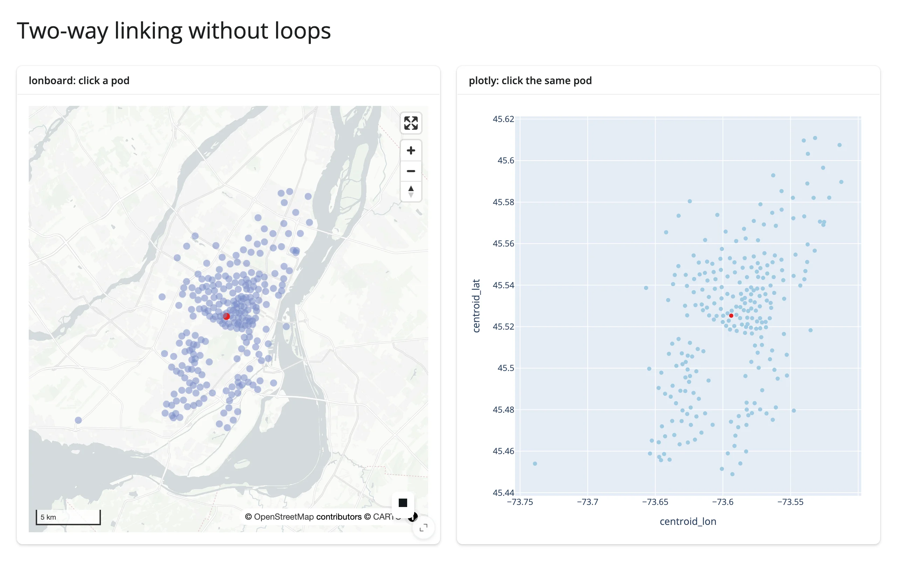

...and clicking a *different* pod in the plotly scatter plot moves the highlight on
**both** widgets to the new point -- confirming the link runs both ways:

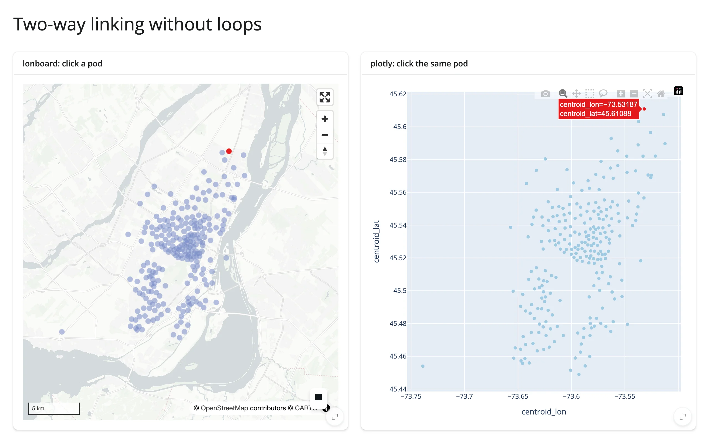

## 6. Crossfilter: in-widget vs. through Shiny

**When**: several charts over the same data should all narrow down together as the user
brushes any one of them.

**The idea**: some libraries express crossfiltering as a declarative spec the library
re-executes itself on every brush step, instead of a `@reactive.effect` you write.
Vega-Lite's `transform_filter(selection)` genuinely has no round trip: the filter runs
in the browser's own dataflow graph. Mosaic's `filterBy` *looks* the same from the spec,
but where it actually runs depends on where its DuckDB connection lives -- and for
`render_mosaic_widget` built from a `pandas.DataFrame` (how every Mosaic example in this
roster builds one), that connection is in **Python**, so each brush step still re-queries
DuckDB server-side and ships the result back over the Shiny websocket as an Arrow buffer.
[Pattern 7](#7-brushing-large-data-push-summaries-not-points) measures this directly: about
3 MB per query at Gaia-5M scale, still small because it's an aggregate, not raw rows, but
not "no round trip" either. Shiny's accessors add a second tier on top of either case:
read the same selection in Python and do something the browser-side grammar can't --
arbitrary pandas/DuckDB, a call to a model, a totally different kind of output, or a
crossfilter against data too large to ship to the browser in the first place. The two
tiers aren't exclusive; the clearest apps use both on the same chart.

**When each wins**: in-widget crossfiltering (true zero-round-trip, i.e. Vega-Lite) keeps
working offline of Shiny entirely, but it's confined to that library's own grammar and to
data already loaded in the browser. Through Shiny -- or through a spec whose own engine
happens to live server-side, like Mosaic's DuckDB connection here -- costs a round trip
(plus whatever debounce the accessor declares -- typically 250ms) but can cross into a
completely different widget library, run arbitrary Python, or filter server-side against
data orders of magnitude
larger than what the browser could hold (Mosaic and quak both push the actual filtering
into DuckDB for exactly this reason).

### altair: both tiers on one chart

[`examples/13_altair_crossfilter_in_widget_vs_shiny.py`](examples/13_altair_crossfilter_in_widget_vs_shiny.py)
(reused verbatim from the [altair guide](../../widgets/altair/index.md#coordinating-multiple-views)):

```{.python file="examples/13_altair_crossfilter_in_widget_vs_shiny.py"}
import altair as alt
from altair.datasets import data
from shiny.express import render, ui

from shinywidgets import render_altair

ui.page_opts(title="Two ways to link a selection", fillable=True)

cars = data.cars()

with ui.card(full_screen=True):
    ui.card_header("Brush the scatter plot")

    @render_altair
    def chart():
        brush = alt.selection_interval(name="brush", encodings=["x"])
        top = (
            alt.Chart(cars)
            .mark_point()
            .encode(x="Horsepower:Q", y="Miles_per_Gallon:Q")
            .properties(height=260)
            .add_params(brush)
        )
        # Filtered entirely inside Vega-Lite: no Python round trip, updates
        # on every mouse-move while dragging.
        bottom = (
            alt.Chart(cars)
            .mark_bar()
            .encode(x="Origin:N", y="count()")
            .properties(height=140)
            .transform_filter(brush)
        )
        return top & bottom

with ui.card():
    ui.card_header("Through Shiny: a stat Vega-Lite's grammar can't compute")

    @render.text
    def summary():
        rows = chart.selected_rows("brush")
        if len(rows) == 0:
            return "Brush the scatter plot above to select cars."
        return f"{len(rows)} selected, average {rows['Miles_per_Gallon'].mean():.1f} mpg"
```

The bar chart under the scatter plot is pure Vega-Lite (`transform_filter` recomputes it
in the browser on every frame of the drag); the average-mpg line below it is pure Shiny,
because averaging isn't something Vega-Lite's grammar can express:

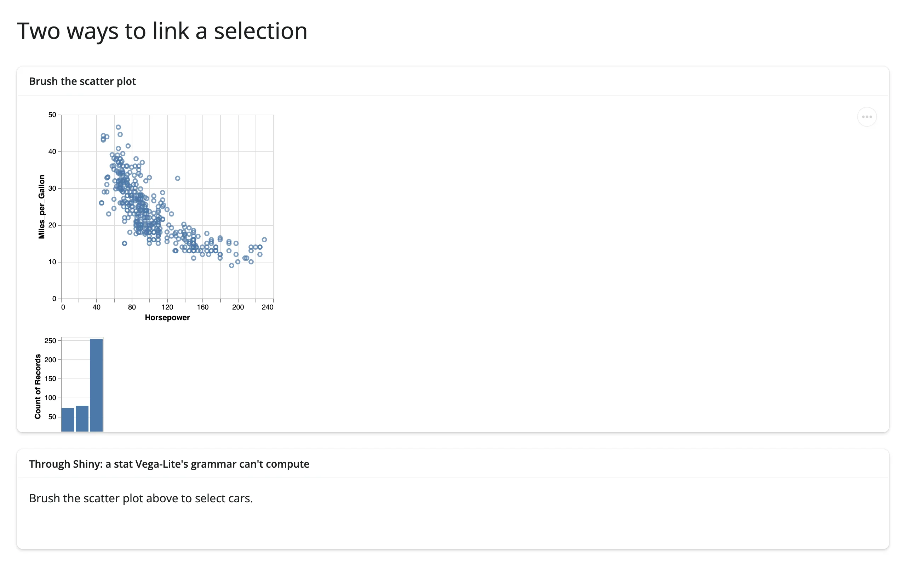
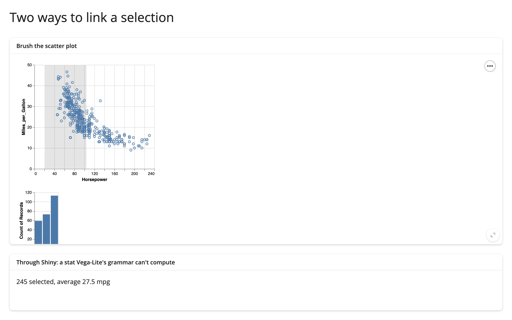

### mosaic: in-widget crossfilter, plus a Shiny-side aggregate table

Mosaic's own spec already crossfilters: the `"filterBy": "$brush"` on the plot mark is
the in-widget tier. `params()`/`data()` add the through-Shiny tier -- a per-species
breakdown DuckDB can compute but the chart spec alone can't
([`examples/14_mosaic_crossfilter_stats_table.py`](examples/14_mosaic_crossfilter_stats_table.py), reused
verbatim from the [mosaic guide](../../widgets/mosaic/index.md#coordinating-multiple-views)):

```{.python file="examples/14_mosaic_crossfilter_stats_table.py"}
from __future__ import annotations

import pandas as pd
from mosaic_widget import MosaicWidget
from shiny import reactive
from shiny.express import render, ui
from shinywidgets import render_mosaic_widget

PENGUINS_URL = "https://raw.githubusercontent.com/allisonhorst/palmerpenguins/main/inst/extdata/penguins.csv"
penguins = pd.read_csv(PENGUINS_URL).dropna(subset=["species", "flipper_length_mm", "body_mass_g"])

spec = {
    "params": {"brush": {"select": "crossfilter"}},
    "plot": [
        {
            "mark": "dot",
            "data": {"from": "penguins", "filterBy": "$brush"},
            "x": "flipper_length_mm",
            "y": "body_mass_g",
            "fill": "species",
            "r": 2.5,
        },
        {"select": "intervalXY", "as": "$brush"},
    ],
    "xDomain": "Fixed",
    "yDomain": "Fixed",
    "width": 600,
    "height": 320,
}

ui.page_opts(title="Linked stats + table", fillable=True)

with ui.layout_columns(col_widths=[7, 5]):
    with ui.card(full_screen=True):

        @render_mosaic_widget
        def dashboard():
            return MosaicWidget(spec, data={"penguins": penguins})

    with ui.card():
        ui.card_header("Selected penguins")

        @reactive.calc
        def selected():
            dashboard.params()
            return dashboard.data()

        @render.text
        def n_selected():
            (n,) = selected().aggregate("count(*)").fetchall()[0]
            return f"{n} of {len(penguins)} selected"

        @render.data_frame
        def by_species():
            cols = "species, count(*) AS n, round(avg(body_mass_g)) AS mean_mass"
            df = selected().aggregate(cols, "species").order("species").df()
            return render.DataGrid(df)
```

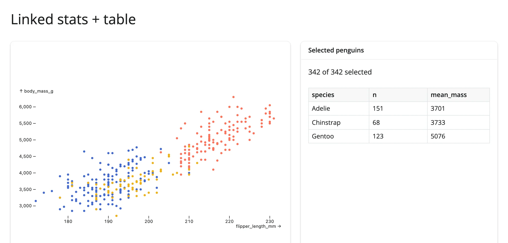
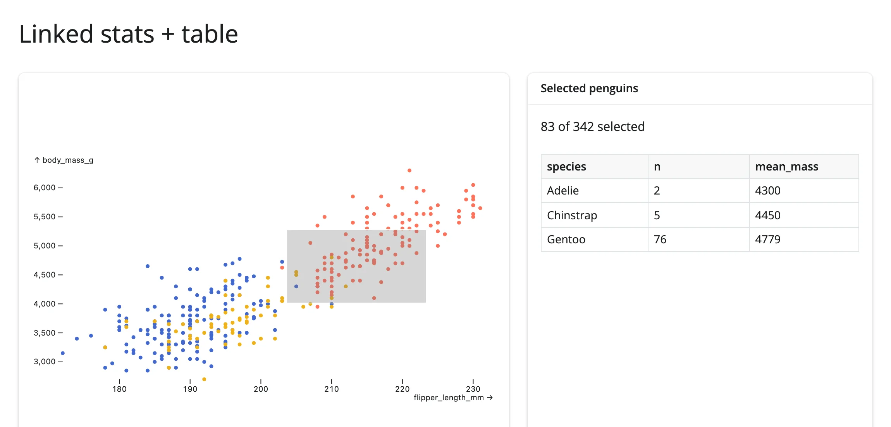

### mosaic &rarr; lonboard: crossfilter reaching into a completely different widget (cross-library)

This is the case in-widget crossfiltering structurally *can't* do: Mosaic's selection
syntax only applies to Mosaic's own marks. Getting the same brush to highlight points on
a lonboard map has to go through Shiny -- `params()` triggers an effect that recolors the
map's layer in place:

[`examples/15_mosaic_crossfilter_to_lonboard.py`](examples/15_mosaic_crossfilter_to_lonboard.py)
(reused verbatim from the [mosaic guide](../../widgets/mosaic/index.md#coordinating-multiple-views)):

```{.python file="examples/15_mosaic_crossfilter_to_lonboard.py"}
# Linked view: a Mosaic brush highlights matching points on a lonboard map.
#
# Pairs with: lonboard. The map isn't re-rendered on every brush move -- its
# layer's colors are updated in place (`reactive.isolate()` + assignment),
# which keeps the map's pan/zoom state untouched.
#
# Synthetic store locations (a small bundled dataset with this lon/lat/revenue
# shape isn't readily available) spread across the continental US.

from __future__ import annotations

import geopandas as gpd
import numpy as np
import pandas as pd
from lonboard import Map, ScatterplotLayer
from mosaic_widget import MosaicWidget
from shiny import reactive
from shiny.express import ui
from shinywidgets import render_lonboard, render_mosaic_widget

rng = np.random.default_rng(3)
n = 1500
stores = pd.DataFrame(
    {
        "id": np.arange(n),
        "lon": rng.uniform(-124, -70, n),
        "lat": rng.uniform(26, 48, n),
        "revenue": rng.gamma(2.0, 4000, n),
    }
)
GDF = gpd.GeoDataFrame(geometry=gpd.points_from_xy(stores.lon, stores.lat), crs="EPSG:4326")
DIM, BRIGHT = (120, 140, 200, 140), (255, 140, 0, 255)

spec = {
    "params": {"brush": {"select": "crossfilter"}},
    "plot": [
        {
            "mark": "rectY",
            "data": {"from": "stores"},
            "x": {"bin": "revenue"},
            "y": {"count": ""},
            "fill": "steelblue",
            "inset": 0.5,
        },
        {"select": "intervalX", "as": "$brush"},
    ],
    "xDomain": "Fixed",
    "width": 600,
    "height": 220,
}

ui.page_opts(title="Mosaic + lonboard", fillable=True)

with ui.layout_columns(col_widths=[6, 6]):
    with ui.card(full_screen=True):

        @render_mosaic_widget
        def dashboard():
            return MosaicWidget(spec, data={"stores": stores})

    with ui.card(full_screen=True):

        @render_lonboard
        def geo_map():
            colors = np.array([DIM] * n, dtype=np.uint8)
            layer = ScatterplotLayer.from_geopandas(
                GDF, get_fill_color=colors, radius_units="pixels", get_radius=4
            )
            return Map(layer)

        @reactive.effect
        def _highlight():
            params = dashboard.params()
            active = params.get("brush", {}).get("predicate", "").strip() != ""
            if active:
                selected_ids = {row[0] for row in dashboard.data().select("id").fetchall()}
                colors = np.array(
                    [BRIGHT if i in selected_ids else DIM for i in stores.id], dtype=np.uint8
                )
            else:
                colors = np.array([DIM] * n, dtype=np.uint8)
            with reactive.isolate():
                w = geo_map.widget
                if w is not None:
                    w.layers[0].get_fill_color = colors
```

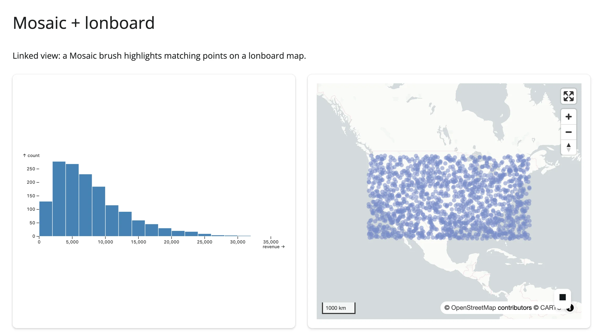
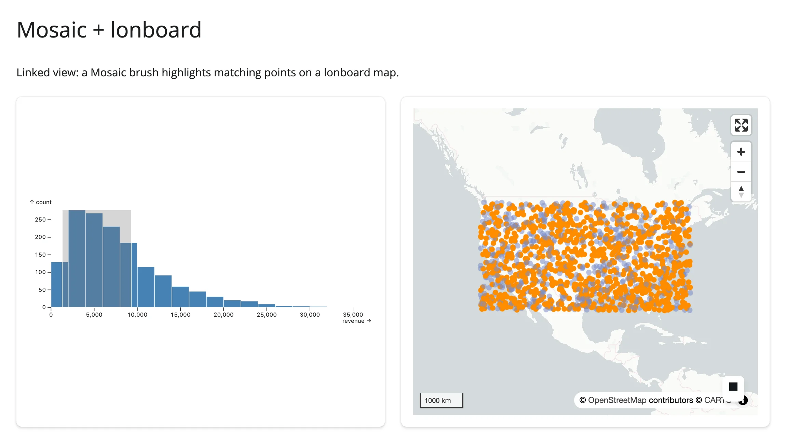

`render_mosaic_widget`'s DuckDB connection is locked down by default on current `main`
(#395: `enable_external_access=False` and friends, the same lockdown `render_quak`
applies) -- browser-sent SQL can no longer read or write server files. Pass
`allow_unrestricted_connection=True` to opt out if you need the shared connection to
reach outside data it was explicitly given.

Also worth knowing about: [embedding-atlas](../../widgets/embedding-atlas/index.md#coordinating-multiple-views)'s
`predicate()` is the same "through Shiny" idea applied to its own lasso/click crossfilter
-- a DuckDB `WHERE` clause you can replay against a second connection to drive a `plotly`
breakdown chart, since the atlas itself can only be driven one way (out, never in).

## 7. Brushing large data: push summaries, not points

**When**: the data behind a linked view is in the millions of rows, and the whole point
of brushing is that it should feel *fluid* -- every step of a drag should redraw as fast
as it would over a thousand rows.

**The idea**: a brush step's cost is a function of what it *ships*, not what it's
*computed from*. A step that ships a summary -- an image, a handful of bin counts --
costs the same whether it was aggregated from a thousand rows or five million, because
the summary's size depends on the output (screen pixels, bin count), not the input. A
step that ships rows -- every point inside a lasso, every selected marker's coordinates
-- grows with the selection, because there's no fixed size capping it: a bigger lasso is
just a bigger payload. The two examples below run the identical gesture (a 20-step,
one-second drag) over the identical dataset (5,000,000 real
[Gaia](https://www.cosmos.esa.int/web/gaia) stars, via the
[Mosaic datasets](https://github.com/uwdata/mosaic-datasets) collection) and differ only
in which of these two shapes each one takes.

### Push a summary: datashader raster + linked histograms

```{.python file="examples/18_datashader_brush_summaries.py"}
# Brushing large data: push summaries, not points. A datashader raster over
# 5M Gaia stars; box-selecting either histogram (brushing(), the live,
# debounced variant of brushed()) re-filters a shared param.Parameterized
# state the raster's DynamicMap watches -- re-rasterizing in place -- and
# writes the OTHER histogram's bar heights in place. Every brush step ships
# one image plus two arrays of 50 numbers, not the 5,000,000 rows.
from __future__ import annotations

import os
from pathlib import Path

import holoviews as hv
import numpy as np
import pandas as pd
import param
import plotly.graph_objects as go
from holoviews.operation.datashader import rasterize
from holoviews.streams import Params
from shiny import reactive
from shiny.express import ui

from shinywidgets import render_holoviews, render_plotly

hv.extension("bokeh")

DATA_PATH = Path(__file__).parent.parent / "data" / "gaia-5m.parquet"
gaia = pd.read_parquet(DATA_PATH, columns=["l", "b", "parallax", "phot_g_mean_mag"])
# measure/brush_payload.py overrides this to re-run the app at a smaller scale.
_n_rows = int(os.environ.get("LINKED_VIEWS_ROWS", len(gaia)))
if _n_rows < len(gaia):
    gaia = gaia.sample(n=_n_rows, random_state=0).reset_index(drop=True)

# Fixed bin edges so a brush only ever changes bar HEIGHTS, never the bins.
MAG_BINS = np.linspace(14.0, 21.5, 51)
PLX_BINS = np.linspace(-3.0, 5.0, 51)
MAG_CENTERS = (MAG_BINS[:-1] + MAG_BINS[1:]) / 2
PLX_CENTERS = (PLX_BINS[:-1] + PLX_BINS[1:]) / 2


def mag_counts(df: pd.DataFrame) -> np.ndarray:
    counts, _ = np.histogram(df["phot_g_mean_mag"].dropna(), bins=MAG_BINS)
    return counts


def plx_counts(df: pd.DataFrame) -> np.ndarray:
    counts, _ = np.histogram(df["parallax"].dropna(), bins=PLX_BINS)
    return counts


class BrushState(param.Parameterized):
    # (column, lo, hi) of the active brush, or None. One brush at a time --
    # brushing a new histogram replaces whichever filter was active before.
    filter_range = param.Parameter(default=None)


state = BrushState()  # one per session (Express re-runs this module per session)


def filtered(df: pd.DataFrame) -> pd.DataFrame:
    fr = state.filter_range
    if fr is None:
        return df
    col, lo, hi = fr
    return df[df[col].between(lo, hi)]


def make_points(filter_range):
    return hv.Points(filtered(gaia), ["l", "b"])


ui.page_opts(title="Brushing large data: push summaries, not points", fillable=True)

with ui.card(full_screen=True):
    ui.card_header(f"Sky map: {len(gaia):,} Gaia stars, rasterized")

    @render_holoviews
    def sky():
        points_dmap = hv.DynamicMap(make_points, streams=[Params(state, ["filter_range"])])
        return rasterize(points_dmap).opts(
            responsive=True,
            cmap="fire",
            cnorm="eq_hist",
            colorbar=True,
            xlim=(0, 360),
            ylim=(-90, 90),
        )


with ui.layout_columns(col_widths=[6, 6]):
    with ui.card():
        ui.card_header("Magnitude (brush to filter)")

        @render_plotly
        def mag_hist():
            fig = go.Figure(go.Bar(x=MAG_CENTERS, y=mag_counts(gaia), marker_color="#4c78a8"))
            fig.update_layout(dragmode="select", height=260, margin=dict(l=40, r=10, t=10, b=30))
            return fig

    with ui.card():
        ui.card_header("Parallax (brush to filter)")

        @render_plotly
        def plx_hist():
            fig = go.Figure(go.Bar(x=PLX_CENTERS, y=plx_counts(gaia), marker_color="#f58518"))
            fig.update_layout(dragmode="select", height=260, margin=dict(l=40, r=10, t=10, b=30))
            return fig


@reactive.effect
def _brush_magnitude():
    region = mag_hist.brushing()
    if region is None:
        return
    lo, hi = region["range"]["x"]
    with reactive.isolate():
        state.filter_range = ("phot_g_mean_mag", lo, hi)
        sub = gaia[gaia["phot_g_mean_mag"].between(lo, hi)]
        with plx_hist.widget.batch_update():
            plx_hist.widget.data[0].y = plx_counts(sub)


@reactive.effect
def _brush_parallax():
    region = plx_hist.brushing()
    if region is None:
        return
    lo, hi = region["range"]["x"]
    with reactive.isolate():
        state.filter_range = ("parallax", lo, hi)
        sub = gaia[gaia["parallax"].between(lo, hi)]
        with mag_hist.widget.batch_update():
            mag_hist.widget.data[0].y = mag_counts(sub)
```

`brushing()` -- the live, debounced variant of `brushed()` -- is what makes this feel
fluid: the raster re-filters and the other histogram's bars update continuously while the
user drags, not just once at release. Same `hv.DynamicMap`/`hv.streams.Params` idiom as the
[datashader guide's category-filter example](../../widgets/datashader/index.md#driving-the-aggregator-and-a-category-filter-from-shiny-inputs)
([HoloViews guide](../../widgets/holoviews/index.md) for `render_holoviews` itself, which has no
accessors of its own). Neither figure is rebuilt, so the sky map's zoom survives every brush.

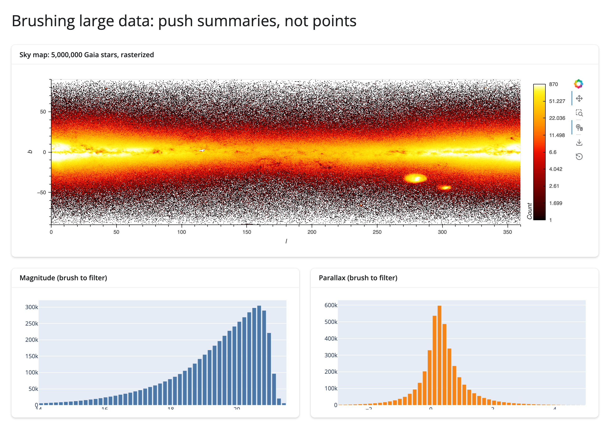
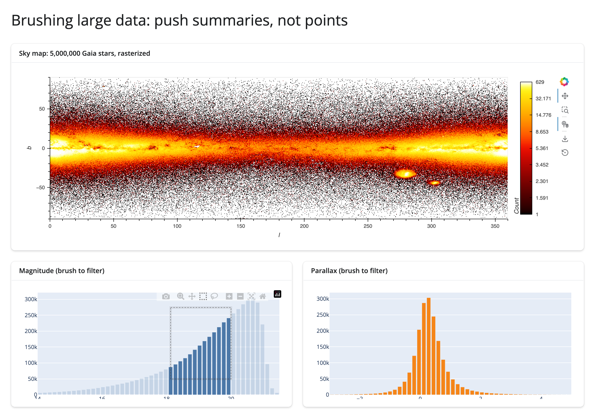

### The anti-pattern: lasso raw points at scale

[`examples/19_scattergl_lasso_raw_points.py`](examples/19_scattergl_lasso_raw_points.py)
(1,000,000 of the same 5,000,000 rows, plotted individually):

```{.python file="examples/19_scattergl_lasso_raw_points.py"}
# The anti-pattern: lassoing raw points at scale. Same Gaia data as 18, but
# sampled to 1M rows and plotted as individual go.Scattergl markers instead
# of a raster. The table reacts to selecting() -- the live variant of
# selected(), matching 18's brushing() -- so every point the lasso has
# caught so far streams back to Python continuously, and the work AND the
# payload grow with the SELECTION, not with a fixed image size like 18's.
from __future__ import annotations

import os
from pathlib import Path

import pandas as pd
import plotly.graph_objects as go
from shiny.express import ui

from shinywidgets import render_itables, render_plotly

DATA_PATH = Path(__file__).parent.parent / "data" / "gaia-5m.parquet"
# measure/brush_payload.py overrides this to re-run the app at a different scale.
SAMPLE_N = int(os.environ.get("LINKED_VIEWS_ROWS", "1000000"))

gaia = pd.read_parquet(DATA_PATH, columns=["l", "b", "phot_g_mean_mag"])
sample = gaia.sample(n=min(SAMPLE_N, len(gaia)), random_state=0).reset_index(drop=True)

ui.page_opts(title="Anti-pattern: lasso raw points at scale", fillable=True)

with ui.layout_columns(col_widths=[8, 4]):
    with ui.card(full_screen=True):
        ui.card_header(f"{SAMPLE_N:,} of {len(gaia):,} Gaia stars (Scattergl)")

        @render_plotly
        def scatter():
            fig = go.Figure(
                go.Scattergl(
                    x=sample["l"],
                    y=sample["b"],
                    mode="markers",
                    marker=dict(
                        size=2,
                        color=sample["phot_g_mean_mag"],
                        colorscale="Inferno",
                        opacity=0.5,
                    ),
                    customdata=sample.index,
                )
            )
            fig.update_layout(dragmode="lasso", xaxis_title="l", yaxis_title="b")
            return fig

    with ui.card(full_screen=True):
        ui.card_header("Lassoed stars")

        @render_itables
        def table():
            cols = ["l", "b", "phot_g_mean_mag"]
            pts = scatter.selecting()
            if pts is None or pts.empty:
                return sample.iloc[:0][cols]
            return sample.loc[sample.index.isin(pts["customdata"]), cols]
```

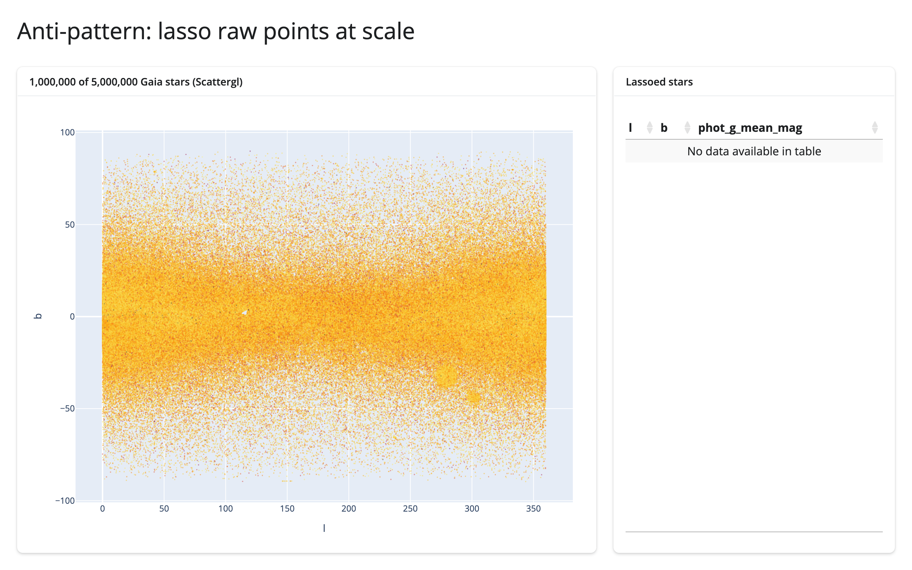
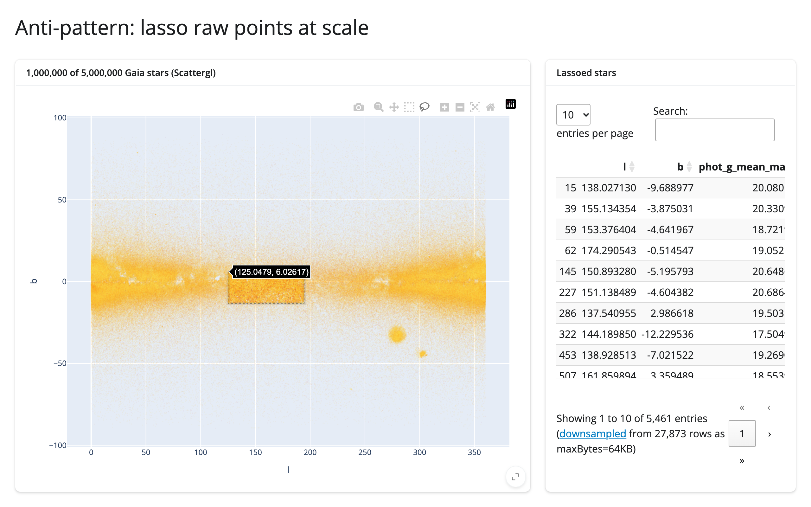

### The same idea inside the widget: Mosaic

[`examples/20_mosaic_brush_in_widget.py`](examples/20_mosaic_brush_in_widget.py) runs a
raster and the same two histograms over the same 5,000,000 rows as a single Mosaic spec,
with no `@reactive.effect` at all: `filterBy: "$brush"` on the raster mark and
`{"select": "intervalX", "as": "$brush"}` on each histogram push the brush through
Mosaic's own crossfilter grammar -- same idiom as the
[mosaic guide's raster example](../../widgets/mosaic/index.md#scale-a-million-rows-still-instant),
scaled up 5x with the interactor moved onto the histograms.

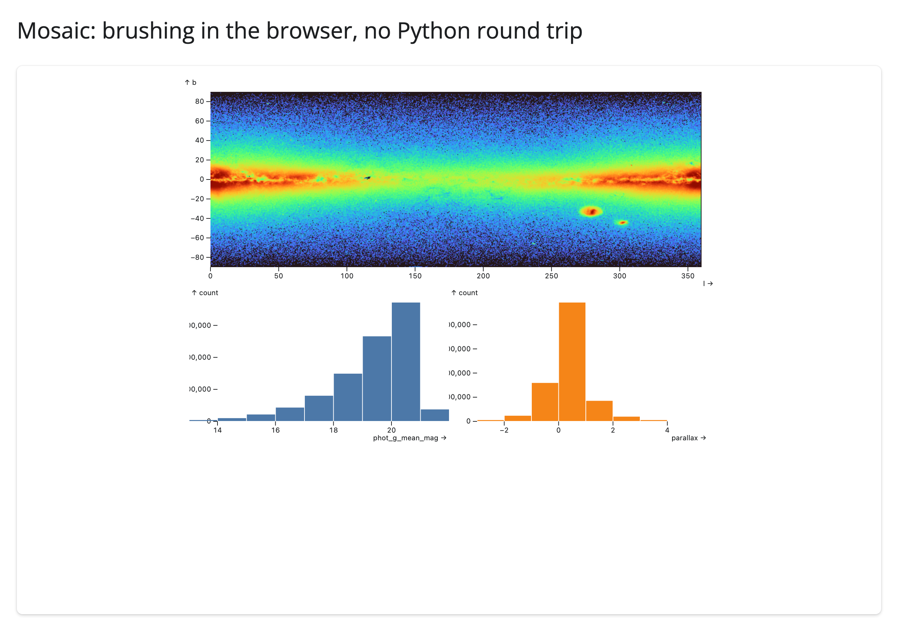
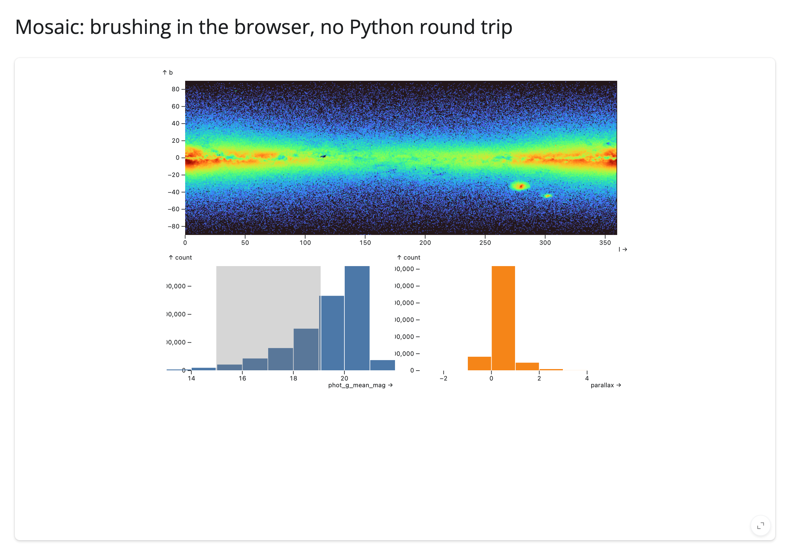

### Measured

20-step, one-second drag, real Playwright mouse gestures, websocket frames captured
after the first render and a full warm-up drag (method and raw numbers in
[NOTES.md](NOTES.md); the script is [`measure/brush_payload.py`](measure/brush_payload.py)):

| Example | Scale | Browser &rarr; server | Server &rarr; browser | Latency/step |
|---|---|---|---|---|
| 18 datashader (push summary) | 1,000,000 rows | 142 KB/drag | 2.12 MB/drag | 526 ms |
| 18 datashader (push summary) | 5,000,000 rows (full) | 206 KB/drag | 2.12 MB/drag | 592 ms |
| 19 Scattergl (raw points, anti-pattern) | 1,000,000 rows | 9.45 MB/drag | 4.93 MB/drag | 87 ms |
| 19 Scattergl (raw points, anti-pattern) | 5,000,000 rows (full) | widget's comm channel failed outright (see below) | -- | -- |
| 20 Mosaic (in-widget crossfilter) | 5,000,000 rows (full) | 33 KB/drag | 40.9 MB/drag | 3 ms |

18's server-to-browser bytes barely move between 1,000,000 rows and the full dataset
(2.12 MB both times, under a 0.01% difference) -- the raster is one image-sized frame
regardless of row count, exactly the claim. 19 costs more at *one fifth* the row count
than 18 does at any scale, and driving the identical gesture against the full
5,000,000-row `Scattergl` broke the plotly widget's comm channel outright
(`no comm channel defined`, then repeated `Cannot read properties of undefined (reading
'_hoverlayer')` page errors) -- not just slower, unusable. This is the browser-to-server
side of [#459](https://github.com/posit-dev/py-shinywidgets/issues/459): a lasso over
that many points serializes to a single widget-to-server message too large for the
default websocket frame limit, and the session drops rather than erroring cleanly; `shiny
run --ws-max-size` is the workaround until it's fixed. Per this task's instructions, that
row is left blank rather than estimated; 1,000,000 rows is 19's only verified scale.

**Latency/step doesn't tell the same story as bytes**: 18's 526-592 ms is *slower per
step* than 19's 87 ms, even though 18 ships two orders of magnitude fewer bytes -- because
18's debounced `brushing()` pays for a full datashader `rasterize()` over up to 5,000,000
points per commit, while 19's per-step cost is just a cheap pandas boolean filter over
1,000,000 rows, run more often. 18 is cheap in total traffic but pays a real compute cost
per update; 19 is fast per update but its *total* cost scales with the selection -- exactly
the failure mode "push summaries, not points" warns about. Latency per step was never the
claim bytes/drag makes (full derivation: [NOTES.md](NOTES.md)).

20 is a genuine surprise: the heaviest number in the table, in absolute bytes. Mosaic's
crossfilter grammar needs no Python glue code, but `render_mosaic_widget`'s DuckDB
connection lives in **Python**, not browser-side WASM, so every query the browser's
`vgplot` layer issues still round-trips over the websocket -- each result an Arrow buffer
close to 3 MB. It's still an *aggregate* (a density grid, not one row per star), so it
doesn't grow with row count the way 19's does, but "in the widget" doesn't always mean
"off the network" -- see [Crossfilter](#6-crossfilter-in-widget-vs-through-shiny) above.

### When to use which

- **Push a summary** (datashader/`rasterize`, or a server-computed histogram) when you
  want a dense view of literally all the data and can express what you need as an image
  or a small aggregate. You write the in-place update yourself (`hv.streams.Params`,
  `.widget.batch_update()`), but the payload is capped by output resolution, not row
  count.
- **Let the widget's own grammar push the aggregate** (Mosaic, Vega-Lite's
  `transform_filter` in [pattern 6](#6-crossfilter-in-widget-vs-through-shiny)) when the
  spec already expresses the aggregate you want -- no glue code. Check where the data
  actually lives first: a DuckDB connection built from a `pandas.DataFrame` (as
  `render_mosaic_widget` does here) still queries server-side, even though the pattern
  reads the same as a true in-browser case.
- **Select raw points or rows** only at sizes the browser can already show you
  comfortably -- tens of thousands, not millions. Past that, the payload (and, as
  measured here, the widget itself) scales with the selection, not a fixed output size.

## 8. One selection, many views

**When**: three or four outputs all need to react to the same selection -- a stat line,
a table, a chart -- and you want to compute the selection's underlying rows exactly
once, not once per output.

**The idea**: wrap the accessor read in a `@reactive.calc`. Every output that calls the
calc gets the same cached result for that reactive "tick," recomputed only when the
underlying accessor actually changes -- instead of each output independently re-running
whatever work turning the selection into rows requires (a customdata join, a DuckDB
query, a Vega-Lite selection test).

```{.python file="examples/16_plotly_one_calc_many_views.py"}
import matplotlib.pyplot as plt
import plotly.express as px
from shiny import reactive
from shiny.express import render, ui
from shinywidgets import render_itables, render_plotly

tips = px.data.tips().reset_index(drop=True)

ui.page_opts(title="One selection, many views", fillable=True)

with ui.layout_columns(col_widths=[6, 6]):
    with ui.card(full_screen=True):
        ui.card_header("Lasso some visits")

        @render_plotly
        def plot():
            fig = px.scatter(tips, x="total_bill", y="tip", color="time", custom_data=[tips.index])
            fig.update_layout(dragmode="lasso")
            return fig

    with ui.card(full_screen=True):
        ui.card_header("Selected visits")

        @reactive.calc
        def selected():
            # Computed once per selection change, however many outputs read
            # it below -- without this, each output would re-run plot's
            # selected_rows() (a customdata join against `tips`) on its own.
            return plot.selected_rows(tips)

        @render.text
        def summary():
            rows = selected()
            if rows.empty:
                return "Lasso some points to select visits."
            pct = rows["tip"] / rows["total_bill"] * 100
            return f"{len(rows)} visits, average tip {pct.mean():.1f}%"

        @render_itables
        def table():
            return selected()[["total_bill", "tip", "time", "size"]]

        @render.plot
        def hist():
            rows = selected()
            fig, ax = plt.subplots(figsize=(4, 2.2))
            if not rows.empty:
                ax.hist(rows["tip"] / rows["total_bill"] * 100, bins=10)
            ax.set_xlabel("Tip %")
            return fig
```

One lasso drives a text summary, an itables table, and a matplotlib histogram -- three
different libraries, one shared calc:

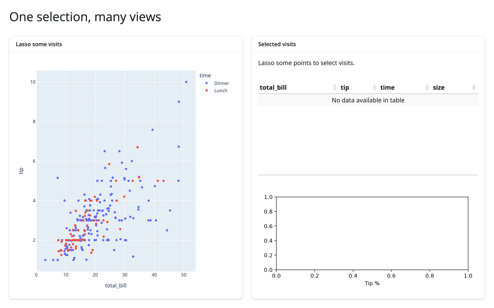
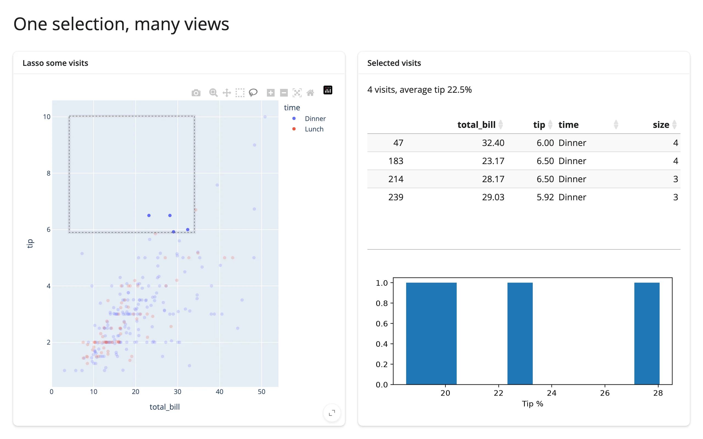

### Performance tips for this shape

- **Share the calc; don't call the accessor's post-processing (`selected_rows()`,
  `.data()`, `.aggregate()`) from each output separately.** Every one of those does real
  work -- a join, a query -- that's wasteful to repeat three or four times per tick.
- **`req()` early** inside the calc (or inside each output) so a "nothing selected yet"
  state short-circuits before the expensive part runs, rather than running the join
  against an empty selection and branching afterward.
- **Update in place instead of rebuilding** whichever output is heaviest to reconstruct
  (a big WebGL layer, a complex figure) -- see [pattern 4](#4-table--plotmap-updated-in-place)
  above. A `@reactive.calc` controls *how often* work happens; an in-place write
  controls *how much* work each occurrence does.
- **Know which accessor declares a default rate policy.** Accessors that debounce (most
  selection streams, including ipydatagrid's `selected()` and lonboard's `view_state()`
  as of #400) already collapse a drag into one or two calc recomputations; a few --
  k3d/pythreejs's `camera()` among them -- still declare no default policy at all and
  publish every raw update, which multiplies straight through a shared calc into every
  output reading it. The [ipydatagrid guide](../../widgets/ipydatagrid/index.md#rate-limiting)
  has a measured repro of a heavy per-tick redraw stalling a drag before that accessor
  had a default debounce, and the general rule in the
  [rate limiting section](../reacting-to-widgets/index.md#rate-limiting) of the
  accessors article.

## Pattern picker

| Goal | Pattern | Recommended widget pairs |
|---|---|---|
| See exactly which records are selected | 1. Selection &rarr; table | [plotly](../../widgets/plotly/index.md)/[altair](../../widgets/altair/index.md)/[bokeh](../../widgets/bokeh/index.md)/[jscatter](../../widgets/jscatter/index.md) &rarr; [itables](../../widgets/itables/index.md) |
| Show everything about one clicked thing | 2. Click &rarr; detail card | [lonboard](../../widgets/lonboard/index.md)/[maplibre](../../widgets/maplibre/index.md)/[ipyleaflet](../../widgets/ipyleaflet/index.md) (map), [ipycytoscape](../../widgets/ipycytoscape/index.md)/[ipysigma](../../widgets/ipysigma/index.md) (graph), [altair](../../widgets/altair/index.md)/[bqplot](../../widgets/bqplot/index.md) (chart point) |
| Summarize only what's on screen | 3. Viewport &rarr; summary | [ipyleaflet](../../widgets/ipyleaflet/index.md)/[lonboard](../../widgets/lonboard/index.md)/[maplibre](../../widgets/maplibre/index.md)/[geolibre](../../widgets/geolibre/index.md) &rarr; [plotly](../../widgets/plotly/index.md)/[matplotlib](../../widgets/matplotlib/index.md) |
| Drive a chart or map from a row click, without resetting it | 4. Table &rarr; plot/map, in place | [itables](../../widgets/itables/index.md)/`render.data_frame` &rarr; [plotly](../../widgets/plotly/index.md)/[geolibre](../../widgets/geolibre/index.md)/[ipyleaflet](../../widgets/ipyleaflet/index.md) |
| Keep two views of the same selection in sync | 5. Two-way linking | [jscatter](../../widgets/jscatter/index.md) &harr; [jscatter](../../widgets/jscatter/index.md) (direct mirror), [lonboard](../../widgets/lonboard/index.md) &harr; [plotly](../../widgets/plotly/index.md) (broker), [bqplot](../../widgets/bqplot/index.md) mark &harr; mark (Python round-trip) |
| Let several charts narrow down together | 6. Crossfilter | [altair](../../widgets/altair/index.md) (Vega-Lite `transform_filter`), [mosaic](../../widgets/mosaic/index.md) (`filterBy`), [quak](../../widgets/quak/index.md)/[embedding-atlas](../../widgets/embedding-atlas/index.md) (DuckDB, through Shiny) |
| Keep a brush fluid over millions of rows | 7. Brushing large data | [datashader](../../widgets/datashader/index.md)/[holoviews](../../widgets/holoviews/index.md) (rasterize + linked histograms), [mosaic](../../widgets/mosaic/index.md) (in-widget aggregate), vs. [plotly](../../widgets/plotly/index.md) `Scattergl` raw-point selection (anti-pattern) |
| Feed a stat line, a table, and a chart from one gesture | 8. One selection, many views | any selection accessor &rarr; shared `@reactive.calc` &rarr; [itables](../../widgets/itables/index.md)/`render.text`/[matplotlib](../../widgets/matplotlib/index.md)/[plotly](../../widgets/plotly/index.md) |

## Learn more

- [Reacting to widgets](../reacting-to-widgets/index.md) and its
  [cheat sheet](../reacting-to-widgets/cheatsheet.md): the accessor mental model these
  patterns are all built from -- kept vs. re-seeded across a re-render, reading on
  demand, rate limits, writing back, and lifetimes.
- Every guide's own "Coordinating multiple views" section has 2-4 more patterns specific
  to that widget, including several not shown here: start with
  [plotly](../../widgets/plotly/index.md#coordinating-multiple-views),
  [itables](../../widgets/itables/index.md#coordinating-multiple-views),
  [ipyleaflet](../../widgets/ipyleaflet/index.md#coordinating-multiple-views),
  [lonboard](../../widgets/lonboard/index.md#coordinating-multiple-views),
  [mosaic](../../widgets/mosaic/index.md#coordinating-multiple-views),
  [quak](../../widgets/quak/index.md#coordinating-multiple-views),
  [ipydatagrid](../../widgets/ipydatagrid/index.md#coordinating-multiple-views),
  [bqplot](../../widgets/bqplot/index.md#coordinating-multiple-views),
  [maplibre](../../widgets/maplibre/index.md#coordinating-multiple-views),
  [geolibre](../../widgets/geolibre/index.md#coordinating-multiple-views),
  [ipycytoscape](../../widgets/ipycytoscape/index.md#coordinating-multiple-views),
  [altair](../../widgets/altair/index.md#coordinating-multiple-views),
  [perspective](../../widgets/perspective/index.md#coordinating-multiple-views),
  [embedding-atlas](../../widgets/embedding-atlas/index.md#coordinating-multiple-views),
  [datashader](../../widgets/datashader/index.md#coordinating-multiple-views), and
  [holoviews](../../widgets/holoviews/index.md#coordinating-multiple-views).
- `docs/widget-guides/FINDINGS.md` for cross-cutting bugs that affect linking apps;
  one worth calling out here since an earlier version of this article routed around
  it: the `render_reactable` accessor regression it describes (`_accessor_specs` vs.
  `accessor_specs`, all five accessors dead) is **fixed on current `main`** (#394),
  confirmed directly against `render_reactable`'s source for this update. Reactable is
  a fine choice for pattern 1 or 8 now; this article still only builds itables-based
  examples of those patterns (see [NOTES.md](NOTES.md)), not because reactable doesn't
  work.
