Every number on this page was measured on this machine, by driving a real Shiny app with Playwright and reading
real websocket frames, HTTP responses, and server process memory -- not estimated from reading source code. Most
numbers date from the original pass against shinywidgets `main` @ `00f90249`; Section 4 (rate limiting) and the
accessor-attachment check in Section 2 were re-measured against `main` @ `32ca7035` after the reactive-accessor
redesign changed what they were testing.

This page opens with an orientation section -- the three strategies that cover every widget in this roster
that handles genuinely large data -- then answers five further, narrower, measured questions, each with its
own section below:

1. **Re-render vs. in-place update** -- when a widget changes, should your code build a new one or mutate the
   existing one? How much does the choice cost in bytes, and what does it preserve?
2. **Big data: choosing the right widget** -- at 10 thousand, 100 thousand, and a million points, how do
   plotly, jscatter, lonboard, and perspective actually compare?
3. **Lifetimes and memory** -- what does `session_lifetime()` vs. `shared_lifetime()` cost in server RAM as
   concurrent sessions pile up?
4. **Rate limiting** -- does `rate_policy`/`rate_delay` actually do anything for the accessor you're reading?
5. **Bundle size and first load** -- how many bytes does a user download before any of this matters?

This article assumes you've read [Reacting to widgets](../reacting-to-widgets/index.md) for the accessor
mental model, lifetimes, and rate-limiting concepts; this page re-verifies the performance-relevant claims from
that article and the per-widget guides with fresh measurements, and goes one level deeper on *why* the numbers
come out the way they do.

## Three approaches to large data

Every widget in this roster that handles genuinely large data does it with one of three strategies. Picking the
right one (or combining two, as the linked-views article's pattern 7 does, below) matters more than which
specific library you reach for within a strategy.

1. **Draw it with the GPU in the browser.** Send the real points to the browser and let the GPU handle
   per-point rendering and hit-testing: plotly's `Scattergl`/`render_mode="webgl"`, bokeh's
   `figure(output_backend="webgl")`, [jscatter](../../widgets/jscatter/index.md#large-data), and
   [lonboard](../../widgets/lonboard/index.md#large-data). Payload and render time both scale with point count
   (Section 2 below), but you get real per-point interaction -- lasso, hover, pick -- that a server-side image
   can't offer.
2. **Summarize on the server.** Aggregate before anything crosses the wire, so the payload is sized by the
   *output* (screen pixels, bin count), not the *input* (row count):
   [datashader](../../widgets/datashader/index.md#large-data) (`rasterize`/`datashade`, via HoloViews) and
   [VegaFusion for altair](../../widgets/altair/index.md#large-data). This is the only strategy of the three that stays
   flat as data grows into the tens of millions of rows (Section 2 below).
3. **Only send what's visible.** Keep the data server-side (or in a server-managed query engine) and ship only
   the current page, view, or query result: [perspective](../../widgets/perspective/index.md#large-data)'s virtualized
   table, [mosaic](../../widgets/mosaic/index.md#large-data) and [quak](../../widgets/quak/index.md#large-data) via DuckDB, and
   itables' `maxBytes` downsampling (see the [itables guide](../../widgets/itables/index.md#large-data)).

These aren't mutually exclusive. The linked-views article's
["Brushing large data: push summaries, not points"](../linked-views/index.md#7-brushing-large-data-push-summaries-not-points)
pattern combines (1) and (2) -- a GPU-drawn raster for the dense view, server-summarized histograms for the
linked controls -- and measures bytes per brush step for both. Its one-sentence finding is the principle behind
all three strategies above: **a brush (or any interaction) step's cost should be a function of what it ships,
not what it's computed from** -- push a summary, not the rows.

## 1. Re-render vs. in-place update

A render function that reads nothing but its own module-level data runs once and never again: every update has
to come from somewhere else, and there are exactly two ways to deliver it. **Re-render** means the render
function runs again and returns a brand new widget -- new zoom level, new selection, new everything, and (for
an anywidget-based widget) another full copy of its JavaScript bundle. **In-place update** means a
`@reactive.effect` mutates the *existing* widget's trait (`plot.widget.data[0].marker.color = ...`,
`layer.get_fill_color = ...`) and only the changed trait crosses the wire.

Three widgets, one apples-to-apples test each: two buttons wired to the identical visual change (toggle a
color), one driving a `@reactive.effect` that mutates the live widget, the other driving a `reactive.value`
that forces the render function to run again. A Playwright page listens to every websocket frame in both
directions and sums the bytes for each click.

| Widget | Change | In-place bytes | Re-render bytes | Ratio |
|---|---|---:|---:|---:|
| plotly (5,000 points) | marker color | 36.3 KB | 5.45 MB | **146x** |
| lonboard (50,000 points) | per-point fill color | 141.8 KB | 6.19 MB | **43x** |
| ipyleaflet (177-country choropleth) | `layer.visible` toggle | 0.4 KB | 1.11 MB | **2,500x** |
| ipyleaflet (same choropleth) | `layer.style` color | 1.09 MB | 1.11 MB | **1.02x** (see below) |

The three apps (lonboard: [`examples/02_inplace_lonboard.py`](examples/02_inplace_lonboard.py);
ipyleaflet: [`examples/03_inplace_ipyleaflet.py`](examples/03_inplace_ipyleaflet.py)).
The plotly one ([`examples/01_inplace_plotly.py`](examples/01_inplace_plotly.py)):

```{.python file="examples/01_inplace_plotly.py"}
import numpy as np
import pandas as pd
import plotly.express as px
from shiny import reactive
from shiny.express import input, ui
from shinywidgets import render_plotly

ui.page_opts(title="plotly: re-render vs in-place", fillable=True)

N = 5000
rng = np.random.default_rng(42)
df = pd.DataFrame({"x": rng.normal(size=N), "y": rng.normal(size=N)})

ui.input_action_button("inplace", "Update in place (batch_update)")
ui.input_action_button("rerender", "Force re-render (new figure)")

color_toggle = reactive.value(False)
rerender_trigger = reactive.value(0)


@render_plotly
def plot():
    # Reads rerender_trigger so clicking "rerender" forces a fresh figure;
    # the in-place path never touches this and so never re-enters here.
    rerender_trigger()
    with reactive.isolate():
        is_red = color_toggle()
    color = "red" if is_red else "blue"
    fig = px.scatter(df, x="x", y="y", color_discrete_sequence=[color])
    return fig.update_traces(marker=dict(size=4))


@reactive.effect
@reactive.event(input.inplace)
def _inplace():
    with reactive.isolate():
        is_red = not color_toggle()
    color_toggle.set(is_red)
    with plot.widget.batch_update():
        for trace in plot.widget.data:
            trace.marker.color = "red" if is_red else "blue"


@reactive.effect
@reactive.event(input.rerender)
def _rerender():
    with reactive.isolate():
        color_toggle.set(not color_toggle())
    rerender_trigger.set(rerender_trigger() + 1)
```

### Why re-render costs 146x more than the data itself

5,000 points of `x`/`y` float data is only tens of kilobytes either way. Decoding the actual comm_open message
on the wire for the re-render case shows why it's 5.45 MB: the new `FigureWidget`'s state includes an `_esm`
field -- **the entire plotly.js bundle, re-sent as part of the widget's own state, every single re-render**.
In-place's `batch_update()` never creates a new model, so it never touches `_esm` at all; only the changed
`marker.color` buffer crosses the wire. This is the old plotly report's "5 MB bundle resent per render" claim,
independently re-measured and confirmed real on current `main` (the plotly guide's own notes had left it
unverified).

lonboard shows the same shape for a different reason: its re-render resends both the point *positions* (which
never changed) and lonboard's own deck.gl/maplibre JavaScript, where in-place only resends the one Arrow buffer
that changed (the color column):

```{.python file="examples/02_inplace_lonboard.py"}
import geopandas as gpd
import numpy as np
from lonboard import Map, ScatterplotLayer
from shiny import reactive
from shiny.express import input, ui
from shinywidgets import render_lonboard

ui.page_opts(title="lonboard: re-render vs in-place", fillable=True)

N = 50_000
rng = np.random.default_rng(42)
lon = rng.uniform(-122.6, -122.3, N)
lat = rng.uniform(37.6, 37.85, N)
POINTS = gpd.GeoDataFrame(geometry=gpd.points_from_xy(lon, lat), crs="EPSG:4326")

ui.input_action_button("inplace", "Update in place (set get_fill_color)")
ui.input_action_button("rerender", "Force re-render (new Map)")

color_toggle = reactive.value(False)
rerender_trigger = reactive.value(0)


# Per-point varying colors (not a constant RGB triple) so the measured
# payload reflects real per-point data, not a degenerate, highly
# compressible constant array.
_rank = np.argsort(np.argsort(lon)) / N


def colors(is_red: bool) -> np.ndarray:
    r = (_rank * 255).astype("uint8")
    out = np.zeros((N, 3), dtype="uint8")
    if is_red:
        out[:, 0] = r
        out[:, 2] = 255 - r
    else:
        out[:, 2] = r
        out[:, 0] = 255 - r
    return out


@render_lonboard
def map():
    rerender_trigger()
    with reactive.isolate():
        is_red = color_toggle()
    layer = ScatterplotLayer.from_geopandas(
        POINTS, get_fill_color=colors(is_red), get_radius=20
    )
    return Map(layer)


@reactive.effect
@reactive.event(input.inplace)
def _inplace():
    with reactive.isolate():
        is_red = not color_toggle()
    color_toggle.set(is_red)
    map.widget.layers[0].get_fill_color = colors(is_red)


@reactive.effect
@reactive.event(input.rerender)
def _rerender():
    with reactive.isolate():
        color_toggle.set(not color_toggle())
    rerender_trigger.set(rerender_trigger() + 1)
```

Zooming in on each map before clicking either button shows what the bytes difference buys you:

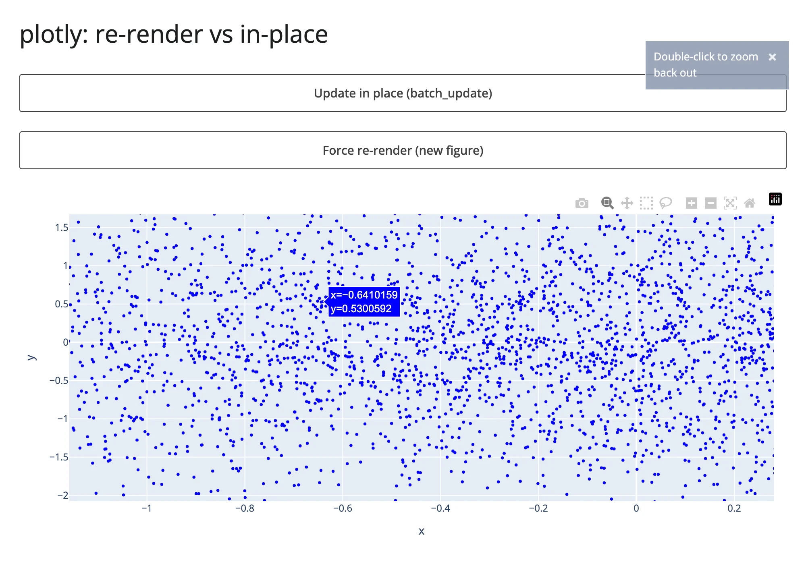

After **in-place** color update, still zoomed to the identical range:

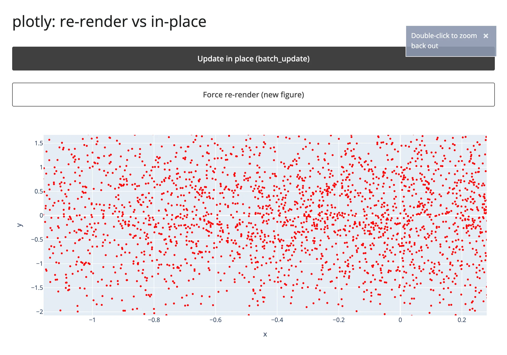

After **re-render**, zoomed back out to the figure's original extent -- the color changed, but so did
everything else:

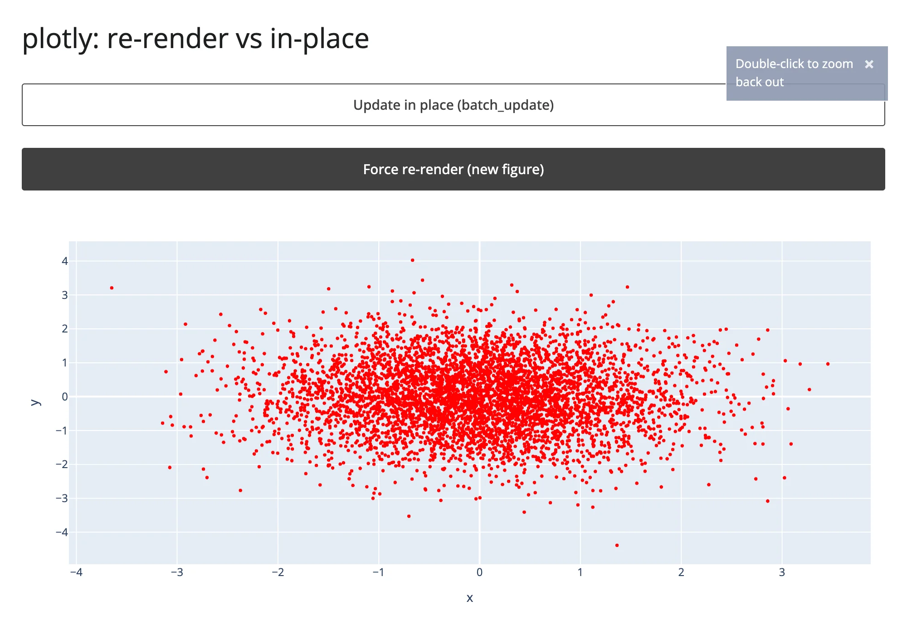

lonboard tells the identical story with camera state instead of axis ranges -- zoomed in to a "2 km" scale bar
before either button, still at "2 km" after in-place, back to the map's default "5 km" fit-to-data view after
re-render:

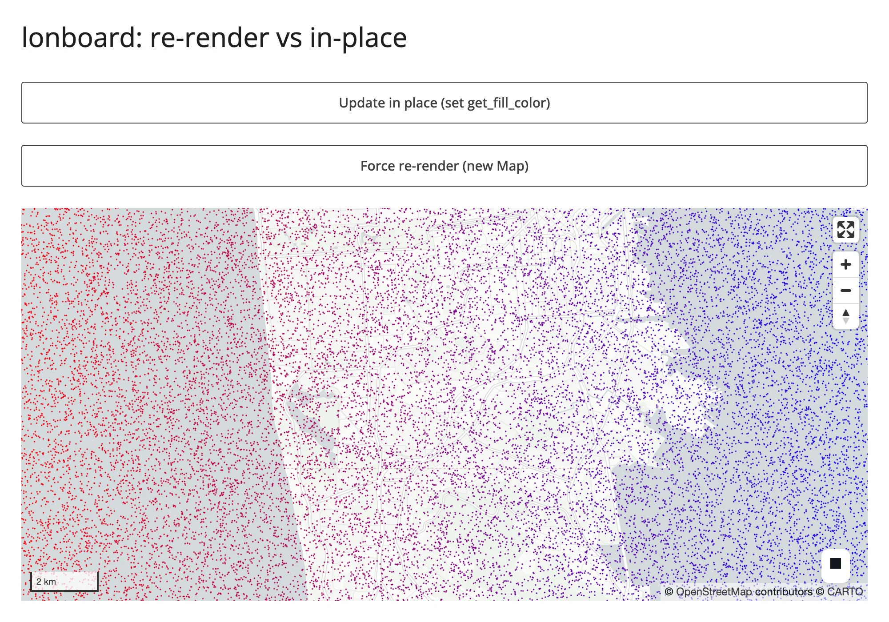
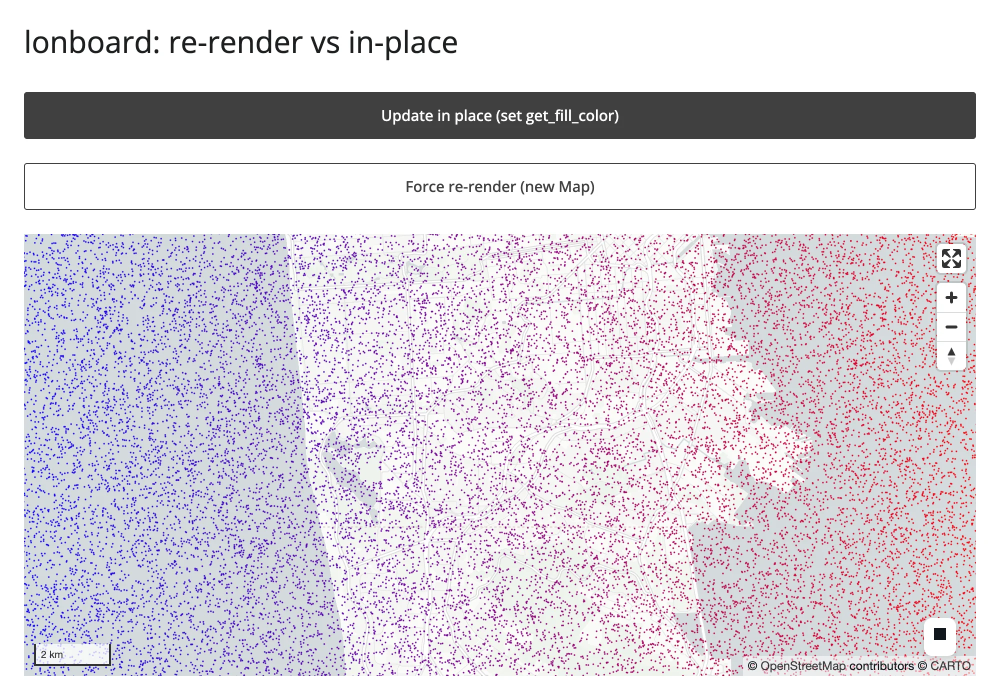
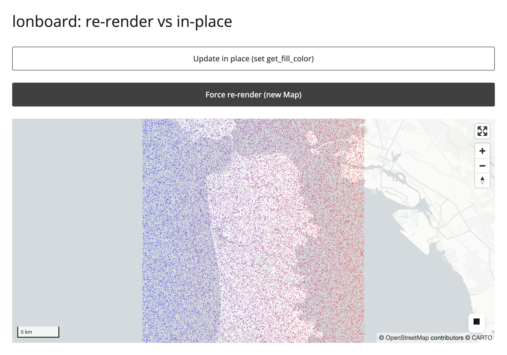

### When "in-place" doesn't actually save bytes

The ipyleaflet row above has two different in-place updates on the exact same 819 KB countries GeoJSON layer,
and they tell opposite stories. Toggling `layer.visible` (a plain boolean trait) costs 444 bytes -- the
textbook case. Setting `layer.style` costs **1.09 MB, almost exactly what a full re-render costs (1.11 MB)**.

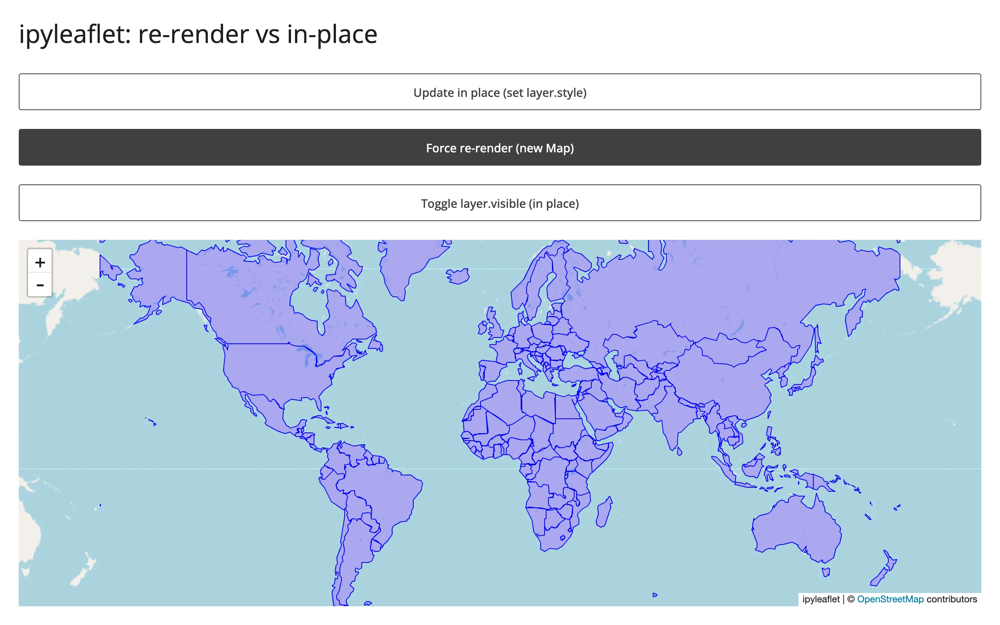

The reason is upstream, not a shinywidgets limitation: ipyleaflet's `GeoJSON` class observes its own `style`
trait and, on every change, rebuilds its `data` trait by baking the style into each feature's `properties`
(`ipyleaflet.GeoJSON._get_data()`) -- so *any* style change re-syncs the entire feature collection, not just a
small style object. There is no cheaper way to recolor a GeoJSON layer in ipyleaflet; if you need cheap
restyling of many features, a vector-tile-backed map (maplibre, lonboard) or a layer whose style is separate
from its data is the better fit. This is worth knowing before you assume "in-place" is a blanket win -- verify
what actually crosses the wire for the trait you're setting.

```{.python file="examples/03_inplace_ipyleaflet.py"}
import json
import urllib.request

import ipyleaflet as L
from shiny import reactive
from shiny.express import input, ui
from shinywidgets import render_ipyleaflet

ui.page_opts(title="ipyleaflet: re-render vs in-place", fillable=True)

COUNTRIES_URL = "https://raw.githubusercontent.com/nvkelso/natural-earth-vector/master/geojson/ne_110m_admin_0_countries.geojson"
with urllib.request.urlopen(COUNTRIES_URL) as resp:
    COUNTRIES = json.load(resp)

ui.input_action_button("inplace", "Update in place (set layer.style)")
ui.input_action_button("rerender", "Force re-render (new Map)")
ui.input_action_button("toggle_visible", "Toggle layer.visible (in place)")

color_toggle = reactive.value(False)
rerender_trigger = reactive.value(0)


def style(is_red: bool) -> dict:
    return {"color": "red" if is_red else "blue", "fillOpacity": 0.3, "weight": 1}


@render_ipyleaflet
def map():
    rerender_trigger()
    with reactive.isolate():
        is_red = color_toggle()
    m = L.Map(center=(20, 0), zoom=2)
    m.add(L.GeoJSON(data=COUNTRIES, style=style(is_red), name="countries"))
    return m


def countries_layer():
    return next(lyr for lyr in map.widget.layers if lyr.name == "countries")


@reactive.effect
@reactive.event(input.inplace)
def _inplace():
    with reactive.isolate():
        is_red = not color_toggle()
    color_toggle.set(is_red)
    countries_layer().style = style(is_red)


@reactive.effect
@reactive.event(input.rerender)
def _rerender():
    with reactive.isolate():
        color_toggle.set(not color_toggle())
    rerender_trigger.set(rerender_trigger() + 1)


@reactive.effect
@reactive.event(input.toggle_visible)
def _toggle_visible():
    layer = countries_layer()
    layer.visible = not layer.visible
```

A note on timing: the bytes numbers above are solid (summed directly from websocket frames). Wall-clock
"time to visible update" is not reported in this table on purpose -- on localhost, network transfer is never
the bottleneck, so a network-quiet-based timer mostly measures server-side serialization time, and in one run
it made the 5.45 MB re-render look *faster* than the 36 KB in-place update, which is an artifact, not a real
result. Section 2 below has a wall-clock comparison with a trustworthy methodology (waiting for the browser's
own widget registry to report a mounted, stable view) where the time differences are real and substantial.

**Mined from other guides, not re-measured here**:
pyvista's in-place re-render dropped from a roughly 1.1 MB floor (trame-pyvista 0.2.3) to about 12 KB for an
unchanged mesh once its vtk.js runtime became a per-session singleton instead of a per-render resend
(trame-pyvista 0.3.4) -- see the [pyvista guide](../../widgets/pyvista/index.md). keplergl's playback/animation stream
showed roughly 12-215 raw config syncs per 4 seconds unthrottled vs. about 2/second throttled -- see the
[keplergl guide](../../widgets/keplergl/index.md).

## 2. Big data: choosing the right widget

At 10,000 / 100,000 / 1,000,000 synthetic points (`numpy.random.default_rng(42)`, fixed seed, generated in
memory), four renderers' **initial** payload and time-to-render:

| Renderer | Transport | 10K bytes | 10K time | 100K bytes | 100K time | 1M bytes | 1M time |
|---|---|---:|---:|---:|---:|---:|---:|
| plotly (`Scattergl`) | binary buffer, base64 | 5.58 MB | 3.6 s | 7.50 MB | 4.5 s | 26.7 MB | 8.8 s |
| jscatter | binary buffer, base64 | 2.53 MB | 1.5 s | 4.45 MB | 1.5 s | 23.6 MB | 3.7 s |
| lonboard | GeoArrow binary, base64 | 5.03 MB | 1.8 s | 7.07 MB | 2.0 s | 25.2 MB | 3.1 s |
| perspective | virtualized (server-side table) | 6.48 MB | 2.3 s | 6.48 MB | 2.1 s | not run* |
| datashader (`rasterize`, via holoviews) | server-rasterized image, binary buffer | 2.19 MB | 2.7 s | 2.26 MB | 2.7 s | 2.36 MB | 2.7 s |
| embedding-atlas | binary buffer (positions + text), base64 | 6.13 MB | 1.7 s | 7.05 MB | 1.9 s | 16.2 MB | 2.3 s |

\* perspective's payload is flat from 10K to 100K rows (see below); a 1M-row run would almost certainly repeat
that result for the same architectural reason, so it was skipped to keep this pass's 1M-point runs few, per
this project's resource rules.

datashader's flatness holds another order of magnitude further: pushed to 10,000,000 points -- a scale none of
the other renderers in this table can even attempt -- the rasterized image is still only 2.51 MB, a 15%
increase over the 10K case for 1,000x the data (bytes-only this pass; the row holds a fixed 700x450 image size
constant so the comparison isn't confounded by viewport).
embedding-atlas does **not** get this flatness for free: its GPU map needs the real points client-side, the
same way the three scatter renderers above do, so its payload grows with N -- it belongs with "draw it with the
GPU in the browser" for transport purposes, even though its auto-labeling, charts, and SQL cross-filter put it
in a different category on the sidebar. Its time-to-render grows with N too (1.7 s to 2.3 s, 10K to 1M), while
datashader's stays flat (2.7 s at every scale) -- the same story bytes tell, for the same reason. Both rows
needed a different stopping signal than the other renderers in this table to measure that time honestly: a
widget can register as mounted, and the page as settled, before its image or WebGPU map
actually finishes drawing the points it already received.

The four apps ([`examples/05_bigdata_jscatter.py`](examples/05_bigdata_jscatter.py),
[`examples/06_bigdata_lonboard.py`](examples/06_bigdata_lonboard.py), and
[`examples/07_bigdata_perspective.py`](examples/07_bigdata_perspective.py) follow the same shape).
The plotly one ([`examples/04_bigdata_plotly.py`](examples/04_bigdata_plotly.py)):

```{.python file="examples/04_bigdata_plotly.py"}
import os

import numpy as np
import pandas as pd
import plotly.graph_objects as go
from shiny.express import ui
from shinywidgets import render_plotly

N = int(os.environ.get("PERF_N", "10000"))
rng = np.random.default_rng(42)
df = pd.DataFrame({"x": rng.normal(size=N), "y": rng.normal(size=N)})

ui.page_opts(title=f"plotly scattergl: {N:,} points", fillable=True)


@render_plotly
def plot():
    return go.FigureWidget(
        data=[go.Scattergl(x=df["x"], y=df["y"], mode="markers", marker=dict(size=3))]
    )
```

[`examples/04_bigdata_plotly.py`](examples/04_bigdata_plotly.py) (run with `PERF_N=100000 uv run shiny run ...`)

100,000 points, all three scatter-style renderers, all rendered successfully and panned/zoomed interactively in
the browser:

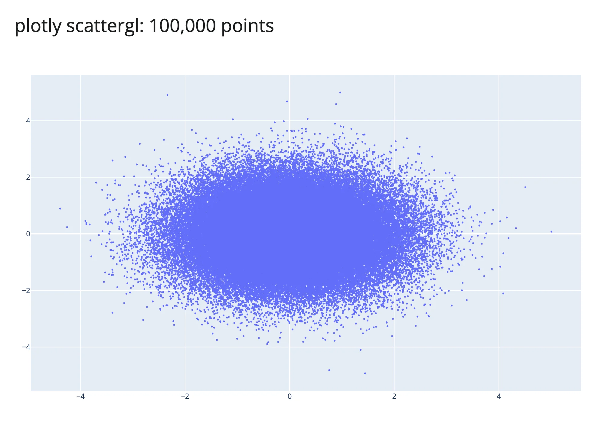
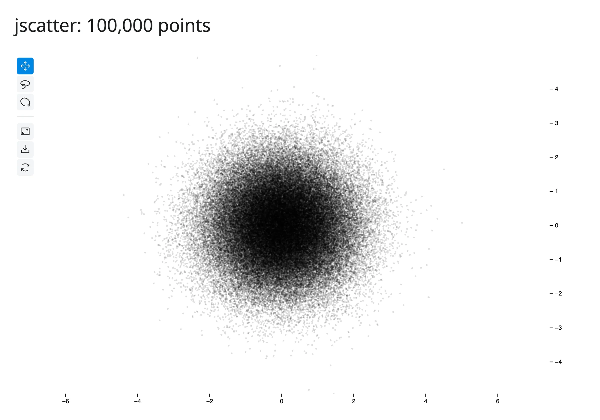
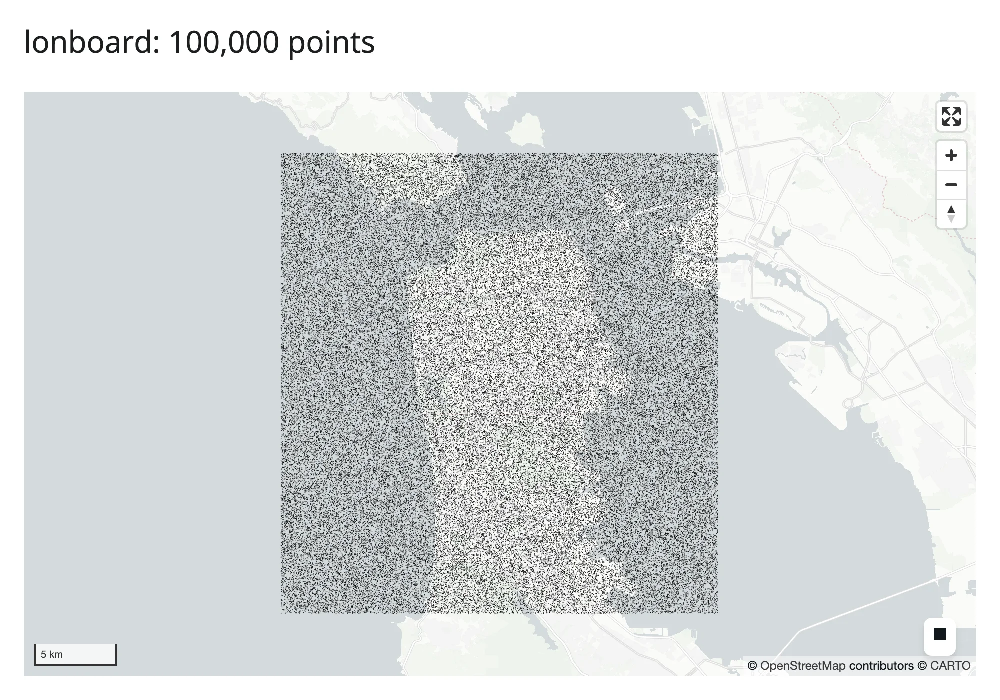

100,000 points again, but the two new rows -- a rasterized image (datashader) instead of individual marks, and
embedding-atlas's GPU map plus its auto-generated table:

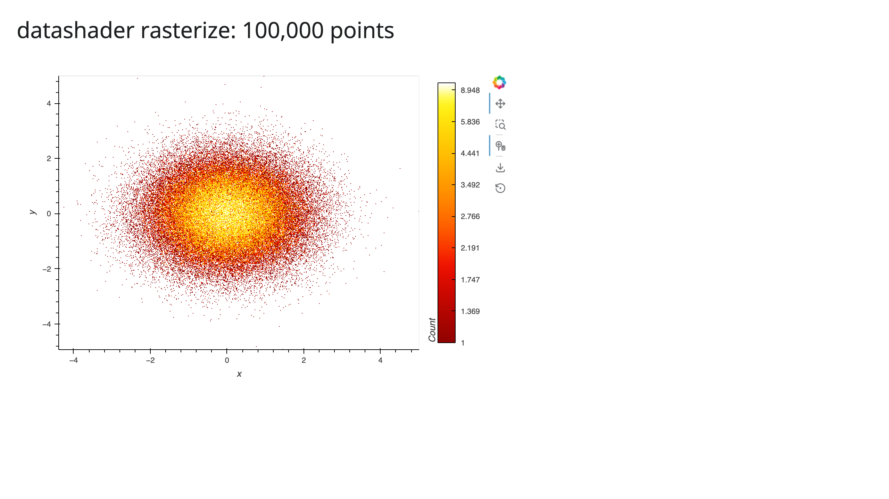
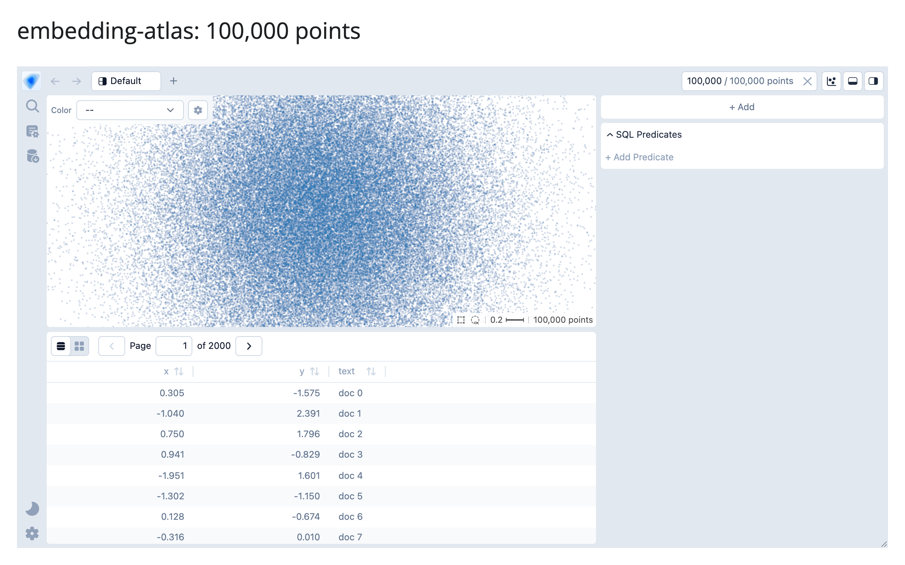

[`examples/15_bigdata_datashader.py`](examples/15_bigdata_datashader.py),
[`examples/16_bigdata_embedding_atlas.py`](examples/16_bigdata_embedding_atlas.py)

### The real story isn't "JSON vs. binary" -- it's bundle size and client-side cost

The obvious guess going in was "plotly sends inefficient JSON text, jscatter and lonboard send efficient binary
buffers, so plotly should be dramatically bigger." Measuring the actual comm_open message disproves half of
that: **plotly's `Scattergl` trace data travels through the exact same binary-buffer-plus-base64 channel as
jscatter and lonboard** (confirmed via the message's own `buffer_paths`, which point straight at `_widget_data`
for the x/y arrays) -- because shinywidgets' comm layer gives every traitlets-synced numpy array this treatment,
not just plotly's. Fitting a line to the marginal cost per point across all three gives essentially the same
rate, about 20-21 bytes/point (two float64 coordinates, inflated 33% by base64), for all three libraries. The
story is a **fixed one-time bundle cost, not a per-point transport difference**:

| Renderer | Extrapolated bundle (N->0) | Marginal cost/point |
|---|---:|---:|
| jscatter | ~2.3 MB | ~21 B |
| lonboard | ~4.8-5.1 MB | ~20-22 B |
| plotly | ~5.4 MB | ~21 B |

The bundle is paid once per browser session regardless of row count; the per-point rate is what makes the
curve climb afterward. That changes the decision: for a few hundred thousand points, jscatter's much lighter
bundle wins on cold-start bytes even though its marginal per-point rate is no better than plotly's. It also
explains why **plotly took roughly twice as long to render 1M points as jscatter or lonboard despite similar
byte counts (8.8s vs. 3.1-3.7s)**: plotly.js's SVG/WebGL setup and trace processing is simply slower per point
than regl-scatterplot (jscatter) or deck.gl (lonboard) at this scale, a client-side cost that bytes alone don't
capture -- which is exactly why this table reports both.

### perspective doesn't pay for row count at all

perspective's payload is **identical at 10,000 and 100,000 rows** (6.48 MB both times). This isn't a
measurement fluke: `render_perspective` keeps the actual table on a server-side Perspective engine
(`PerspectiveWidget(df)`, per its own docstring), and the browser's viewer queries that server for only the
*visible* rows of its current view -- the same virtual-scrolling architecture that makes a spreadsheet UI usable
at any row count. The 6.48 MB is almost entirely perspective's own WASM analytics engine (see Section 5), paid
once regardless of whether your table has 10 rows or 10 million. This is the cleanest argument in this whole
article for *not* reaching for a scatter-plot renderer when what you actually have is tabular data someone
wants to browse, filter, and sort: a virtualized table scales where a point cloud doesn't.

### datashader: the payload is an image, not the data

The two new rows above aren't scatter renderers competing on the same transport, so they don't belong in the
"bundle plus ~20 bytes/point" story above -- each has its own shape:

```{.python file="examples/15_bigdata_datashader.py"}
import os

import holoviews as hv
import numpy as np
import pandas as pd
from holoviews.operation.datashader import rasterize
from shiny.express import ui
from shinywidgets import render_holoviews

hv.extension("bokeh")

N = int(os.environ.get("PERF_N", "10000"))
rng = np.random.default_rng(42)
df = pd.DataFrame({"x": rng.normal(size=N), "y": rng.normal(size=N)})

ui.page_opts(title=f"datashader rasterize: {N:,} points", fillable=True)


@render_holoviews
def plot():
    # A fixed pixel size (not responsive=True) isolates the payload's
    # dependence on N from its dependence on viewport/DPI -- the point of
    # this example is that the former is flat, which a responsive size
    # would otherwise confound.
    points = hv.Points(df, ["x", "y"])
    return rasterize(points, width=700, height=450).opts(
        width=700, height=450, cmap="fire", cnorm="eq_hist", colorbar=True
    )
```

`rasterize()` bins every point into a 700x450 grid on the server before anything crosses the wire, so the
payload is the *image* (plus the surrounding Bokeh document's own JSON, which is the fixed majority of these
bytes at this image size), not the data -- 2.19 MB at 10K points and 2.36 MB at 1M, a 7.7% difference for 100x
the data. This is the datashader guide's own
[Payload and latency at scale](../../widgets/datashader/index.md#payload-and-latency-at-scale) finding, re-confirmed
here with a second, independent harness.

embedding-atlas's 6.13 MB to 16.2 MB climb over the same range is the opposite shape, for a specific reason:
unlike datashader, its WebGPU scatter map draws the real points on the client, so `EmbeddingAtlasWidget` has to
ship every row's `x`/`y` (and, in this example, a short `text` string) to the browser up front, the same
architectural choice jscatter and lonboard make above. Its DuckDB cross-filter still runs server-side afterward
(see the [embedding-atlas guide](../../widgets/embedding-atlas/index.md#large-data)), but that doesn't change what the
*initial* payload costs.

[`examples/16_bigdata_embedding_atlas.py`](examples/16_bigdata_embedding_atlas.py)

### Does attaching every accessor at render cost anything?

Accessors used to attach lazily, on first read; since the accessor redesign (#437), every accessor on a
renderer attaches the moment its output renders, whether or not the app ever reads it -- plotly's output alone
now carries ten of them (`clicked`, `selected`, `selecting`, `brushed`, `brushing`, `relayout`, `hover`,
`double_clicked`, `legend_clicked`, `visible_traces`), each registering its own browser-side event bridge, none
of which `examples/04_bigdata_plotly.py` above reads. That raises an obvious question for this section's
numbers: is the 10K/100K/1M plotly timing above now paying for ten attached accessors it never asked for?
Re-measuring the 10K case against the original run (same methodology: Chromium waits for
`widgetManager._liveViews` to report a stable, mounted view) found no regression -- three fresh runs landed at
2.35-2.42s, at or below the original 3.6s, well within this shared machine's normal run-to-run noise (Section 1
already documented how noisy timing is here). Attaching an accessor registers a message handler; it doesn't
move data, so there's no reason to expect it to scale with point count, and the measurement doesn't show it
scaling with accessor count either. If a future renderer accumulates a much larger accessor set, this is worth
re-checking, but for plotly's current ten, eager attachment is not a measurable tax.

### What this means for picking a renderer

- **A few thousand to a few hundred thousand points, interactive pan/zoom/lasso:** jscatter's bundle is the
  lightest of the three scatter renderers here: pick it unless you specifically need lonboard's map
  projections/basemap or plotly's broader chart-type ecosystem (facets, subplots, non-scatter traces on the
  same figure).
- **Up to a million points:** all three render, but budget for the bundle (a few MB) plus about 20 bytes/point,
  and expect plotly to take roughly 2x as long on the client as the other two at this scale.
- **Tabular browsing (sort/filter/aggregate), even millions of rows:** perspective (or itables with
  server-side processing) sidesteps the whole "ship everything" problem; see the itables guide's own
  virtualization note for the equivalent story on its `maxBytes` downsampling.
- **Tens of millions of rows and up, as a dense overview:** datashader stays flat (2.19-2.51 MB from 10K to
  10M, measured above) because the payload is an image, not the data -- reach for it once a raw scatter stops
  being viable at all (the [datashader guide](../../widgets/datashader/index.md#payload-and-latency-at-scale) found a
  plain scatter didn't even finish transferring 10,000,000 points in 90 seconds).
- **Embedding/cluster exploration with auto-labeling, charts, and SQL filtering built in:** embedding-atlas, but
  budget for its payload like the GPU scatter renderers above (6.13 MB at 10K to 16.2 MB at 1M) -- it doesn't
  get datashader's flatness, because its map needs the real points client-side.

## 3. Lifetimes and memory

[Updating in place](../updating-in-place/index.md#lifetimes) covers what `session_lifetime()` and
`shared_lifetime()` preserve functionally. Here's what they cost in server RAM: a 200,000-point lonboard
`ScatterplotLayer`, built either fresh per session or once via `shared_lifetime()` in a sibling `globals.py`
(the Express gotcha the other article documents), with the server process's total RSS (including its `uv run`
child processes) sampled at 0, 3, and 5 concurrent Playwright browser contexts.

| Lifetime | 0 sessions | 3 sessions | 5 sessions |
|---|---:|---:|---:|
| per-session (run 1) | 175.4 MB | 284.6 MB (+109 MB) | 269.1 MB (+94 MB) |
| per-session (run 2) | 147.9 MB | 238.4 MB (+91 MB) | 211.7 MB (+64 MB) |
| `shared_lifetime()` | 251.2 MB* | 248.2 MB (+0 MB) | 248.4 MB (+0 MB) |

\* `shared_lifetime()`'s baseline is already higher than per-session's, because the widget is built once at
import time, *before* any session connects -- the cost is paid up front instead of amortized per session.

The two apps (the shared one is [`examples/lifetimes/09_lifetimes_memory_shared.py`](examples/lifetimes/09_lifetimes_memory_shared.py) +
[`examples/lifetimes/globals.py`](examples/lifetimes/globals.py), both shown below). Per-session
([`examples/lifetimes/08_lifetimes_memory_persession.py`](examples/lifetimes/08_lifetimes_memory_persession.py)):

```{.python file="examples/lifetimes/08_lifetimes_memory_persession.py"}
import geopandas as gpd
import numpy as np
from lonboard import Map, ScatterplotLayer
from shiny.express import ui
from shinywidgets import render_lonboard

N = 200_000

ui.page_opts(title="memory: per-session widget", fillable=True)


@render_lonboard
def map():
    # Each session builds its OWN 200k-point layer -- memory for this widget
    # scales with the number of concurrent sessions.
    rng = np.random.default_rng(42)
    lon = rng.uniform(-122.6, -122.3, N)
    lat = rng.uniform(37.6, 37.85, N)
    points = gpd.GeoDataFrame(geometry=gpd.points_from_xy(lon, lat), crs="EPSG:4326")
    layer = ScatterplotLayer.from_geopandas(points, get_radius=20)
    return Map(layer)
```

vs. the shared version, where the widget is built once in a sibling module
([`examples/lifetimes/globals.py`](examples/lifetimes/globals.py)):

```{.python file="examples/lifetimes/globals.py"}
# Built once, at import time, before any session exists -- Express imports
# this sibling module before any session connects (not necessarily exactly
# once: see the "Lifetimes" article's shared_lifetime()-in-Express gotcha
# for why, and for why this can't live in the main app file directly).
import geopandas as gpd
import numpy as np
from lonboard import Map, ScatterplotLayer
from shinywidgets import shared_lifetime

N = 200_000

with shared_lifetime():
    rng = np.random.default_rng(42)
    lon = rng.uniform(-122.6, -122.3, N)
    lat = rng.uniform(37.6, 37.85, N)
    _points = gpd.GeoDataFrame(geometry=gpd.points_from_xy(lon, lat), crs="EPSG:4326")
    _layer = ScatterplotLayer.from_geopandas(_points, get_radius=20)
    SHARED_MAP = Map(_layer)
```

and the app itself just returns the shared instance
([`examples/lifetimes/09_lifetimes_memory_shared.py`](examples/lifetimes/09_lifetimes_memory_shared.py)):

```{.python file="examples/lifetimes/09_lifetimes_memory_shared.py" files="globals.py"}
from globals import SHARED_MAP
from shiny.express import ui
from shinywidgets import render_lonboard

ui.page_opts(title="memory: shared_lifetime widget", fillable=True)


@render_lonboard
def map():
    # Every session is shown the SAME Map instance (built once, at import
    # time, in globals.py -- see the "Lifetimes" article's shared_lifetime()
    # + Express gotcha for why it can't be built directly in this file).
    # Memory for this widget does not scale with the number of concurrent
    # sessions.
    return SHARED_MAP
```

The two per-session runs are noisy -- this is a shared, loaded machine, Python's allocator doesn't always
return freed memory to the OS promptly, and transient construction garbage (building 200,000 `shapely` points
is itself allocation-heavy) gets reclaimed on its own schedule, not in lockstep with my measurement points. But
the *shape* is consistent across both runs and is the whole point: per-session memory climbs by tens of
megabytes per concurrent session (roughly 15-35 MB/session net, after GC noise), while `shared_lifetime()`'s
memory is flat regardless of whether 3 or 5 sessions are connected, because every session is looking at the
same Python object. For N concurrent sessions viewing the same heavy, read-mostly dataset, `shared_lifetime()`
turns an O(N) memory cost into O(1) -- at the price (documented in the other article) that every session can
see, and move, the same shared state.

## 4. Rate limiting

[Reacting to widgets](../reacting-to-widgets/index.md#rate-limiting) already measured the headline contrast
(`render_plotly`'s `selecting()`, which declares a default debounce: 3 fires vs. 8 for the identical drag,
debounced vs. `rate_delay=0`). ipydatagrid's `selected()` and lonboard's `view_state()` used to be the
cross-cutting example of an accessor with *no* declared rate policy at all -- a gap this article's first pass
measured directly. Both now declare a default debounce (0.25s; #400), so that specific no-op no longer exists.
The [ipydatagrid guide](../../widgets/ipydatagrid/index.md#rate-limiting) has the clean before/after for its half of
that fix: a 9-row drag publishes `.selected()` twice (the initial seed plus one settled value) against ten
times for an un-rate-limited `reactive_read()` on the same trait -- ipydatagrid's raw trait really does stream
on every pointer move, so the new default debounce visibly collapses it.

This section re-verifies lonboard's half of #400 with a fresh gesture, and finds a more interesting result than
"now it's debounced too": the declared default is real (confirmed by reading `shinywidgets/_lonboard.py`), but
it's very hard to observe from a single ordinary gesture, for a reason that has nothing to do with shinywidgets.
Two identical lonboard maps, one default, one `rate_delay=0`, each counting `view_state()` fires via an effect
during an identical 10-step scroll-zoom burst on its own canvas:

```{.python file="examples/10_ratelimit_lonboard.py"}
import geopandas as gpd
import numpy as np
from lonboard import Map, ScatterplotLayer
from shiny import reactive
from shiny.express import render, ui
from shinywidgets import render_lonboard

ui.page_opts(title="lonboard view_state(): debounced vs. rate_delay=0", fillable=True)

rng = np.random.default_rng(42)
lon = rng.uniform(-122.6, -122.3, 2000)
lat = rng.uniform(37.6, 37.85, 2000)
POINTS = gpd.GeoDataFrame(geometry=gpd.points_from_xy(lon, lat), crs="EPSG:4326")


def counter():
    n = reactive.value(0)

    def bump():
        with reactive.isolate():
            n.set(n() + 1)

    return n, bump


with ui.layout_columns():
    with ui.card(full_screen=True):
        ui.card_header("default rate_policy/rate_delay")

        @render_lonboard
        def map_default():
            return Map(ScatterplotLayer.from_geopandas(POINTS, get_radius=30))

        n_default, bump_default = counter()

        @reactive.effect
        def _():
            map_default.view_state()
            bump_default()

        @render.code
        def out_default():
            return f"view_state() fired {n_default()} times"

    with ui.card(full_screen=True):
        ui.card_header("rate_delay=0 (same renderer kwarg)")

        @render_lonboard(rate_delay=0)
        def map_fast():
            return Map(ScatterplotLayer.from_geopandas(POINTS, get_radius=30))

        n_fast, bump_fast = counter()

        @reactive.effect
        def _():
            map_fast.view_state()
            bump_fast()

        @render.code
        def out_fast():
            return f"view_state() fired {n_fast()} times"
```

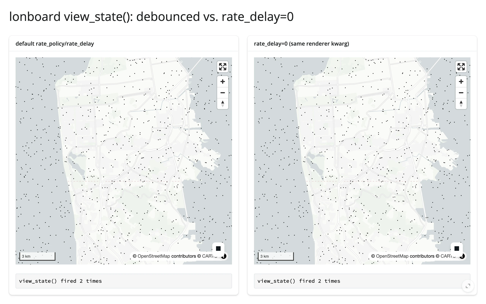

Both panels fired **exactly twice** for the identical zoom burst, reproducibly across repeated runs -- the same
shape the pre-#400 no-op measurement found, but not for the same reason. Watching the raw outgoing websocket
traffic (not just the debounced Python-side count) during the gesture shows why: a single continuous drag or
scroll-zoom burst produces **at most one** `view_state` sync message from the browser to Python in the first
place, regardless of `rate_delay`. The cause is upstream of shinywidgets: lonboard's own bundled JS already
debounces its browser-to-Python trait sync at 300ms --
`_rr=debounce(t=>t.save_changes(),300)` in the installed package's `lonboard/static/index.js` -- a window close
to shinywidgets' own 0.25s default. By the time a raw update reaches shinywidgets' rate-limiting layer, lonboard
has usually already collapsed the gesture to one message, so there's nothing left for `rate_policy`/`rate_delay`
to do. Spacing separate gestures further apart (confirmed with 600ms gaps between discrete clicks-and-drags)
does produce one raw message per gesture, each firing its reader immediately either way -- consistent with
shinywidgets' debounce being real but rarely the binding constraint for a widget whose own JS already throttles
at a comparable rate. Practically: the new default is good hygiene (and matters if a future lonboard release
removes its own throttle, or for rapid *programmatic* `.widget.view_state = ...` writes), but don't expect a
visibly different fire count from `rate_delay=0` on lonboard the way you would on plotly or ipydatagrid, whose
underlying streams really are that chatty.

The no-op list -- accessors with no declared rate policy at all, where `rate_policy`/`rate_delay` do nothing --
is shorter after #400: mols2grid's accessors, ipyvolume's `camera()`, and k3d/pythreejs's `camera()` (not
re-verified this pass; carried over from the original measurement). ipycytoscape's child `Node`/`Edge` widgets
used to be on this list too (the kwargs reached the top-level `CytoscapeWidget` but not the child widgets that
actually hold `selected`/`grabbed`); `rate_policy`/`rate_delay` now reach those child widgets as well (#404),
per the renderer's own docstring. If your accessor is on the remaining no-op list and a downstream recompute is
expensive enough to matter, debounce the expensive step yourself with `reactive.debounce()` (see
[Reacting to widgets](../reacting-to-widgets/index.md#rate-limiting)).

Rate limits matter most when one gesture arrives as a *burst* of messages, because the cost multiplies.
ipycytoscape is the clearest case: each node is its own widget, so box-selecting N nodes sends N messages, and
an app that loops `reactive_read(node, "selected")` over every node redoes that loop on each one, about N²
work for a single gesture. In an earlier evaluation, that pattern took several seconds to catch up after
selecting 1,000 nodes and fell minutes behind at 3,000. Collecting the burst into one value, which is what
`selected_nodes()` does, kept up in a second or two. The same applies to any widget that reports one gesture
as many trait changes.

For contrast, accessors that *do* declare a default policy and visibly respond to it, already measured
elsewhere on this roster: plotly's `selecting()` (3 vs. 8, cited above), ipydatagrid's `selected()` (2 vs. 10,
cited above), mosaic's `params()` (3 fires debounced vs. 12 with `rate_delay=0` for one brush drag), and
ipyaladin's drag-to-rotate gesture (4 debounced vs. 11 raw updates).

## 5. Bundle size and first load

Every shinywidgets app pays a **shared static framework cost** on first load -- Shiny's own JS/CSS, Bootstrap,
jQuery, bslib components, and shinywidgets' own `ipywidget-output-binding` loader (dominated by one 3.57 MB
`libembed-amd.js` file) -- regardless of which widget you use. Measured directly: four completely different
renderers (plotly, jscatter, perspective, k3d) each loaded **5.05 MB of static HTTP assets, within 51 bytes of
each other** (noise, not a real difference), before a single widget-specific byte arrived. On top of that shared
baseline, each renderer adds its
own JS (or WASM) bundle, measured here with a tiny, near-empty widget so the renderer's fixed cost isn't
confused with its data cost (that's Section 2's job):

| Renderer | Renderer-specific bytes | Total first load |
|---|---:|---:|
| matplotlib | 0.23 MB | 5.28 MB |
| itables | 0.81 MB | 5.85 MB |
| ipyleaflet | 1.25 MB (+0.50 MB basemap tiles, viewport-dependent) | 6.30 MB |
| jscatter | 2.32 MB | 7.37 MB |
| k3d | 4.59 MB | 9.64 MB |
| plotly | 5.37 MB | 10.41 MB |
| perspective | 6.48 MB | 11.53 MB |
| lonboard | 10.06 MB (incl. a 5.25 MB `parquet-wasm` fetch from a CDN) | 15.11 MB |

[`examples/14_bundle_matplotlib.py`](examples/14_bundle_matplotlib.py),
[`examples/12_bundle_itables.py`](examples/12_bundle_itables.py),
[`examples/11_bundle_ipyleaflet.py`](examples/11_bundle_ipyleaflet.py),
[`examples/05_bigdata_jscatter.py`](examples/05_bigdata_jscatter.py) (run at `PERF_N=100`),
[`examples/13_bundle_k3d.py`](examples/13_bundle_k3d.py),
[`examples/04_bigdata_plotly.py`](examples/04_bigdata_plotly.py) (run at `PERF_N=100`),
[`examples/07_bigdata_perspective.py`](examples/07_bigdata_perspective.py) (run at `PERF_N=100`),
[`examples/06_bigdata_lonboard.py`](examples/06_bigdata_lonboard.py) (run at `PERF_N=100`)

Methodology: a fresh, uncached Playwright browser context for each app (so every byte is a true cold start),
summing HTTP response bytes plus websocket frame bytes, with `blob:`-URL reconstructions (the browser rebuilding
an anywidget ESM module from bytes already counted once in the comm channel) and basemap tile imagery excluded
from both totals to avoid double-counting or penalizing map widgets for a viewport-dependent cost.

```{.python file="examples/14_bundle_matplotlib.py"}
import matplotlib.pyplot as plt
import numpy as np
from shiny.express import ui
from shinywidgets import render_matplotlib

ui.page_opts(title="bundle: matplotlib", fillable=True)


@render_matplotlib
def plot():
    fig, ax = plt.subplots()
    rng = np.random.default_rng(42)
    ax.scatter(rng.normal(size=50), rng.normal(size=50))
    return fig
```

This machine's environment always resolves the local, already-installed copy of every renderer's JS (the
`shinywidgets[<extra>]` install includes the nbextension data `_dependencies.py` looks for first); the
CDN-fallback path (`unpkg.com`, used when a local nbextension isn't found -- e.g. a deploy that didn't install
the full extra) was not re-measured here, since triggering it would mean uninstalling package data in a shared
venv other agents are using. Treat the CDN path as strictly *more* bytes and *more* latency than the numbers
above, not less.

### What this means in practice

Cold start -- the very first thing a brand-new browser (no cache) loads from your app -- costs somewhere
between about 5.3 MB (matplotlib: a static image, essentially no interactive JS) and about 15 MB (lonboard: a
full WebGL mapping + GeoArrow stack) before any of your actual data arrives. The 5.05 MB shared framework cost
is fixed and not something a widget choice changes; the renderer-specific column is the one your choice of
library controls. If first-load latency on a slow connection matters more than feature breadth, that's a real
argument for itables or a plain plot over perspective or lonboard for a given page -- and it's additive: a page
with three different heavy renderers pays all three renderer-specific costs once each, on top of one shared
baseline.

## Pitfalls and a checklist

- **A heavy downstream recompute driven by a continuously-streaming accessor with no rate limit can stall the
  browser badly enough to break the gesture that's feeding it.** This isn't hypothetical: the ipydatagrid guide
  measured exactly this before #400 added `selected()`'s default debounce (a full figure rebuild on every
  tick of a cell-rectangle drag). The default debounce fixes the worst of it for `selected()` specifically,
  but the lesson generalizes to whatever's still on the no-op rate-limiting list (Section 4): update a
  companion view *in place* on each tick instead of rebuilding it from scratch, regardless of how often the
  accessor fires.
- **Re-rendering an anywidget-based widget resends its entire JS bundle, every time**, not just its data
  (Section 1). If a change can be expressed as a trait mutation on the existing widget, prefer that -- but
  verify what the trait mutation actually sends (the ipyleaflet `style` case in Section 1 is the cautionary
  tale: not every "in-place" update is cheap).
- **`shared_lifetime()` built directly in a Shiny Express script's top level is rebuilt once per session**,
  silently defeating both the memory savings in Section 3 and the cross-session mirroring it's meant to
  provide -- see [Updating in place](../updating-in-place/index.md#shared_lifetime-and-shiny-express)
  for the worked repro. Put it in a sibling `globals.py`, as every example in Section 3 does.
- **A sibling `globals.py`'s `shared_lifetime()` widget gets opened for every session of every app in the same
  directory, even apps that never reference it** ([#461](https://github.com/posit-dev/py-shinywidgets/issues/461)).
  Shiny Express auto-loads a directory's `globals.py` before running any app file in that directory
  (`shiny.express._run.create_express_app`); shinywidgets then opens every process-global widget at session
  start regardless of which render functions that particular session's app actually defines. Measured
  directly, before this article's own `examples/08_lifetimes_memory_persession.py`,
  `09_lifetimes_memory_shared.py`, and `globals.py` were moved into their own `examples/lifetimes/`
  subdirectory for exactly this reason: every *other* example in the shared directory -- including ones with
  no lonboard import at all -- silently carried an extra ~9 MB of the Section 3 shared map's own payload on
  first load. Section 5's re-measurement after the move showed no change to its own numbers (they'd been
  captured before `globals.py` existed in that directory), but the lesson holds
  generally: keep a `shared_lifetime()` cache module in its own subdirectory, away from unrelated example apps.
- **A million-point scatter plot is not automatically a bad idea, but budget for both bytes and client-side
  render time** (Section 2) -- and for genuinely tabular data (sort/filter/browse, not a 2D point cloud),
  perspective's virtualized architecture sidesteps the scaling problem entirely.
- **Bundle size is additive across renderers on one page, and paid once per browser, not once per server.**
  Five different heavy widgets on one dashboard means five renderer-specific bundles for every new visitor,
  on top of the one shared framework cost (Section 5).
- **Checklist before shipping a widget-heavy page:**
  1. Does every update to this widget *need* to re-render, or can an effect mutate a trait in place? (Section 1)
  2. At your expected data size, have you actually measured the renderer's payload and render time, or are you
     assuming? (Section 2)
  3. If this widget is shown to many concurrent users and the data is the same for all of them, is it a
     `shared_lifetime()` candidate? (Section 3)
  4. Does the accessor you're reading in a hot path declare a default rate policy, and can one gesture send
     it a burst of changes? If so, are you reading an accessor that collects the burst, or debouncing the
     expensive part yourself? (Section 4)
  5. How many renderer-specific bundles does one page load, and does that match your target audience's
     connection? (Section 5)

## Where to go next

- [Reacting to widgets](../reacting-to-widgets/index.md): the conceptual model this article's measurements
  build on -- accessor kinds, re-fire/clearing semantics, the three lifetimes, writing back without looping.
- [Linked views](../linked-views/index.md): coordinating multiple widgets through accessors (a different
  concern from this page's single-widget performance, but the same `reactive.effect` + in-place-update idiom).
- Per-widget guides with their own measured performance notes: [pyvista](../../widgets/pyvista/index.md) (the
  trame-pyvista 0.2.3 -> 0.3.4 payload story), [keplergl](../../widgets/keplergl/index.md) (playback rate limiting),
  [ipydatagrid](../../widgets/ipydatagrid/index.md) (`selected()`'s default debounce vs. an un-rate-limited
  `reactive_read()`, and the in-place-update pattern for a heavy downstream recompute),
  [itables](../../widgets/itables/index.md) (`maxBytes` downsampling for large tables),
  [plotly](../../widgets/plotly/index.md), [lonboard](../../widgets/lonboard/index.md), [jscatter](../../widgets/jscatter/index.md),
  [perspective](../../widgets/perspective/index.md).
