A rendered ipywidget in Shiny is not just a picture. It is a live object with a comm open to the browser,
and the browser pushes every pan, click, and lasso back across that comm as the user makes them. Reactive
accessors are the API that turns that stream into something you already know how to use: a method on the
render output that reads like a Shiny input -- `plot.clicked()` called in a reactive context behaves exactly
like `input.my_slider()`, down to invalidating whatever reads it when the user interacts.

`plot.clicked()`, `chart.selected_rows()`, `map.view_state()`, `tbl.selected_rows()`,
`grid.edited_cell()` -- every `@render_*` decorator that wraps a widget with user interaction worth reading
has a handful of these. This article is the cross-cutting reference for what they all have in common: the
mental model, what they read before the first interaction, what a re-render keeps versus re-seeds, reading a
selection on demand (in a button handler, a `@reactive.event`, a chat or LLM tool), re-fire and clearing
rules, rate limiting, turning points into rows of your data, `.read()` and `reactive_read()`, writing back
to a widget safely, and the three lifetimes a widget can have. Each per-widget guide in the roster documents
its own accessors in detail; this page is where the patterns that repeat across all of them live. The
companion [cheat sheet](cheatsheet.md) lists every accessor on every renderer, generated from the current
source.

## The mental model: accessors are inputs that remember

Every accessor follows one behavior, regardless of which widget or which gesture it reports:

- it **attaches the moment its output renders** -- not on its first read, not lazily the first time some
  downstream code happens to call it;
- it **records the interaction whether or not anything has read it yet** -- a click, a lasso, a drag, a
  parameter change;
- and it **keeps or re-seeds that value across a re-render**, depending on what kind of thing it reports
  (the next two sections cover both halves of that in detail).

`examples/01_mental_model.py` shows the first consequence of this directly: an accessor reads exactly like a
Shiny input, side by side with the lower-level primitive underneath it, `reactive_read()`.

```{.python file="examples/01_mental_model.py"}
# Accessors read like inputs. This renders the same ipyleaflet map twice,
# side by side: the left card reads `map.zoom()` and `map.center()` -- the
# renderer's accessors -- and the right card reads the identical state with
# the lower-level primitive underneath them, `reactive_read(map.widget, "zoom")`.
# Both update together on every pan or zoom; the accessor adds nothing here but
# a name, a docstring, and (for other accessors) a default rate policy -- see
# the next examples for cases where that default actually matters.
from ipyleaflet import Map
from shiny.express import render, ui
from shinywidgets import reactive_read, render_ipyleaflet

ui.page_opts(title="Accessors vs. reactive_read", fillable=True)

with ui.layout_columns():
    with ui.card(full_screen=True):
        ui.card_header("The map")

        @render_ipyleaflet
        def map():
            return Map(center=(45.5, -122.6), zoom=10)

    with ui.card():
        ui.card_header("map.zoom() / map.center() -- the accessor")

        @render.code
        def via_accessor():
            return f"zoom={map.zoom()}\ncenter={map.center()}"

    with ui.card():
        ui.card_header('reactive_read(map.widget, ["zoom", "center"]) -- the primitive')

        @render.code
        def via_reactive_read():
            zoom, center = reactive_read(map.widget, ["zoom", "center"])
            return f"zoom={zoom}\ncenter={center}"
```

Pan and zoom the map and both panels update together, with identical values:

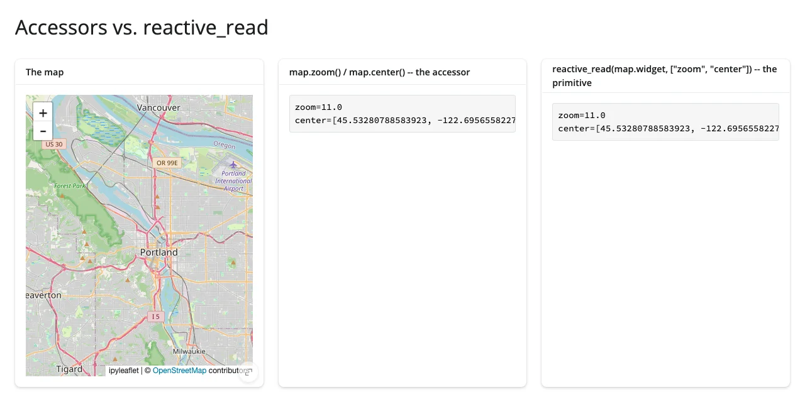

For a plain state trait like `zoom`, the two are nearly equivalent -- the accessor is really just a named,
documented wrapper around `reactive_read()`, with one upgrade this article comes back to repeatedly: `read()`
(below) is now the taught way to reach for that wrapper even when there's no dedicated accessor method.
The real gap is everything `reactive_read()` can't do at all: plotly's clicks arrive as one-off browser
messages, not a trait change, so there is no trait for `reactive_read()` to watch -- `clicked()` only exists
because shinywidgets built a message bridge for it (see `shinywidgets/_plotly.py`). A raw trait also has no
rate policy and no "what does this mean before the user has touched it" contract; an accessor's docstring
gives you both, for free.

That second point -- what an accessor means before the user has touched it, and what a re-render does to
it -- is where the interesting behavior lives, and it's what the next two sections cover.

## Before the first interaction

Read an accessor before its output has ever rendered, and it does the same thing `.widget` does: it
**cancels**, silently, like `req(False)` -- the output just doesn't render, with no error and nothing to
check for. Once the widget has rendered, every accessor settles into one of four starting states, and which
one it is depends entirely on what the accessor reports -- not on when you happen to read it:

- **cancels** -- the widget has rendered, but the browser hasn't reported the thing the accessor needs yet
  (k3d's `camera()` before the scene auto-fits). Still no `req()` needed; there's nothing to check.
- **`None`** -- nothing has happened yet, and `None` unambiguously means that (ipyleaflet's `clicked()`
  before the first click). `req(map.clicked())` is the idiom for waiting on it.
- **`[]` / `{}`** -- an empty collection means the same thing `None` would, but the accessor's return type is
  naturally a collection, so it stays one even when empty (bokeh's `selected()` returns `[]`, not `None`,
  while nothing is selected).
- **a seeded value** -- the accessor is never "empty" in a special sense at all; an untouched chart's
  selection is itself a real, usable object (altair's `selected()`; Vega-Lite has no separate "nothing
  selected yet" state from "selected nothing").

`examples/02_not_rendered_none_state.py` shows all four, each on a different widget in one app:

```{.python file="examples/02_not_rendered_none_state.py"}
# Four different "before the first interaction" states, across four widgets:
#
# - k3d's camera() CANCELS (like `req(False)`) until the browser reports a
#   camera -- the output renders nothing at all, same as a widget that
#   hasn't rendered. No `req()` needed; there is nothing to check.
# - ipyleaflet's clicked() returns None until the first click.
#   `req(map.clicked())` is the pattern for waiting on it.
# - bokeh's selected() returns `[]` (not None) until the first tap/box
#   select -- an empty list either means "nothing selected yet" or "a
#   selection that caught nothing"; both read the same way.
# - altair's selected() is seeded the moment the chart renders: it is never
#   None or empty-as-a-sentinel -- an untouched selection is itself a real,
#   usable (empty) Vega-Lite object. Checking `.value` (or `selected_rows()`,
#   which returns an empty frame) is how you tell "untouched" from "selected
#   nothing" apart -- no `req()` needed either.
import altair as alt
import numpy as np
import pandas as pd
from bokeh.models import ColumnDataSource
from bokeh.plotting import figure
from ipyleaflet import Map
from k3d import points
from shiny.express import render, ui

from shinywidgets import render_altair, render_bokeh, render_ipyleaflet, render_k3d

df = pd.DataFrame({"x": range(10), "y": [i**2 % 7 for i in range(10)]})
bokeh_source = ColumnDataSource(
    data=dict(x=list(range(10)), y=[i**2 % 7 for i in range(10)])
)

ui.page_opts(title="Before the first interaction", fillable=True)

with ui.layout_columns():
    with ui.card():
        ui.card_header("k3d: camera() -- cancels until ready")

        @render_k3d
        def plot():
            return points(np.random.normal(size=(200, 3)).astype("float32"))

        @render.code
        def camera_out():
            return str([round(v, 1) for v in plot.camera()])

    with ui.card():
        ui.card_header("ipyleaflet: clicked() -- None until the first click")

        @render_ipyleaflet
        def map():
            return Map(center=(45.5, -122.6), zoom=9)

        @render.code
        def clicked_out():
            pt = map.clicked()
            return "None (click the map)" if pt is None else str(pt["coordinates"])

    with ui.card():
        ui.card_header("bokeh: selected() -- [] until the first selection")

        @render_bokeh
        def bplot():
            p = figure(tools="tap,box_select,reset", title="Tap or box-select points")
            p.scatter("x", "y", source=bokeh_source, size=14)
            return p

        @render.code
        def bokeh_out():
            return f"selected(): {bplot.selected()}"

    with ui.card():
        ui.card_header("altair: selected() -- never None")

        @render_altair
        def chart():
            brush = alt.selection_interval(name="brush")
            return (
                alt.Chart(df)
                .mark_point(size=100)
                .encode(x="x", y="y")
                .add_params(brush)
            )

        @render.code
        def selected_out():
            sel = chart.selected("brush")
            return f"value={sel.value!r}\nselected_rows: {len(chart.selected_rows('brush'))} row(s)"
```

Before any interaction, three of the four panels already show something -- `None`, `[]`, or a real seeded
value -- and only k3d's camera is still cancelling:

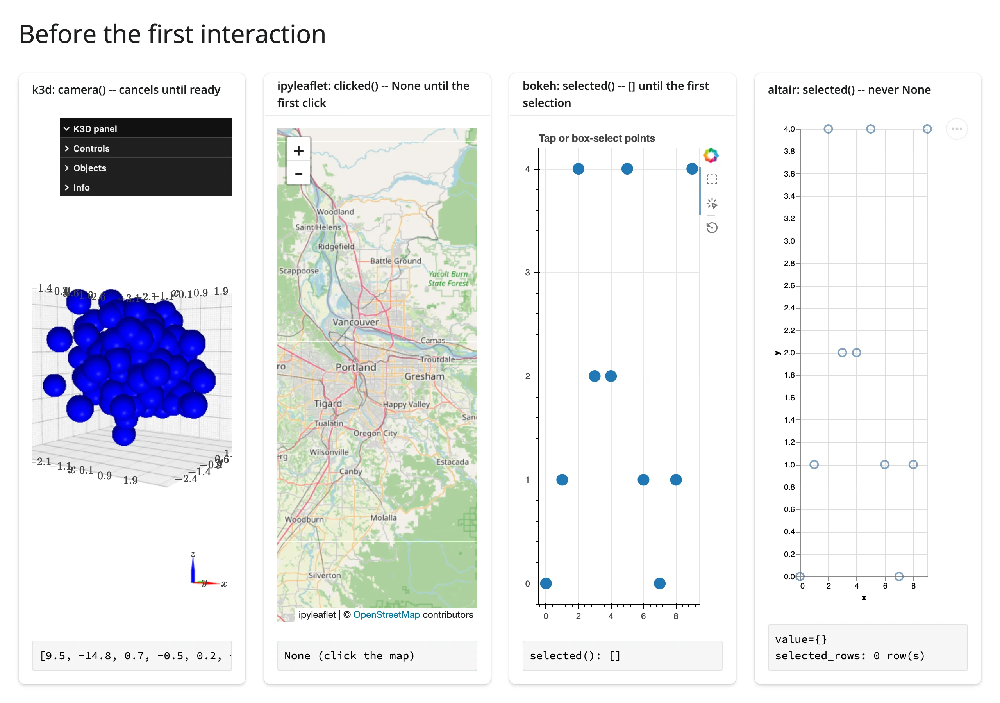

Clicking the map, tapping a bokeh point, and dragging a brush on the altair chart (and giving k3d a moment
to auto-fit) settles all four into their touched state at once:

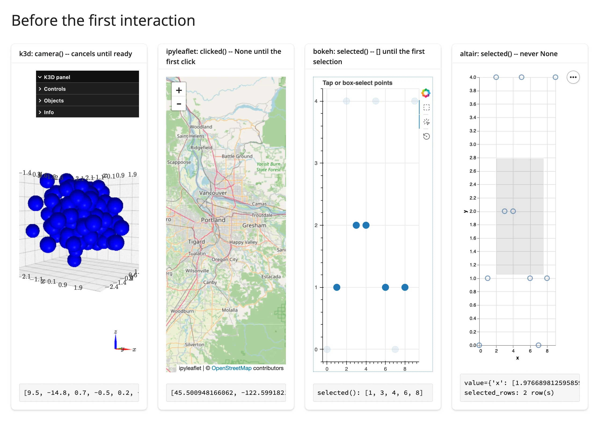

The accessor reference table in each guide's "Reacting to user interaction" section says which of these four
states applies to each of that widget's accessors, and the [cheat sheet](cheatsheet.md)'s "Before any
interaction" column does the same across all of them.

> **Never leave `req(x)` as a bare statement inside `@render.express`.** `req()` returns its argument, and
> `render.express` treats every bare top-level expression as UI to display -- so `req(map.clicked())` on its
> own line renders the value it was meant to gate (or errors trying to render it). Assign the result instead:
> `clicked = req(map.clicked())`.

## Across re-renders

A re-render builds a brand new widget. What happens to an accessor's value when that happens depends on
*what* the accessor reports, not on some global "event vs. state" label:

- **User-interaction state** -- clicks, taps, gestural selections, crosshair moves -- is **kept**. The
  interaction genuinely happened; a re-render doesn't erase it. The accessor just keeps reporting the last
  thing the user did until they interact with the *new* widget.
- **Inherent widget state** -- viewport, zoom, camera, fov, axis limits, a widget-owned current selection --
  is **re-seeded** from the new widget at every render, so it always describes what's actually on screen.

Either way, a reader re-runs only when the accessor's value actually publishes -- a new interaction, or a
re-seed that differs from the previous value -- just like an ordinary Shiny input. A re-render on its own
doesn't re-run a kept accessor's readers, which is what makes the natural "click -> derive something -> draw
it on the same plot" pattern safe: the derived value can feed the plot's own render function without
looping.

`examples/08_across_rerenders.py` puts both on the very same map, so the contrast is visible in one
screenshot: `clicked()` is kept, `zoom()`/`center()` are re-seeded.

```{.python file="examples/08_across_rerenders.py"}
# Kept vs. re-seeded, side by side, on the same map: `clicked()` is
# *user-interaction state* -- it keeps the last click until the user clicks
# the new map. `zoom()`/`center()` are *inherent widget state* -- each
# re-render re-seeds them from the freshly built Map's own construction-time
# zoom/center. Click the map, pan and zoom it, then click "Re-render":
# clicked() is unchanged; zoom()/center() snap back to zoom=9.
#
# A kept payload can describe the PREVIOUS render's widget. If a re-render
# replaces the data a click's payload indexed into (a point index, a row
# position), the retained value can silently point at something else after
# the re-render -- see plot.clicked()'s docstring (plotly) and
# ipydatagrid's edited_cell() for the same caveat: prefer an ID-keyed lookup
# over a positional one whenever the data itself can change across a render.
from ipyleaflet import Map
from shiny import reactive
from shiny.express import input, render, ui
from shinywidgets import render_ipyleaflet

ui.page_opts(title="Across re-renders", fillable=True)
ui.input_action_button("rerender", "Re-render map")

with ui.layout_columns(col_widths=[7, 5]):
    with ui.card(full_screen=True):
        ui.card_header("Click, pan, and zoom, then click Re-render")

        @render_ipyleaflet
        @reactive.event(input.rerender, ignore_none=False)
        def map():
            return Map(center=(45.5, -122.6), zoom=9)

    with ui.card():
        ui.card_header("map.clicked() -- kept across re-render")

        @render.code
        def clicked_out():
            pt = map.clicked()
            return "None (click the map)" if pt is None else str(pt["coordinates"])

    with ui.card():
        ui.card_header("map.zoom() / map.center() -- re-seeded every render")

        @render.code
        def zoom_out():
            return f"zoom={map.zoom()}\ncenter={map.center()}"
```

Click, zoom in twice, and pan a bit -- `clicked()` reports the click, `zoom()`/`center()` report the new
viewport:

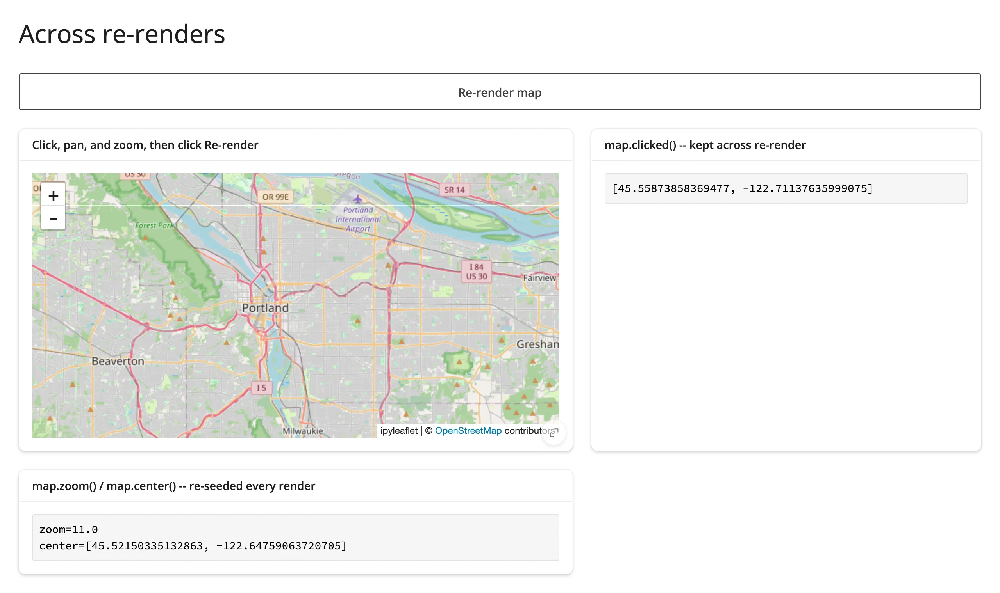

Click "Re-render": `clicked()` is exactly unchanged, while `zoom()`/`center()` snap straight back to the
map's construction-time values:

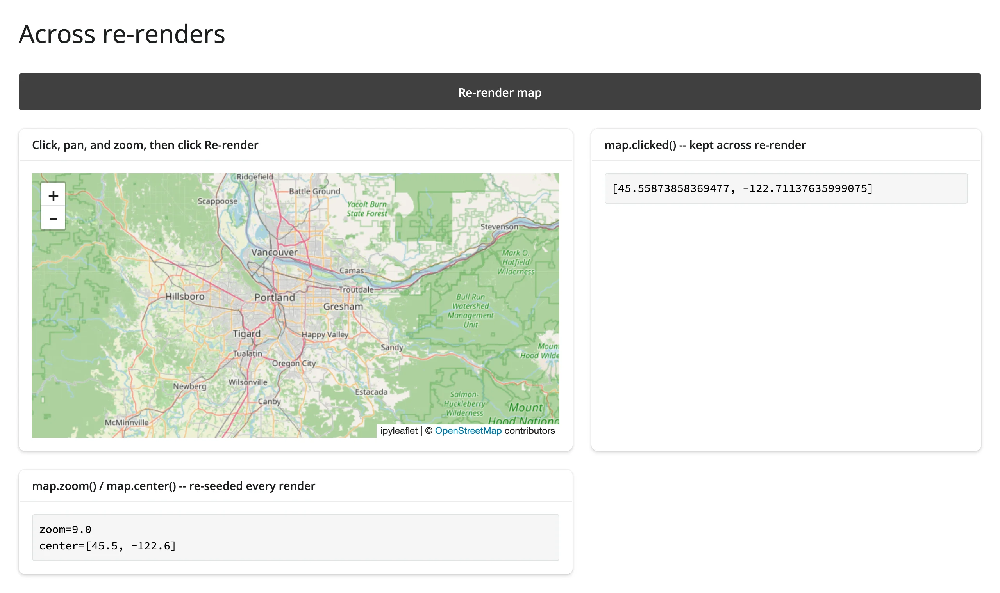

**The caveat worth remembering**: a kept value can describe the *previous* render's widget, not the one on
screen now. If a re-render swaps in new data, a retained payload's positional fields -- a point index, a row
position -- can silently point at something else once the new data is in place. This is called out,
widget by widget, right in the relevant docstrings: plotly's `clicked()` says a retained `point_index` "can
point at a different point" after a re-render with new data; ipydatagrid's `edited_cell()` says the same
about a retained row position. The fix is the same one R's `DT` package teaches: don't trust a position
across a data change, key off something stable instead -- a `customdata` value (plotly), a data frame
index (ipydatagrid's `.widget.data`), an ID column you added yourself. The [cheat sheet](cheatsheet.md)'s
"Across re-render" column marks every accessor kept vs. re-seeded, including the ones not shown here.

A kept payload can also dangle outright: the re-render may swap in data where an ID the payload references
no longer exists at all. Then the failure isn't a silent mis-point but a crash in your own lookup -- an
unguarded `next(row for row in rows if row["id"] == kept_id)` surfaces as a `RuntimeError` raised from
`StopIteration` inside the reactive flush. If you keep a payload across a re-render that can change the
underlying data, guard the lookup: filter first and check `.empty` (pandas), use `.get()` with a default, or
`req()` a validated result, and treat a payload that no longer resolves as "nothing selected" rather than
letting it blow up the output.

## Read on demand

Because every accessor is live from the moment its output renders -- not from the moment something first
reads it -- a gesture made before any code reads the accessor is never lost. This is the headline new
capability: you can safely read an accessor **on demand**, from code that only runs well after the user
interacted -- a button handler, a `@reactive.event`-gated output, a download handler, a chat message handler,
or a tool an LLM decides to call. None of these need to read the accessor earlier "just in case"; there's no
earlier read to arrange.

`examples/09_read_on_demand.py` makes the "on demand" part concrete: nothing in the app reads
`plot.selected_rows()` until the user clicks a button, and the lasso or box selection made *before* that
click is still there when it finally runs.

```{.python file="examples/09_read_on_demand.py"}
# Read on demand: nothing in this app reads `plot.selected()` /
# `plot.selected_rows()` until the button's gated reader runs -- not a
# warm-up effect, not a visible output, nothing. Box- or lasso-select points
# FIRST, then click "Show selection": the selection you already made is
# there, because the accessor attached and started recording the moment the
# plot rendered, not on its first read. This is what makes a selection safe
# to read from a button handler, a `@reactive.event`-gated output, a
# download handler, or (see the ai-exploration article) a chat message
# handler or an LLM tool call -- any reader that only runs after the user
# has already interacted.
import plotly.express as px
from shiny import reactive
from shiny.express import input, render, ui
from shinywidgets import render_plotly

df = px.data.iris().reset_index(drop=True)

ui.page_opts(title="Read on demand", fillable=True)

with ui.layout_columns(col_widths=[7, 5]):
    with ui.card(full_screen=True):
        ui.card_header("Lasso or box-select points, THEN click the button")

        @render_plotly
        def plot():
            fig = px.scatter(
                df, x="sepal_width", y="sepal_length", custom_data=[df.index]
            )
            return fig.update_layout(dragmode="select")

    with ui.card():
        ui.input_action_button("show", "Show selection")
        ui.card_header("Only reads plot.selected_rows() once clicked")

        @render.data_frame
        @reactive.event(input.show)
        def selection_out():
            return render.DataGrid(plot.selected_rows(df))
```

Box-select a region -- nothing has read the selection yet, so nothing shows it:

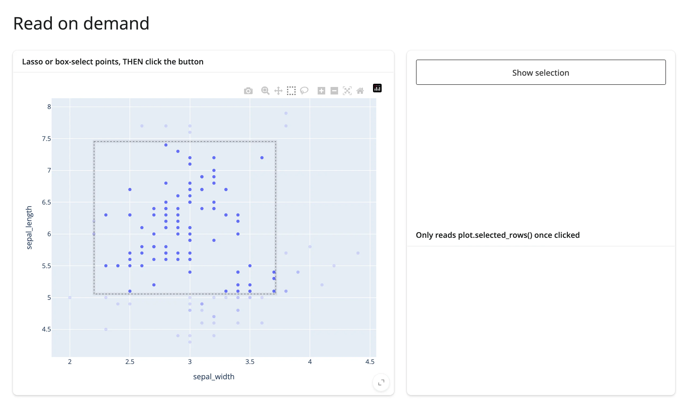

Click the button, and the selection made *before* the click is there in full, down to the exact rows:

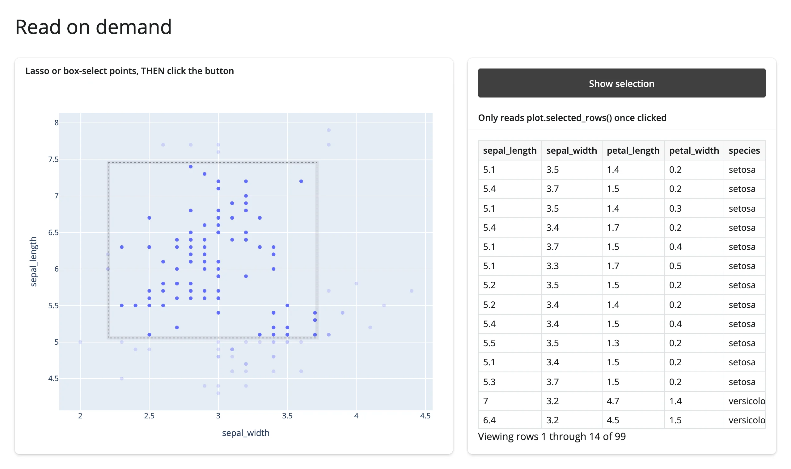

The same pattern is what makes it safe to hand a selection to a chat interface or an LLM tool: the user can
lasso a region of a plot, then start chatting about it, or the model can call a tool that reads
`plot.selected_rows()` on its own schedule -- in both cases the gesture happened first and the read happens
whenever it happens, with nothing lost in between. The [ai-exploration article](../ai-exploration/index.md)
builds this out fully, including a worked chat example that reads a lasso selection from inside a
`chat.on_user_submit` handler.

## Re-firing and clearing

A **dedup** rule applies to almost every accessor: a value equal to what it last published doesn't invalidate
readers, so clicking the exact same point twice only fires once. `examples/03_refire_and_clearing.py` counts
actual fires (via an effect, using `reactive.isolate()` -- see
[Writing back](../updating-in-place/index.md#writing-back) for why) for two different plotly accessors on
the same figure: `clicked()` (dedups) and `double_clicked()` (a **pulse**, which doesn't).

```{.python file="examples/03_refire_and_clearing.py"}
# Re-fire and clearing semantics, using two plotly accessors on the same
# figure. An effect counts how many times each accessor's value actually
# changes (using `reactive.isolate()` so the counter doesn't depend on
# itself; see "Writing back" in the Updating in place article for why that
# matters):
#
# - `clicked()` dedupes by value (input priority): clicking the SAME point
#   twice publishes the same value twice, but the counter doesn't advance on
#   the second click. A double-click that lands on a MARKER re-fires
#   `clicked()` (the second click of the pair is a normal click on that
#   point) -- it does not clear. A double-click that lands on the BACKGROUND
#   clears `clicked()` back to None (plotly's own "double-click resets the
#   view" gesture).
# - `double_clicked()` is a *pulse*: it fires `True` on every double-click on
#   the background and never clears, so two separate double-clicks there
#   both advance the counter even though the displayed value never changes
#   from `True` -- a pulse re-fires readers on an unchanged value by design,
#   the opposite of `clicked()`'s dedup.
import plotly.express as px
from shiny import reactive
from shiny.express import render, ui
from shinywidgets import render_plotly

df = px.data.iris().reset_index(drop=True)

ui.page_opts(title="Re-fire and clearing", fillable=True)

fires = reactive.value(0)
pulses = reactive.value(0)

with ui.layout_columns(col_widths=[6, 3, 3]):
    with ui.card(full_screen=True):

        @render_plotly
        def plot():
            return px.scatter(df, x="sepal_width", y="sepal_length", custom_data=[df.index])

    with ui.card():
        ui.card_header("plot.clicked()")

        @reactive.effect
        def _count_fires():
            plot.clicked()  # depend on it
            with reactive.isolate():
                fires.set(fires() + 1)

        @render.code
        def clicked_out():
            pts = plot.clicked()
            state = "None" if pts is None else f"point_index={pts['point_index'].iloc[0]}"
            return f"fires so far: {fires()}\nclicked(): {state}"

    with ui.card():
        ui.card_header("plot.double_clicked() -- a pulse")

        @reactive.effect
        def _count_pulses():
            plot.double_clicked()  # depend on it
            with reactive.isolate():
                pulses.set(pulses() + 1)

        @render.code
        def double_clicked_out():
            return f"fires so far: {pulses()}\ndouble_clicked(): {plot.double_clicked()}"
```

Clicking a marker twice in a row leaves `clicked()`'s fire count unchanged -- the second click is an exact
duplicate of the first, so it's silently dropped before it ever reaches the reactive value:

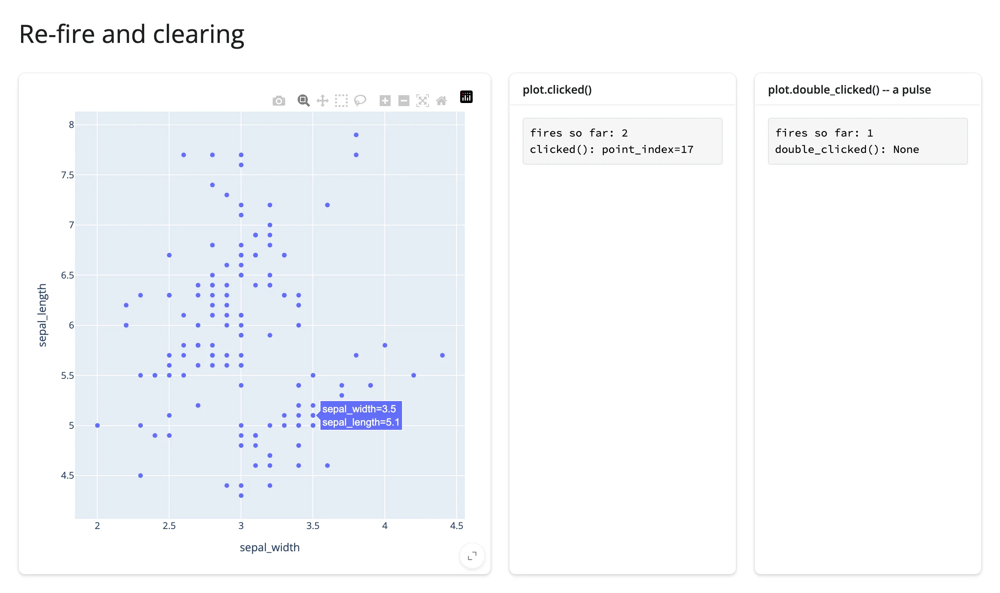

A double-click that lands back on a marker clears `clicked()` and then immediately re-sets it (two fires, net
value unchanged) -- and because that double-click resets the view in default (non-select) dragmode,
`double_clicked()` pulses too:

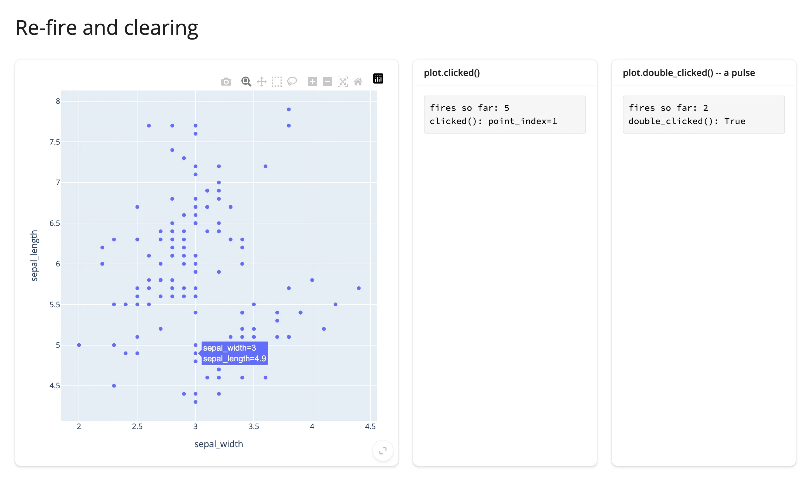

A double-click on the background clears `clicked()` to `None` (one fire) and pulses `double_clicked()` (one
fire):

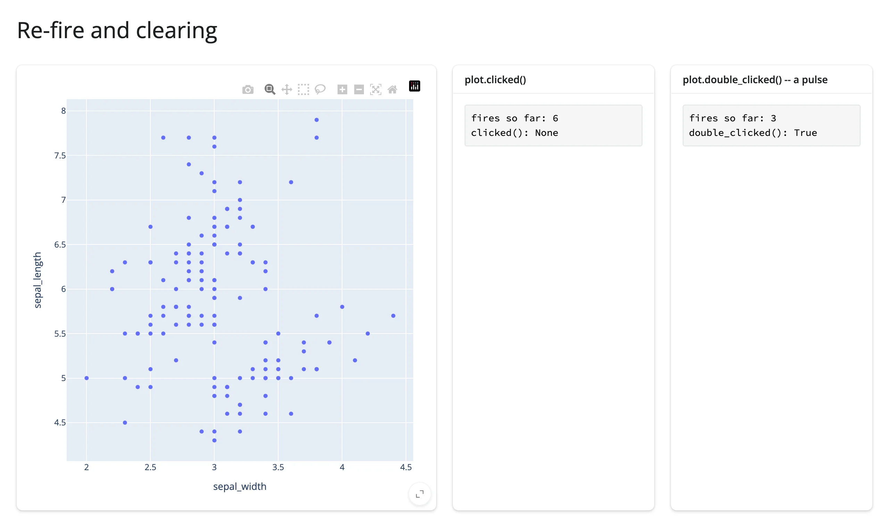

The interesting contrast is a **second**, separate double-click on the background. `clicked()` was already
`None`, so clearing it again is a no-op -- the dedup rule holds, and its fire count doesn't move. But
`double_clicked()`'s value is already `True`, and it pulses again anyway:


| Gesture | `clicked()` fires | `double_clicked()` fires |
|---|---|---|
| Click a marker, then the same marker again | +0 | -- |
| Click a different marker | +1 | -- |
| Double-click that marker | +2 (clear, then re-set) | +1 (pulse) |
| Double-click on background | +1 (clear only) | +1 (pulse) |
| Double-click on background again | +0 (deduped: already `None`) | +1 (pulse again) |

That last row is the whole reason a **pulse** accessor exists: most accessors report *a value* (a point, a
selection, a position), and "did it change" is the right question to ask about a value. Some gestures,
though, are really just events with no state worth remembering -- "the user reset the view" is true or it
isn't, and asking it twice in a row is still two meaningful things that happened, not one. `double_clicked()`
declares `priority="event"` for exactly this: identical values re-fire readers on purpose. If your effect does
something visible on every fire (flashing a highlight, logging an event), a marker double-click will visibly
fire `clicked()`'s readers twice even though its value ends up back where it started -- worth knowing before
you assume "the value didn't change" means "nothing happened." See the
[plotly guide](../../widgets/plotly/index.md#reacting-to-user-interaction) for the rest of its accessors' clearing
behavior (`selected()`/`brushed()` also clear on deselect, and a plain click clears a selection when
`dragmode` is `select`/`lasso`), and the [ipyleaflet guide](../../widgets/ipyleaflet/index.md) for its own
click/double-click dedup story.

## Rate limiting

Some widgets report a single gesture as a burst of changes, and each change re-runs everything that read it. A
box-select in ipycytoscape is the extreme case: every node is its own widget, so selecting 1,000 nodes sends
1,000 separate `selected` updates. If an expensive calc, effect, or redraw reads those traits, one gesture
queues up hundreds of re-runs and the app looks frozen until they drain, even though only the final, settled
selection was worth computing. The ways out, cheapest first:

1. **Read an accessor that already collects the burst.** ipycytoscape's `selected_nodes()` keeps one running
   set as nodes toggle and publishes it once the gesture settles. A loop of `reactive_read(node, "selected")`
   over every node does the opposite: it re-runs the whole loop on every toggle.
2. **Rate-limit the trait reads with the renderer's `rate_policy`/`rate_delay`** (below).
3. **Debounce the expensive step itself:** put `@reactive.debounce(0.5)` (or `@reactive.throttle(0.5)`)
   directly below `@reactive.calc`. Only the calc's *readers* wait; the calc itself still runs on every change,
   so keep it a cheap read and do the expensive work in whatever reads it.

Every accessor has a **rate policy**: some declare a default (almost always `"debounce"`, 250ms) because the
gesture they report naturally streams -- a brush drag, a crosshair move, a filter edit. The renderer's
`rate_policy`/`rate_delay` kwargs (e.g. `@render_plotly(rate_delay=0)`) let you change that, for every
accessor on that output at once.

The part that surprises people: **these kwargs only affect accessors that declare a default rate policy in
the first place**, plus `reactive_read()` calls on `.widget` directly. An accessor with no declared default
(see the cheat sheet's "Default rate" column) ignores `rate_policy`/`rate_delay` entirely and always
publishes immediately. `examples/04_rate_limiting.py` puts both cases side by side: plotly's `selecting()`
(debounced by default) against k3d's `camera()` (no default policy at all -- k3d throttles camera updates on
its own, upstream, independent of anything shinywidgets does), each driven by a slow drag with and without
`rate_delay=0`:

```{.python file="examples/04_rate_limiting.py"}
# The renderer's rate_policy/rate_delay kwargs only govern accessors that
# declare a DEFAULT rate policy (plus reactive_read() on the root widget).
# plotly's selecting() debounces by default, so rate_delay actually changes
# its behavior; k3d's camera() declares no default rate policy at all, so
# the same kwargs are silently a no-op for it -- every raw update publishes
# immediately either way (k3d's own JS throttles camera updates to roughly
# once per 200ms, independent of anything shinywidgets does). Each panel
# counts how many times the accessor's value actually changes during one
# slow drag.
import k3d
import numpy as np
import plotly.express as px
from shiny import reactive
from shiny.express import render, ui
from shinywidgets import render_k3d, render_plotly

df = px.data.iris().reset_index(drop=True)


def counter():
    n = reactive.value(0)

    def bump():
        with reactive.isolate():
            n.set(n() + 1)

    return n, bump


def k3d_points():
    rng = np.random.default_rng(0)
    plot = k3d.plot()
    plot += k3d.points(
        rng.random((200, 3), dtype=np.float32), point_size=0.05, color=0xFF0000
    )
    return plot


ui.page_opts(title="rate_policy / rate_delay", fillable=True)
ui.markdown(
    "Drag a box slowly on each plotly figure (~1 second), and orbit-drag each "
    "k3d plot slowly (~1 second), then read the counts."
)

with ui.layout_columns():
    with ui.card():
        ui.card_header("plotly selecting(): default debounce (250ms)")

        @render_plotly
        def plot_default():
            return px.scatter(df, x="sepal_width", y="sepal_length").update_layout(
                dragmode="select"
            )

        n_default, bump_default = counter()

        @reactive.effect
        def _():
            plot_default.selecting()
            bump_default()

        @render.code
        def out_default():
            return f"selecting() fired {n_default()} times"

    with ui.card():
        ui.card_header("plotly selecting(rate_delay=0): every raw update")

        @render_plotly(rate_delay=0)
        def plot_fast():
            return px.scatter(df, x="sepal_width", y="sepal_length").update_layout(
                dragmode="select"
            )

        n_fast, bump_fast = counter()

        @reactive.effect
        def _():
            plot_fast.selecting()
            bump_fast()

        @render.code
        def out_fast():
            return f"selecting() fired {n_fast()} times"

    with ui.card():
        ui.card_header("k3d camera(): no default -- rate_delay=0 here")

        @render_k3d(rate_delay=0, height="300px")
        def plot_a():
            return k3d_points()

        n_a, bump_a = counter()

        @reactive.effect
        def _():
            plot_a.camera()
            bump_a()

        @render.code
        def out_a():
            return f"camera() fired {n_a()} times"

    with ui.card():
        ui.card_header("k3d camera(rate_delay=2): same renderer kwarg, no effect")

        @render_k3d(rate_delay=2, height="300px")
        def plot_b():
            return k3d_points()

        n_b, bump_b = counter()

        @reactive.effect
        def _():
            plot_b.camera()
            bump_b()

        @render.code
        def out_b():
            return f"camera() fired {n_b()} times"
```

One slow box-drag on each plotly figure, and one slow orbit-drag on each k3d plot, give:

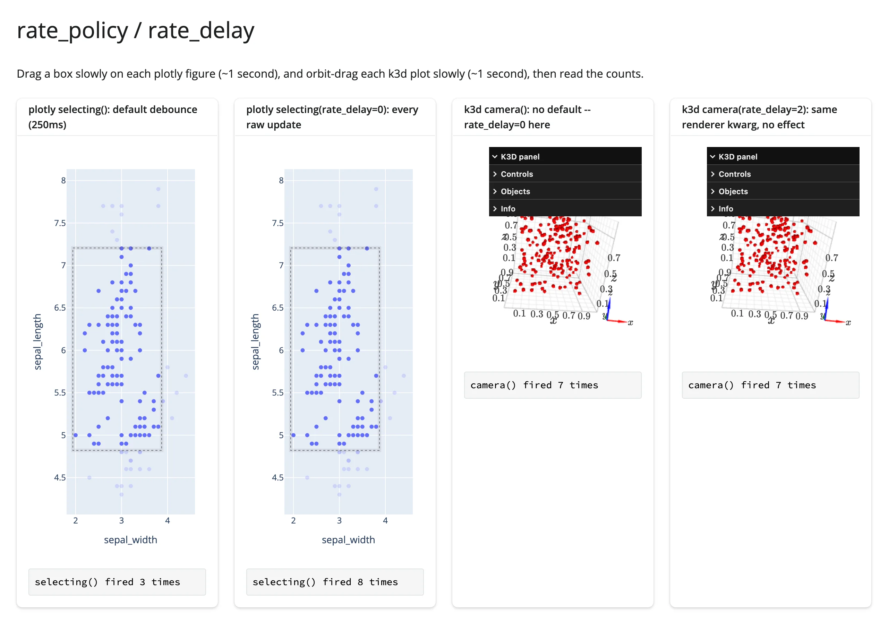

The two plotly panels diverge sharply (3 fires vs. 8, for the same drag) because `selecting()` declares
`rate_policy="debounce"`. The two k3d panels land on the *exact same* count (7 and 7) regardless of
`rate_delay`, because `camera()` declares no default at all -- the kwarg has nothing to rate-limit; k3d's own
upstream throttle (roughly one update per 200ms) is the only thing limiting it either way. This matters
beyond a curiosity: an accessor with no default debounce streams every raw browser update straight through,
and a heavy downstream redraw driven directly off one can stall the browser badly enough to break the
gesture itself. `lonboard`'s `view_state()` and `ipydatagrid`'s `selected()` used to be exactly this kind
of no-default accessor and now debounce by default (#400); most other no-default accessors in the
[cheat sheet](cheatsheet.md) still don't, and whether one *should* grow a default debounce is a case-by-case
call for the maintainer, not something the kwargs turn on today. The
[ipydatagrid guide](../../widgets/ipydatagrid/index.md#rate-limiting) now shows the complementary comparison worth
knowing instead: `selected()` (debounced) against a raw `reactive_read()` on `.widget` directly, which is
**never** rate-limited unless you pass `rate_policy`/`rate_delay` to the renderer -- at which point it governs
both, accessor and raw trait, the same way.

The library-side rate effects are visible further up the stack too: `mosaic_widget`'s `params()` and
altair's `selected()` both debounce a brush drag down from a dozen-odd raw updates to a couple of settled
ones -- see the [mosaic guide](../../widgets/mosaic/index.md#rate-limiting)'s side-by-side counter for a second,
independently measured example of the *effective* (declares-a-default) case.

## Rows of your data

Most widgets that report a selection report it in *their own* coordinate space -- a point index into a
trace, a row position in a currently-sorted table -- not a row of the data frame you built the chart from.
`selected_rows()` (plotly, altair, bokeh, itables, reactable, jscatter, bqplot, lonboard) exists to close that gap. Plotly's version is the most explicit about the mechanism,
because it has the least to go on: a point only carries whatever you told it to.

```{.python file="examples/05_rows_of_data.py"}
# selected_rows() turns "which points did the user select" into "which rows
# of MY data frame". Plotly (like most selection-reporting widgets) reports
# points of the figure, not rows of a data frame, so each point must carry
# its row's identity as `customdata` -- here, the pandas index, via
# `custom_data=[df.index]`. altair/bokeh/itables/reactable each have their
# own version of this contract; see their guides' `selected_rows()` sections.
import plotly.express as px
from shiny.express import render, ui
from shinywidgets import render_plotly

df = px.data.tips().reset_index(drop=True)

ui.page_opts(title="Rows of your data", fillable=True)

with ui.layout_columns(col_widths=[7, 5]):
    with ui.card(full_screen=True):

        @render_plotly
        def plot():
            fig = px.scatter(df, x="total_bill", y="tip", custom_data=[df.index])
            return fig.update_layout(dragmode="select")

    with ui.card():
        ui.card_header("plot.selected_rows(df) -- matched by df.index")

        @render.data_frame
        def selected():
            return render.DataGrid(plot.selected_rows(df))
```

`custom_data=[df.index]` is the contract: each point carries its row's index label as `customdata`, and
`selected_rows(df)` matches selected points back to `df` by that label -- which is also why this still works
on a filtered or re-sorted `df` (the match is by label, not position). Lassoing a cluster gets you exactly
those rows, ready for a table or a downstream calculation:

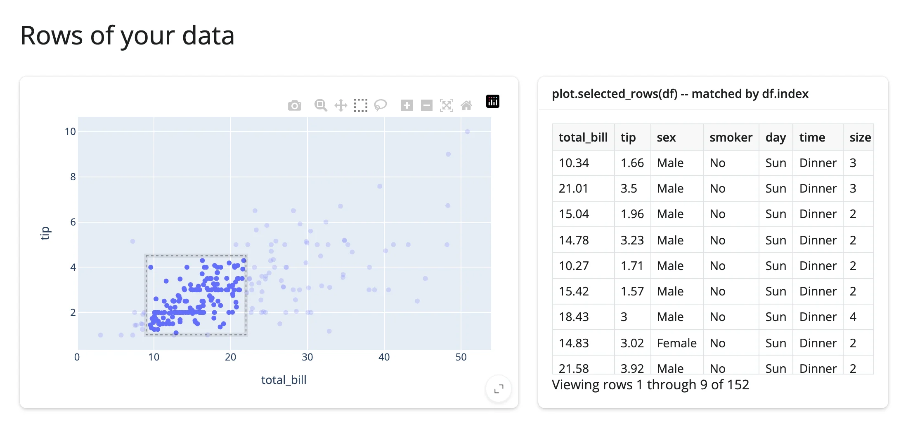

For a frame without row labels (polars, or any `key=`-based match), pass `key="id"` with
`custom_data=["id"]` instead -- see the [plotly guide](../../widgets/plotly/index.md#reacting-to-user-interaction)
for both forms verified end to end. The same idea, different mechanics per library:

- **altair**: `selected_rows(name, df=...)` replays Vega-Lite's own selection test against `df`, including
  binned and temporal fields -- see the [altair guide](../../widgets/altair/index.md#reacting-to-user-interaction).
- **bokeh**: `selected_rows()` reads straight from the plot's `ColumnDataSource` (`source.to_df()`), since a
  bokeh plot's data source *is* the data frame -- see the [bokeh guide](../../widgets/bokeh/index.md).
- **jscatter**: `selected_rows(df=None)` maps the lasso/click positions back into the frame the `Scatter` was
  built with (or an explicit `df`, pandas or polars) -- see the
  [jscatter guide](../../widgets/jscatter/index.md#reacting-to-user-interaction).
- **bqplot**: `selected_rows(df, *, mark=None)` maps one mark's selected positions back into `df` (required --
  a figure retains no data frame); `mark=` picks the mark for multi-mark figures -- see the
  [bqplot guide](../../widgets/bqplot/index.md#reacting-to-user-interaction).
- **lonboard**: `selected_rows(df=None)` is the picked row of `df`, defaulting to a frame rebuilt from the
  pickable layer's own data (fresh `RangeIndex`; the default needs exactly one pickable layer and
  geopandas) -- see the [lonboard guide](../../widgets/lonboard/index.md#reacting-to-user-interaction).
- **itables** / **reactable**: `selected_rows()` returns row *positions*, already in your original data's
  order (itables: data order, survives sort/search; reactable: data order, survives sort/filter/paging) --
  no customdata contract needed, because the table is rendered straight from the frame. See the
  [itables](../../widgets/itables/index.md) and [reactable](../../widgets/reactable/index.md) guides.

## Beyond the accessors: `.read()` and `reactive_read()`

Reach for these two in order, after the accessor methods themselves:

1. **`output.read("name")`** reads an accessor by name -- `plot.read("selected")` is exactly
   `plot.selected()`. When `"name"` isn't an accessor, it falls through to a bare synced trait of the
   rendered widget instead, the same way `reactive_read(output.widget, "name")` would. This makes `.read()`
   the generic tool for either case, and it's now the taught fallback everywhere a renderer output exists --
   prefer it over reaching for `reactive_read()` directly on `.widget`. An unknown name raises
   `AttributeError` with a "did you mean" hint built from the renderer's own accessor names.
2. **`reactive_read(obj, "trait")`** is for widgets that *aren't* the output itself: a child or nested
   widget a parent widget owns (an ipycytoscape `Node`/`Edge`, an ipyleaflet layer or control, a panel-wrapped
   bokeh model), or any widget you built outside a renderer altogether. There's no `.read()` for these,
   because there's no renderer output wrapping them.

`examples/10_read_method.py` shows the first tier directly: an accessor read by name, a bare trait with no
accessor, and the "did you mean" error, live.

```{.python file="examples/10_read_method.py"}
# .read(name) is the generic way to read either an accessor (by name) or,
# when the name isn't one, a bare synced trait of the rendered widget --
# without the caller needing to know ahead of time which. `map.read("zoom")`
# below returns exactly what `map.zoom()` does (an accessor wins when a name
# is both). `map.read("scroll_wheel_zoom")` falls through to
# `reactive_read(map.widget, "scroll_wheel_zoom")`, since ipyleaflet has no
# accessor for that trait. An unknown name raises, with a "did you mean"
# hint built from the renderer's accessor names -- shown live below by
# catching it and rendering `str(exc)`.
from ipyleaflet import Map
from shiny.express import render, ui
from shinywidgets import render_ipyleaflet

ui.page_opts(title=".read()")

with ui.card(height="350px"):
    ui.card_header("Pan or zoom the map")

    @render_ipyleaflet
    def map():
        return Map(center=(45.5, -122.6), zoom=9, scroll_wheel_zoom=True)


with ui.layout_columns():
    with ui.card():
        ui.card_header('map.read("zoom") -- an accessor, by name')

        @render.code
        def read_zoom():
            return str(map.read("zoom"))

    with ui.card():
        ui.card_header('map.read("scroll_wheel_zoom") -- a bare trait, no accessor')

        @render.code
        def read_trait():
            return str(map.read("scroll_wheel_zoom"))

with ui.card():
    ui.card_header('map.read("zooom") -- unknown name raises, with a hint')

    @render.code
    def read_typo():
        try:
            return str(map.read("zooom"))
        except AttributeError as e:
            return str(e)
```

Zoom in and the accessor and the bare trait both read back correctly; the deliberately misspelled `"zooom"`
raises with an exact pointer to the name you meant:

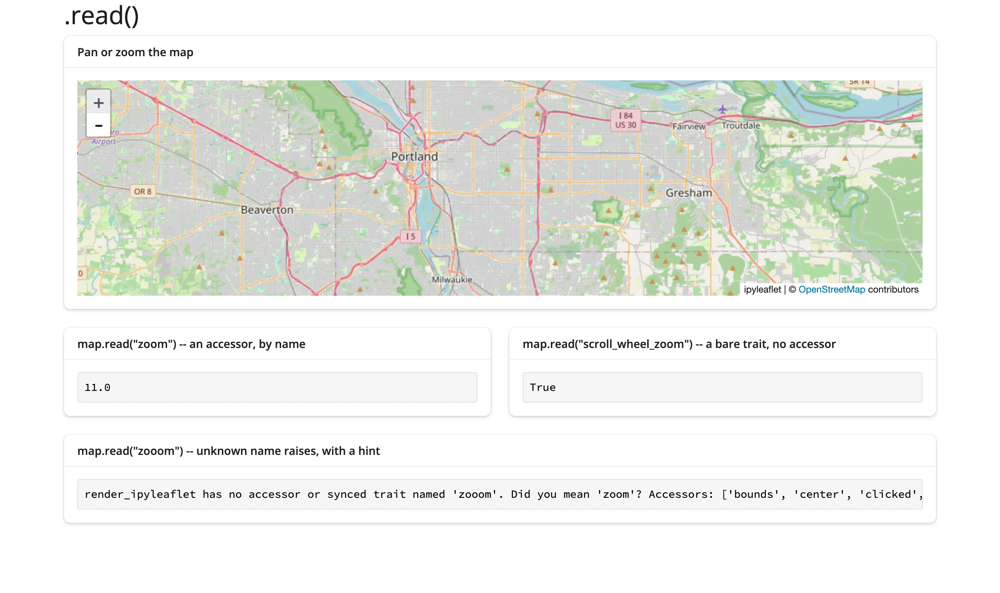

Two already-verified recipes for the second tier -- `reactive_read()` on a *child* widget, where there's no
output to call `.read()` on:

- **lonboard**, multiple pickable layers: `selected()` tells you *a* row was picked, across every
  layer, but not which layer. Read each layer's own `selected_index` trait directly instead:
  `reactive_read(layer, "selected_index")`. See the lonboard guide's
  [Beyond the accessors](../../widgets/lonboard/index.md#beyond-the-accessors-reactive_read) section
  (`examples/08_reactive_read_layer.py`) for the full pattern.
- **bqplot**: a `PanZoom` interaction's scales report the zoomed-in domain live as the user pans --
  `reactive_read(scale, ["min", "max"])` on `fig.widget.marks[0].scales["x"]` -- and a mark's own `selected`
  trait is the one-mark escape hatch when there's no figure-level `interaction` to intercept clicks. See the
  bqplot guide's [Beyond the accessors](../../widgets/bqplot/index.md#beyond-the-accessors-reactive_read) section.

To find a trait worth reading on a widget without a guide yet (or for a library-specific state no accessor
covers, e.g. perspective's `theme`), skim the widget class's `trait_names()` for anything that looks
user-facing, and `reactive_read()` (or `.read()`, for an output) it to confirm it actually updates from the
browser -- some traits, especially upstream-internal ones, don't sync reliably (see each guide's Gotchas for
named examples).

**Param-based libraries** (holoviews, panel): panel's `param(name)` accessor (e.g., `slider.param("value")`)
now covers the common case directly -- see the [panel guide](../../widgets/panel/index.md). holoviews and
bokeh-backed `render_bokeh`/`render_holoviews` outputs still have the older escape hatch for anything a
`param()`-style accessor can't reach: bokeh model properties aren't ipywidgets traits, so `reactive_read()`
can't see them either -- reacting to them means registering bokeh's own callbacks
(`source.selected.on_change(...)`, `fig.on_event(...)`) inside the render function and setting a
`reactive.Value` from inside the callback.

## Writing back

Re-rendering a widget is simple but blunt: a fresh render function call builds a brand new widget, with a
brand new zoom level, a cleared selection, and (for anywidget-based widgets) another copy of its JavaScript
bundle sent to the browser. For a change that's naturally "update this one thing," update the *existing*
widget in place from a `@reactive.effect` instead -- see
[Writing back](../updating-in-place/index.md#writing-back) in the Updating in place article for the full
pattern, the `reactive.isolate()` self-trigger-loop trap, and the measured bytes an in-place update saves.

## Lifetimes

A widget built directly inside a render function lives exactly as long as that render; `session_lifetime()`
and `shared_lifetime()` let it outlive one. See
[Lifetimes](../updating-in-place/index.md#lifetimes) in the Updating in place article for all three, the
Express `globals.py` caveat `shared_lifetime()` needs, and what a shared widget means for per-user state.

## Where to go next

- [Updating in place](../updating-in-place/index.md): writing back to a widget without a re-render loop,
  and the three widget lifetimes (moved out of this article -- see "Writing back" and "Lifetimes" above).
- The [accessor cheat sheet](cheatsheet.md) in this directory: every accessor on every renderer, its return
  type, what it reads before the first interaction, whether a re-render keeps or re-seeds it, its default
  rate policy, and a one-line meaning, generated from the current source.
- The [ai-exploration article](../ai-exploration/index.md) builds a chat/LLM-tool workflow directly on top
  of "read on demand" -- the pattern this article introduces above, worked through end to end with a real
  selection-to-chat-context example.
- Each widget's own guide has a full "Reacting to user interaction" section with every one of its accessors
  exercised individually, plus 2-4 linked-view patterns specific to that widget: start with
  [plotly](../../widgets/plotly/index.md), [altair](../../widgets/altair/index.md), [bokeh](../../widgets/bokeh/index.md),
  [ipyleaflet](../../widgets/ipyleaflet/index.md), [lonboard](../../widgets/lonboard/index.md),
  [ipydatagrid](../../widgets/ipydatagrid/index.md), [itables](../../widgets/itables/index.md),
  [mosaic](../../widgets/mosaic/index.md), [bqplot](../../widgets/bqplot/index.md), [panel](../../widgets/panel/index.md), and
  [reactable](../../widgets/reactable/index.md).
