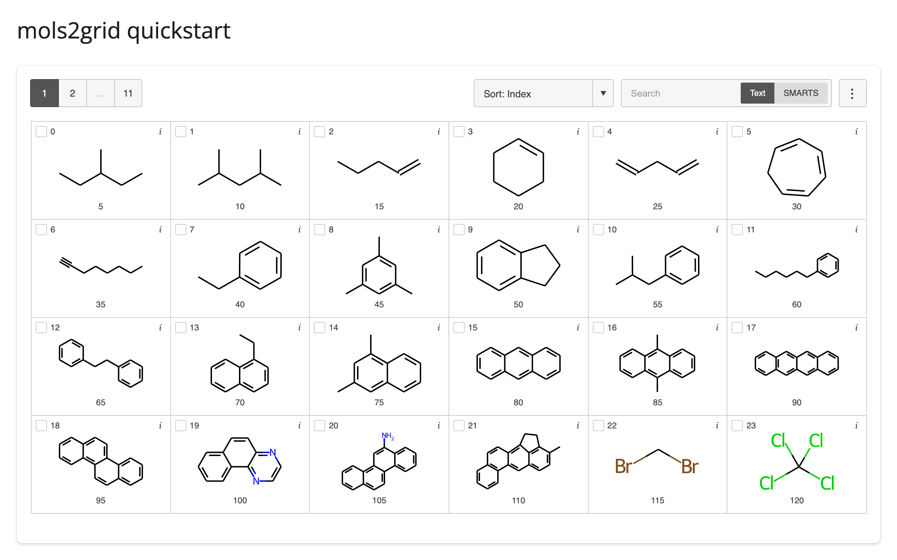
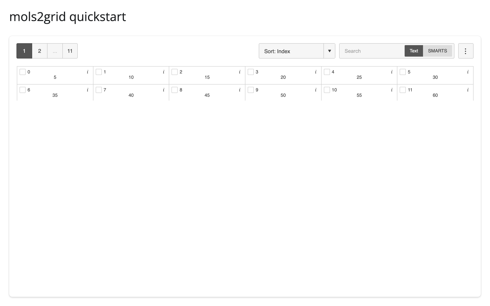

When a widget doesn't show up, it's almost always one of two things.

## The widget library isn't installed

shinywidgets doesn't install widget libraries itself; each one is an extra (see
[Installation](../installation/index.md)). Without it, you'll see an ordinary `ModuleNotFoundError` where your app
imports the library. If shinywidgets is the one importing it, for example to turn a data frame into a table,
the error names the extra to install:

```
Install the itables package to use data frames with shinywidgets (pip install 'shinywidgets[itables]').
```

Either way, the fix is `pip install 'shinywidgets[<name>]'`, where `<name>` is the extra from the widget's guide.

## The widget's JavaScript couldn't load

Every widget has a JavaScript half that runs in the reader's browser. Usually shinywidgets serves it from your
Python environment, but two kinds of widget need the internet for it:

- **Widgets that download part of themselves from a CDN**, in Jupyter too. mols2grid, for example, loads its
  molecule-drawing library from [unpkg](https://unpkg.com).
- **Classic ipywidgets whose package doesn't include their JavaScript.** shinywidgets loads those from a CDN.

If the reader's browser can't reach that CDN, the widget only partly draws, or stays empty, and the browser's
developer console shows the failed request (e.g. `Failed to load resource: net::ERR_FAILED`). Here's
[mols2grid](../../widgets/mols2grid/index.md) with unpkg reachable, and then blocked: the grid appears, but
none of the molecules are drawn.




If your readers' browsers can't reach the internet, see
[Deployment](../deployment/index.md#without-internet-access).

## Something else

For problems with the app itself rather than a widget, see Shiny's
[Debug, troubleshoot, & help](https://shiny.posit.co/py/get-started/debug.html). If a widget misbehaves in
shinywidgets but works in a Jupyter notebook, please
[open an issue](https://github.com/posit-dev/py-shinywidgets/issues).
