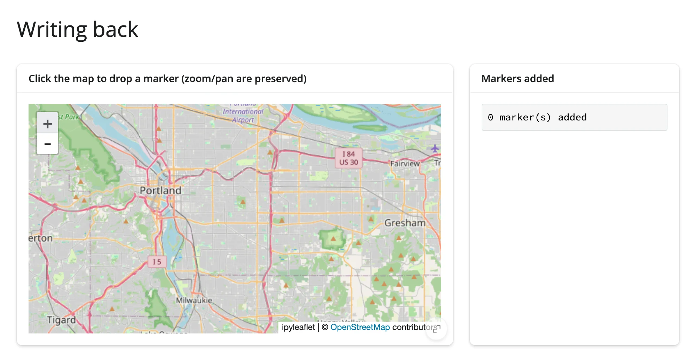
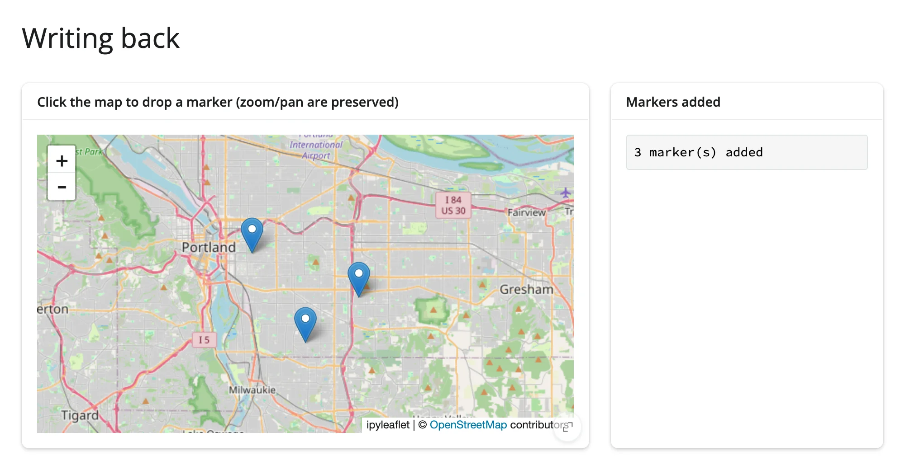
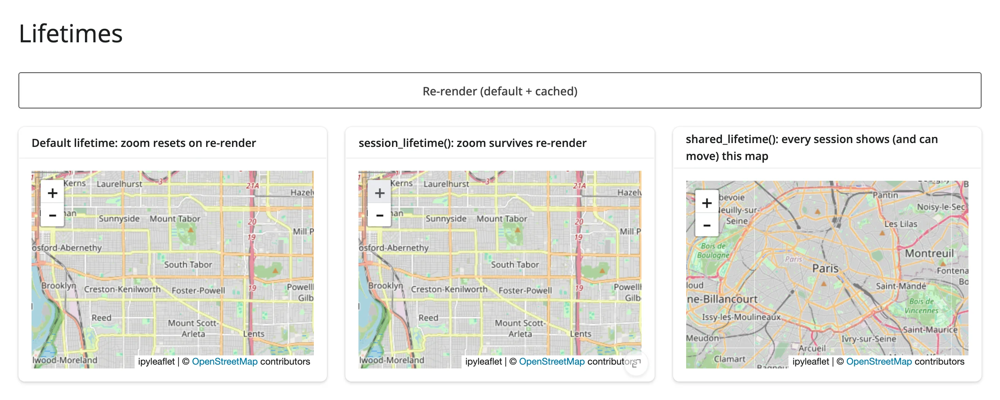
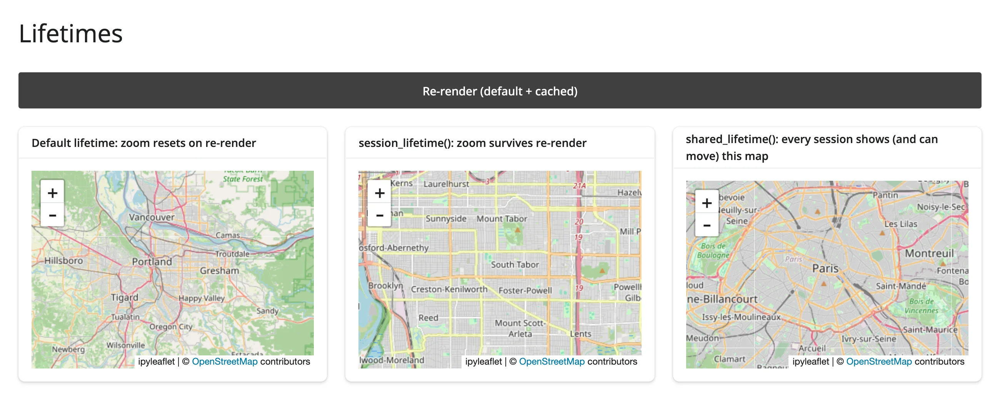
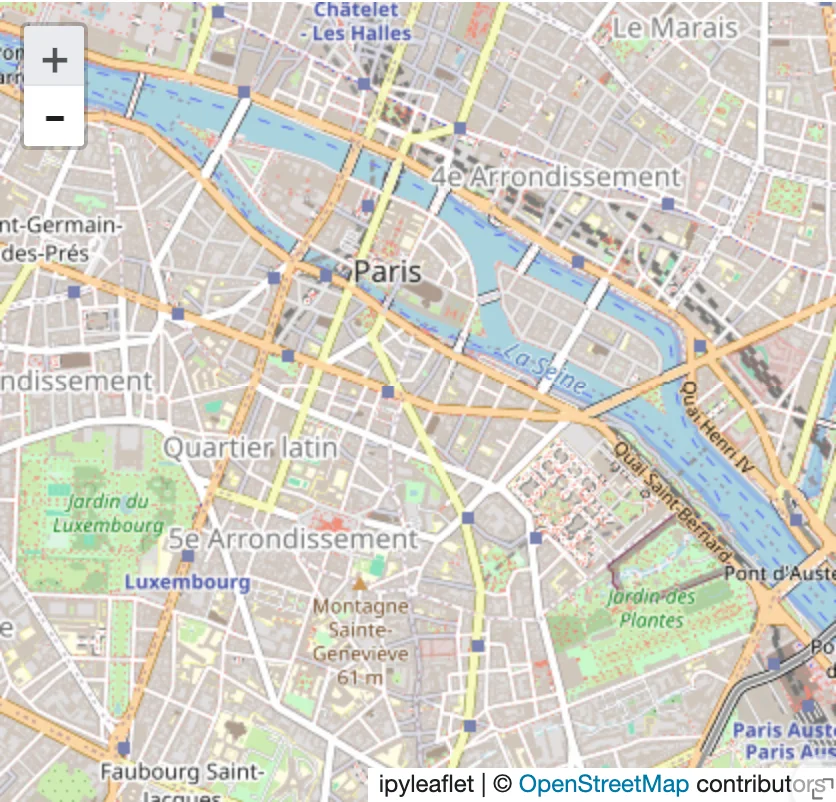
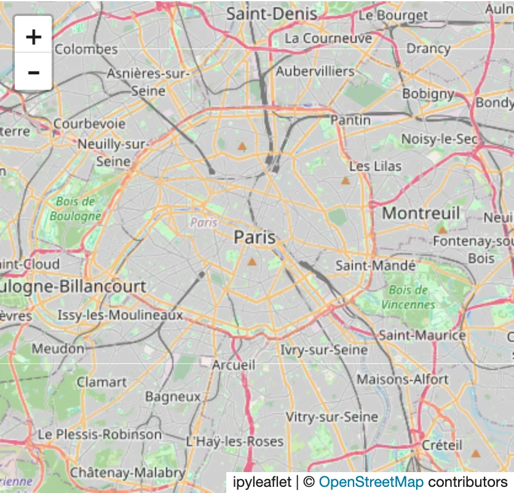
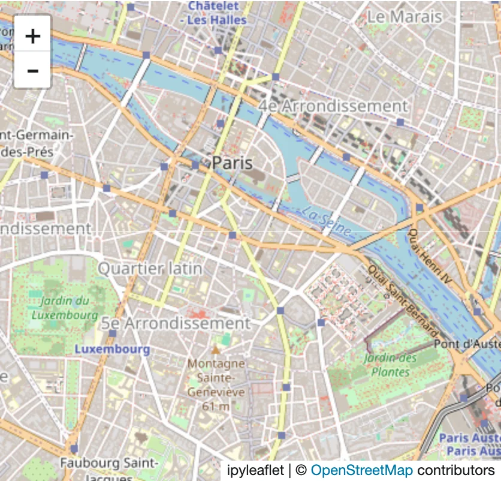

A render function that depends on a changed input runs again and returns a brand new widget: new zoom level,
new selection, new everything, and (for an anywidget-based widget) another full copy of its JavaScript bundle
sent to the browser. Most of the time that's exactly what you want -- the shape of the data changed, so a fresh
widget is the simplest correct thing to build. But when the change is naturally "update this one thing" --
recolor a trace, toggle a layer, scrub a frame -- re-rendering throws away state the user was relying on for no
reason. The alternative is to mutate the *existing* widget from a `@reactive.effect` instead of returning a new
one from the render function: only the changed trait crosses the wire, and everything else about the widget --
camera, zoom, pan, in-progress selections on other accessors -- stays exactly where the user left it.

The [performance article](../performance/index.md#1-re-render-vs-in-place-update) measures exactly how much
this costs: a plotly marker-color update is **36.3 KB in place vs. 5.45 MB on re-render (146x)**, because
re-rendering resends the entire plotly.js bundle as part of the widget's own state; lonboard is **141.8 KB vs.
6.19 MB (43x)** for the same reason. Those numbers (and the methodology behind them) live there, not here --
this article is about the mechanics and the judgment call, not the measurement.

## Writing back

Update the *existing* widget in place from a `@reactive.effect` instead of re-rendering:

```{.python file="examples/01_writing_back.py"}
# Updating a widget in place from an effect, instead of re-rendering it.
# Each click on the map adds a marker at that spot via `map.widget.add(...)`
# -- the SAME Map instance keeps running, so whatever the user already
# panned/zoomed to survives. Re-rendering the map from the click (e.g. by
# making `map()` read a `reactive.value` that the effect sets) would send a
# brand new Map to the browser and reset the zoom/center every time.
#
# The counter is bumped with `reactive.isolate()`. Without it, this effect
# would read `clicks()` (to compute `clicks() + 1`) AND set it in the same
# run, so `clicks.set(...)` would invalidate the very effect that's running
# -- which reschedules itself, reads `clicks()` again, sets it again, and
# never stops: a silent infinite loop that pins a CPU core and freezes the
# whole app (no error, no output change -- see the article text for how to
# recognize this).
from ipyleaflet import Map, Marker
from shiny import reactive
from shiny.express import render, ui
from shinywidgets import render_ipyleaflet

ui.page_opts(title="Writing back", fillable=True)

clicks = reactive.value(0)

with ui.layout_columns(col_widths=[8, 4]):
    with ui.card(full_screen=True):
        ui.card_header("Click the map to drop a marker (zoom/pan are preserved)")

        @render_ipyleaflet
        def map():
            return Map(center=(45.5, -122.6), zoom=9)

    with ui.card():
        ui.card_header("Markers added")

        @reactive.effect
        def _add_marker():
            pt = map.clicked()
            if pt is None:
                return
            lat, lng = pt["coordinates"]
            map.widget.add(Marker(location=(lat, lng), draggable=False))
            with reactive.isolate():
                clicks.set(clicks() + 1)

        @render.code
        def count_out():
            return f"{clicks()} marker(s) added"
```

Before any clicks, the map is zoomed to street level and no markers exist:



Three clicks later, three markers sit on the *same* `Map` instance, at the exact same zoom level -- nothing
about the view was touched:



Notice `reactive.isolate()` around the counter update. **This is not a style preference -- skip it and the
app silently hangs.** `clicks.set(clicks() + 1)` first *reads* `clicks()` to compute the new value. Read
inside a `@reactive.effect`, that read makes the effect depend on `clicks`; the very next line then sets
`clicks`, which invalidates every reader of it -- including this same effect. The effect reschedules,
reads `clicks()` again, sets it again, forever: a tight loop that pins a CPU core and never produces an
error, a changed output, or any other visible sign that something is wrong. The rule: **any time an effect
reads-and-writes its own reactive state (a counter, an accumulator, anything of the shape
`x.set(x() + ...)`), wrap the read in `reactive.isolate()`.** The
[mosaic guide](../../widgets/mosaic/index.md#rate-limiting) and the
[ipydatagrid guide](../../widgets/ipydatagrid/index.md#rate-limiting) both use this exact idiom to count accessor
fires without looping, if you want a second worked example.

## What each widget calls in-place

Every renderer exposes a read-only `.widget` (or, for a handful, a `.value`) once it has rendered -- the live
object the browser is already showing. What's worth mutating on it is different per library, because each
library's own object model is different. Each guide's own **Updating the widget from Python** section is the
full, verified version with a runnable example; this table is the index into all of them, in one place:

| Widget | In-place API |
|---|---|
| [plotly](../../widgets/plotly/index.md#updating-the-widget-from-python) | `.widget` traces under `batch_update()` (`trace.marker.color = ...`) |
| [altair](../../widgets/altair/index.md#updating-the-widget-from-python) | `chart.widget.params.<name> = value` (selections are read-only from Python) |
| [bokeh](../../widgets/bokeh/index.md#updating-the-widget-from-python) | mutate a kept `ColumnDataSource`/model reference directly |
| [matplotlib](../../widgets/matplotlib/index.md#updating-the-widget-from-python) | edit the `Figure`'s artists, then `.widget.draw_idle()` |
| [plotnine](../../widgets/plotnine/index.md#updating-the-widget-from-python) | the same matplotlib-artist technique, reached through `.widget` |
| [bqplot](../../widgets/bqplot/index.md#updating-the-widget-from-python) | mutate a mark's or scale's traits on the existing `Figure` |
| [holoviews](../../widgets/holoviews/index.md#updating-the-widget-from-python) | drive a `DynamicMap` with `hv.streams.Pipe`/`Params` |
| [geoviews](../../widgets/geoviews/index.md#updating-the-widget-from-python) | the same `hv.streams.Pipe` mechanism as holoviews |
| [datashader](../../widgets/datashader/index.md#updating-the-widget-from-python) | `hv.streams.Params` driving `rasterize()`'s aggregator/filter |
| [jscatter](../../widgets/jscatter/index.md#updating-the-widget-from-python) | a method on `plot.value` or a trait on `.widget`, under `reactive.isolate()` |
| [obsplot](../../widgets/obsplot/index.md#updating-the-widget-from-python) | assign a new spec to `.widget.spec` |
| [panel](../../widgets/panel/index.md#updating-the-widget-from-python) | mutate `.value` (the live Panel object) directly |
| [ipyleaflet](../../widgets/ipyleaflet/index.md#updating-the-widget-from-python) | mutate `.widget`'s layers/traits (style, visibility, basemap) |
| [leafmap](../../widgets/leafmap/index.md#updating-the-widget-from-python) | the same ipyleaflet-backed trait writes |
| [localtileserver](../../widgets/localtileserver/index.md#updating-the-widget-from-python) | `map.widget.layers[...].url`/`.opacity` -- the ipyleaflet pattern |
| [maplibre](../../widgets/maplibre/index.md#updating-the-widget-from-python) | `.widget` methods: `set_paint_property`, `set_filter`, `set_data`, `add_layer` |
| [lonboard](../../widgets/lonboard/index.md#updating-the-widget-from-python) | `layer.<trait> = ...` to restyle, or `map.widget.fly_to(...)` to move the camera |
| [geolibre](../../widgets/geolibre/index.md#updating-the-widget-from-python) | project-mutation methods: `add_geojson()`, `set_center()`, `layer.set_style()` |
| [keplergl](../../widgets/keplergl/index.md#updating-the-widget-from-python) | `.widget.data = ...` (roughly 1,500x smaller than re-sending the full bundle) |
| [itables](../../widgets/itables/index.md#updating-the-widget-from-python) | `table.widget.selected_rows = [...]` |
| [reactable](../../widgets/reactable/index.md#updating-the-widget-from-python) | `tbl.widget.props = {**w.props, ...}` |
| [ipydatagrid](../../widgets/ipydatagrid/index.md#updating-the-widget-from-python) | `.transform()`, `.set_cell_value*()`, or assigning `.selections` |
| [perspective](../../widgets/perspective/index.md#updating-the-widget-from-python) | `.widget.update()`, `.widget.theme = ...` |
| [mosaic](../../widgets/mosaic/index.md#updating-the-widget-from-python) | assign a new `.widget.spec` (resets the current selection) |
| [quak](../../widgets/quak/index.md#updating-the-widget-from-python) | layout only (`.layout.height`) -- the `sql` trait is read-only from Python |
| [pygwalker](../../widgets/pygwalker/index.md#updating-the-widget-from-python) | none -- no synced trait; carry a saved chart spec forward across a re-render instead |
| [embedding-atlas](../../widgets/embedding-atlas/index.md#updating-the-widget-from-python) | none -- ignores Python trait writes; round-trip `_state` across a re-render instead |
| [k3d](../../widgets/k3d/index.md#updating-the-widget-from-python) | `.widget.objects[i].<trait>` |
| [pythreejs](../../widgets/pythreejs/index.md#updating-the-widget-from-python) | any trait on any object reachable from `scene.widget` |
| [ipyvolume](../../widgets/ipyvolume/index.md#updating-the-widget-from-python) | `plot.widget.<trait>` |
| [pyvista](../../widgets/pyvista/index.md#updating-the-widget-from-python) | none -- `.widget` is a dead HTML snapshot; every change is a re-render |
| [mols2grid](../../widgets/mols2grid/index.md#updating-the-widget-from-python) | `grid.grid.filter(mask)` |
| [nglview](../../widgets/nglview/index.md#updating-the-widget-from-python) | `.widget.add_representation(...)`, `.widget.frame = ...`, `.widget.clear_representations()` |
| [vitessce](../../widgets/vitessce/index.md#updating-the-widget-from-python) | edit a deep copy of `.widget._config`, bump `uid`, reassign it |
| [vizarr](../../widgets/vizarr/index.md#updating-the-widget-from-python) | `.widget.add_image()` (add-only -- no remove or replace) |
| [niivue](../../widgets/niivue/index.md#updating-the-widget-from-python) | `.widget.set_*()` methods and writable traits (`volumes[i].cal_min`, `scene.crosshair_pos`) |
| [ipyaladin](../../widgets/ipyaladin/index.md#updating-the-widget-from-python) | `sky.widget.<trait> = ...` |
| [rerun](../../widgets/rerun/index.md#updating-the-widget-from-python) | the high-level `Viewer` wrapper's `update_panels()`/`set_time_ctrl()` |
| [ipycytoscape](../../widgets/ipycytoscape/index.md#updating-the-widget-from-python) | `network.widget.<trait> = ...` |
| [ipysigma](../../widgets/ipysigma/index.md#updating-the-widget-from-python) | none -- writes reach the browser model but nothing redraws; re-render, carrying `camera_state` forward |
| [drawdata](../../widgets/drawdata/index.md#updating-the-widget-from-python) | `ScatterWidget`: `canvas.widget.data = [...]`; `BarWidget`: none, re-render only |
| [ipycanvas](../../widgets/ipycanvas/index.md#updating-the-widget-from-python) | draw directly on `.widget` from an effect |
| [ipyfilechooser](../../widgets/ipyfilechooser/index.md#updating-the-widget-from-python) | `.widget.show_hidden`, `.widget.filter_pattern`, `.widget.reset(...)` |
| [render_widget (any anywidget)](../any-widget/index.md#updating-the-widget-from-python) | the same pattern, generically: `.widget.<trait> = ...` from an effect |

A handful of widgets have no in-place path at all (pygwalker, embedding-atlas, pyvista, ipysigma): their browser
code either never listens for Python-driven trait changes, or has nothing left to mutate once rendered. For
those, re-rendering is the only option, and each guide's section above explains what state (if any) is worth
carrying forward into the next render to soften the reset.

## When in-place doesn't save bytes

Not every trait write is cheap, and assuming otherwise is the one place this pattern bites back. The
performance article's
[measured comparison](../performance/index.md#when-in-place-doesnt-actually-save-bytes) has the numbers: on
the same 819 KB GeoJSON choropleth, toggling ipyleaflet's `layer.visible` costs 444 bytes, but setting
`layer.style` costs 1.09 MB -- almost exactly what a full re-render costs. The reason is upstream, not a
shinywidgets limitation: ipyleaflet's `GeoJSON` rebuilds its entire `data` trait from scratch whenever `style`
changes, so *any* style change re-syncs the whole feature collection, not a small style object. The lesson
generalizes past this one widget: "in-place" means "only the changed trait crosses the wire" only when the
trait you're setting is actually small on the wire. Verify what a given trait write actually costs (the
performance article's methodology section shows how) before assuming in-place is automatically the cheap path.

## Lifetimes

A widget built directly inside a render function lives exactly as long as that render: the next time the
function runs, the old widget is closed and a new one takes its place. Two other lifetimes exist for the
cases that need to outlive a single render:

- **`session_lifetime()`**: build the widget once per *session*, and keep returning that same instance from
  later renders (e.g., cache it in a `@reactive.calc`, which only recomputes if something it reads
  changes). Use this when a render would otherwise rebuild a widget the user is actively interacting with --
  the cached instance keeps its zoom, selection, and everything else.
- **`shared_lifetime()`** (**experimental** -- its own docstring warns that not every widget package behaves
  well mirrored into several browsers, and its behavior may change in a future release): build the widget
  once for the whole *process*, before -- or outside -- any session, and show it to every session that
  connects. Every user sees (and can change) the same object; it is never freed.

`examples/03_lifetimes.py` renders one map each way, plus a "Re-render" button for the first two:

```{.python file="examples/03_lifetimes.py" files="globals.py"}
# Three lifetimes for a widget:
#
# - Default (render-scoped): a widget built directly in the render function
#   is closed and replaced every time that function runs. "Re-render" here
#   rebuilds the map from scratch, so any zoom/pan the user did is gone.
# - session_lifetime(): build the map ONCE per session (cached in a
#   `@reactive.calc`, which only recomputes if something it reads changes),
#   and keep returning that same instance. "Re-render" redisplays the same
#   Map, so the user's zoom/pan survives.
# - shared_lifetime(): built once, before any session exists, and shown to
#   every session. One user's pan/zoom changes it for everyone -- open this
#   app in two tabs and zoom one to see the other move.
#
# THE_SHARED_MAP lives in the sibling `globals.py`, not here. Express re-runs
# THIS file's body for every session (see globals.py's comment); a
# `shared_lifetime()` widget constructed directly in it would be rebuilt --
# and re-shown as a fresh, independent map -- on every new session, which
# defeats the whole point (each session would silently get its own map,
# never mirroring another session's interaction).
from globals import THE_SHARED_MAP
from ipyleaflet import Map
from shiny import reactive
from shiny.express import input, render, ui
from shinywidgets import render_ipyleaflet, session_lifetime

ui.page_opts(title="Lifetimes", fillable=True)
ui.input_action_button("rerender", "Re-render (default + cached)")

with ui.layout_columns():
    with ui.card(full_screen=True):
        ui.card_header("Default lifetime: zoom resets on re-render")

        @render_ipyleaflet
        @reactive.event(input.rerender, ignore_none=False)
        def default_map():
            return Map(center=(45.5, -122.6), zoom=9)

    with ui.card(full_screen=True):
        ui.card_header("session_lifetime(): zoom survives re-render")

        @reactive.calc
        def cached_map_calc():
            with session_lifetime():
                return Map(center=(45.5, -122.6), zoom=9)

        @render_ipyleaflet
        @reactive.event(input.rerender, ignore_none=False)
        def cached_map():
            return cached_map_calc()

    with ui.card(full_screen=True):
        ui.card_header("shared_lifetime(): every session shows (and can move) this map")

        @render_ipyleaflet
        def shared_map():
            return THE_SHARED_MAP
```

Zoom in on both, then click "Re-render": the default-lifetime map snaps back to its construction-time view;
the `session_lifetime()` one doesn't move, because the button's click just redisplays the exact same Python
object:




### `shared_lifetime()` and Shiny Express

`shared_lifetime()`'s own docstring promises that "any user's interaction with one changes it for everyone,"
and that's true -- *if* the widget is actually constructed once. The trap: **Shiny Express re-runs an app
file's entire top-level body for every new session** (that's what lets plain `reactive.value()` calls at
the top of an Express script work per-session in the first place). Put
`with shared_lifetime(): THE_MAP = Map(...)` directly in the Express script, and every new session
re-executes that line, building its *own* independent map -- `shared_lifetime()` doesn't stop the
reconstruction, it just mislabels each session's private copy as "shared." Nothing errors; two sessions
simply never affect each other, which is easy to miss if you only ever test with one browser tab open.

The fix is a sibling `globals.py` file, which Express imports before any session connects:

```{.python file="examples/globals.py"}
# Shiny Express re-runs 03_lifetimes.py's whole body for every new session
# (that's what lets each session get its own `reactive.value()`s). A
# `shared_lifetime()` widget must be built once for the whole process, so it
# cannot live directly in that file -- it would be rebuilt per session,
# defeating the point. Express imports a sibling `globals.py` before any
# session connects, but NOT necessarily exactly once (it can run at least
# twice: once while Express builds the page's static UI, again per session
# import) -- see "Lifetimes" above for what happens if you skip this file,
# and for why setup here must be idempotent rather than one-shot.
from ipyleaflet import Map
from shinywidgets import shared_lifetime

with shared_lifetime():
    THE_SHARED_MAP = Map(center=(48.85, 2.35), zoom=11)
```

[`examples/globals.py`](examples/globals.py), imported by the `shared_map` output already shown in full above
(`from globals import THE_SHARED_MAP`) in [`examples/03_lifetimes.py`](examples/03_lifetimes.py).

**`globals.py` is not guaranteed to run exactly once.** A probe that prints its own process ID shows it can
execute at least twice before the first session even connects (once while Express builds the page's static
UI, again per session's module import), and Shiny's own module loader logs "already loaded, but is being
loaded again" each time it reruns. `shared_lifetime()` tolerates this fine -- re-running it just rebuilds the
widget harmlessly, so nothing user-visible breaks in the example above. But treat `globals.py` as **running
at least once, possibly more, and write idempotent setup code**: anything that can only safely happen once
(acquiring a lock, setting a database flag that can't be unset) needs its own guard, e.g. checking the
current state before acting, rather than assuming the module body is a one-shot.

With that fix, two separate browser tabs against the same running app genuinely mirror each other: zooming
the map in one tab --



-- updates the *other* tab's map too, with no interaction there at all:




(Before the fix, tab B's map never moved, even after several seconds -- confirmed both through the browser
view and through `reactive_read()` on the trait in tab B's own session, which never invalidated either.
This was a bug in the test app, not in shinywidgets: the two tabs were reading two different `Map` objects
the whole time, because the per-session re-execution that `shared_lifetime()`'s own docstring warns about
had silently defeated it. It's a sharp edge to watch for, not a shinywidgets bug to wait on a fix for.)

One more thing worth knowing about shared widgets: **accessors on a shared widget aren't scoped to a
session.** If two users are both looking at the same `shared_lifetime()` map, `map.clicked()` reports
whichever session's click arrived most recently -- to *every* session reading it, not just the one that
clicked. For state that should mean something different per user, don't make the widget `shared_lifetime()`
in the first place; use `session_lifetime()` (or just a plain render) and let each session hold its own
accessor values.

**A `shared_lifetime()` widget is currently opened for every session that connects, even ones that never
display it** ([#461](https://github.com/posit-dev/py-shinywidgets/issues/461)). Every session pays that
widget's full payload on first load, regardless of whether any of its own render functions reference the
widget -- and if the widget lives in a `globals.py` next to other Shiny Express apps in the same directory,
*every one of those apps'* sessions pays it too, since Express auto-imports a directory's `globals.py` before
running any app file in it (see the [performance article's own pitfall](../performance/index.md#pitfalls-and-a-checklist)
for a measured example: one directory, one unrelated 9 MB map, every app in it taxed). Until this is fixed,
keep each `shared_lifetime()` cache module in its own directory, away from apps that don't use it.

## Where to go next

- [Reacting to widgets](../reacting-to-widgets/index.md) for the accessor mental model this article's
  "Writing back" examples read from (`map.clicked()`), re-fire and clearing semantics, and rate limiting.
- The [performance article](../performance/index.md) for the measured bytes behind every claim here: re-render
  vs. in-place, what a trait write actually costs, and what `session_lifetime()`/`shared_lifetime()` cost in
  server memory as concurrent sessions pile up.
- Each widget's own guide's **Updating the widget from Python** section (linked from the table above) for a
  verified, runnable example specific to that widget.
