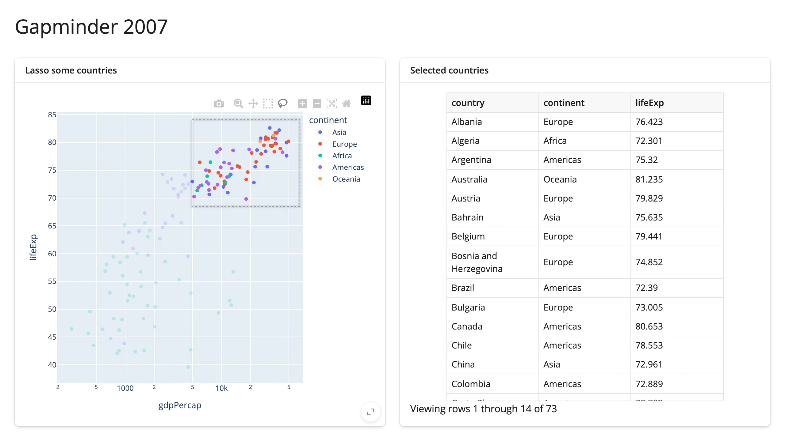

Much of Python's interactive visualization -- plotly, altair, lonboard, itables, and many more -- is built as
Jupyter widgets, made for notebooks. Notebooks are great for exploring, but they stall when it's time to share
what you found: everyone else needs your code, your environment, and the patience to run it.

Shiny bridges that gap between exploration and publication. Your analysis becomes a web app anyone can open,
and it can grow from a few lines of Python into a sophisticated application without switching frameworks.
shinywidgets brings the widgets you explored with along, so publishing doesn't mean rebuilding with different
tools.

In theory, [any widget](../any-widget/index.md) works, but dozens of popular libraries get first-class support:

- **Your notebook code carries over.** Return the figure, map, or table you'd display in a notebook, and
  shinywidgets handles the rest, including responsive sizing.
- **What users do becomes an input.** Each library's own decorator, like `@render_plotly`, adds methods for its
  interactions -- a lasso, a click, an edited cell -- that your app can read like any other input.
- **Updates are fast.** You can change a widget that's already on screen instead of rebuilding it, and each
  library's guide shows how.

Here's a whole app. Lasso some countries, and the table updates to match:

```{.python file="examples/reactive.py"}
import plotly.express as px
from shiny.express import render, ui
from shinywidgets import render_plotly

df = px.data.gapminder().query("year == 2007").reset_index(drop=True)

ui.page_opts(title="Gapminder 2007", fillable=True)

with ui.layout_columns():

    with ui.card(full_screen=True):
        ui.card_header("Lasso some countries")

        @render_plotly
        def plot():
            fig = px.scatter(
                df, x="gdpPercap", y="lifeExp", color="continent", log_x=True,
                hover_name="country", custom_data=[df.index],
            )
            return fig.update_layout(dragmode="lasso")

    with ui.card(full_screen=True):
        ui.card_header("Selected countries")

        @render.data_frame
        def table():
            return plot.selected_rows(df)[["country", "continent", "lifeExp"]]
```



Each decorated function is one piece of the page. [Your first widget app](../first-app/index.md) builds an app
like this step by step, then updates the chart in place.

## Reactive, not event-driven

Traditionally, responding to widget interactions requires event-driven programming: you write a callback for
each thing the user might do, and each callback has to update every part of the page that cares. As an app
grows, keeping those callbacks in step gets hard, and a missed one leaves views that quietly disagree.

With shinywidgets, what the user did is captured in a reactive value, not an event. Anything that reads it,
like the table above, updates whenever it changes, the way a spreadsheet formula updates when a cell it uses
changes. Adding another view means writing one more function that reads the same value; nothing else changes.
[Reacting to widgets](../reacting-to-widgets/index.md) covers the details.

## Staying responsive

When something in an app changes, say the user picks a new highlight color, the obvious way to show it is to
rebuild the widget: rerun the function that made it. For a big chart or map, that's where an app starts to feel
sluggish. The whole widget goes back to the browser and starts over, so every change means a wait, and the user
loses their zoom and selection each time.

shinywidgets lets you update the widget that's already on screen instead, sending only what changed. The
difference is large: recoloring a plotly chart's points in place sends 36 KB, while rebuilding the chart sends
5.5 MB, because a rebuild resends plotly's JavaScript too.

[Updating in place](../updating-in-place/index.md) shows how, and
[Large data & performance](../performance/index.md#1-re-render-vs-in-place-update) has the measurements.

## Is it for you?

shinywidgets fits when you want people to *do* something with your charts, maps, and tables -- select, filter,
drill in -- and have the rest of the app respond. How that compares to what you might be using now:

- **Jupyter notebooks or Voilà.** Voilà turns a notebook into a web page, but it's still a notebook underneath:
  by default the layout follows your cells, every visitor gets their own Python kernel, and interactivity means
  `observe()` callbacks. A Shiny app is designed as an app from the start, with layouts like sidebars and cards,
  one server process for many visitors, and reactive values instead of callbacks, all using the widgets you
  already know.
- **Streamlit.** Streamlit reruns your script (or a fragment of it) on every interaction, so charts are
  rebuilt each time, and caching and session state are how you keep that fast and stateful. Here, only what
  depends on a change reruns, widgets update in place, and you can draw on the whole Jupyter widget ecosystem.
- **Dash.** Dash apps are wired together with callbacks that name their inputs and outputs, and bringing in a
  new kind of widget means a Dash component written in React. Here, Shiny works out what depends on what, and
  Jupyter widgets work as they are.

If a static image or a shared notebook already does the job, you don't need any of this. And if you're used to
callbacks, reactivity takes a little getting used to; [Reacting to widgets](../reacting-to-widgets/index.md)
covers the model.

**Next:** [install shinywidgets](../installation/index.md), then
[build your first widget app](../first-app/index.md).
