```{=html}
<div class="sw-landing">

<div class="hero">
  <div class="wall" id="wall" aria-hidden="true"></div>
  <div class="veil"></div>
  <div class="copy">
    <div class="eyebrow">SHINY FOR PYTHON × JUPYTER WIDGETS</div>
    <h1>Bring your Jupyter widgets to Shiny.</h1>
    <p class="lede">Keep the libraries you already know: plotly, altair, lonboard, k3d, itables, and dozens more. One decorator puts them in a reactive web app, and what users do with them comes back as Python values.</p>
    <div class="ctas"><a class="btn primary" href="guide/why/index.html">Get started</a><a class="btn ghost" href="gallery/index.html">Browse the gallery →</a></div>
    <div class="install">$ <b>pip install shinywidgets</b></div>
  </div>
</div>

<section>
  <div class="sec-k">Widgets</div>
  <h2>43 integrations, grouped by what you're building.</h2>
  <p class="sub">Each group opens a set of guides. Every guide shows the widget rendering, the user's gestures flowing back to Python, and the widget updating in place.</p>
  <div class="cats">
    <a class="cat" href="widgets/plotly/index.html">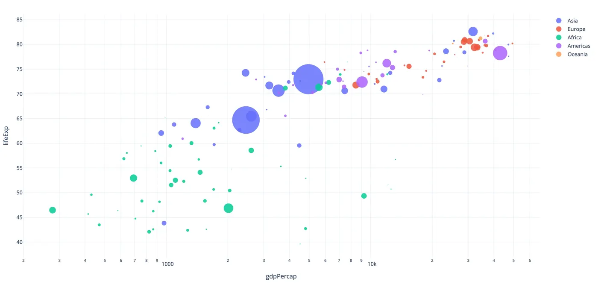<span class="n">11</span><div><h3>Charts</h3><p>plotly · altair · bokeh · matplotlib …</p></div></a>
    <a class="cat" href="widgets/ipyleaflet/index.html">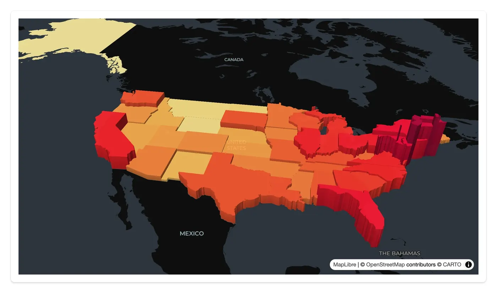<span class="n">09</span><div><h3>Maps &amp; geospatial</h3><p>lonboard · maplibre · ipyleaflet · kepler.gl …</p></div></a>
    <a class="cat" href="widgets/k3d/index.html">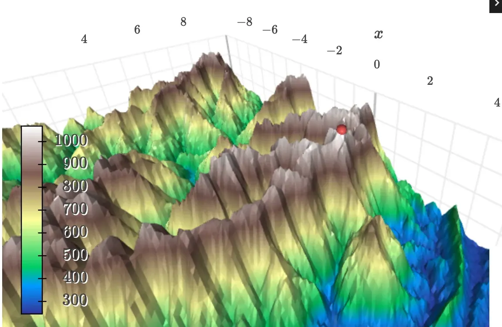<span class="n">04</span><div><h3>3D</h3><p>k3d · pythreejs · pyvista · ipyvolume</p></div></a>
    <a class="cat" href="widgets/mols2grid/index.html">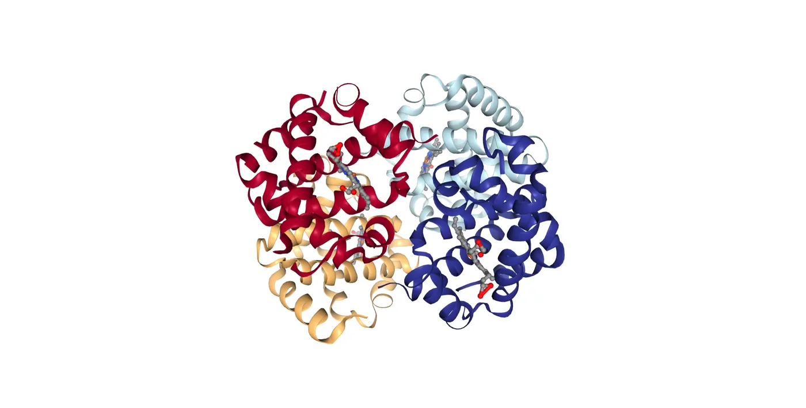<span class="n">06</span><div><h3>Scientific</h3><p>nglview · niivue · vizarr · mols2grid …</p></div></a>
    <a class="cat" href="widgets/itables/index.html">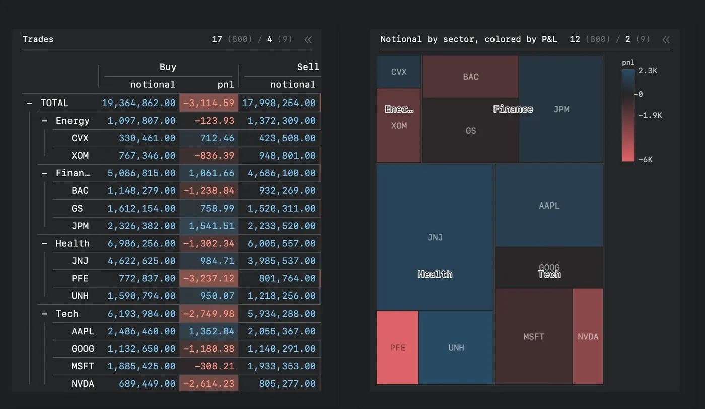<span class="n">04</span><div><h3>Tables &amp; grids</h3><p>itables · reactable · perspective · ipydatagrid</p></div></a>
    <a class="cat" href="widgets/pygwalker/index.html">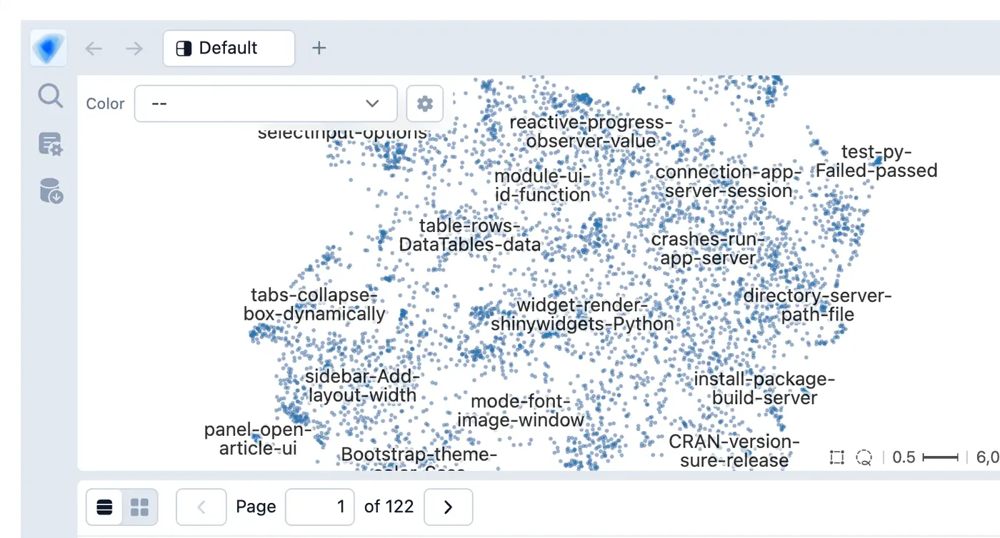<span class="n">04</span><div><h3>Data exploration</h3><p>embedding-atlas · mosaic · quak · pygwalker</p></div></a>
    <a class="cat" href="widgets/ipycytoscape/index.html">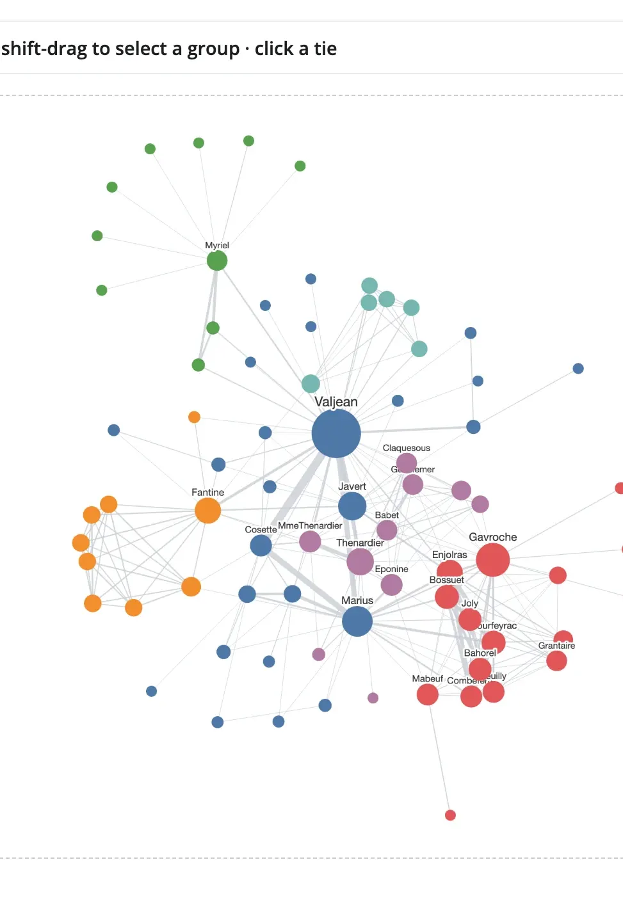<span class="n">02</span><div><h3>Networks</h3><p>ipycytoscape · ipysigma</p></div></a>
    <a class="cat" href="widgets/drawdata/index.html">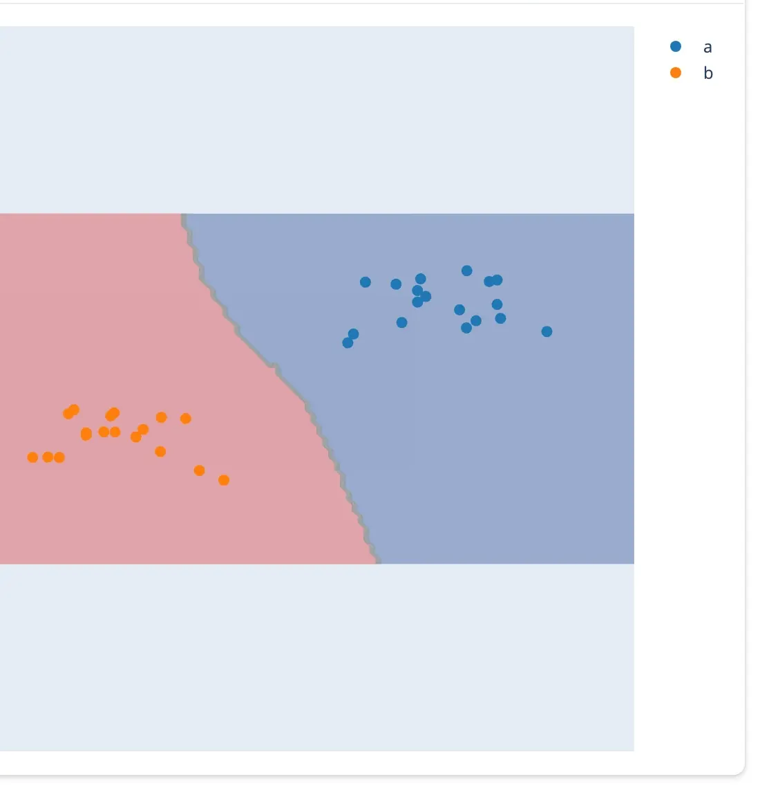<span class="n">03</span><div><h3>Input &amp; drawing</h3><p>drawdata · ipycanvas · ipyfilechooser</p></div></a>
  </div>
</section>

<section>
  <div class="sec-k">See it in code</div>
  <h2>A few lines of Python, from widget to input.</h2>
  <p class="sub">Pick a widget. The highlighted call is how your app reads what the user did; flip between before and after the gesture.</p>
  <div class="tabs" id="tabs" role="tablist"></div>
  <div class="panel">
    <div class="code"><div class="file"><span>app.py</span><a id="src"></a></div><pre id="code"></pre></div>
    <div class="out"><div class="ctrl" id="ctrl"><button type="button" data-s="0">before</button><button type="button" data-s="1">after</button></div><div class="gesture" id="gesture"></div></div>
  </div>
  <p class="more">Every example runs as-is: <code class="ic">shiny run app.py</code>. <a href="guide/choosing-a-widget/index.html">See all 43 guides →</a></p>
</section>

<section>
  <div class="sec-k">How it works</div>
  <h2>Three ideas, every widget.</h2>
  <p class="sub">Learn them once with one widget and they carry over to the other 42. Each one is a page in the guide.</p>
  <div class="steps">
    <a class="step" href="guide/first-app/index.html"><div class="num">01</div><h3>Render</h3>
      <p>Return a figure, map, or scene from a decorated function. It fills its card like any Shiny output.</p>
<pre><span class="dec">@render_plotly</span>
<span class="kw">def</span> plot():
    <span class="kw">return</span> px.scatter(df, ...)</pre></a>
    <a class="step" href="guide/reacting-to-widgets/index.html">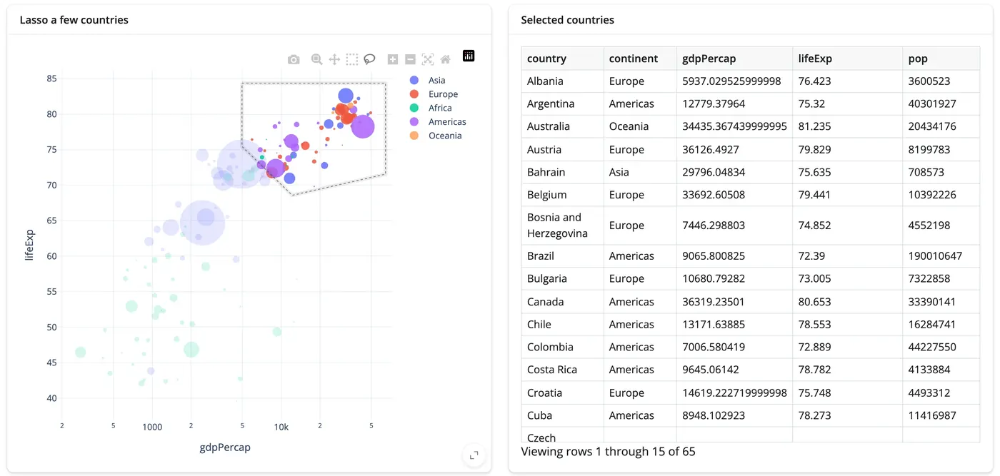<div class="num">02</div><h3>React</h3>
      <p>Every gesture is an accessor. Call it from any reactive context, the way you'd call <code>input.x()</code>.</p>
<pre><span class="dec">@render.data_frame</span>
<span class="kw">def</span> picked():
    <span class="kw">return</span> <span class="acc">plot.selected_rows(df)</span></pre></a>
    <a class="step" href="guide/updating-in-place/index.html">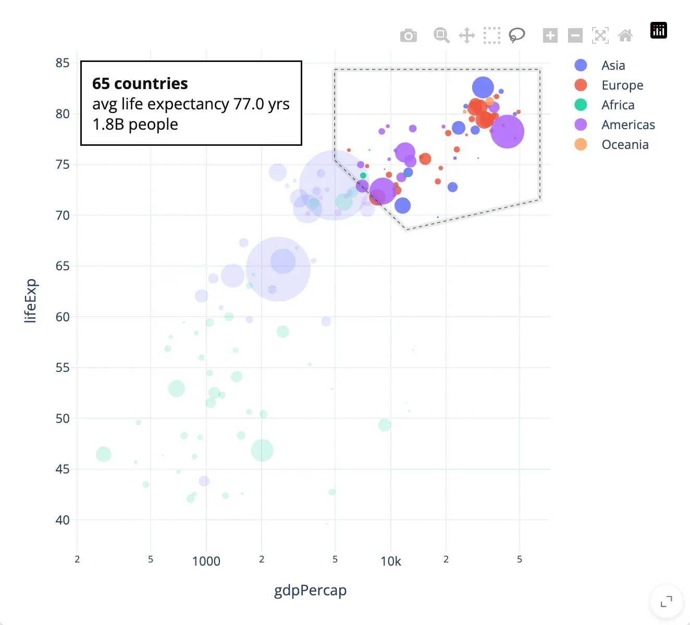<div class="num">03</div><h3>Update in place</h3>
      <p>Change the live widget from Python. Here a summary of the selection is written onto the chart, and the lasso and zoom stay put.</p>
<pre><span class="dec">@reactive.effect</span>
<span class="kw">def</span> _summarize():
    rows = <span class="acc">plot.selected_rows(df)</span>
    plot.widget.layout.annotations = [
        dict(text=<span class="str">f"{len(rows)} countries…"</span>, ...)
    ]</pre></a>
  </div>
</section>

<section class="gal">
  <div class="sec-k">Gallery</div>
  <div class="head-row"><h2>Whole apps, not just widgets.</h2><a class="see" href="gallery/index.html">All showcases &amp; templates →</a></div>
  <p class="sub">Real data, several views driving each other, a hundred or two lines of Python. Every one is open source and runs with <code class="ic">shiny run app.py</code>.</p>
  <div class="stage" id="stage">
    <ol class="picker" id="picker"></ol>
    <div class="browser">
      <div class="chrome"><span class="dots"><i></i><i></i><i></i></span><span class="url" id="url"></span><span class="live"><b></b>live</span></div>
      <div class="screen" id="screen">
        
        <div class="cursor" id="cursor"><span id="gest"></span></div>
      </div>
      <div class="foot"><span id="wchips"></span><span class="meta" id="meta"></span><a class="src" id="view-src" href="gallery/index.html">View source →</a></div>
    </div>
  </div>
</section>

<section>
  <div class="sec-k">Going further</div>
  <h2>When your app outgrows the basics.</h2>
  <div class="further">
    <a class="fur" href="guide/performance/index.html">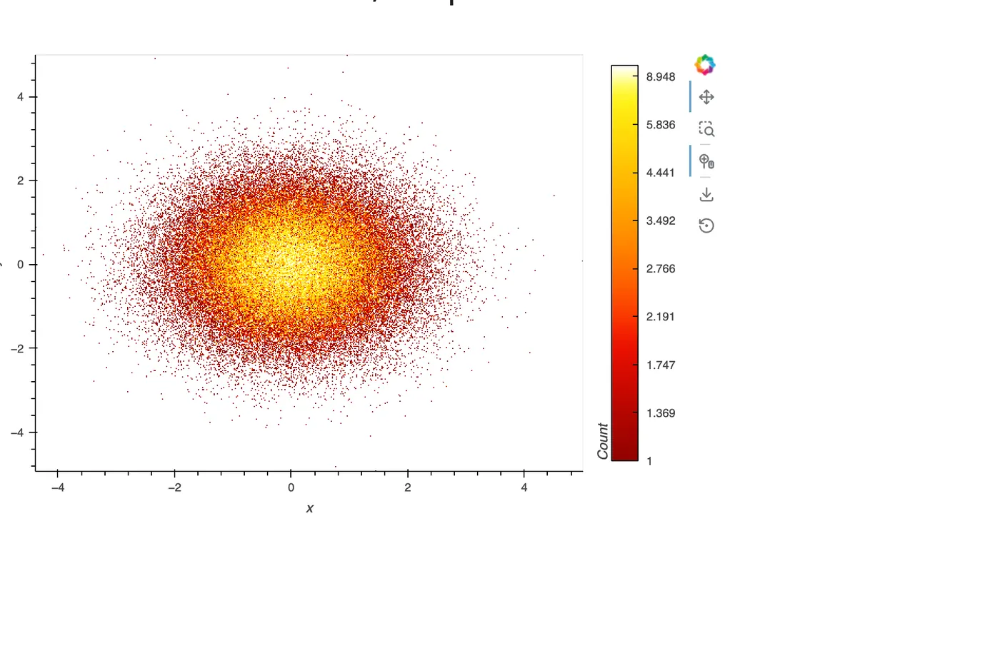<div class="b"><h3>Millions of rows</h3><p>Draw on the GPU, aggregate on the server, or query only what's visible. Three approaches, measured.</p><span class="go">Large data &amp; performance →</span></div></a>
    <a class="fur" href="guide/ai-exploration/index.html">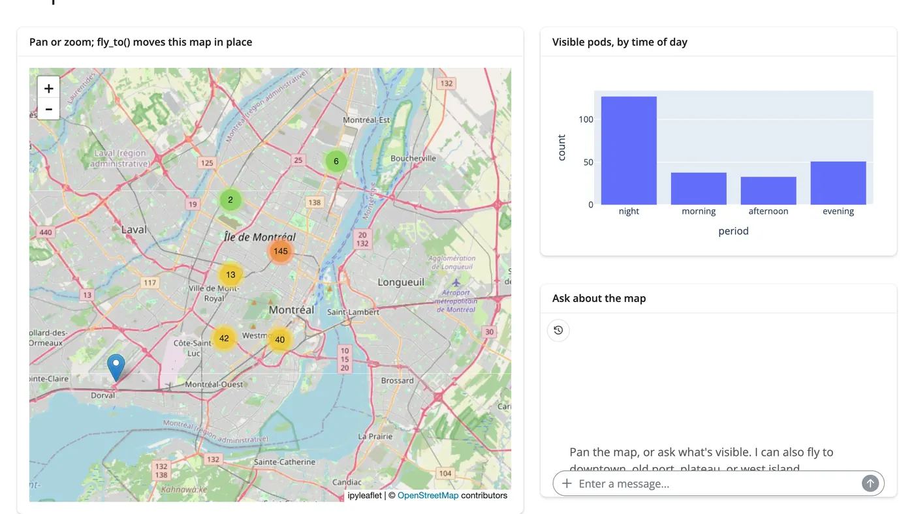<div class="b"><h3>AI exploration</h3><p>Let a chat filter your data, read a selection, or steer a map. The LLM sees the same accessors you do.</p><span class="go">AI exploration →</span></div></a>
    <a class="fur" href="guide/any-widget/index.html"><div class="im code-im"><pre><span class="kw">import</span> anywidget, traitlets

<span class="kw">class</span> Counter(anywidget.AnyWidget):
    _esm = <span class="str">"…"</span>
    count = traitlets.Int(0).tag(sync=<span class="kw">True</span>)

<span class="dec">@render_widget</span>
<span class="kw">def</span> counter():
    <span class="kw">return</span> Counter()

counter.read(<span class="str">"count"</span>)</pre></div><div class="b"><h3>Your widget isn't listed?</h3><p>Any ipywidget or anywidget renders with <code>@render_widget</code>, including one you write yourself.</p><span class="go">Any widget →</span></div></a>
  </div>
</section>

<section class="closing">
  <h2>Start with a widget you already use.</h2>
  <div class="install-big"><span>$</span> pip install shinywidgets</div>
  <div class="ctas"><a class="btn primary" href="guide/first-app/index.html">Your first widget app</a><a class="btn ghost" href="gallery/index.html">Gallery</a><a class="btn ghost" href="https://shiny.posit.co/py/">Shiny for Python docs ↗</a></div>
</section>

</div>
```
