[Altair](https://altair-viz.github.io) is the Python API for [Vega-Lite](https://vega.github.io/vega-lite/), the
declarative grammar of interactive graphics built by the University of Washington Interactive Data Lab. You
describe a chart as data plus encodings plus marks, and Vega-Lite compiles it to a complete interactive
visualization, including its own grammar for selections: brushes, clicks, legend picks, and parameter-bound
widgets that live *inside* the chart.

`@render_altair` accepts either a plain `alt.Chart` (or any composed `LayerChart`, `HConcatChart`, `VConcatChart`,
`FacetChart`, or `RepeatChart`) or an `altair.JupyterChart` you built yourself, and takes care of the parts that
are awkward on your own: charts without an explicit size are set to fill their container, so they resize with
cards, sidebars, and full-screen toggles; the chart renders once, even though a Shiny render function reruns on
every input change the function reads.

The headline feature is two accessors: `selected()` and `selected_rows()`. Because Vega-Lite's selections are
already declared, named state (not ad hoc click events), there is no large menu of accessors to learn -- one
accessor reads any selection by name, and a second filters your data frame the same way Vega-Lite would,
including the fiddly cases (half-open bins, timezones). What you get for free is Altair's best trick: your chart
is also an **input**, readable in any `@render.*` function, `@reactive.calc`, or `@reactive.effect` the way you'd
read `input.my_slider()`.

Pick Altair when the interaction *is* the product: linked brushing, legend filtering, parameter-driven styling,
small-to-medium data, with minimal glue code. Pick [plotly](../plotly/index.md) for larger WebGL scatter plots, 3D,
maps, or a built-in zoom/pan/lasso toolbar. Pick [bokeh](../bokeh/index.md) if you're already invested in its event
model. Altair's own grammar also means a lot of linking never needs Python at all -- see "Coordinating multiple
views" below for exactly where the line falls.

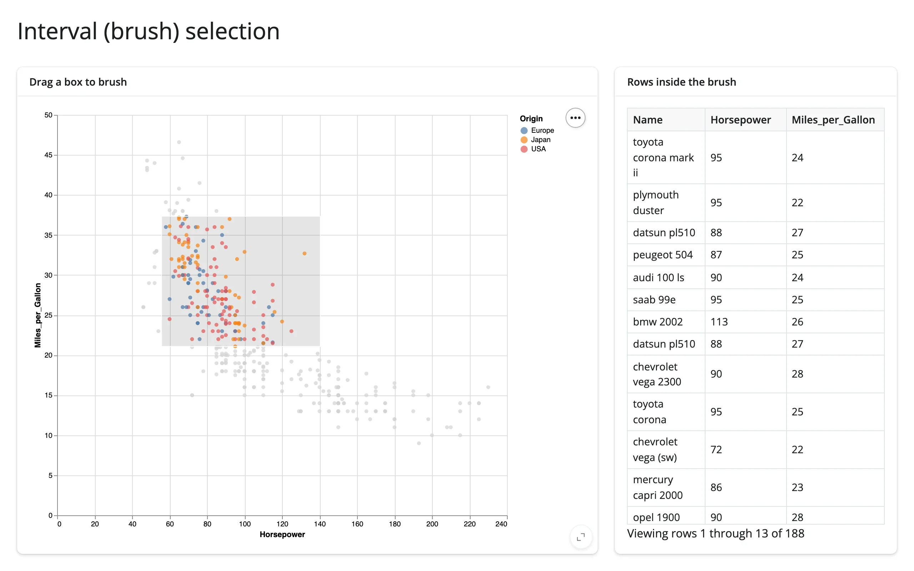

## Installation

```
pip install 'shinywidgets[altair]'
```

This installs `altair` and `vl-convert-python` (needed for `JupyterChart.enable_offline()`, below). The sample
datasets used below (`cars`, `seattle_weather`) come from `altair.datasets`, which is bundled with altair itself
-- nothing else to install.

## Quick start

```{.python file="examples/01_quickstart.py"}
import altair as alt
from altair.datasets import data
from shiny.express import ui

from shinywidgets import render_altair

ui.page_opts(title="Cars", fillable=True)

cars = data.cars()


@render_altair
def plot():
    return (
        alt.Chart(cars)
        .mark_circle()
        .encode(x="Horsepower:Q", y="Miles_per_Gallon:Q", color="Origin:N")
    )
```

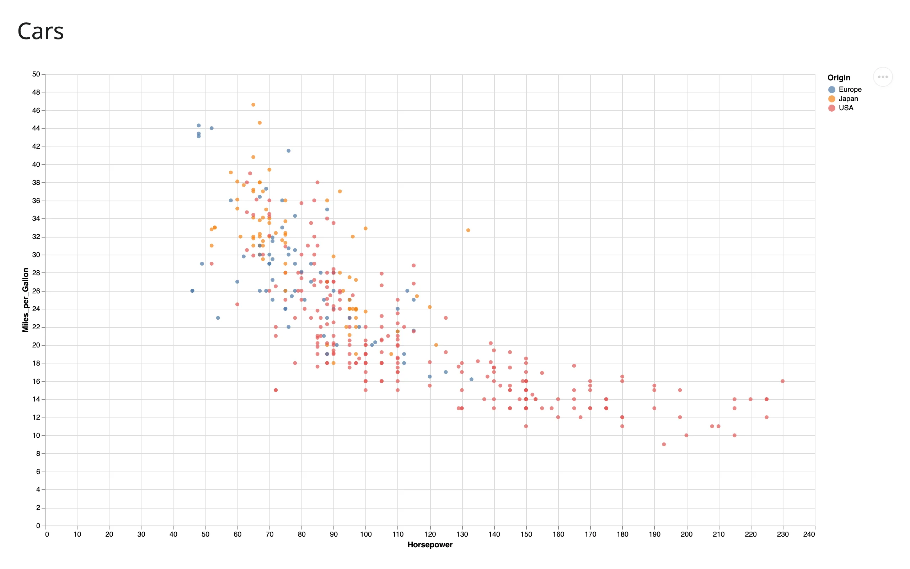

No layout kwargs, no sizing calls: the chart fills its card because the output has no explicit height.

## What you can build

Altair's encoding grammar covers most of what you'd reach for a plotting library to do. Two highlights that are
easy to miss and look great in a dashboard:

**Layers and small multiples.** `+` layers two charts (e.g., points and a reference rule) on shared axes;
`.facet()` repeats an encoding across small multiples. Both are ordinary Altair, rendered as-is by
`render_altair`.

```{.python file="examples/02_layers_and_facets.py"}
import altair as alt
from altair.datasets import data
from shiny.express import ui

from shinywidgets import render_altair

ui.page_opts(title="Layers and small multiples", fillable=True)

weather = data.seattle_weather()

with ui.layout_columns():
    with ui.card(full_screen=True):
        ui.card_header("Points layered with a mean rule")

        @render_altair
        def layered():
            points = (
                alt.Chart(weather)
                .mark_circle(opacity=0.4)
                .encode(x="date:T", y="temp_max:Q", color="weather:N")
            )
            mean_rule = alt.Chart(weather).mark_rule(color="black").encode(y="mean(temp_max):Q")
            return points + mean_rule

    with ui.card(full_screen=True):
        ui.card_header("Small multiples with facet()")

        @render_altair
        def faceted():
            return (
                alt.Chart(weather)
                .mark_bar()
                .encode(x="temp_max:Q", y="count()", color="weather:N")
                .properties(width=140, height=120)
                .facet("weather:N", columns=3)
            )
```

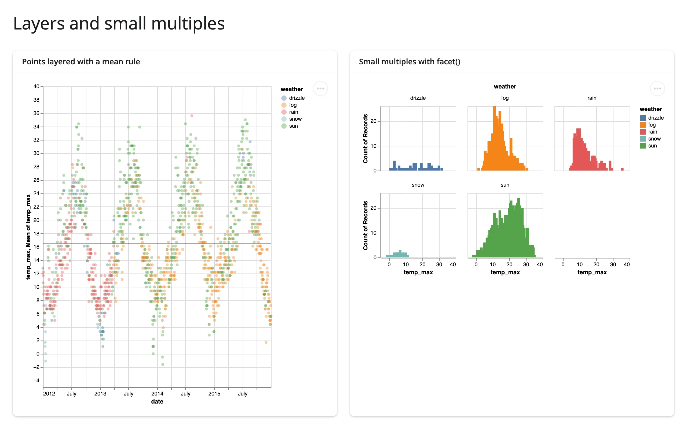

Note the facet grid keeps its own natural size rather than filling the card -- more on that in "Layout and
sizing". Data: `altair.datasets`' `seattle_weather` (four years of real NOAA daily observations for Seattle; the same
dataset reappears in the gallery below).

**Controls built into the chart.** `alt.param(bind=alt.binding_range(...))` (or `binding_select`,
`binding_checkbox`, `binding_radio`) puts an HTML control under the chart that's wired directly into Vega-Lite's
expression language. This needs no Shiny input and no Python round trip at all.

```{.python file="examples/03_bound_widget.py"}
import altair as alt
from altair.datasets import data
from shiny.express import ui

from shinywidgets import render_altair

ui.page_opts(title="A control built into the chart", fillable=True)

cars = data.cars()


@render_altair
def chart():
    year_slider = alt.binding_range(min=1970, max=1982, step=1, name="Model year: ")
    year = alt.param(name="year", value=1977, bind=year_slider)
    return (
        alt.Chart(cars)
        .mark_circle()
        .encode(
            x="Horsepower:Q",
            y="Miles_per_Gallon:Q",
            color="Origin:N",
            opacity=alt.condition("year(datum.Year) == year", alt.value(0.9), alt.value(0.05)),
        )
        .add_params(year)
    )
```

Before (year 1977) and after dragging the slider to 1982 -- every car outside the chosen year fades, with no
request to the server:

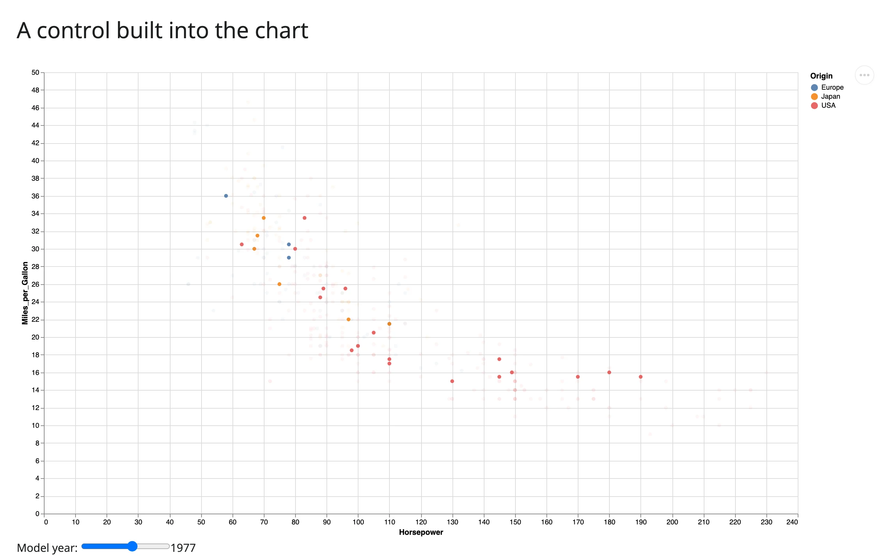
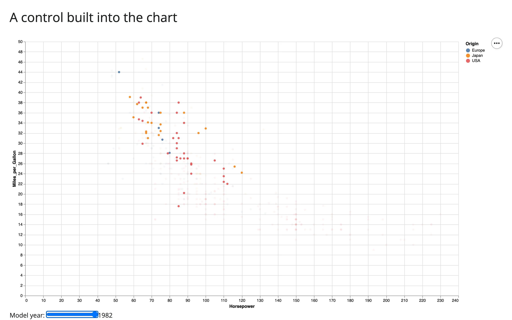

If you do want Python involved when this slider moves (to drive a computation Vega-Lite's grammar can't express),
see "Beyond the accessors: reactive_read" below -- the same param is readable from Python too.

## Reacting to user interaction

A Vega-Lite selection is declared state, not a transient event: you name it when you add it to the chart
(`alt.selection_interval(name="brush")`, `alt.selection_point(name="pick")`), and from then on the chart always
has a current value for it, starting out empty. That's why Altair collapses to just two accessors instead of a
menu of event handlers.

### Accessor reference

| Accessor | Returns | Before any interaction | Across re-render | Default rate policy |
|---|---|---|---|---|
| `selected(name=None)` | An `IntervalSelection`, `PointSelection`, or `IndexSelection` (`altair.utils.selection`) | seeded: an empty selection, never `None` | re-seeded -- a new chart's named selection starts empty again | debounce, 250 ms |
| `selected_rows(name=None, df=None)` | A frame of the matching rows, same type as `df` (pandas or polars) | seeded: empty frame | re-seeded (follows `selected()`) | follows `selected()`; no separate rate limit |

`name` can be omitted when the chart has exactly one selection; with more than one, you must name which one you
want (see "Multiple named selections" below). Always give your selections explicit names -- Altair's
auto-generated ones (`param_3`, ...) change on every re-render, which would silently break `selected("param_3")`
the next time your render function runs.

Unlike renderers whose accessors start at `None` until the user interacts, `selected()` attaches already seeded
(an empty selection) the moment the chart renders -- there's no warm-up and no `None` to guard against. You don't
need `req()` to wait for it the way you would for most other renderers' accessors -- it's always safe to call
inside a `@render.*` function. What you usually want to guard instead is the *emptiness* of the result, e.g.
`if len(rows) == 0: ...`.

### Interval (brush) selections

Dragging a box (or, with `encodings=["x"]`, a 1-D range) is the most common Altair interaction. The empty
selection filters to zero rows, not "everything," so a `@render.data_frame` can consume `selected_rows()`
directly without checking for `None`:

```{.python file="examples/04_interval_selection.py"}
import altair as alt
from altair.datasets import data
from shiny.express import render, ui

from shinywidgets import render_altair

ui.page_opts(title="Interval (brush) selection", fillable=True)

cars = data.cars()

with ui.layout_columns(col_widths=[8, 4]):
    with ui.card(full_screen=True):
        ui.card_header("Drag a box to brush")

        @render_altair
        def scatter():
            brush = alt.selection_interval(name="brush")
            return (
                alt.Chart(cars)
                .mark_circle()
                .encode(
                    x="Horsepower:Q",
                    y="Miles_per_Gallon:Q",
                    color=alt.condition(brush, "Origin:N", alt.value("lightgray")),
                )
                .add_params(brush)
            )

    with ui.card(full_screen=True):
        ui.card_header("Rows inside the brush")

        @render.data_frame
        def brushed():
            return scatter.selected_rows("brush")[["Name", "Horsepower", "Miles_per_Gallon"]]
```

Before dragging, the table is empty (not full of every row); after dragging, it fills with exactly the brushed
cars:

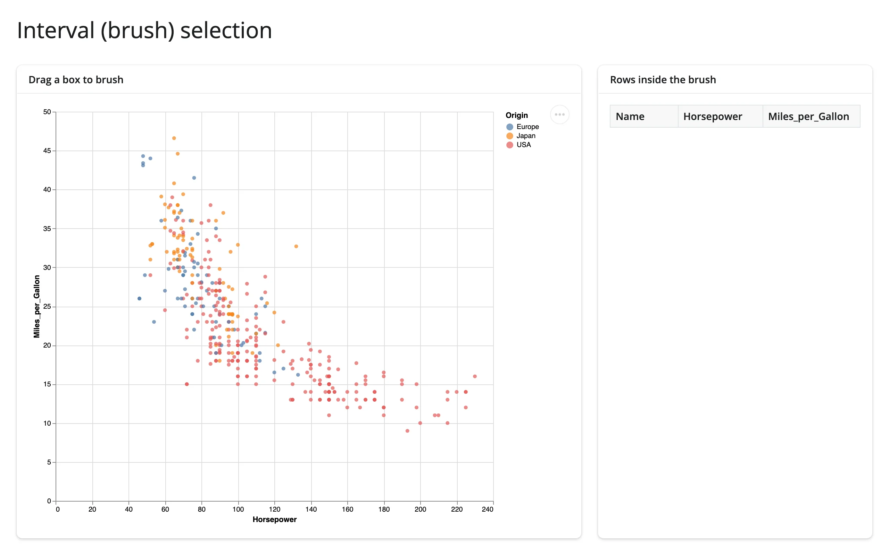


### Point and index selections

A point selection has three distinct flavors, depending on how you construct it:

- `alt.selection_point(name=..., encodings=["color"], bind="legend")`: clicking a **legend** entry picks every
  mark whose value on that encoding channel matches. `encodings=` names a channel, so it resolves to whatever
  field happens to be mapped there.
- `alt.selection_point(name=..., fields=["Origin"])`: the same idea, but naming the data column directly instead
  of a channel -- useful when you want the test tied to a field regardless of which channel (if any) encodes it.
  Verified interchangeable with `encodings=["color"]` above when `color` *is* bound to `Origin`: both report
  `[{'Origin': 'Europe'}]` from the same legend click.
- `alt.selection_point(name=...)` with neither `encodings=` nor `fields=`: clicking (or shift-clicking, for
  multiple) individual **marks**. This is an `IndexSelection` -- `.value` is a list of 0-based row positions in
  the underlying data, so `df.iloc[sel.value]` (which is exactly what `selected_rows()` does for you) just works.

```{.python file="examples/05_point_and_index_selection.py"}
import altair as alt
from altair.datasets import data
from shiny.express import render, ui

from shinywidgets import render_altair

ui.page_opts(title="Point selections: legend vs. mark clicks", fillable=True)

cars = data.cars()

with ui.layout_columns():
    with ui.card(full_screen=True):
        ui.card_header("encodings=['color']: click a legend entry")

        @render_altair(height="320px")
        def by_legend():
            pick = alt.selection_point(name="origin_pick", encodings=["color"], bind="legend")
            return (
                alt.Chart(cars)
                .mark_circle()
                .encode(
                    x="Horsepower:Q",
                    y="Miles_per_Gallon:Q",
                    color=alt.condition(pick, "Origin:N", alt.value("lightgray")),
                )
                .add_params(pick)
            )

        @render.code
        def legend_value():
            return str(by_legend.selected("origin_pick").value)

    with ui.card(full_screen=True):
        ui.card_header("No encodings/fields: shift-click points")

        @render_altair(height="320px")
        def by_mark():
            pick = alt.selection_point(name="car_pick")
            return (
                alt.Chart(cars)
                .mark_circle()
                .encode(
                    x="Horsepower:Q",
                    y="Miles_per_Gallon:Q",
                    color=alt.condition(pick, alt.value("steelblue"), alt.value("lightgray")),
                )
                .add_params(pick)
            )

        @render.text
        def picked_count():
            return f"{len(by_mark.selected_rows('car_pick'))} cars picked (row positions: {by_mark.selected('car_pick').value})"

        @render.data_frame
        def picked_cars():
            return by_mark.selected_rows("car_pick")[["Name", "Horsepower"]]
```

Legend click on the left (reports `[{'Origin': 'Europe'}]`), one click plus one shift-click on the right (reports
two row positions and both matching cars):

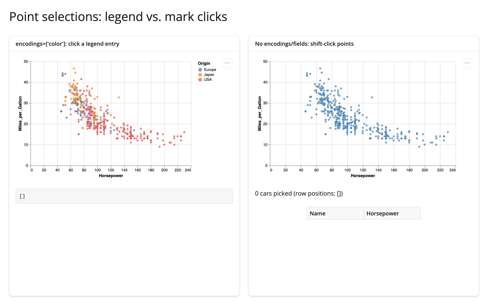
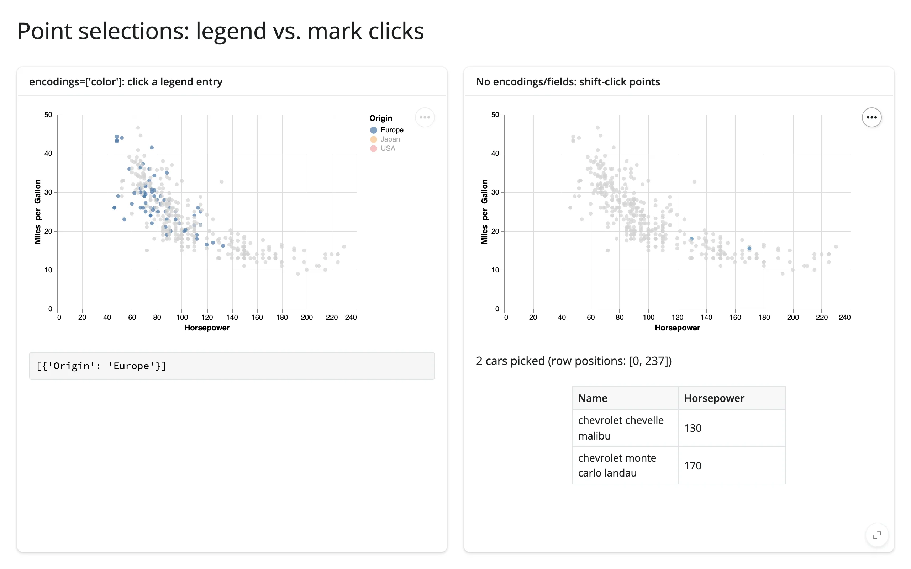

### Binned and temporal fields

`selected_rows()` evaluates the selection the way Vega-Lite does, which matters for two field types in
particular:

- **Binned fields** (`alt.X("Horsepower:Q", bin=alt.Bin(step=25))`): clicking a bar selects a half-open range
  (`[lo, hi)`), matching Vega-Lite's own semantics -- not the closed interval you'd get from a naive
  `df.query("lo <= x <= hi")`.
- **Temporal fields**: Vega sends dates as UTC; a time-zone-naive column is compared in the *browser's* local
  time zone (via the widget's `local_tz`), and a time-zone-aware column is compared in its own zone. You don't
  have to do this conversion yourself.

```{.python file="examples/06_binned_temporal.py"}
import altair as alt
from altair.datasets import data
from shiny.express import render, ui

from shinywidgets import render_altair

ui.page_opts(title="Binned and temporal fields", fillable=True)

cars = data.cars()

with ui.layout_columns():
    with ui.card(full_screen=True):
        ui.card_header("Click a bar: binned selection")

        @render_altair
        def histogram():
            pick = alt.selection_point(name="hp_bin", encodings=["x"])
            return (
                alt.Chart(cars)
                .mark_bar()
                .encode(
                    x=alt.X("Horsepower:Q", bin=alt.Bin(step=25)),
                    y="count()",
                    color=alt.condition(pick, alt.value("steelblue"), alt.value("lightgray")),
                )
                .add_params(pick)
            )

        @render.text
        def bin_count():
            n = len(histogram.selected_rows("hp_bin"))
            return f"{n} cars in the selected 25-hp bin" if n else "Click a bar above"

    with ui.card(full_screen=True):
        ui.card_header("Drag along the axis: temporal interval")

        @render_altair
        def timeline():
            brush = alt.selection_interval(name="years", encodings=["x"])
            return (
                alt.Chart(cars)
                .mark_tick()
                .encode(x="Year:T")
                .add_params(brush)
            )

        @render.text
        def year_count():
            n = len(timeline.selected_rows("years"))
            return f"{n} cars in the selected years" if n else "Drag along the axis above"
```

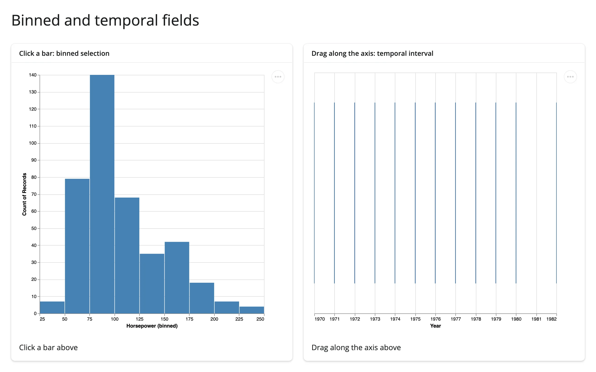
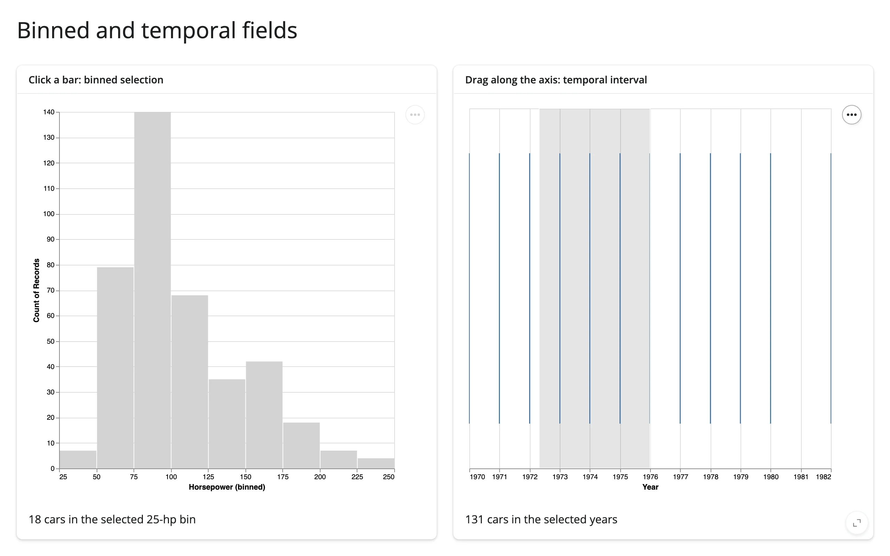

The right-hand chart's gray brush overlay confirms the drag registered, and the count below it (131 cars across
the dragged years) is computed from the correct, Vega-Lite-equivalent range test. The left-hand chart is also
genuinely selected -- `bin_count` updates correctly -- even though, as covered in Gotchas below, Vega-Lite itself
doesn't visually highlight the clicked bar in this particular case.

### Multiple named selections

A chart can declare more than one selection; read each by name. Two selections *in the same view* interact,
though: in this example, dragging the brush clears the legend pick, and clicking the legend clears the brush
(this is Vega-Lite's own behavior for co-located selections, not something shinywidgets adds or could prevent).

```{.python file="examples/07_multiple_selections.py"}
import altair as alt
from altair.datasets import data
from shiny.express import render, ui

from shinywidgets import render_altair

ui.page_opts(title="Two named selections on one chart", fillable=True)

cars = data.cars()


@render_altair
def chart():
    brush = alt.selection_interval(name="brush", encodings=["x"])
    origin_pick = alt.selection_point(name="origin_pick", encodings=["color"], bind="legend")
    return (
        alt.Chart(cars)
        .mark_circle()
        .encode(
            x="Horsepower:Q",
            y="Miles_per_Gallon:Q",
            color=alt.condition(origin_pick, "Origin:N", alt.value("lightgray")),
            opacity=alt.condition(brush, alt.value(1.0), alt.value(0.3)),
        )
        .add_params(brush, origin_pick)
    )


with ui.layout_columns():

    @render.code
    def brush_state():
        return f"brush: {chart.selected('brush').value}"

    @render.code
    def legend_state():
        return f"origin_pick: {chart.selected('origin_pick').value}"
```

Legend click only (`brush` stays `{}`), then brush drag only (`origin_pick` resets to `[]`):

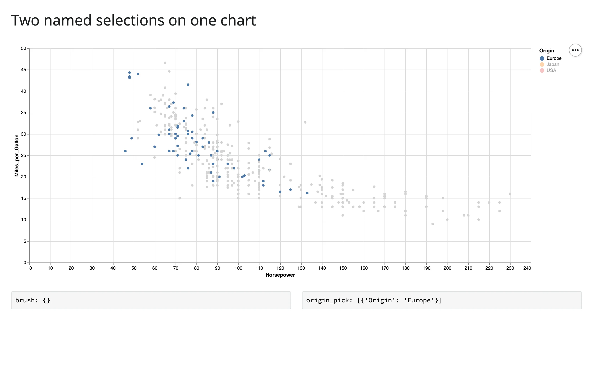
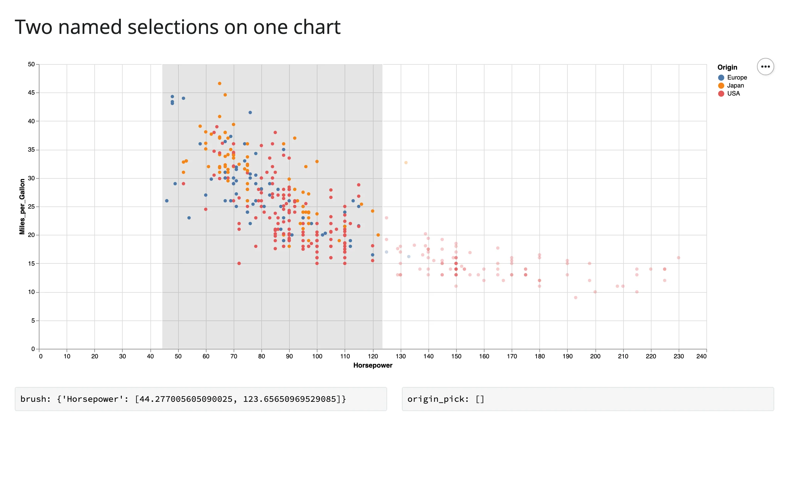

If you want two selections that don't clear each other, put them in separate views (e.g. two chart outputs, or
two layers that aren't both direct interaction targets) rather than relying on them coexisting peacefully in one.

### Polars frames

`selected_rows()` is built on [narwhals](https://narwhals-dev.github.io/narwhals/), which Altair itself depends
on, so a chart built from a `polars.DataFrame` filters to a `polars.DataFrame`, with no extra configuration.

```{.python file="examples/08_polars_frame.py"}
import altair as alt
from altair.datasets import data
import polars as pl
from shiny.express import render, ui

from shinywidgets import render_altair

ui.page_opts(title="Polars data", fillable=True)

cars = pl.from_pandas(data.cars())

with ui.layout_columns(col_widths=[8, 4]):
    with ui.card(full_screen=True):
        ui.card_header("Chart built from a polars.DataFrame")

        @render_altair
        def scatter():
            brush = alt.selection_interval(name="brush")
            return (
                alt.Chart(cars)
                .mark_circle()
                .encode(
                    x="Horsepower:Q",
                    y="Miles_per_Gallon:Q",
                    color=alt.condition(brush, "Origin:N", alt.value("lightgray")),
                )
                .add_params(brush)
            )

    with ui.card(full_screen=True):
        ui.card_header("selected_rows() returns a polars.DataFrame")

        @render.code
        def kind():
            return type(scatter.selected_rows("brush")).__name__

        @render.data_frame
        def rows():
            return scatter.selected_rows("brush").select("Name", "Horsepower")
```

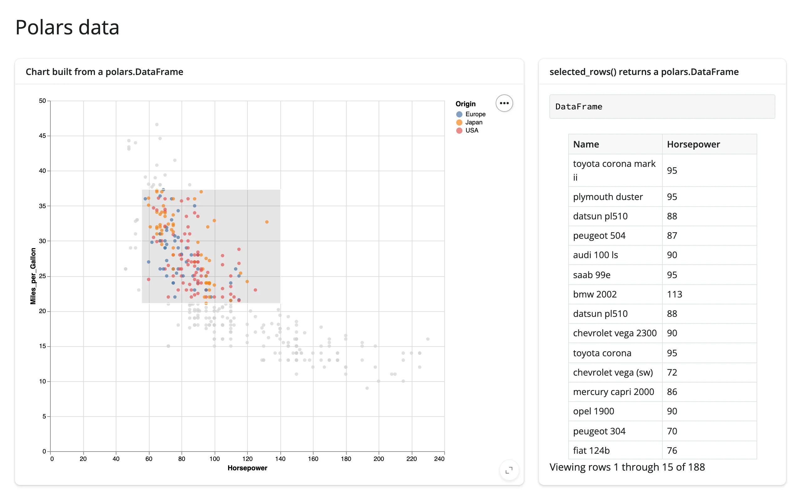

`df=` defaults to the chart's own data frame; pass it explicitly for charts whose data is a URL string, or (see
"Gotchas" below) a layered/concatenated chart whose layers weren't built from the identical data frame object.

### Beyond the accessors: reactive_read

Params (`alt.param(...)`, including ones bound to in-chart controls like `binding_range`) are not selections, so
they have no dedicated accessor. They also aren't traits of `chart.widget` itself -- each bound param becomes a
trait of `chart.widget.params`, a separate object the widget builds -- so `chart.read("name")` (which only looks
at `chart.widget`'s own traits) can't reach them. Read one with `reactive_read(chart.widget.params, "name")`
instead -- the same slider from "What you can build" above, now also driving a Python-side output:

```{.python file="examples/09_params_reactive_read.py"}
import altair as alt
from altair.datasets import data
from shiny.express import render, ui

from shinywidgets import reactive_read, render_altair

ui.page_opts(title="Reading a bound param with reactive_read", fillable=True)

cars = data.cars()

with ui.layout_columns(col_widths=[8, 4]):
    with ui.card(full_screen=True):
        ui.card_header("Model year is a param, not a selection")

        @render_altair
        def chart():
            year_slider = alt.binding_range(min=1970, max=1982, step=1, name="Model year: ")
            year = alt.param(name="year", value=1977, bind=year_slider)
            return (
                alt.Chart(cars)
                .mark_circle()
                .encode(
                    x="Horsepower:Q",
                    y="Miles_per_Gallon:Q",
                    opacity=alt.condition(
                        "year(datum.Year) == year", alt.value(0.9), alt.value(0.05)
                    ),
                )
                .add_params(year)
            )

    with ui.card(full_screen=True):
        ui.card_header("Python reacts to the slider too")

        @render.text
        def year_value():
            # params aren't selections, so there's no accessor for them;
            # reactive_read watches the trait directly.
            year = reactive_read(chart.widget.params, "year")
            return f"Showing model year {int(year)}" if year is not None else "..."
```

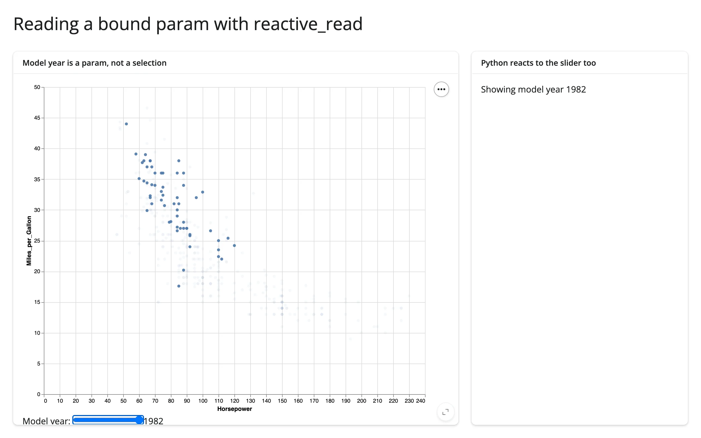

`local_tz` and `debounce_wait`, by contrast, *are* traits of `chart.widget` itself, so reading them doesn't need
`reactive_read()` at all -- `chart.read("local_tz")` (the browser's IANA zone name, the same one
`selected_rows()` uses internally for naive temporal columns) and `chart.read("debounce_wait")` (see "Rate
limiting," next).

### Rate limiting

Two independent rate limits are in play, and they solve different problems:

- **`rate_policy` / `rate_delay` on `@render_altair`** control how often *Python* re-reads `selected()` (and
  `reactive_read()` on this widget). The default is a 250 ms debounce, which is what you want for a brush you're
  dragging: Python only sees the final-ish value, not every intermediate frame. Pass `rate_policy="throttle"` for
  steady-interval updates instead of trailing-edge ones, or `rate_delay=0` to see every message.
- **`debounce_wait` / `max_wait` on `alt.JupyterChart`** (default `debounce_wait=10`, `max_wait=True`) control how
  often the *browser* sends a selection update to the kernel at all, independent of shinywidgets. Raising this
  (`alt.JupyterChart(chart, debounce_wait=150)`) cuts the number of messages that cross the wire while dragging,
  which matters more as your data or your downstream computation gets larger.

In practice, the shinywidgets-side default is enough for most apps; reach for `debounce_wait` when a selection
drives something expensive enough that even a debounced Python read is too frequent relative to the number of
browser messages arriving.

### Reading on demand

Because `selected()`/`selected_rows()` are live and seeded from the moment the chart renders, they're safe to
read from somewhere that only runs occasionally, like a download handler -- no prior read, no warm-up, and the
value you get back is whatever the user last brushed, even on the handler's first run:

```{.python file="examples/14_download_selection.py"}
import altair as alt
from altair.datasets import data
from shiny.express import render, ui

from shinywidgets import render_altair

ui.page_opts(title="Reading selected_rows() on demand", fillable=True)

cars = data.cars()

with ui.layout_columns(col_widths=[8, 4]):
    with ui.card(full_screen=True):
        ui.card_header("Drag a box to brush, then download -- no need to click anything first")

        @render_altair
        def scatter():
            brush = alt.selection_interval(name="brush")
            return (
                alt.Chart(cars)
                .mark_circle()
                .encode(
                    x="Horsepower:Q",
                    y="Miles_per_Gallon:Q",
                    color=alt.condition(brush, "Origin:N", alt.value("lightgray")),
                )
                .add_params(brush)
            )

    with ui.card():

        @render.download_button(
            filename="brushed.csv", label="Download brushed rows as CSV"
        )
        def download():
            # selected_rows() is seeded empty from the moment the chart
            # renders, so this never needs a req() or a prior interaction.
            yield scatter.selected_rows("brush").to_csv(index=False)
```

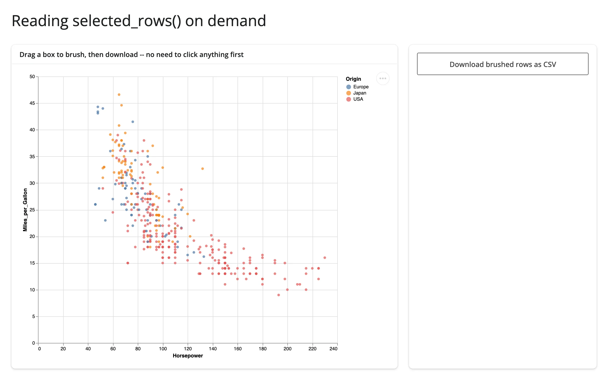
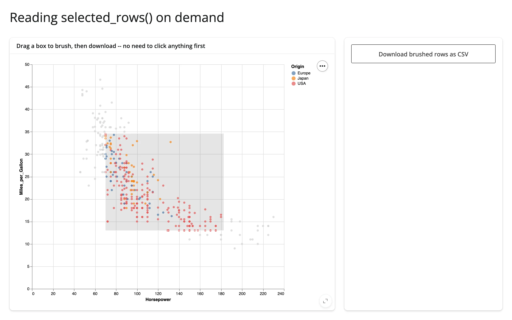

## Updating the widget from Python

Selections are **read-only from Python** -- there's no way to set `chart.widget.selections.brush = ...` and have
it move the brush. Params, by contrast, are meant to be set from Python: assign
`chart.widget.params.<name> = value` inside a `@reactive.effect`, and the chart restyles in place, without
resending its data or losing the user's current selection/zoom state.

```{.python file="examples/10_params_inplace_update.py"}
import altair as alt
from altair.datasets import data
from shiny import reactive
from shiny.express import input, render, ui

from shinywidgets import render_altair

ui.page_opts(title="Updating a param in place", fillable=True)

cars = data.cars()

with ui.sidebar():
    ui.input_slider("threshold", "Highlight above (mpg)", min=10, max=45, value=30)

with ui.card(full_screen=True):
    ui.card_header("Moving the slider restyles the chart without resending data")

    @render_altair
    def chart():
        with reactive.isolate():
            threshold = alt.param(name="threshold", value=input.threshold())
        return (
            alt.Chart(cars)
            .mark_circle()
            .encode(
                x="Horsepower:Q",
                y="Miles_per_Gallon:Q",
                color=alt.condition(
                    "datum.Miles_per_Gallon > threshold", alt.value("crimson"), alt.value("lightgray")
                ),
            )
            .add_params(threshold)
        )

    @reactive.effect
    def _():
        chart.widget.params.threshold = input.threshold()
```

`reactive.isolate()` around the *initial* value keeps the render function from re-running every time the slider
moves -- only the effect reacts to it, and only to patch the existing chart:

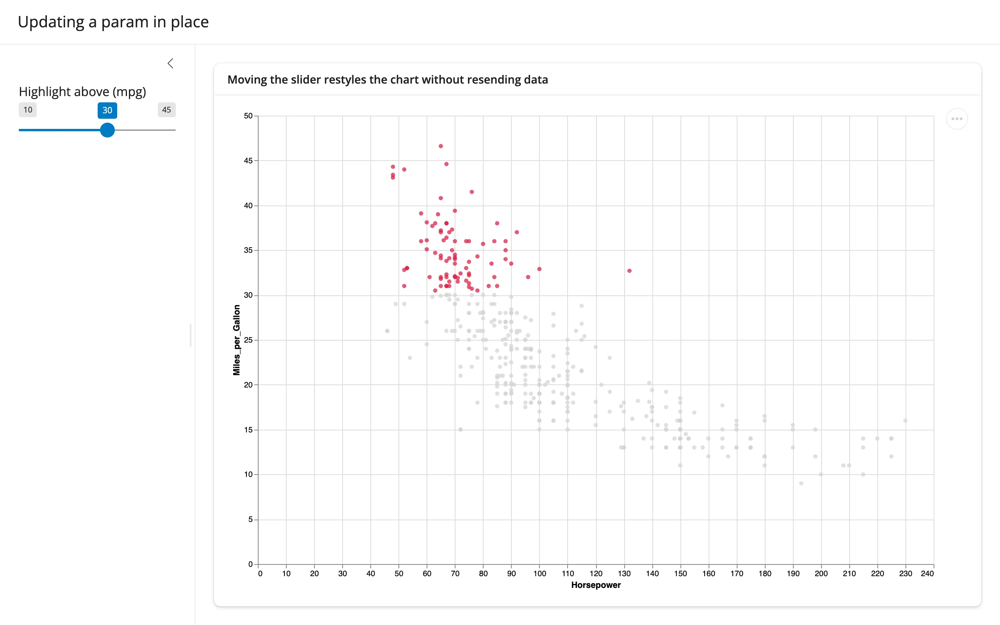
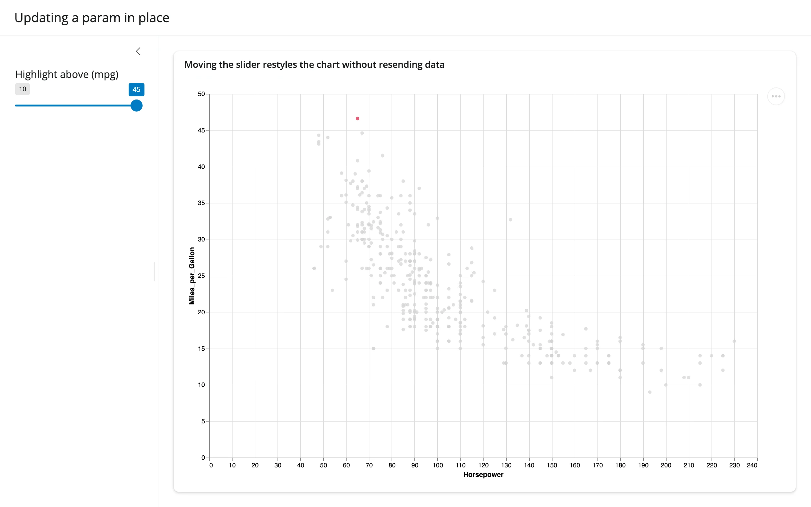

Use in-place param updates when you're restyling an existing chart (thresholds, highlighted categories, a bound
range). Re-render (just read the input in the `@render_altair` function itself) when the structure changes --
different marks, a different data frame, added/removed encodings -- since a param can't add a layer that wasn't
already there. Avoid reassigning `chart.widget.chart` or `chart.widget.spec` wholesale from your own code as a
substitute for either: see "Gotchas," below.

## Coordinating multiple views

Vega-Lite can link views entirely on its own, with `transform_filter(selection)` -- no server round trip, updates
on every mouse-move. Shiny's accessors let you link through Python instead, which costs a round trip but lets you
do anything Python can do: pandas aggregation, calling a model, writing to a database, or feeding a completely
different kind of output. The two are not mutually exclusive -- the clearest showcase is the same chart doing
both at once.

### Two ways to link a selection

```{.python file="examples/11_vegalite_vs_shiny_linking.py"}
import altair as alt
from altair.datasets import data
from shiny.express import render, ui

from shinywidgets import render_altair

ui.page_opts(title="Two ways to link a selection", fillable=True)

cars = data.cars()

with ui.card(full_screen=True):
    ui.card_header("Brush the scatter plot")

    @render_altair
    def chart():
        brush = alt.selection_interval(name="brush", encodings=["x"])
        top = (
            alt.Chart(cars)
            .mark_point()
            .encode(x="Horsepower:Q", y="Miles_per_Gallon:Q")
            .properties(height=260)
            .add_params(brush)
        )
        # Filtered entirely inside Vega-Lite: no Python round trip, updates
        # on every mouse-move while dragging.
        bottom = (
            alt.Chart(cars)
            .mark_bar()
            .encode(x="Origin:N", y="count()")
            .properties(height=140)
            .transform_filter(brush)
        )
        return top & bottom

with ui.card():
    ui.card_header("Through Shiny: a stat Vega-Lite's grammar can't compute")

    @render.text
    def summary():
        rows = chart.selected_rows("brush")
        if len(rows) == 0:
            return "Brush the scatter plot above to select cars."
        return f"{len(rows)} selected, average {rows['Miles_per_Gallon'].mean():.1f} mpg"
```

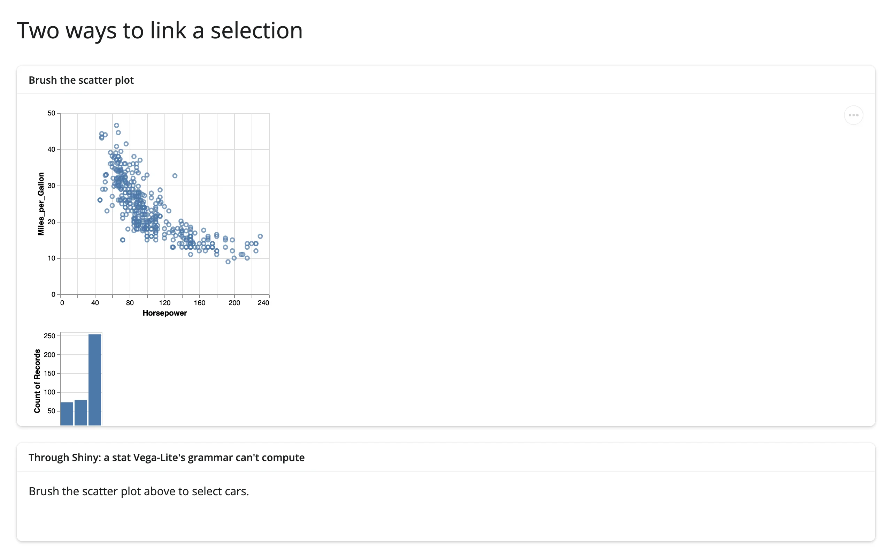
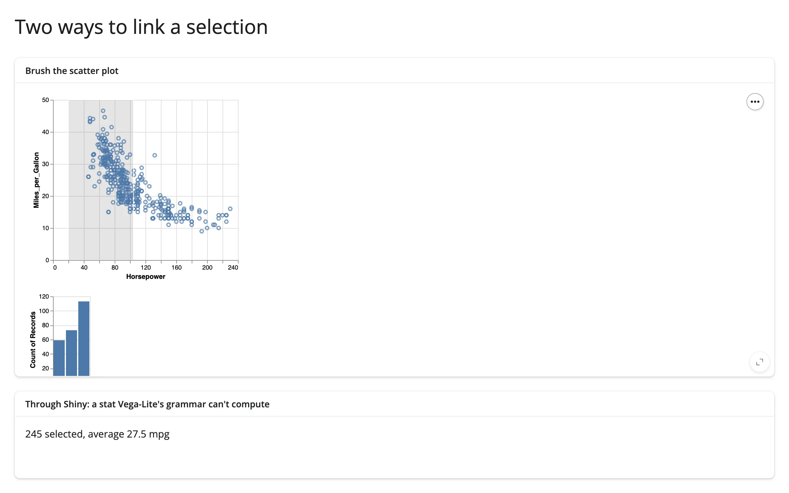

The bar chart under the scatter plot is pure Vega-Lite: `transform_filter` recomputes the counts in the browser
on every frame of the drag. The text below it is pure Shiny: averaging the selected rows' mpg isn't something
Vega-Lite's grammar can express, so it goes through `selected_rows()`. **Rule of thumb**: reach for
`transform_filter` / shared params when the derived view is itself a Vega-Lite chart filtering or recoloring the
same data; reach for the accessors when you need arbitrary Python, a different kind of output (a value box, a
table, another widget entirely), or server-side state.

### Click a point for details

A single-mark `IndexSelection` is a natural fit for a "detail card" pattern -- the selected row's other columns
(not just the ones plotted) render as free-form UI.

```{.python file="examples/12_click_to_detail_card.py"}
import altair as alt
from altair.datasets import data
from shiny.express import render, ui

from shinywidgets import render_altair

ui.page_opts(title="Click a point for details", fillable=True)

cars = data.cars()

with ui.layout_columns(col_widths=[8, 4]):
    with ui.card(full_screen=True):
        ui.card_header("Click a car")

        @render_altair
        def scatter():
            pick = alt.selection_point(name="pick")
            return (
                alt.Chart(cars)
                .mark_circle()
                .encode(
                    x="Horsepower:Q",
                    y="Miles_per_Gallon:Q",
                    color=alt.condition(pick, alt.value("steelblue"), alt.value("lightgray")),
                )
                .add_params(pick)
            )

    with ui.card(full_screen=True):
        ui.card_header("Detail card")

        @render.ui
        def detail():
            rows = scatter.selected_rows("pick")
            if len(rows) == 0:
                return ui.p("Click a point to see its details.")
            car = rows.iloc[0]
            return ui.TagList(
                ui.h5(car["Name"]),
                ui.p(f"{car['Horsepower']:.0f} hp, {car['Miles_per_Gallon']:.1f} mpg"),
                ui.p(f"{car['Cylinders']} cylinders, {car['Origin']}"),
            )
```

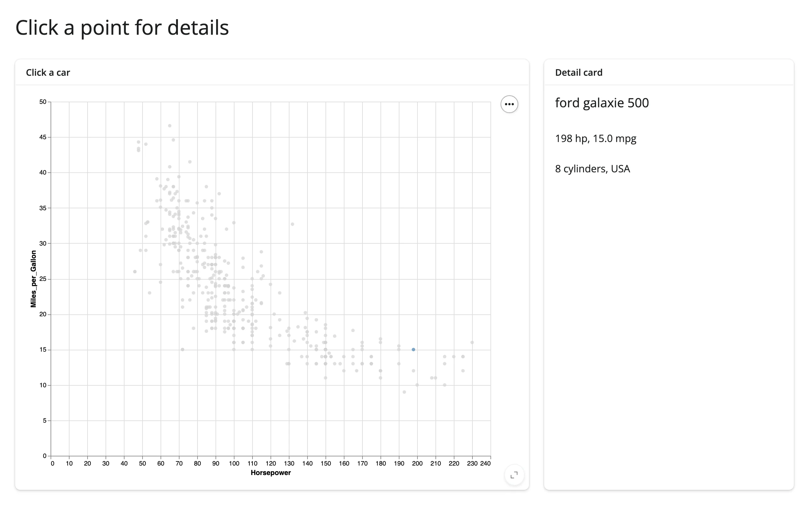

### Brush an Altair chart, render a different widget

The accessors work the same way regardless of what consumes them -- including a different `@render_*` output
entirely. Here, a brushed selection feeds a [reactable](../reactable/index.md) table instead of
`@render.data_frame`:

```{.python file="examples/13_brush_to_reactable_table.py"}
import altair as alt
from altair.datasets import data
from reactable import Reactable
from shiny.express import ui

from shinywidgets import render_altair, render_reactable

ui.page_opts(title="Brush an altair chart, render a reactable table", fillable=True)

cars = data.cars()

with ui.layout_columns(col_widths=[8, 4]):
    with ui.card(full_screen=True):
        ui.card_header("Drag a box to brush")

        @render_altair
        def scatter():
            brush = alt.selection_interval(name="brush")
            return (
                alt.Chart(cars)
                .mark_circle()
                .encode(
                    x="Horsepower:Q",
                    y="Miles_per_Gallon:Q",
                    color=alt.condition(brush, "Origin:N", alt.value("lightgray")),
                )
                .add_params(brush)
            )

    with ui.card(full_screen=True):
        ui.card_header("Selected rows, as a reactable table")

        @render_reactable
        def tbl():
            # reactable reads its data once per render, so a new selection
            # means a new table rather than an in-place update.
            rows = scatter.selected_rows("brush")[["Name", "Horsepower", "Miles_per_Gallon"]]
            return Reactable(rows, default_page_size=6)
```

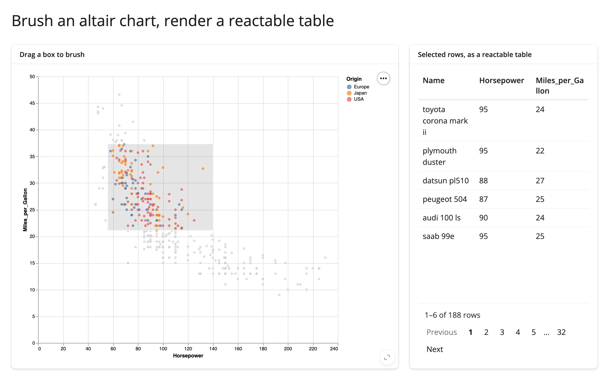

This pairs naturally with any table or chart renderer in the roster -- the brush doesn't need to know what's
downstream.

## Large data

More than 5,000 rows raises `MaxRowsError` on a bare DataFrame (see [Gotchas](#gotchas-and-limitations)) unless
you opt into a transformer that stops inlining raw rows into the spec. **VegaFusion**
(`alt.data_transformers.enable("vegafusion")`) runs bin/aggregate transforms in Python via DataFusion instead of
the browser, and `selected()`/`selected_rows()` keep working through it -- but it only pays off when the chart
*aggregates*. Measured directly: a binned histogram's spec stays flat (about 3.7-5.5 KB) from 5,000 to
2,000,000 rows, while a raw per-row `mark_circle` scatter's spec still grows linearly (344 KB at 5,000 rows to
134 MB at 2,000,000) -- VegaFusion moves *where* the transform runs, it doesn't shrink a raw-point payload.

```{.python file="examples/15_vegafusion_scale.py"}
import altair as alt
import numpy as np
import pandas as pd
from shiny.express import render, ui

from shinywidgets import render_altair

# Above ~5,000 rows, Altair raises MaxRowsError on a bare DataFrame unless you
# opt into a transformer that stops inlining raw rows into the spec. VegaFusion
# computes bin/aggregate transforms in Python (via DataFusion) instead of the
# browser, so only the aggregated result crosses the wire -- not the million
# rows behind it. Assign the return value: Shiny Express auto-displays any
# bare top-level expression, including the enabler object `enable()` returns.
_ = alt.data_transformers.enable("vegafusion")

rng = np.random.default_rng(0)
n = 1_000_000
df = pd.DataFrame({"value": rng.normal(loc=50, scale=15, size=n)})

ui.page_opts(title="VegaFusion at scale", fillable=True)

with ui.layout_columns(col_widths=[8, 4]):
    with ui.card(full_screen=True):
        ui.card_header(f"Click a bar ({n:,} rows, aggregated with VegaFusion)")

        @render_altair
        def histogram():
            pick = alt.selection_point(name="bin", encodings=["x"])
            return (
                alt.Chart(df)
                .mark_bar()
                .encode(x=alt.X("value:Q", bin=alt.Bin(maxbins=40)), y="count()")
                .add_params(pick)
            )

    with ui.card(full_screen=True):
        ui.card_header("histogram.selected_rows('bin')")

        @render.code
        def count():
            rows = histogram.selected_rows("bin")
            return f"{len(rows):,} of {len(df):,} rows in the selected bin"
```

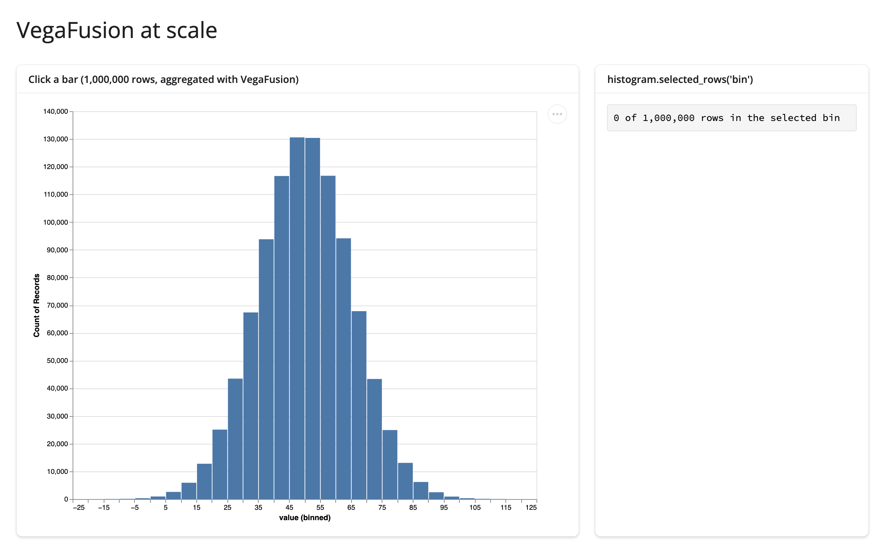
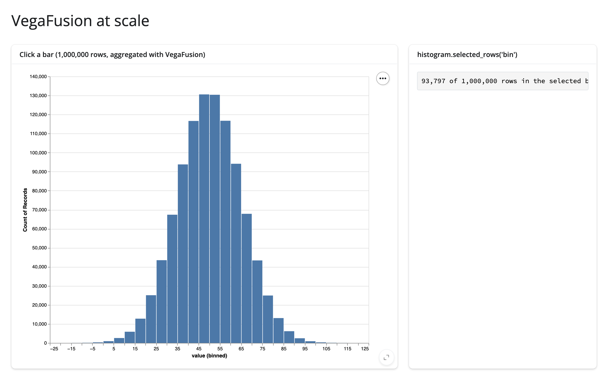

Clicking a bar on 1,000,000 rows still updates `selected_rows()` correctly (93,797 of 1,000,000 selected,
above). Needs both `vegafusion` and `vl-convert-python` installed -- the altair extra pulls in neither, and
with only `vegafusion` present the chart silently never renders: no browser console error, only a server-log
`ImportError` ([#320](https://github.com/posit-dev/py-shinywidgets/issues/320), the general case of a widget
error surfacing only in the server log once rendering has already started). This is the "summarize on the
server" approach from
[Large data & performance](../../guide/performance/index.md#three-approaches-to-large-data).

## Layout and sizing

A chart without an explicit `width`/`height` is sized to `"container"` and fills its output -- cards, sidebars,
full-screen toggles, and window resizes all just work, with no code beyond the usual `ui.page_opts(fillable=True)`
/ `ui.card(full_screen=True)`. This applies to a plain `alt.Chart` and to `LayerChart`.

**Concatenated, faceted, and repeated charts keep their natural size instead.** `render_altair` warns when it
sees an `alt.concat()` for exactly this reason, suggesting `shiny.ui.layout_column_wrap()` (one chart per card)
instead, which does fill; the same limitation applies to `|`/`&` (`hconcat`/`vconcat`), `facet()`, and `repeat()`,
which don't currently trigger the warning. Use a `vconcat`/`hconcat` (as in "Two ways to link a selection" above)
only when you specifically want several views that share one Vega-Lite spec and its selections; otherwise prefer
one chart per card.

An explicit size always wins: `.properties(width=..., height=...)` (as used for `facet()` above, and for the two
stacked views in "Two ways to link a selection") pins a chart or sub-view to a fixed size regardless of its
container.

## Gotchas and limitations

Verified on current `main` (altair 6.3.0, shiny 1.9.0):

- **A point selection's own highlight can fail to show on an aggregated, binned bar chart.** In
  `06_binned_temporal.py`, clicking a histogram bar correctly updates `selected()`/`selected_rows()` in Python,
  but the clicked bar itself doesn't turn blue the way `alt.condition(pick, ...)` suggests it should. This
  reproduces in plain `vega-embed` with no shinywidgets involved at all, so it's an upstream Vega-Lite behavior:
  highlighting a mark by testing a selection against *aggregated* data doesn't resolve the way it does against
  raw rows. The selection itself is correct; only the in-chart color feedback is missing. If you need a visual
  cue here, drive it from a second, Python-rendered element instead (as the example does with the `bin_count`
  text), rather than from `alt.condition` on the same bar mark.
- **Two selections in the same view can clear each other.** Clicking a legend-bound point selection clears an
  interval brush in the same chart, and dragging the brush clears the legend pick -- verified in both directions
  (`07_multiple_selections.py`). This is Vega-Lite's own behavior for co-located selections, not something
  shinywidgets introduces or can suppress. If you want two selections that stay independently "sticky," put them
  in separate views.
- **`selected_rows()` needs a real data frame on the chart, and layered/concatenated charts only hoist one under
  a specific condition.** Altair hoists a shared data frame to the top of a layered or concatenated spec only
  when every layer was built from the *same frame object* -- checked by identity, not by equal content. Calling a
  filter function twice (`alt.Chart(shown())` for one layer, `alt.Chart(shown())` again for another) produces two
  distinct objects even if their contents are identical, and `selected_rows()` then can't find a frame to filter
  and raises `TypeError`. Compute the frame once and reuse the same object for every layer, or pass
  `selected_rows(df=...)` explicitly (see `gallery/showcase_weather_dashboard.py`, which does both: it reuses one
  `data` object across the chart's layers *and* passes `df=` to the accessor for clarity). This isn't documented
  anywhere upstream or in the `selected_rows()` docstring, and it's an easy mistake to repeat.
- **Selections are read-only from Python.** There's no supported way to move a brush or set a legend pick from
  Python; use a param (`alt.param`) for anything you want to drive from the server side, as in "Updating the
  widget from Python."
- **Reassigning `chart.widget.chart` (or `.spec`) wholesale resends the chart's entire data payload and replaces
  `chart.widget.selections`/`.params`.** This also means Altair's own documented idiom for reacting to selections,
  `jchart.selections.observe(callback, ["name"])`, stops firing after such a reassignment, because it's watching
  the nested `.selections` object that gets replaced. We verified that `selected()`/`selected_rows()` do **not**
  have this problem -- they watch a lower-level trait on the widget that survives a `.chart` reassignment, so the
  accessors keep working (reset to empty, then pick up the next gesture normally) even if your own code replaces
  `.chart`. Prefer a param update or a full re-render over reassigning `.chart`/`.spec` yourself regardless, since
  the data resend and sizing reset still apply.
- **More than 5,000 rows raises `MaxRowsError`** unless you call `alt.data_transformers.disable_max_rows()` or
  enable the VegaFusion transformer (`alt.data_transformers.enable("vegafusion")`, which additionally requires
  `pyarrow`). Both are upstream Altair settings, not something `render_altair` changes.
- **`JupyterChart` loads its JavaScript from a CDN at runtime.** For an offline or firewalled deployment, call
  `alt.JupyterChart.enable_offline()` (requires `vl-convert-python`, included in the `altair` extra) once at
  import time.
- **A module-level docstring renders as page text in Shiny Express**, not just as Python metadata -- this bit
  both gallery apps below during writing. Use a `#`-comment header instead of a triple-quoted string at the top
  of an Express file if you want file-level notes that don't show up in the UI.

## Gallery candidates

**Template** -- [`gallery/template_weather_brush.py`](gallery/template_weather_brush.py): four years of real
Seattle weather (NOAA, via `altair.datasets`), brushable by date range, with two value boxes and a table computed
from `timeline.selected_rows()`. About 55 lines; a reasonable starting point for any "brush a timeline, summarize
the selection" dashboard.

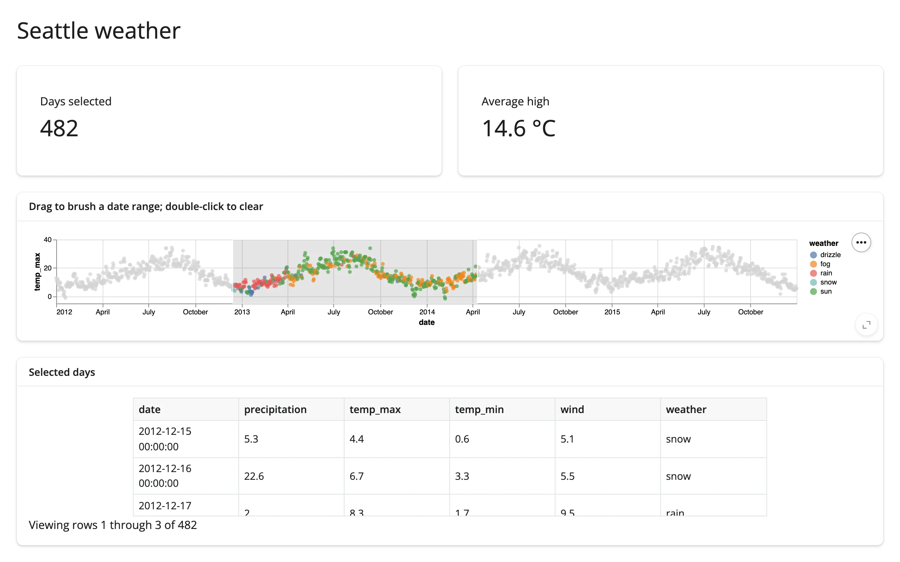

**Showcase** -- [`gallery/showcase_weather_dashboard.py`](gallery/showcase_weather_dashboard.py): the same four
years of real Seattle weather, with more of the story told. A brushed date range drives three value boxes, a
Python-computed comparison chart (selected days vs. all shown days, by weather type), and a "hottest selected
days" table -- all from `timeline.selected_rows()`. A sidebar slider restyles the chart's hot-day threshold line
in place via a param update (no data resent, selection preserved), while a weather-type checkbox group re-renders
the chart (since it changes what data it holds). About 135 lines.

Before any interaction, after brushing a date range, and after moving the threshold slider (brush and selection
are preserved; only the dashed line moves):

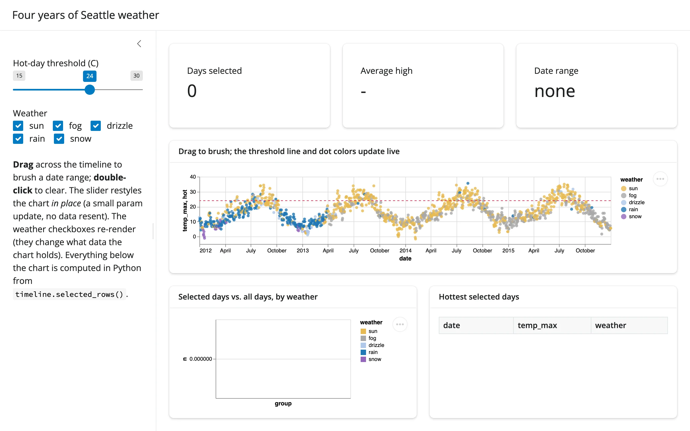
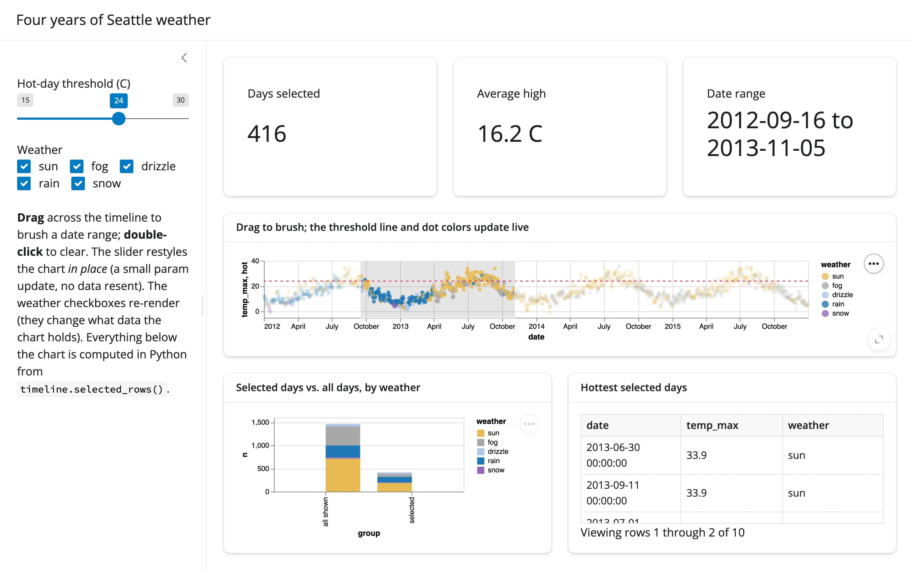
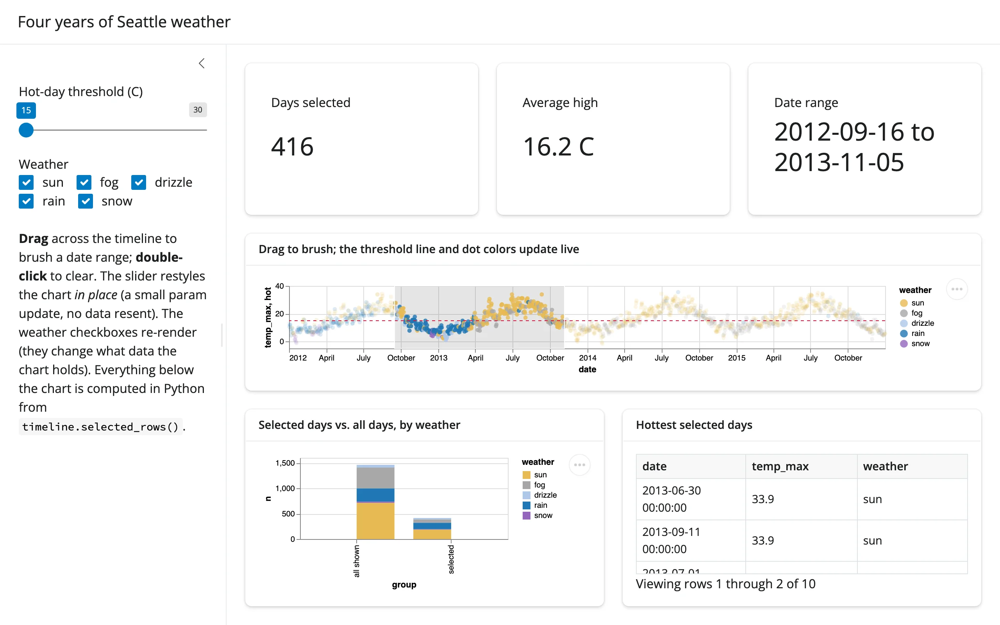

## Learn more

- [Altair documentation](https://altair-viz.github.io) and its [example gallery](https://altair-viz.github.io/gallery/index.html)
- [JupyterChart and selections](https://altair-viz.github.io/user_guide/jupyter_chart.html)
- [Vega-Lite selection parameters](https://vega.github.io/vega-lite/docs/parameter.html#selection-parameters) (the grammar `selected()`/`selected_rows()` read)
- Related guides in this roster: [plotly](../plotly/index.md), [bokeh](../bokeh/index.md), [reactable](../reactable/index.md)
