[Bokeh](https://bokeh.org) is a Python plotting library built and maintained by Anaconda. Unlike most plotting
libraries, a Bokeh plot isn't a static picture that gets redrawn -- it's a tree of live Python objects (a `figure`,
its `ColumnDataSource`s, axes, tools, widgets) that stay connected to the browser. Normally that connection requires
running a `bokeh serve` process. `shinywidgets` recreates it inside a Shiny app instead, through `jupyter_bokeh`,
so Bokeh's full Python object model -- selections, ranges, events, even Bokeh's own `Slider`/`Select`/`DataTable`
widgets -- works without a separate server.

`@render_bokeh` accepts a `bokeh.plotting.figure`, a layout (`row`, `column`, `gridplot`), any other `LayoutDOM`
(a `Div`, a Bokeh widget), or a `jupyter_bokeh.BokehModel` you built yourself. It fills its card by default: a bare
`figure()` gets `sizing_mode="stretch_both"` unless you give it a `width`, `height`, `sizing_mode`, or
`aspect_ratio`, in which case Bokeh's own sizing takes over. BokehJS loads automatically, including for outputs
created dynamically inside `@render.ui`.

The four accessors below (`selected()`, `selected_rows()`, `tapped()`, `zoomed()`) read the single most common
things apps need from a plot: its selection, its last click, and its current view. For anything else, Bokeh's own
`on_change()`/`on_event()` callbacks work directly inside a reactive context -- which is also how you'd reach
Bokeh's own widgets (`Slider`, `Select`, `DataTable`) or an editing tool like `PointDrawTool`.

Choose Bokeh when you want linked views that update in the browser with no round trip, Python callbacks on any
part of the plot (not just a curated set of events), editable plots, or you're porting code written for
`bokeh serve`. Choose [plotly](../plotly/index.md) for more chart types and smoother 3D; choose
[altair](../altair/index.md) for a declarative grammar of selections; choose
[holoviews](../holoviews/index.md) or [panel](../panel/index.md) (both covered in their own guides) if you're
already building on top of those -- they render through Bokeh under the hood but don't get accessors.

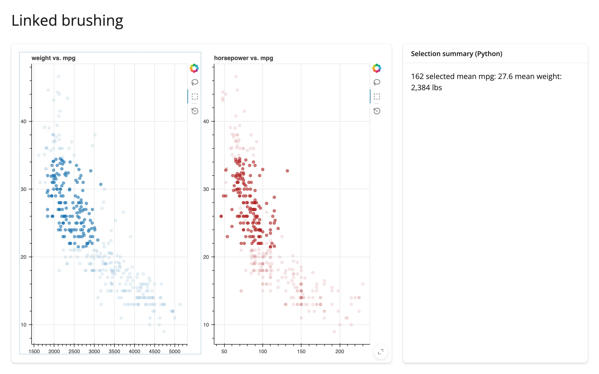

## Installation

```
pip install 'shinywidgets[bokeh]'
```

That installs `bokeh` and `jupyter_bokeh>=4.1`. The version floor matters: `jupyter_bokeh` 4.1 serves its
JavaScript locally, so apps work offline; earlier versions fall back to a CDN. Nothing else to configure --
`output_widget()` (for Shiny Core) or a bare `@render_bokeh` function (Shiny Express) is all the UI needs.

## Quick start

A `figure()` with no explicit size fills its card:

```{.python file="examples/01_quickstart.py"}
# Uses bokeh's own sample-data package (downloaded on first use):
#   pip install bokeh_sampledata
from bokeh.plotting import figure
from bokeh.sampledata.autompg import autompg as df
from shiny.express import ui
from shinywidgets import render_bokeh

ui.page_opts(title="Bokeh quickstart", fillable=True)

with ui.card(full_screen=True):
    ui.card_header("Fuel economy vs. weight (1970-82 cars)")

    @render_bokeh
    def plot():
        p = figure(title="EPA mileage drops as cars get heavier")
        p.xaxis.axis_label = "weight (lbs)"
        p.yaxis.axis_label = "mpg"
        p.scatter(df.weight, df.mpg, size=8, alpha=0.6)
        return p
```

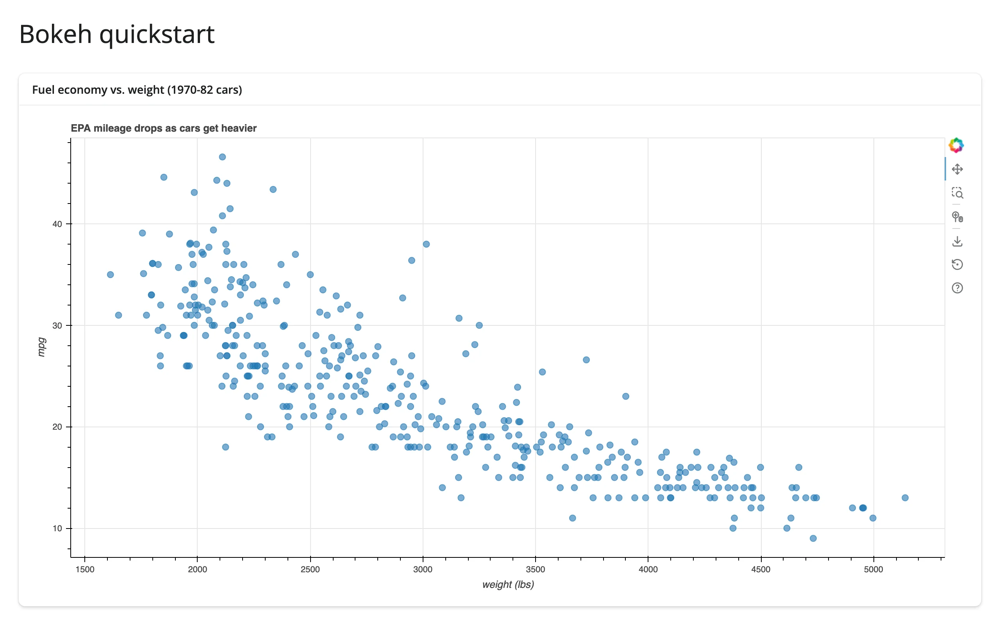

## What you can build

### Layouts fill their card too

`row`, `column`, and `gridplot` all participate in filling, as long as both the layout and its children ask for
it. A 2x2 `gridplot` of `stretch_both` figures divides the available space evenly:

```{.python file="examples/02_layouts.py"}
import numpy as np
from bokeh.layouts import gridplot
from bokeh.plotting import figure
from shiny.express import ui
from shinywidgets import render_bokeh

ui.page_opts(title="Bokeh layouts", fillable=True)

rng = np.random.default_rng(0)
x = rng.normal(size=300)
y = x * 0.6 + rng.normal(size=300)


@render_bokeh
def grid():
    scatter = figure(title="x vs. y", sizing_mode="stretch_both")
    scatter.scatter(x, y, size=6, alpha=0.6)

    hx, ex = np.histogram(x, bins=20)
    hist_x = figure(title="histogram of x", sizing_mode="stretch_both")
    hist_x.quad(top=hx, bottom=0, left=ex[:-1], right=ex[1:])

    hy, ey = np.histogram(y, bins=20)
    hist_y = figure(title="histogram of y", sizing_mode="stretch_both")
    hist_y.quad(top=hy, bottom=0, left=ey[:-1], right=ey[1:], fill_color="firebrick")

    cum = figure(title="cumulative mean of y", sizing_mode="stretch_both")
    cum.line(np.arange(len(y)), np.cumsum(y) / np.arange(1, len(y) + 1), line_width=2)

    return gridplot(
        [[scatter, hist_x], [hist_y, cum]], sizing_mode="stretch_both"
    )
```

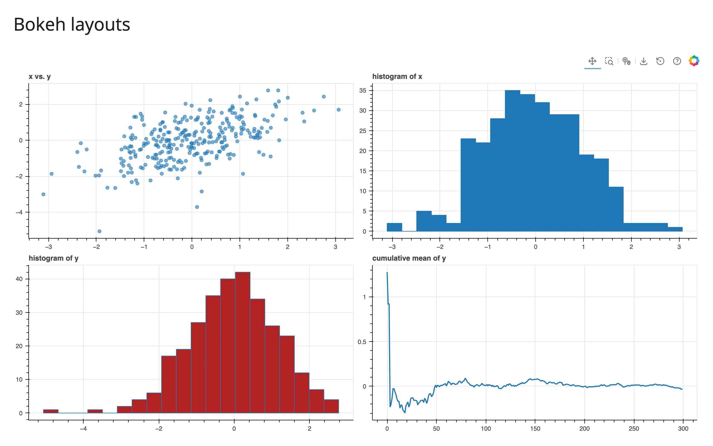

### Bokeh's own widgets, wired up with ordinary Python callbacks

Bokeh ships `Slider`, `Select`, `DataTable`, and more. Their `on_change`/`on_event` callbacks run inside Shiny's
reactive machinery, so a callback that mutates a `ColumnDataSource` updates every view that reads it -- here, a
`Select` filters both a scatter plot and a `DataTable` sharing one source:

```{.python file="examples/03_bokeh_widgets.py"}
import numpy as np
from bokeh.layouts import column, row
from bokeh.models import ColumnDataSource, DataTable, Select, TableColumn
from bokeh.plotting import figure
from shiny.express import ui
from shinywidgets import render_bokeh

ui.page_opts(title="Bokeh's own widgets", fillable=True)

rng = np.random.default_rng(1)
data = {
    "temp": rng.normal(20, 4, 90),
    "humidity": rng.normal(55, 10, 90),
    "site": rng.choice(["A", "B", "C"], size=90),
}


@render_bokeh
def dashboard():
    src = ColumnDataSource(data)
    view = ColumnDataSource(data)

    p = figure(title="temperature vs. humidity", sizing_mode="stretch_both")
    p.scatter("temp", "humidity", source=view, size=10, alpha=0.7)

    table = DataTable(
        source=view,
        columns=[TableColumn(field=c) for c in ("site", "temp", "humidity")],
        height=200,
    )

    picker = Select(title="Site", value="All", options=["All", "A", "B", "C"])

    def filter_site(attr, old, new):
        if new == "All":
            view.data = dict(src.data)
        else:
            mask = src.data["site"] == new
            view.data = {k: np.asarray(v)[mask] for k, v in src.data.items()}

    picker.on_change("value", filter_site)

    return column(picker, row(p, table, sizing_mode="stretch_both"), sizing_mode="stretch_both")
```

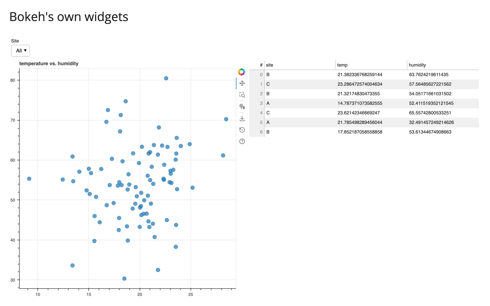
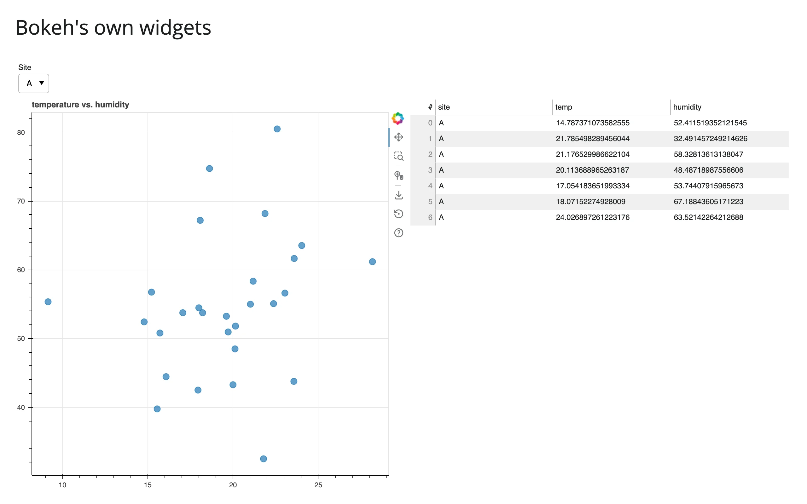

### Editable plots

`PointDrawTool` (and Bokeh's other edit tools) let a plot act as a data-entry form: users drag or add points, and
Python receives the edited `source.data` through a plain `on_change` callback -- the same bridge you'd use for
anything the accessors don't cover (see [Beyond the accessors](#beyond-the-accessors-reactive_read) below):

```{.python file="examples/04_draw_tool.py"}
from bokeh.models import ColumnDataSource, PointDrawTool
from bokeh.plotting import figure
from shiny import reactive
from shiny.express import render, ui
from shinywidgets import render_bokeh

ui.page_opts(title="Editable plot", fillable=True)

edits = reactive.value(0)
src = ColumnDataSource({"x": [1, 2, 3], "y": [1, 2, 1]})
src.on_change("data", lambda attr, old, new: edits.set(edits() + 1))

with ui.layout_columns(col_widths=[8, 4]):
    with ui.card(full_screen=True):

        @render_bokeh
        def plot():
            p = figure(
                x_range=(0, 5), y_range=(0, 5), title="Drag points, or add new ones"
            )
            renderer = p.scatter("x", "y", source=src, size=15, color="firebrick")
            draw_tool = PointDrawTool(renderers=[renderer], add=True)
            p.add_tools(draw_tool)
            p.toolbar.active_tap = draw_tool
            return p

    with ui.card():
        ui.card_header("Current points (from Python)")

        @render.code
        def points():
            edits()  # re-run whenever the source's data changes
            return "\n".join(
                f"({x:.1f}, {y:.1f})" for x, y in zip(src.data["x"], src.data["y"])
            )
```

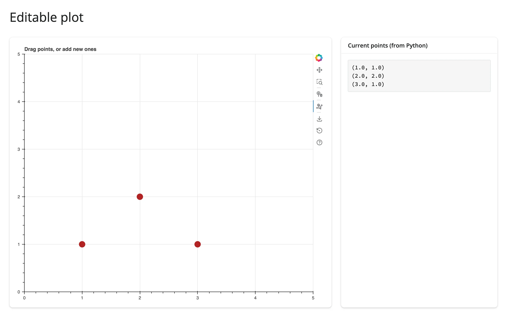
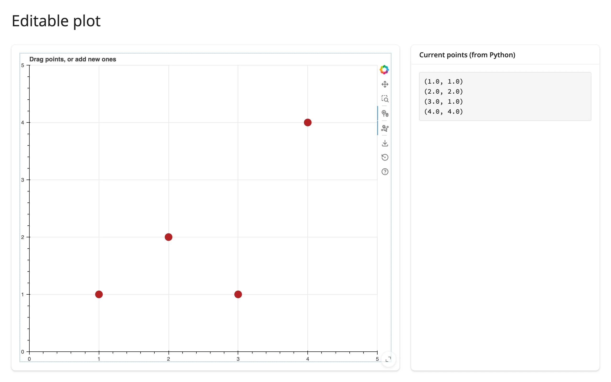

### Themes

Build a `Document` with a built-in theme, add your layout as its root, and return the layout (not the document):

```{.python file="examples/05_theme.py"}
import numpy as np
from bokeh.document import Document
from bokeh.plotting import figure
from bokeh.themes import built_in_themes
from shiny.express import ui
from shinywidgets import render_bokeh

ui.page_opts(title="A themed plot", fillable=True)

rng = np.random.default_rng(2)

with ui.card(full_screen=True):

    @render_bokeh
    def plot():
        doc = Document(theme=built_in_themes["night_sky"])
        p = figure(title="night_sky theme", sizing_mode="stretch_both")
        p.scatter(rng.normal(size=150), rng.normal(size=150), size=8, alpha=0.8)
        doc.add_root(p)
        return p
```

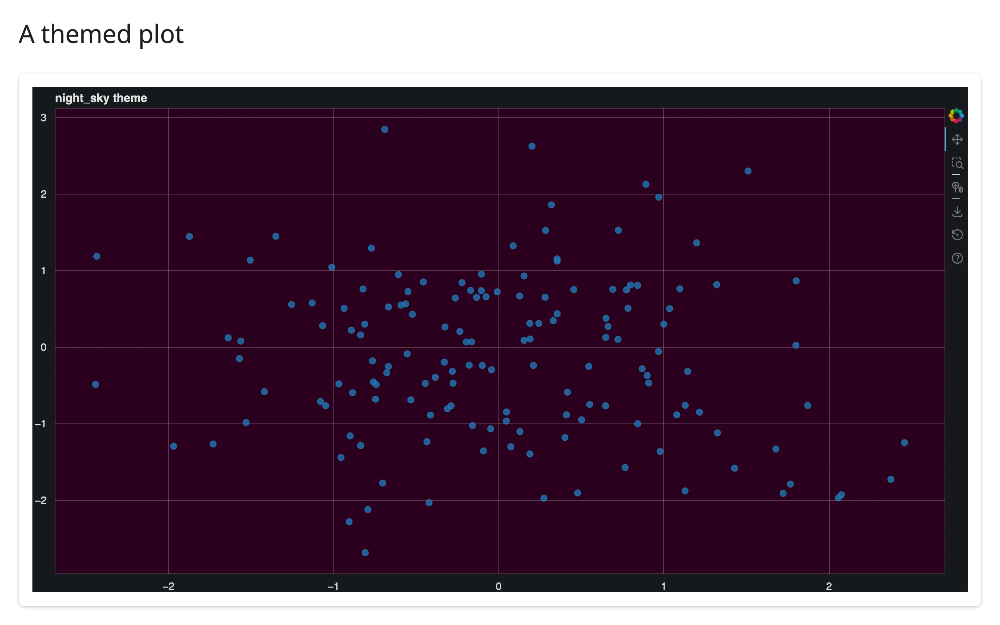

### Client-only interactivity

`js_link()` and `CustomJS` work exactly as they do in standalone Bokeh -- useful for interactions that don't need
Python at all, like this frequency slider that rewrites a line's data with no server round trip:

```{.python file="examples/06_js_link.py"}
import numpy as np
from bokeh.layouts import column
from bokeh.models import CustomJS, Slider
from bokeh.plotting import figure
from shiny.express import ui
from shinywidgets import render_bokeh

ui.page_opts(title="Client-only interactivity", fillable=True)

x = np.linspace(0, 4 * np.pi, 400)

with ui.card(full_screen=True):
    ui.card_header("Drag the slider: no round trip to Python")

    @render_bokeh
    def plot():
        p = figure(sizing_mode="stretch_both")
        line = p.line(x, np.sin(x), line_width=3)

        slider = Slider(start=0.1, end=5, value=1, step=0.1, title="frequency")
        slider.js_on_change(
            "value",
            CustomJS(
                args=dict(source=line.data_source, freq=slider),
                code="""
                const data = source.data
                const x = data['x']
                const y = data['y']
                for (let i = 0; i < x.length; i++) {
                    y[i] = Math.sin(freq.value * x[i])
                }
                source.change.emit()
                """,
            ),
        )
        return column(slider, p, sizing_mode="stretch_both")
```

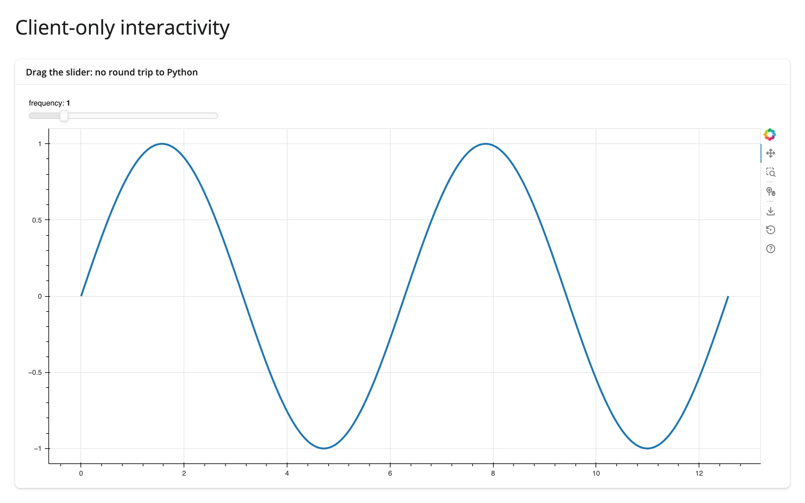
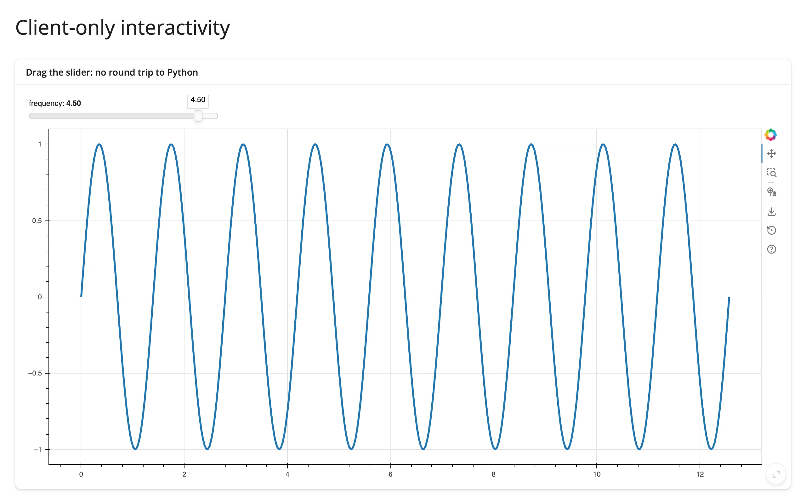

## Reacting to user interaction

### Accessor reference

| accessor | returns | before any interaction | across re-render | default rate policy |
|---|---|---|---|---|
| `selected()` | `list[int]`: row indices into the plot's `ColumnDataSource` | `[]` | re-seeded from the new plot's current selection (`[]` for a fresh plot) | debounce, 250 ms |
| `selected_rows()` | `pandas.DataFrame`: `source.to_df().iloc[indices]` | empty frame | follows `selected()` | follows `selected()`; the `source.data` part isn't rate-limited |
| `tapped()` | `bokeh.events.Tap` (`.x`, `.y` in data units, `.model`) | `None` | kept -- holds the previous plot's last tap until the new plot is tapped | none -- every tap re-runs readers |
| `zoomed()` | `bokeh.events.RangesUpdate` (`.x0`, `.x1`, `.y0`, `.y1`, `.model`) | seeded from the plot's default ranges when they hold real values, else `None` | re-seeded from the new plot's default ranges | none |

`selected()` and `selected_rows()` need a plot (or layout) with exactly **one** `ColumnDataSource`; with more than
one, they raise a `TypeError` that points you at `source.selected.on_change("indices", ...)` instead (see
[Several ColumnDataSources](#several-columndatasources) below). A re-render gives the user a brand new plot, but
no accessor needs a warm-up read to start tracking it: all four attach the moment the plot renders, whether or not
anything has read them yet. What happens to their *value* on a re-render differs by what they track: `tapped()`
is a record of something the user did, so it's kept until they tap the new plot; `selected()` and `zoomed()`
describe the plot's own current state, so they re-seed from the new plot (an unselected plot's `selected()` is
`[]`; a plot whose ranges have real default values seeds `zoomed()` with them). None of the four can be read
inside the same `@render_bokeh` function that builds the plot -- doing so raises a `RuntimeError` pointing you at
a `@reactive.effect` instead, since the render function doesn't have a widget to read from yet.

### `selected()`

```{.python file="examples/07_selected.py"}
from bokeh.models import ColumnDataSource
from bokeh.plotting import figure
from shiny.express import render, ui
from shinywidgets import render_bokeh

ui.page_opts(title="selected()", fillable=True)

src = ColumnDataSource(
    {"x": [1, 2, 3, 4, 5], "y": [2, 4, 1, 3, 5], "name": list("abcde")}
)

with ui.layout_columns(col_widths=[8, 4]):
    with ui.card(full_screen=True):

        @render_bokeh
        def plot():
            p = figure(
                x_range=(0, 6),
                y_range=(0, 6),
                tools="tap,box_select,lasso_select",
                active_drag="box_select",
                title="Tap, box, or lasso",
            )
            p.scatter("x", "y", source=src, size=20)
            return p

    with ui.card():
        ui.card_header("plot.selected()")

        @render.code
        def selected():
            return str(plot.selected())
```

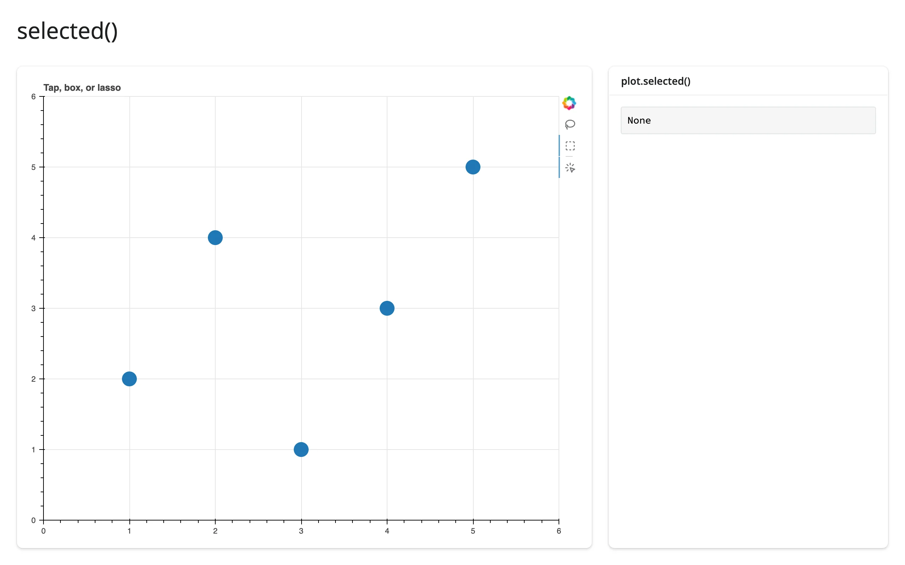
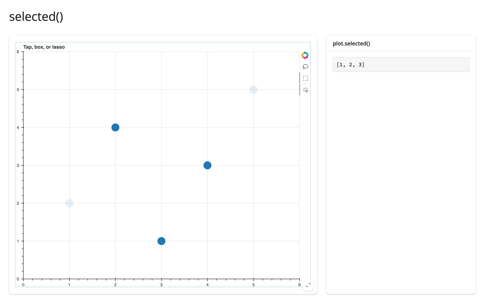

### `selected_rows()`

```{.python file="examples/08_selected_rows.py"}
from bokeh.models import ColumnDataSource
from bokeh.plotting import figure
from shiny.express import render, ui
from shinywidgets import render_bokeh

ui.page_opts(title="selected_rows()", fillable=True)

src = ColumnDataSource(
    {
        "x": [1, 2, 3, 4, 5],
        "y": [2, 4, 1, 3, 5],
        "name": list("abcde"),
    }
)

with ui.layout_columns(col_widths=[7, 5]):
    with ui.card(full_screen=True):

        @render_bokeh
        def plot():
            p = figure(
                x_range=(0, 6),
                y_range=(0, 6),
                tools="tap,box_select",
                active_drag="box_select",
                title="Box-select some points",
            )
            p.scatter("x", "y", source=src, size=20)
            return p

    with ui.card():
        ui.card_header("plot.selected_rows()")

        @render.data_frame
        def rows():
            return plot.selected_rows()
```

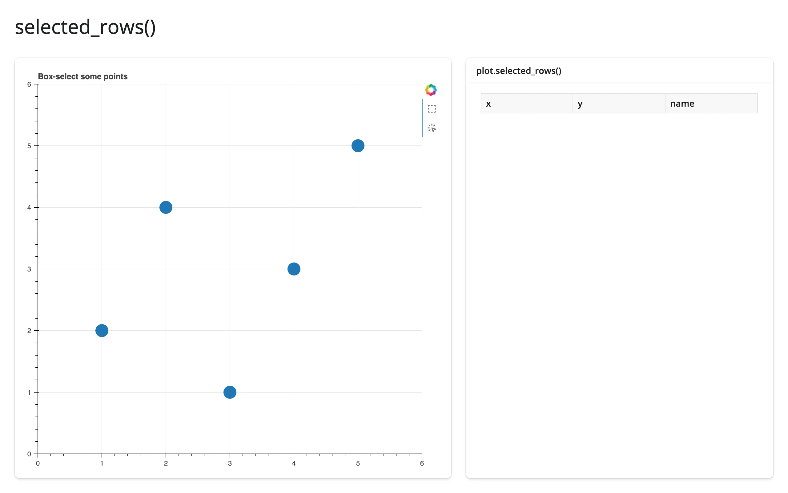
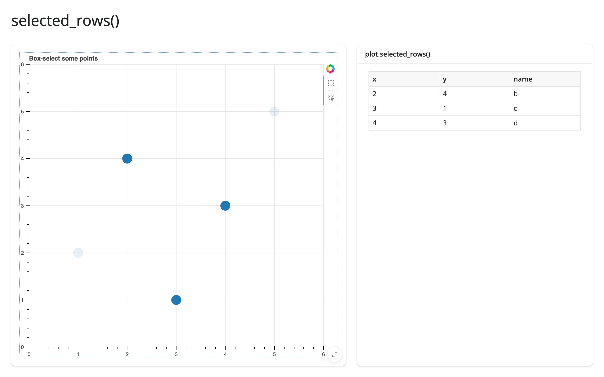

### `tapped()`

```{.python file="examples/09_tapped.py"}
from bokeh.plotting import figure
from shiny import req
from shiny.express import render, ui
from shinywidgets import render_bokeh

ui.page_opts(title="tapped()", fillable=True)

with ui.layout_columns(col_widths=[8, 4]):
    with ui.card(full_screen=True):

        @render_bokeh
        def plot():
            p = figure(x_range=(0, 10), y_range=(0, 10), tools="tap", title="Click anywhere")
            p.scatter([2, 5, 8], [2, 5, 8], size=20)
            return p

    with ui.card():
        ui.card_header("plot.tapped()")

        @render.text
        def coords():
            t = req(plot.tapped())
            return f"({t.x:.2f}, {t.y:.2f})"
```

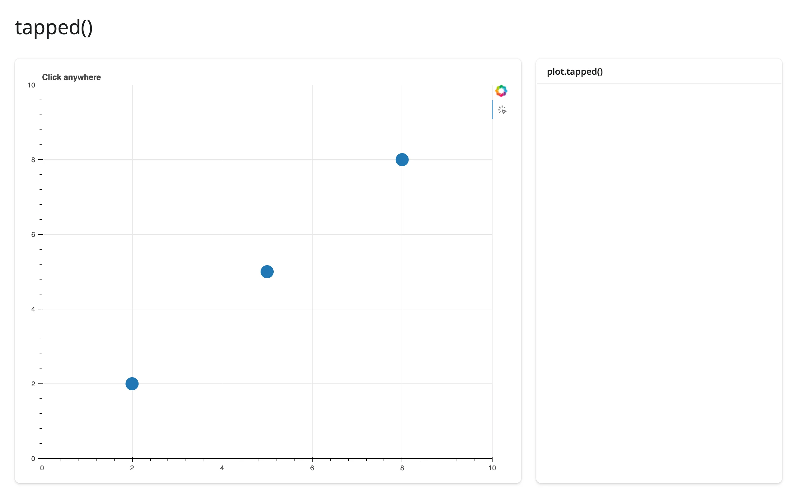
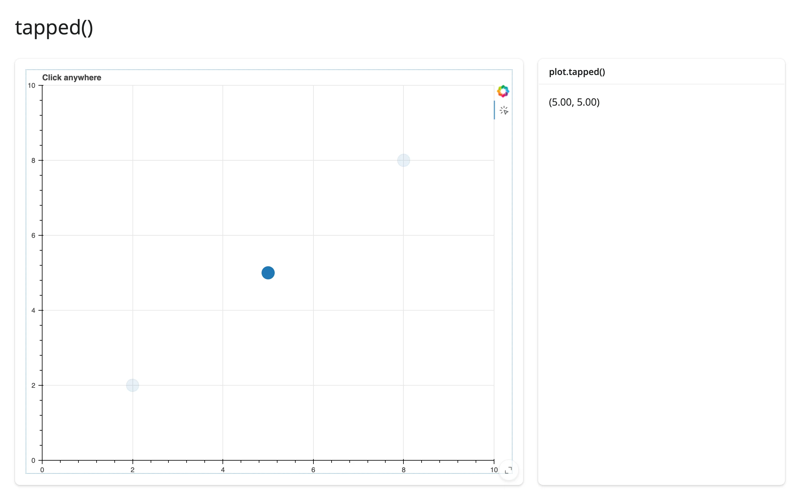

### `zoomed()`

```{.python file="examples/10_zoomed.py"}
import numpy as np
from bokeh.plotting import figure
from shiny import req
from shiny.express import render, ui
from shinywidgets import render_bokeh

ui.page_opts(title="zoomed()", fillable=True)

rng = np.random.default_rng(3)
x = rng.normal(size=300)
y = rng.normal(size=300)

with ui.layout_columns(col_widths=[8, 4]):
    with ui.card(full_screen=True):

        @render_bokeh
        def plot():
            p = figure(tools="pan,wheel_zoom,reset", active_scroll="wheel_zoom")
            p.scatter(x, y, size=6, alpha=0.6)
            return p

    with ui.card():
        ui.card_header("plot.zoomed()")

        @render.text
        def ranges():
            z = req(plot.zoomed())
            return (
                f"x: [{z.x0:.2f}, {z.x1:.2f}]\n"
                f"y: [{z.y0:.2f}, {z.y1:.2f}]"
            )
```

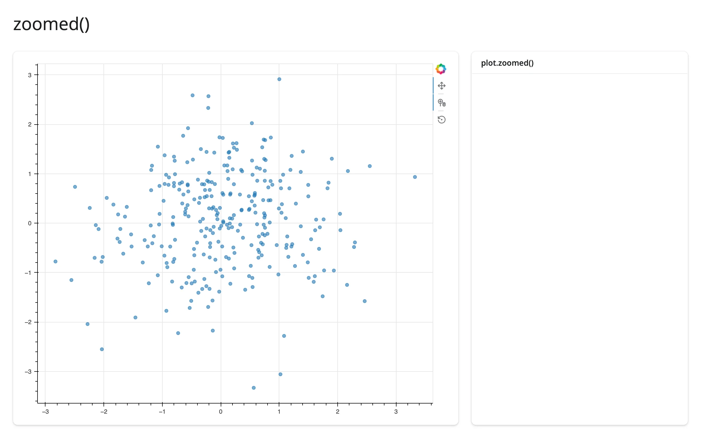
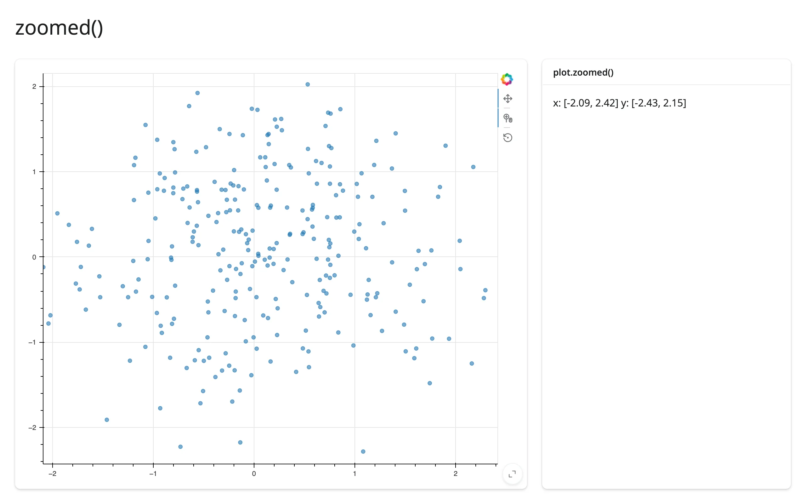

### Several ColumnDataSources

A dashboard with two unrelated plots in one `@render_bokeh` output can't use `selected()` -- it would be
ambiguous which source's selection you meant. Wire each source's own `on_change` into a `reactive.value` instead;
it's the same mechanism the accessors use internally, just addressed to a specific source:

```{.python file="examples/11_multiple_sources.py"}
from bokeh.layouts import row
from bokeh.models import ColumnDataSource
from bokeh.plotting import figure
from shiny import reactive
from shiny.express import render, ui
from shinywidgets import render_bokeh

ui.page_opts(title="Several ColumnDataSources", fillable=True)

west = ColumnDataSource({"x": [1, 2, 3], "y": [1, 2, 1], "name": list("abc")})
east = ColumnDataSource({"x": [1, 2, 3], "y": [2, 1, 2], "name": list("def")})

# plot.selected() would raise TypeError here (two sources). Wire each
# source's own callback into a reactive.value instead.
picked = reactive.value(None)
west.selected.on_change("indices", lambda attr, old, new: picked.set(("west", new)))
east.selected.on_change("indices", lambda attr, old, new: picked.set(("east", new)))

with ui.layout_columns(col_widths=[8, 4]):
    with ui.card(full_screen=True):

        @render_bokeh
        def plot():
            left = figure(
                title="west",
                tools="tap,box_select",
                active_drag="box_select",
                x_range=(0, 4),
                y_range=(0, 3),
                sizing_mode="stretch_both",
            )
            left.scatter("x", "y", source=west, size=20)
            right = figure(
                title="east",
                tools="tap,box_select",
                active_drag="box_select",
                x_range=(0, 4),
                y_range=(0, 3),
                sizing_mode="stretch_both",
            )
            right.scatter("x", "y", source=east, size=20, color="firebrick")
            return row(left, right, sizing_mode="stretch_both")

    with ui.card():
        ui.card_header("Last selection (either source)")

        @render.code
        def selection():
            return str(picked())
```

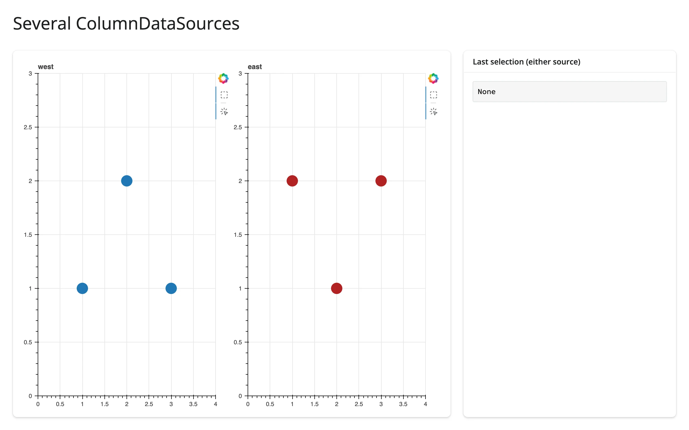
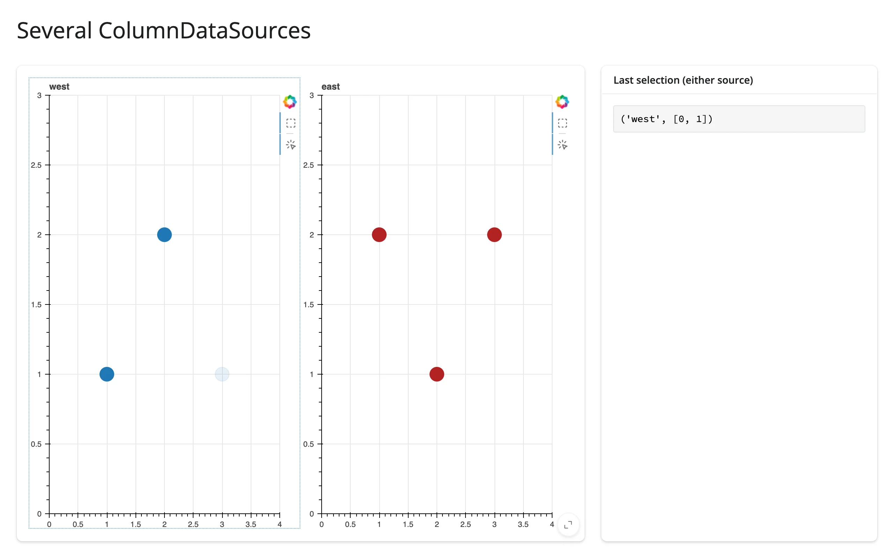

### Beyond the accessors: `reactive_read`

`BokehModel` (the ipywidget `@render_bokeh` builds) has no useful synced traits -- checked directly against
`jupyter_bokeh` on the current version: its only public traits are `combine_events`, `comm`, `keys`, `layout`,
`log`, `render_bundle`, `tabbable`, and `tooltip`, none of which reflect selection, ranges, or anything else
happening in the plot. So `reactive_read(plot.widget, ...)` has nothing to offer here, unlike widgets whose state
genuinely lives in ipywidget traits. Everything Bokeh reports arrives instead as ordinary Python-side changes to
the Bokeh objects themselves (`source.selected.indices`, `range.start`, a `Slider`'s `value`, ...), which is what
the four accessors read and what the raw `on_change()`/`on_event()` bridge in the examples above reaches for
everything else -- Bokeh widgets, draw-tool edits, and multiple sources.

### Rate limiting

`selected()` debounces by default (`rate_policy="debounce"`, `rate_delay=0.25`), so a slow lasso only reports its
final shape. Pass `rate_delay=0` to `@render_bokeh` to see every intermediate selection as the user drags --
useful for a live preview, at the cost of more reactive re-runs. `tapped()` and `zoomed()` aren't rate-limited at
all (Bokeh already reports once per gesture), so there's nothing to tune for them.

```{.python file="examples/12_rate_limiting.py"}
from bokeh.models import ColumnDataSource
from bokeh.plotting import figure
from shiny.express import render, ui
from shinywidgets import render_bokeh

ui.page_opts(title="Rate limiting selected()", fillable=True)


def points():
    return ColumnDataSource({"x": [1, 2, 3, 4, 5], "y": [2, 4, 1, 3, 5]})


def scatter(title):
    p = figure(
        x_range=(0, 6),
        y_range=(0, 6),
        tools="box_select",
        active_drag="box_select",
        title=title,
    )
    p.scatter("x", "y", source=points(), size=20)
    return p


with ui.layout_columns():
    with ui.card(full_screen=True):

        @render_bokeh  # default: debounced 250ms
        def default_plot():
            return scatter("default (debounce 250ms)")

        @render.code
        def default_selected():
            return str(default_plot.selected())

    with ui.card(full_screen=True):

        @render_bokeh(rate_delay=0)  # report every change immediately
        def instant_plot():
            return scatter("rate_delay=0")

        @render.code
        def instant_selected():
            return str(instant_plot.selected())
```

The same box-select gesture, same instant (no-wait) screenshot: the default plot hasn't caught up yet (still
`[]`, its seeded empty value), the `rate_delay=0` plot already has:

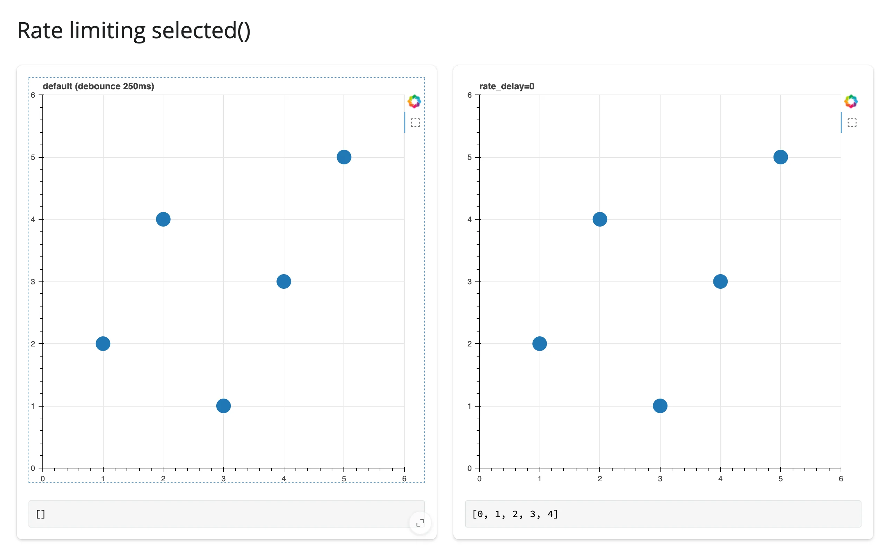
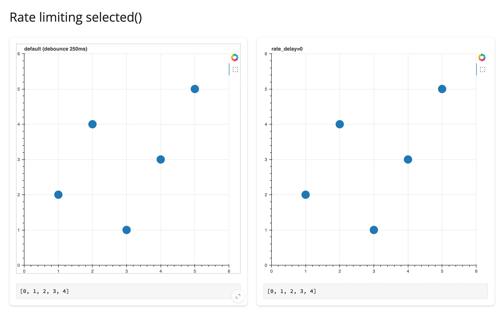

### Reading an accessor on demand

Every accessor is live the moment its plot renders -- it doesn't need a prior read to start tracking
interactions. That makes it safe to read one somewhere that only runs occasionally, like a download handler:
the value it gets back is whatever the user last did, even on the handler's very first run.

```{.python file="examples/17_download_selection.py"}
from bokeh.models import ColumnDataSource
from bokeh.plotting import figure
from shiny.express import render, ui
from shinywidgets import render_bokeh

ui.page_opts(title="Reading an accessor on demand", fillable=True)

src = ColumnDataSource(
    {"x": [1, 2, 3, 4, 5], "y": [2, 4, 1, 3, 5], "name": list("abcde")}
)

with ui.layout_columns(col_widths=[8, 4]):
    with ui.card(full_screen=True):
        ui.card_header("Box-select some points, then download them -- no need to click anything first")

        @render_bokeh
        def plot():
            p = figure(
                x_range=(0, 6),
                y_range=(0, 6),
                tools="box_select",
                active_drag="box_select",
            )
            p.scatter("x", "y", source=src, size=20)
            return p

    with ui.card():

        @render.download_button(
            filename="selection.csv", label="Download selection as CSV"
        )
        def download():
            # plot.selected_rows() is live the moment the plot renders, so
            # this reads whatever is currently selected -- even if the
            # download handler itself has never run before.
            yield plot.selected_rows().to_csv(index=False)
```

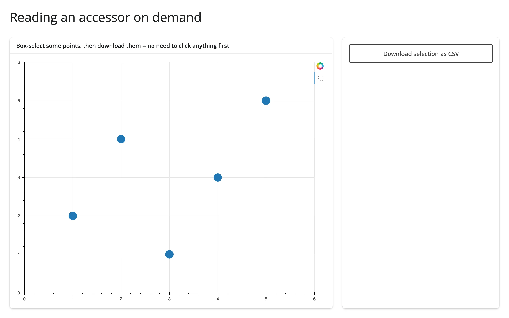
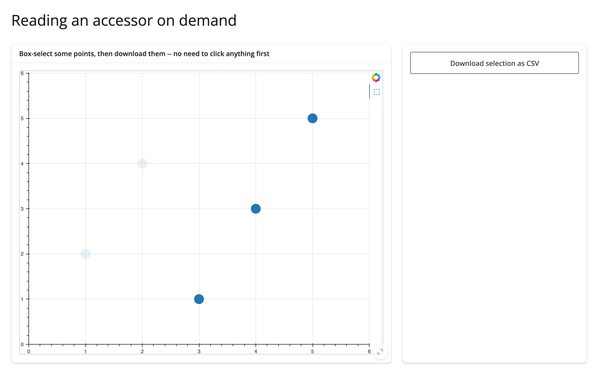

## Updating the widget from Python

Because a Bokeh plot is a tree of live objects, you rarely need to rebuild it to change what it shows. Keep a
Python reference to the pieces you'll change (a module- or session-level `ColumnDataSource`, as in the examples
above), and mutate them from a `@reactive.effect` that runs independently of the render function. This matters
because re-rendering gives the user a brand new plot -- their zoom, pan, and selection all go back to the plot's
defaults, and `selected()`/`zoomed()` re-seed from those defaults too (see the accessor reference above) -- while
an in-place update leaves all of it alone and sends a small patch instead of the whole document again:

```{.python file="examples/13_update_in_place.py"}
import numpy as np
from bokeh.models import ColumnDataSource
from bokeh.plotting import figure
from shiny import reactive
from shiny.express import input, render, ui
from shinywidgets import render_bokeh

ui.page_opts(title="Update in place", fillable=True)

rng = np.random.default_rng(4)
full_x, full_y = rng.normal(size=200), rng.normal(size=200)
src = ColumnDataSource({"x": full_x, "y": full_y})

with ui.card(full_screen=True):
    ui.input_slider("n", "Number of points", min=20, max=200, value=200, step=20)

    @render_bokeh
    def plot():
        p = figure(title="Pan or zoom, then move the slider")
        p.scatter("x", "y", source=src, size=6, alpha=0.6)
        return p


@reactive.effect
def _():
    # Mutates the existing ColumnDataSource instead of returning a new
    # figure, so the user's current zoom/pan survives the update.
    n = input.n()
    src.data = {"x": full_x[:n], "y": full_y[:n]}
```

Panned and zoomed (top-left), then the slider cut the point count to 100 -- the view didn't reset:

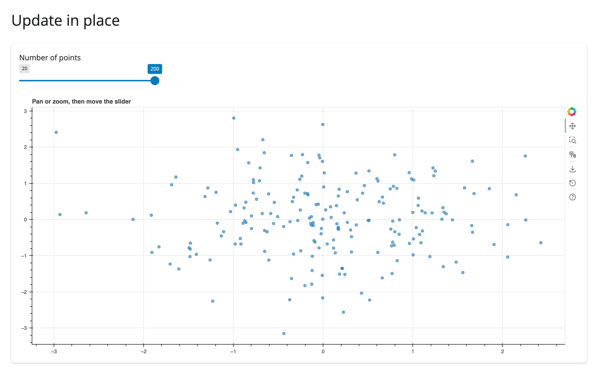
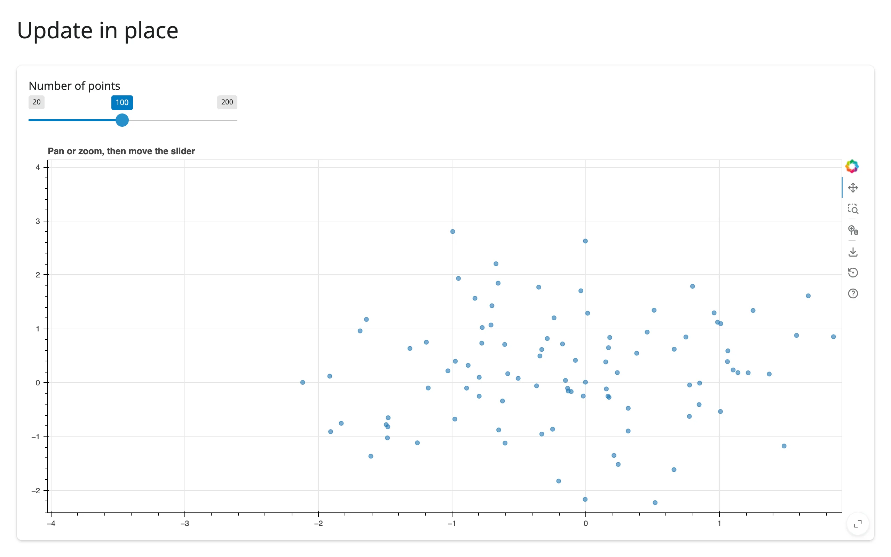

`src.data = {...}` replaces the whole source; `src.data["col"] = arr` patches a single column (used by the
rate-limiting and periodic-table examples above to resize markers without touching anything else); `src.patch()`
updates specific rows. If the effect needs to read an input that shouldn't itself trigger the update, wrap just
that read in `with reactive.isolate(): ...` -- not needed here, since `input.n()` is the only input this effect
cares about.

## Coordinating multiple views

### Linked brushing, with Python in the loop

Give two figures the same `ColumnDataSource` and return them together from one `@render_bokeh` function (a
source can belong to only one Bokeh document, so linked plots can't come from separate outputs). The link itself
is instant and entirely in the browser; Python still sees the selection through `selected_rows()`, so a sidebar
can summarize it live:

```{.python file="examples/14_linked_brushing.py"}
# Uses bokeh's own sample-data package (downloaded on first use):
#   pip install bokeh_sampledata
from bokeh.layouts import row
from bokeh.models import ColumnDataSource
from bokeh.plotting import figure
from bokeh.sampledata.autompg import autompg
from shiny.express import render, ui
from shinywidgets import render_bokeh

ui.page_opts(title="Linked brushing", fillable=True)

src = ColumnDataSource(autompg)

with ui.layout_columns(col_widths=[8, 4]):
    with ui.card(full_screen=True):

        @render_bokeh
        def plots():
            tools = "box_select,lasso_select,reset"
            left = figure(
                title="weight vs. mpg", tools=tools, active_drag="box_select",
                sizing_mode="stretch_both",
            )
            left.scatter("weight", "mpg", source=src, size=6, alpha=0.6)

            right = figure(
                title="horsepower vs. mpg", tools=tools, active_drag="box_select",
                sizing_mode="stretch_both",
            )
            right.scatter("hp", "mpg", source=src, size=6, alpha=0.6, color="firebrick")

            return row(left, right, sizing_mode="stretch_both")

    with ui.card():
        ui.card_header("Selection summary (Python)")

        @render.text
        def summary():
            rows = plots.selected_rows()
            if len(rows) == 0:
                return "Box- or lasso-select cars in either plot."
            return (
                f"{len(rows)} selected\n"
                f"mean mpg: {rows['mpg'].mean():.1f}\n"
                f"mean weight: {rows['weight'].mean():,.0f} lbs"
            )
```

Box-selecting the lighter, more fuel-efficient cars in the left plot highlights the same 162 cars in the
horsepower plot, and the sidebar's mean mpg/weight update through `selected_rows()`:

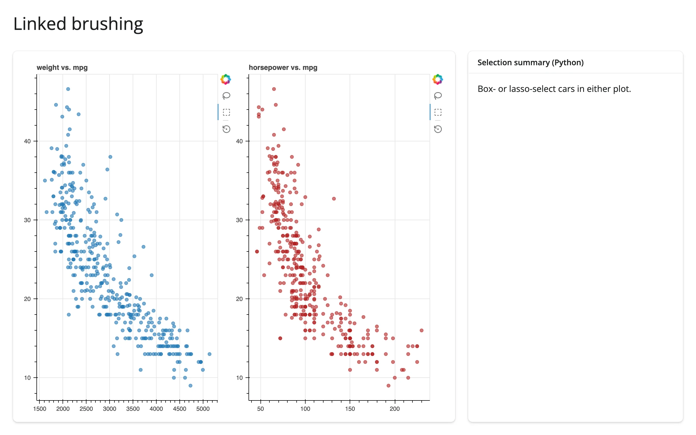


### A Bokeh selection driving a different widget entirely

`selected()` is just a Python list once you have it, so nothing ties it to Bokeh on the receiving end. Here a
box-select in a Bokeh scatter plot drives a live [matplotlib](../matplotlib/index.md) histogram of the selected
points -- the same pattern works for `render_reactable`, `render_itables`, or any other output:

```{.python file="examples/15_lasso_to_histogram.py"}
import matplotlib.pyplot as plt
import numpy as np
from bokeh.models import ColumnDataSource
from bokeh.plotting import figure
from shiny.express import render, ui
from shinywidgets import render_bokeh, render_matplotlib

ui.page_opts(title="Bokeh selection -> matplotlib histogram", fillable=True)

rng = np.random.default_rng(6)
src = ColumnDataSource({"x": rng.normal(size=400), "y": rng.normal(size=400)})

with ui.layout_columns():
    with ui.card(full_screen=True):

        @render_bokeh
        def scatter():
            p = figure(
                title="Box-select a region",
                tools="box_select,reset",
                active_drag="box_select",
            )
            p.scatter("x", "y", source=src, size=6, alpha=0.6)
            return p

    with ui.card(full_screen=True):

        @render_matplotlib
        def hist():
            indices = scatter.selected() or []
            fig, ax = plt.subplots()
            ax.hist(np.asarray(src.data["y"])[indices], bins=15)
            ax.set_title(f"y-distribution of the {len(indices)} selected points")
            return fig
```

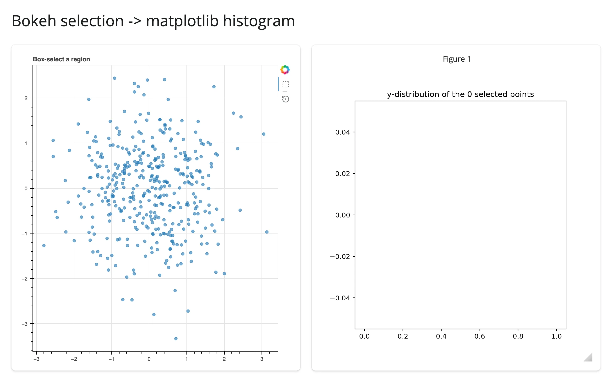
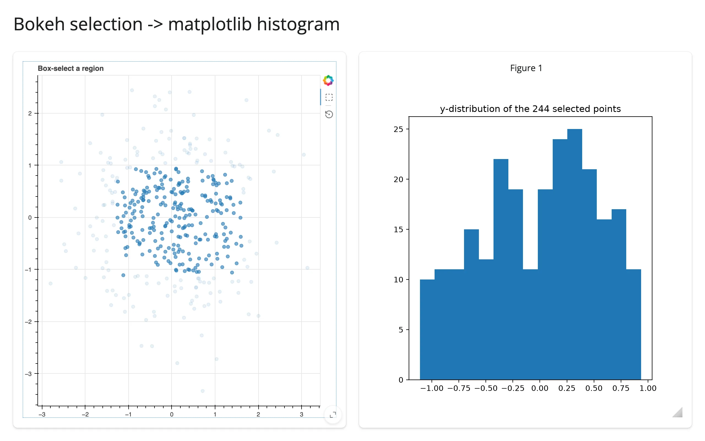

### Tap for details

`tapped()` gives you a click location in data units, not necessarily a row -- so look up the nearest point
yourself. That's more flexible than an auto-selecting tap tool: here it drives a detail card from a tap anywhere
near a station:

```{.python file="examples/16_tap_to_detail.py"}
import numpy as np
from bokeh.models import ColumnDataSource
from bokeh.plotting import figure
from shiny import req
from shiny.express import render, ui
from shinywidgets import render_bokeh

ui.page_opts(title="Tap for details", fillable=True)

rng = np.random.default_rng(7)
n = 40
src = ColumnDataSource(
    {
        "x": rng.uniform(0, 10, n),
        "y": rng.uniform(0, 10, n),
        "city": [f"Station {i}" for i in range(n)],
        "temp": rng.normal(18, 5, n),
    }
)

with ui.layout_columns(col_widths=[8, 4]):
    with ui.card(full_screen=True):

        @render_bokeh
        def plot():
            p = figure(tools="tap", title="Tap a station")
            p.scatter("x", "y", source=src, size=12)
            return p

    with ui.card():
        ui.card_header("Nearest station")

        @render.ui
        def detail():
            t = req(plot.tapped())
            x, y = np.asarray(src.data["x"]), np.asarray(src.data["y"])
            i = int(np.argmin((x - t.x) ** 2 + (y - t.y) ** 2))
            return ui.TagList(
                ui.h5(src.data["city"][i]),
                ui.p(f"temperature: {src.data['temp'][i]:.1f}C"),
                ui.p(f"location: ({x[i]:.1f}, {y[i]:.1f})"),
            )
```

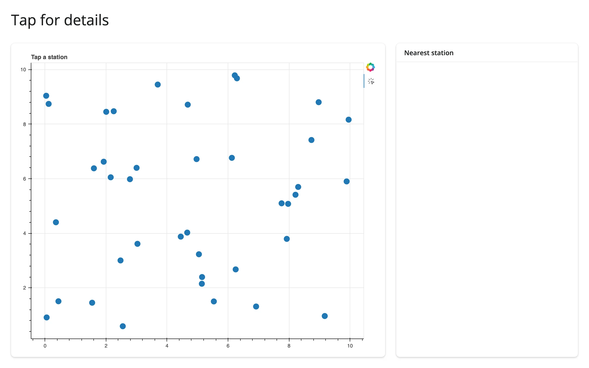
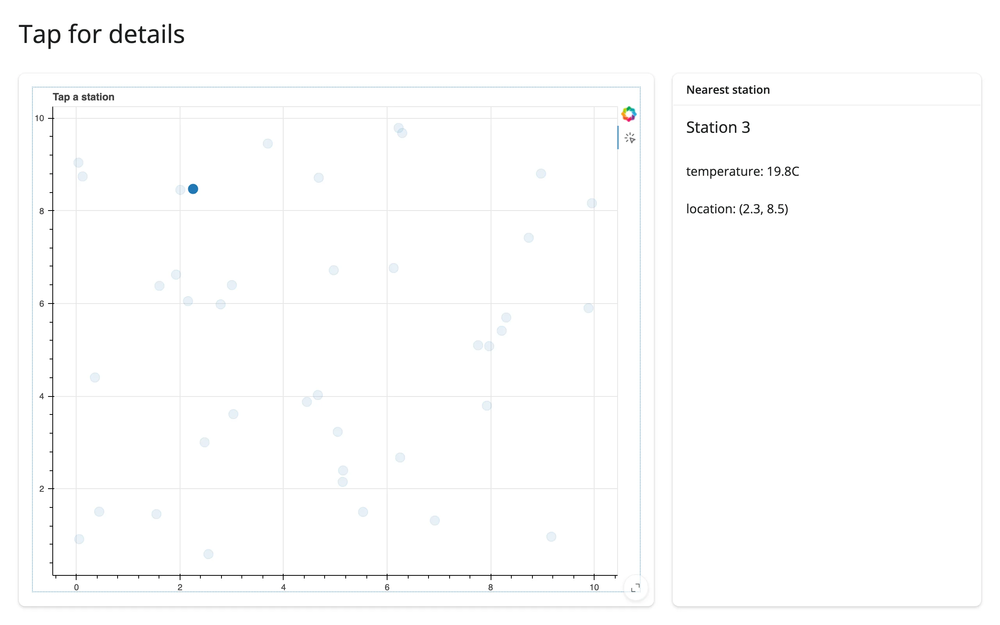

## Large data

**`figure(output_backend="webgl")`** draws glyphs on the GPU instead of the default HTML canvas 2D context. It's
a rendering-only switch: the two backends ship the same `ColumnDataSource` data over the websocket. Measured
directly at 200,000 points, the two panels below sent effectively identical payloads (about 4.13 MB each, a
0.001% difference) -- the same bytes either way, so `output_backend="webgl"` is purely about keeping pan/zoom
smooth once the canvas backend starts to drop frames, not a way to shrink what crosses the wire:

```{.python file="examples/18_webgl_vs_canvas.py"}
import numpy as np
from bokeh.plotting import figure
from shiny.express import ui
from shinywidgets import render_bokeh

rng = np.random.default_rng(0)
n = 200_000
x = rng.normal(size=n)
y = x * 0.5 + rng.normal(size=n)

ui.page_opts(title="WebGL vs. canvas at 200,000 points", fillable=True)

with ui.layout_columns():
    with ui.card(full_screen=True):
        ui.card_header('output_backend="webgl"')

        @render_bokeh
        def webgl_plot():
            p = figure(output_backend="webgl", title="WebGL")
            p.scatter(x, y, size=3, alpha=0.3)
            return p

    with ui.card(full_screen=True):
        ui.card_header("default (canvas)")

        @render_bokeh
        def canvas_plot():
            p = figure(title="Canvas")
            p.scatter(x, y, size=3, alpha=0.3)
            return p
```

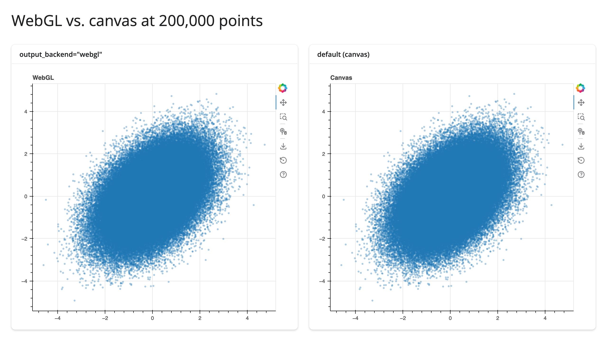

Time to first render also favors WebGL at this scale, not just steady-state pan/zoom smoothness: measured with
isolated single-panel copies of the two apps above (three runs each, median reported), the WebGL panel reached
a stable, fully-drawn scatter in 5.1 s versus 7.4 s for the canvas panel -- about 30% faster, even though both
ship the identical bytes measured above.

This is the "draw it with the GPU in the browser" approach from
[Large data & performance](../../guide/performance/index.md#three-approaches-to-large-data). For data that
doesn't fit even on the GPU as raw points, see [datashader](../datashader/index.md) (which renders through
`@render_holoviews`/Bokeh) to summarize server-side instead.

## Layout and sizing

- A bare `figure()` fills its output; giving it `width`, `height`, `sizing_mode`, or `aspect_ratio` opts out, and
  Bokeh's own sizing applies instead (verified: the output's `fill` only stays on when the figure's
  `sizing_mode` is one of `stretch_both`/`stretch_height`/`scale_both`/`scale_height`).
- For a layout (`row`, `column`, `gridplot`), set `sizing_mode="stretch_both"` on **both** the layout and each
  child figure. Setting it only on the outer layout (not the children) leaves the children at Bokeh's own
  default size, and the layout's flex box then divides space unevenly between them rather than splitting it
  evenly -- `examples/11_multiple_sources.py` sets it on all three for this reason.
- `output_widget()` (Shiny Core) or a plain `@render_bokeh` function under `ui.card()` (Express) is the same for
  Bokeh as for every other renderer; nothing Bokeh-specific to add.
- `bokeh_dependency()` is deprecated and unnecessary -- BokehJS loads automatically with every Bokeh-based
  output, including ones created dynamically inside `@render.ui`.

## Gotchas and limitations

- **One `ColumnDataSource` per plot for `selected()`/`selected_rows()`.** More than one raises `TypeError`; use
  each source's own `on_change("indices", ...)` instead (see [Several ColumnDataSources](#several-columndatasources)).
- **Plots that share a source must come from one render function.** A `ColumnDataSource` (and any Bokeh model)
  can belong to only one Bokeh document; splitting linked plots across two `@render_bokeh` outputs fails with
  Bokeh's own "Models must be owned by only a single document" error.
- **Build Bokeh models per session.** In Shiny Express, top-level code already runs once per session, so this is
  automatic. In Shiny Core, construct figures and sources inside `server()` (or the render function) -- a
  module-level figure is shared by every visitor, selections included.
- **Raw `on_change`/`on_event` callbacks fire twice per browser-driven change.** Verified directly: a single
  box-select gesture called a hand-written `source.selected.on_change("indices", ...)` callback twice (confirmed
  with a counter). `selected()`, `selected_rows()`, `tapped()`, and `zoomed()` already dedupe this for you (one
  value per gesture); if you write your own raw callback instead (as in the Bokeh-widgets and draw-tool
  examples above), make it idempotent -- setting a `reactive.value` already is, incrementing a counter isn't.
- **Accessors can't be read inside their own output's render function.** `plot.selected()` inside `plot`'s own
  `@render_bokeh` function raises `RuntimeError` -- read it from another output or a `@reactive.effect`, and
  update the plot in place from there (see [Updating the widget from Python](#updating-the-widget-from-python)).

## Gallery candidates

[`gallery/template_linked_scatter.py`](gallery/template_linked_scatter.py) -- two linked scatter plots over
Fisher's iris flowers (sepal and petal dimensions, colored by species) feeding a selected-rows table. A clean
starting point for any 2-3-feature linked-brushing dashboard.

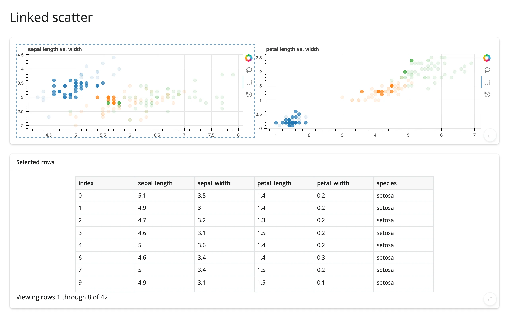

[`gallery/showcase_periodic_table.py`](gallery/showcase_periodic_table.py) -- the periodic table grid linked to
an electronegativity-vs-atomic-radius scatter, both colored with each element's real CPK color on a dark theme.
Box-select in either plot highlights the same elements in the other; a slider rescales markers in place by
atomic mass.

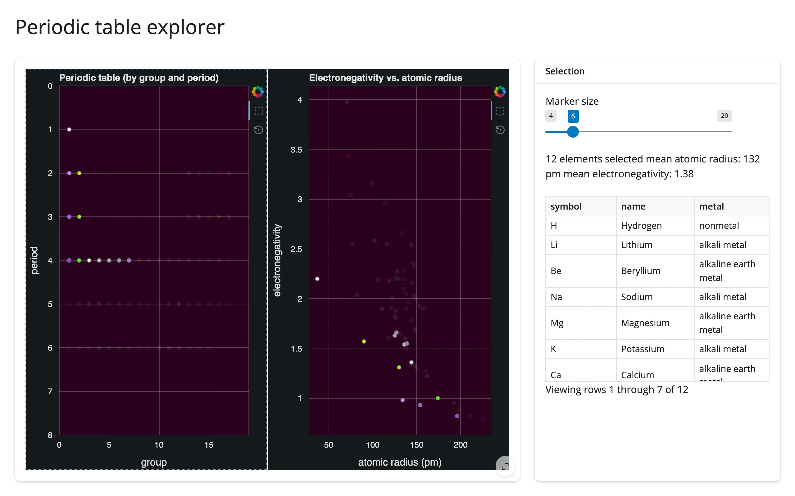

## Learn more

- [Bokeh user guide](https://docs.bokeh.org/en/latest/docs/user_guide.html) and
  [reference](https://docs.bokeh.org/en/latest/docs/reference.html)
- [jupyter_bokeh](https://github.com/bokeh/jupyter_bokeh), the bridge `@render_bokeh` builds on
- Related guides in this roster: [holoviews](../holoviews/index.md) and [panel](../panel/index.md), both of
  which render through Bokeh but don't get accessors; [plotly](../plotly/index.md) and
  [altair](../altair/index.md) for alternative plotting approaches; [matplotlib](../matplotlib/index.md), used
  above as the target of a cross-widget selection.
